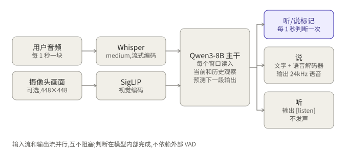
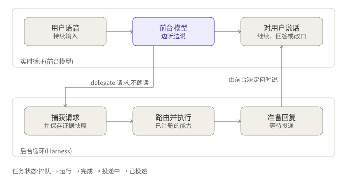

## 摘要

两篇论文各解决一半问题：**MiniCPM-o 4.5** 回答“一个模型怎样同时听和说”，**Realtime-Venus** 回答“同时听说的模型怎样把耗时的事交给后台，又不卡住对话”。前者是底座，后者是在底座上的后训练加运行时。

要点如下：

- MiniCPM-o 4.5 用 1 秒一个窗口的 Omni-Flow，把输入流和输出流放在同一条时间线上，由模型自己在每个窗口判断“听”还是“说”，不依赖外部 VAD。
- Realtime-Venus 以 MiniCPM-o 4.5 为起点分别后训练出 Audio 和 Omni 两个 9B 模型，并配一套 Harness：前台模型写出一条不朗读的 `<delegate>` 请求，后台执行，结果回来后由前台决定何时开口。
- “委托”和普通函数调用的差别不在格式，而在谁持有对话的控制权。
- 在 MiniCPM-o 4.5 上自己搭双循环可行，但最大的阻碍是没有文档化的办法把后台结果注入一个正在运行的双工会话。

本文基于论文和模型卡整理。凡我没能直接核对原文的地方，都在文末的待核实清单里标出。

## 论文与资源

| 项目 | MiniCPM-o 4.5 | Realtime-Venus |
|---|---|---|
| arXiv | 2604.27393 | 2609.13814（2026-09-23 提交） |
| PDF | `https://arxiv.org/pdf/2604.27393` | `https://arxiv.org/pdf/2609.13814` |
| 权重 | `openbmb/MiniCPM-o-4_5`；量化版 `openbmb/MiniCPM-o-4_5-GPTQ`；GGUF 见 `OpenBMB/MiniCPM-o-4_5-gguf` | inclusionAI 的 Realtime-Venus（Audio、Omni 两个模型） |
| 代码 | OpenBMB 官方仓库（含 llama.cpp-omni） | Harness 仅在 GitHub 仓库中，模型卡未提供 |
| 许可 | Apache-2.0（以 README 为准） | Apache-2.0（以模型卡为准，论文页未写） |

下载论文可以直接用命令行：

```bash
curl -L -o minicpm-o-4.5.pdf https://arxiv.org/pdf/2604.27393
curl -L -o realtime-venus.pdf  https://arxiv.org/pdf/2609.13814
```

## MiniCPM-o 4.5 原理

### 模型组成

总参数约 9B，主干是 Qwen3-8B，外加三个小模块：

- 音频编码器：Whisper-medium，约 0.3B，流式编码。
- 视觉编码器：SigLIP，约 0.4B。
- 语音解码器：约 0.3B，把文字侧的输出解码成 24 kHz 语音。

### Omni-Flow：把时间切成窗口

传统语音系统把“听、想、说”拆成串行的几步，中间靠 VAD 判断用户有没有说完。MiniCPM-o 4.5 的做法是把时间切成 1 秒一个的窗口。每个窗口里同时有三条并行的流：环境视觉、环境音频、模型自己的输出流。模型读入当前窗口和历史，然后预测下一段输出。


*图 1：单个窗口内，模型先输出“听/说”标记，再决定是否发声。*

### 听/说标记与时间对齐

每个窗口开头，模型先输出一个控制标记：要说，就继续生成文字并解码成语音；要听，就只输出 `[listen]`，不发声。这个判断完全发生在模型内部，因此不需要外部 VAD。

为了让语音和文字在时间上对得上，论文采用 TAIL（time-aligned interleaving）：文字和语音片段按时间交错排列，使模型在生成时天然知道“这段文字对应哪一秒的语音”。

### 输入输出与接口

输入是 16 kHz 单声道音频，按 1 秒（16000 个采样点）一块送入；输出是 24 kHz 语音。官方的双工接口大致是：

```python
model = model.as_duplex()
model.prepare(prefix_system_prompt=..., ref_audio=...)
model.streaming_prefill(...)          # 每秒喂入一块
out = model.streaming_generate(
    max_new_speak_tokens_per_chunk=20,
    decode_mode="sampling",
)
# out 包含：is_listen, text, end_of_turn, current_time, audio_waveform
```

依赖 `transformers==4.51.0`。显存方面，PyTorch 版演示需要约 28 GB，量化后做流式推理约 12 GB。

## 训练

论文把训练分为四个阶段：

1. **语音预训练**：先让语言模型学会语音的输入输出。
2. **联合预训练**：语音、视觉和文本一起训练，建立全模态能力。
3. **联合 SFT**：用指令数据做监督微调，其中包含双工形式的数据。
4. **强化学习**：使用 GRPO，并加入平滑的长度奖励（回答长度平均缩短 35.3%）以及 RLAIF-V，用来降低幻觉。

## 效果与局限

论文报告的数字包括：OpenCompass 77.6、IFEval-PLS 84.7、MM-IFEval 66.3、LiveSports-3K-CC 54.4。延迟方面，带视觉输入时首 token 延迟约 0.58 到 0.59 秒（RTX 4090，vLLM）；INT4 量化的 llama.cpp-omni 上实时因子（RTF）约 0.21。

局限也要说清楚：

- 论文里**没有**专门针对轮流发言和打断的基准，所以“打断做得好不好”没有直接的数字。
- 语音只支持中文和英文。
- 已知问题包括个别字发音不准，以及中英混说时不稳。
- 没有文档化的工具调用能力。

## Realtime-Venus 原理

Realtime-Venus 要解决的是：全双工模型很会“接话”，但一旦要查订单、算价格、调业务系统，这些事慢，不能让模型停下来等。

### 一、前台模型

作者以 MiniCPM-o 4.5 为起点，后训练出两个独立的 9B 模型：Audio（只处理音频）和 Omni（还能看视频）。它们共享一条因果时间线，用户输入、模型输出和“委托事件”都写在这条线上，所以模型始终知道哪些话已经说出口、哪些事还在后台。

### 二、Harness：后台循环

当前台模型判断某件事需要后台处理，就写出一条私有的自然语言请求 `<delegate>`，这条请求**不会被朗读**。Harness 捕获它，同时保存一份证据快照（也就是当时的对话和观察），再路由到已注册的能力去异步执行。任务状态依次是 Queued → Running → Completed → Delivering → Delivered。结果准备好之后，交回前台，由前台决定什么时候说、怎么说。


*图 2：实时循环负责对话，后台循环负责执行，两者只通过委托请求和投递衔接。*

### 三、被打断之后的三种行为

论文关注的是模型被用户打断时的表现，归纳为三类：用户只是“嗯”一声（backchannel）时**继续往下说**；用户问了新问题时**转去回答**；用户的话让原来的回答作废时，**结束过时的回答，并修改还没说出口的后续内容**。

### 四、委托与普通函数调用有什么不同

这是最容易混淆的一点。表面上看，`<delegate>` 像一次函数调用，但它们承担的角色不同：

| | 普通函数调用 | 委托（delegate） |
|---|---|---|
| 调用方式 | 结构化的函数名和参数 | 一条自然语言请求，加一份证据快照 |
| 执行期间 | 模型通常等待结果，对话暂停 | 模型继续听和说，对话不中断 |
| 谁决定怎么调 | 模型必须挑对函数、填对参数 | 由 Harness 路由到已注册的能力 |
| 结果怎么回来 | 作为工具结果直接进入上下文，模型立即接着生成 | 进入投递状态，由前台决定何时开口 |
| 能否过时 | 一般不考虑 | 用户改变主意时，前台可以放弃或修订 |
| 控制权 | 在调用链里 | 始终在前台模型手里 |

一句话概括：函数调用是“模型调用工具”，委托是“模型把事情交代给一个会自己回来汇报的助手”。

## Venus 训练

两个模型使用同一套后训练配方，包含三类数据：

- 离线理解数据，用来保住基础能力；
- 主动式全双工轨迹，教模型何时开口、何时让出话轮；
- 委托工作流，教模型何时写 `<delegate>`、拿到结果后怎样自然地接上。

具体的数据规模和超参我没有在能访问的页面里核实到，见文末待核实清单。

## Venus 效果与局限

论文报告在 Full-Duplex-Bench v1.5 上，Venus 的 C_RESPOND 为 0.75（对比 Joy-Duplex 0.88、GPT-4o 0.78、Gemini 3.1 Live 0.77），C_RESUME 为 0.97（对比 0.88、0.86）。也就是说它“被打断后接着说”的表现很强，而“该回应时回应”并不是最高。Omni 版在 8 个视频基准中的 6 个排第一。

局限：

- 论文页没有给出系统提示词怎么写、支持哪些语言，许可证以模型卡为准。
- 模型卡只给出 Transformers 本地推理（BF16，需要 `trust_remote_code`，上下文 40,960），**没有**服务化部署方案；Harness 只在 GitHub 仓库里。

## 两篇对比，以及对受控电话对话的启示

MiniCPM-o 4.5 是通用的全模态底座，强项是端到端的低延迟和多模态能力；Realtime-Venus 是在它之上专为“对话加后台任务”做的后训练和运行时。

如果要做一个按 SOP 受控的电话对话系统，值得借鉴的是 Venus 的分工：把 SOP 和业务规则放在后台循环里执行，前台只负责自然地对话和管理节奏。需要注意两点：一是论文没有谈系统提示词的用法，SOP 怎样约束前台模型要自己验证；二是同类的开源方案还有 DuplexOmni（以 Qwen3-Omni 初始化，35B MoE，用控制标记 `[THINK]`、`[CUT]`、`[WAIT]` 等，思考层可以换成别的模型），但它对硬件要求高（推荐至少 8 张 H20）。

## 在 MiniCPM-o 4.5 上自建双循环：可行性分析

能不能不用 Venus，直接在 MiniCPM-o 4.5 上做出双循环？可以做，但有缺口：

- 没有文档化的办法在会话进行中向模型**注入文本**，也就是把后台结果送回去。
- 没有工具调用训练，更没有 `<delegate>` 这类训练。
- 因此模型不会主动“交代”后台任务。

可以考虑三种路径：

1. **直接用 Venus**：它已经做了上面这些训练，适合验证想法。
2. **在 MiniCPM-o 4.5 外面包一层规则**：用关键词或另一个小模型判断何时触发后台，再用预设话术回复。简单，但前台不会“自己想到”委托。
3. **自己做后训练**：仿照 Venus 的配方，给 MiniCPM-o 4.5 加委托数据。成本最高。

不管哪条路，**真正的阻碍是怎样把结果注入一个正在运行的双工会话**。这一点需要读源码确认，我没有核实。

## 复现与上手

- 想先体验：从 Venus 的 Audio 模型开始，用 Transformers 本地推理，把 MiniCPM-o 4.5 当作对照。
- 验证阶段**不要**用量化版本，避免把量化带来的差异误认为模型差异。
- 想看双循环怎么跑：读 GitHub 上的 Harness 部分。

## 阅读建议与待核实事项

建议的阅读顺序：先读 MiniCPM-o 4.5 的 Omni-Flow 和训练阶段两节，再读 Venus 的 Harness 与评测，最后看 DuplexOmni 的控制标记设计。

以下内容我没有直接核对原文，引用时请回到论文确认：

- Venus 的训练数据规模、超参和各类数据的比例；
- Venus 的许可证（模型卡写 Apache-2.0，论文页未提）；
- `openbmb/MiniCPM-o-4_5-awq` 是否存在（没有核实到，GPTQ 版本已核实）；
- DuplexOmni 的细节来自模型卡，论文配置里的思考层使用 Gemini-3.1-Flash-Lite；
- 注入后台结果的具体做法，需要读源码。

延伸阅读：[语音只是入口：从 GPT-Live 看语音智能体的三层架构]()，从工程角度讲了前台、运行时和业务执行三层怎样分工。

## 参考资料

- [MiniCPM-o 4.5 论文（arXiv 2604.27393）](https://arxiv.org/abs/2604.27393)
- [Realtime-Venus 论文（arXiv 2609.13814）](https://arxiv.org/abs/2609.13814)
- [MiniCPM-o 4.5 模型页（Hugging Face）](https://huggingface.co/openbmb/MiniCPM-o-4_5)
- [DuplexOmni 模型页（Hugging Face）](https://huggingface.co/MuyeHuang/DuplexOmni)

*附注：文中数字均来自论文摘要、模型卡或 README，未经我独立复现。*
