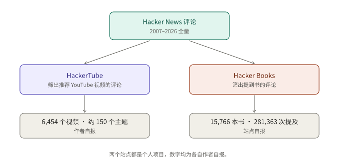
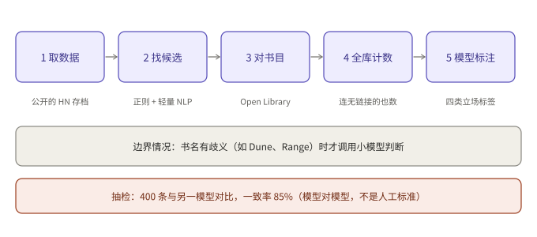

## 摘要

Hacker News 的评论区有个老传统：有人问"有什么好书""有什么值得看的视频"，下面就会有人认真回答。这些回答散在二十年的评论里，没法检索。

最近有两个项目把它们整理出来了。一个是 Andrej Karpathy 在 10 月 31 日发布的 HackerTube，只收 HN 评论里被推荐过的 YouTube 视频。另一个是 roansh 做的 Hacker Books，把 HN 评论里提到的书做成书架，并且区分"提到"和"推荐"。

两个项目做的是同一件事：**用大模型把一堆嘈杂的人类评论，筛成一份可以直接用的清单**。本文讲它们各自怎么做、有什么用，以及最容易被忽略的问题：这些数据你能不能拿去用。

---

## 核心结论

- **两个项目的思路相同**：以 HN 全量评论为原料，先用规则找候选，再用模型判断"这条评论是在推荐吗"，最后做成能浏览的网站。
- **HackerTube 的亮点在速度**：据报道，作者用 Claude Code 加 Opus 5.5 大约两小时做完，得到 6,454 个视频、约 150 个主题。这些数字是作者自报，我没能打开作者原文，信息来自转述文章。
- **Hacker Books 的亮点在区分"提到"和"推荐"**：站点统计 15,766 本书、281,363 次提及，并且给每次提及打上推荐、中性、批评或无关的标签。
- **标签不是真值**：Hacker Books 自己说明，模型标注与另一个模型在 400 条样本上一致率为 85%。这是模型对模型的一致性，不是人工标准。
- **数据能不能用，要分开看**：书目信息来自 Open Library（CC0）；评论文字归评论作者；视频归视频作者；两个站点我都没找到明确的数据许可。个人学习和参考没问题，做成商业产品之前要自己核实。这不是法律意见。

---

## 1. 它们是什么

### 1.1 HackerTube

HackerTube（hackertube.org）是一个长得像 YouTube 的网站，但里面只有一类视频：在 HN 评论里被人推荐过的 YouTube 视频，时间跨度 2007 到 2026 年。

据转述文章，它的做法大致是：

1. Opus 5.5 在 Claude Code 里下载全部 HN 评论，并跑整条流程。
2. Sonnet 通过 Claude Code 的 Workflow 功能批量过滤评论、去掉垃圾内容，最后留下约 4 万条推荐视频的评论。
3. 套上一个类 YouTube 的界面，元数据来自 YouTube API。
4. 由 Claude 把网站部署到一台 VPS 上并做安全加固。

几个产品细节也值得一提：缩略图取视频 50% 处的画面，而不是上传者设的封面；"为你推荐"不需要账号，状态只存在本地浏览器；数据集可以导出，方便别人交给自己的 agent 做变体。

作者自己做的只有三件事：在 Google Cloud 控制台创建 YouTube API key、开 VPS、买域名。

### 1.2 Hacker Books

Hacker Books（hackerbooks.org）是一个书架，收录 2007 到 2026 年 HN 评论里提到的书。页面给出的规模是：15,766 本书、281,363 次提及、225,861 条评论、57,773 位评论者。

它受 HackerTube 启发，但是独立项目，页面明确写着与 Y Combinator 和 Hacker News 无关。作者是 roansh，据页面所述是用 Claude Code 做的。

它关心的问题是：**提到一本书，不等于推荐这本书**。所以每次提及都被标成推荐、中性、批评或无关，并且"推荐数"按不同的人去重，避免一个人刷屏。

*图 1：两个项目共用同一份原料，只是筛选条件不同。数字均为各自作者自报。*

---

## 2. Hacker Books 的流水线

这是我能从一手页面核实的部分，所以讲得细一点。

1. **取数据**：从公开的 HN 全量存档开始。
2. **找候选**：用正则和轻量 NLP 找可能是书的引用，比如带引号的书名、"by 某作者"、Amazon / Goodreads / Open Library 链接、ISBN。
3. **对书目**：把候选匹配到 Open Library 的作品，得到稳定的 ID、作者、首次出版年份、封面和主题。
4. **全库计数**：把每个确认的书名放到整个语料里再搜一遍，这样没带链接的提及也能算进来。
5. **模型标注**：先用 Claude Sonnet 5.5 给每次提及打标签。另有一个步骤，只对有歧义的书名（页面举的例子是 Dune、Influence、Range）用小模型判断这条评论是不是真的在说那本书。

页面还提到，作者最初试过关键词规则、情感打分和 TF-IDF 分类器，准确率都不如大模型。

*图 2：流水线的主干是"规则找候选，模型做判断"。*

这个分工值得记住。规则便宜、快，但会漏也会错；模型准，但贵。所以让规则先把范围缩小，只在真正需要理解语义的地方调用模型。HackerTube 的做法也是这个思路：大批量的粗筛交给较小的 Sonnet，整体编排交给 Opus。

---

## 3. 它们有什么用

下面是我的判断，不是项目作者的说法。

**当书单和片单用。** 这是最直接的用法。HN 的推荐有一个特点：给出推荐的人大多在某个领域做了很多年，推荐的东西往往比算法榜单更对口。

**当"人类推荐"的数据集用。** 这类数据很少见：规模大、跨度二十年、带时间、带主题，而且每条推荐背后有一段说明理由的文字。可以拿来研究一本书或一个视频是怎样被推荐起来的，也可以做推荐系统的评测素材。

**当做数据产品的模板用。** 这两个项目都是"一份大语料，加一个筛选问题，加一个展示界面"。换一个社区、换一个问题，同样的做法就能再来一遍，比如某个技术论坛里被推荐的工具，或者某个社区里被推荐的论文。

**但要留意偏差。** HN 的用户群很特殊，偏技术从业者（这是我的推断，没有为本文查证用户构成）。所以这是"HN 用户推荐什么"，不是"大家推荐什么"。

---

## 4. 数据能不能拿来用

这是我专门核对的部分。结论：**个人浏览和参考没有问题；要二次分发或做商业产品，先逐项核实。**

| 部分 | 状况 |
|---|---|
| 书目信息、封面（Open Library） | Open Library 的数据以 CC0 发布，可自由使用 |
| 评论文字 | 页面写明属于评论作者，并链接回原帖 |
| YouTube 视频 | 版权归视频创作者；HackerTube 只是列出链接和元数据 |
| Hacker Books 的 CSV | 可下载（生成于 2026-11-02），页面没有写明具体许可 |
| HackerTube 的导出数据 | 转述文章说可导出，我没有找到许可说明 |

还有两点：Hacker Books 的书页带 Amazon 联盟链接，购买可能给站点带来佣金，页面自己有说明；HN 数据本身的使用条款也要单独看。

如果你想基于它们做东西，一个稳妥的做法是：只用公开元数据自己重新跑一遍流程，而不是直接转发别人的导出文件。

---

## 总结

两个项目背后是同一个朴素的想法：评论区里有很多好东西，缺的只是一个筛子。大模型让这个筛子的成本降到了一两天甚至两小时。

但要对结果保持分寸：数字是作者自报，标签有大约一成半的分歧，样本来自一个很特殊的社区。拿来找书、找视频很好用；拿来当严肃结论，请先自己抽查。

我没能验证的部分：Karpathy 的原文（作者博客被拒绝访问，信息来自转述文章）、HackerTube 网站本身，以及两个站点的导出数据许可。

---

## 参考资料

- [About Hacker Books](https://hackerbooks.org/about)：Hacker Books 的规模、流水线、标签、一致率、数据来源与隐私说明
- [Karpathy builds HackerTube in about 2 hours with Claude Code and Opus 5.5（AICoder）](https://aicoder.com/news/news-20261031-karpathy-hackertube-youtube-clone-hn-recommended-videos-claude-code-opus-5-5-two-hours)：HackerTube 的数字、流程和作者配置（转述）
- [Karpathy 的原文 HackerTube](https://karpathy.bearblog.dev/hacker-tube/)：发布日期来自一个收录该链接的 GitHub issue，我没能读到正文

*本文整理自公开网页，数字均为项目作者自报，未做独立复现。*
