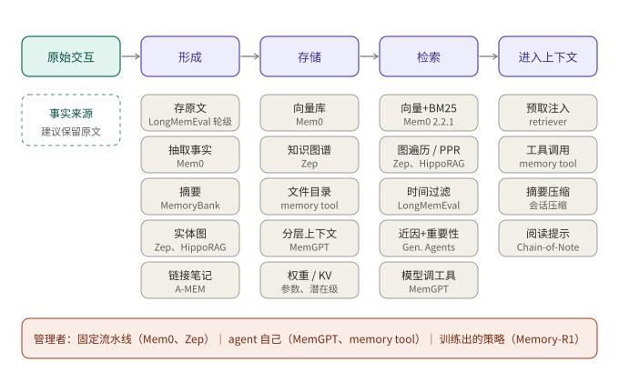
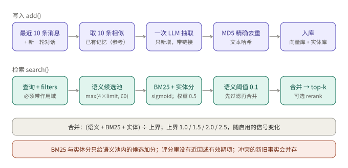
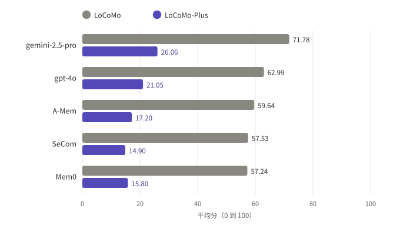

## 摘要

"给大模型加记忆"在近三年里被做成了很多样子：把旧消息换页到外部存储（MemGPT）、给每条记忆打分再检索（Generative Agents）、让模型把对话抽成事实（Mem0）、建时序知识图谱（Zep）、让记忆自己互相链接并演化（A-MEM）、用强化学习训练记忆的增删改（Memory-R1），以及最朴素的一种：给 agent 一个文件目录（Anthropic 的 memory tool）。

本文把这些工作放进同一个坐标系：**记忆是一条流水线**，原始交互经过"形成、存储、检索、进入上下文"四步，每一步都有几种做法，不同系统只是在每一步选了不同的做法。文中还读了 Mem0 2.2.1 的源码，看一个生产级实现在这条流水线上实际做了什么、没做什么；并核对了几个主流评测基准的设计和已发表的数字，说明这些数字能支持什么结论、不能支持什么。

所有事实来自我实际打开过的论文、文档和源码。厂商自己发布的数字会标注"厂商自报"；我自己的推断会标注"推断"。

---

## 核心结论

- **记忆不等于长上下文，也不等于 RAG**。长上下文是容量，RAG 是对静态语料的检索，记忆是在交互中持续写入、更新、遗忘的状态。三者的边界在工程上已经模糊（综述自己也这么说），但"有写入和演化"这一点能把记忆区分出来。
- **设计空间可以压缩成四个选择**：存什么（原文、事实、摘要、图、权重）、什么时候加工（写入时还是读取时）、谁来管理（固定流水线、agent 自己、被训练出来的策略）、怎么取（向量、关键词、图、时间过滤、工具调用）。
- **论文里的设计和代码里的实现可能不一样**。Mem0 论文描述的是"每条候选事实由模型选 ADD / UPDATE / DELETE / NOOP"；我读到的 2.2.1 源码在写入路径上是一次抽取、只新增，旧事实不会被自动改写或删除。读系统要读它当前的实现，不能只读论文。
- **评测数字要带着数据集规模读**。LoCoMo 的对话只有 1.6 万到 2.6 万 token，全上下文基线在 Mem0 自己的表里反而得分最高（72.90，记忆方案 66.88 到 68.44）。记忆方案的实际收益主要体现在 token 和延迟上，不是准确率。LongMemEval 和 BEAM 把规模拉到 11.5 万到 1000 万 token，结论才开始偏向记忆方案。
- **事实性回忆之外还有一类没被测到的能力**。LoCoMo-Plus 把"隐含约束"类问题插进 LoCoMo，所有被测记忆系统从 57 左右掉到 15 左右。当前方案擅长"查到某句话"，不擅长"记住某个状态并在不相关的提问里用上"。
- **一个稳妥的工程默认值**：保留原始数据作为事实来源，把抽取出的事实、摘要、图都当作可重建的派生索引；检索用混合方式并带时间过滤；让冲突的事实带时间戳共存，而不是静默覆盖。这一条是我从多个来源归纳的推断，不是任何一篇论文的原话。

---

## 1. 记忆是什么，不是什么

### 1.1 三个概念的边界

2025 年底发表的综述《Memory in the Age of AI Agents》给出了一个被广泛引用的分类，从三个角度切记忆：

| 角度 | 分类 |
|---|---|
| 形式（forms） | token 级（显式、可编辑的单元，可组织成平面、图、层级）；参数级（写进模型权重或外挂的 adapter / LoRA）；潜在级（隐状态、KV cache） |
| 功能（functions） | 事实记忆（用户、环境的知识）；经验记忆（任务执行中的教训，包括案例、策略、技能）；工作记忆（一次任务内的工作区） |
| 动态（dynamics） | 形成（摘要、蒸馏、结构化构建等）；演化（整合、更新、遗忘）；检索（何时取、怎么构造查询、怎么处理结果） |

综述还区分了几个容易混的概念：RAG 主要是对静态外部来源做单次推理的落地，不维护 agent 自己交互的演化记录；上下文工程把窗口当作有限资源来优化放什么；agent 记忆则要管 agent 知道什么、经历过什么、这些如何随时间变化。综述也承认这条边界已经模糊，实际区分更多取决于任务场景：记忆在多轮、有时间依赖的环境里评测，RAG 在知识密集型问答里评测。

### 1.2 认知架构的视角

CoALA（Sumers、Yao、Narasimhan、Griffiths，TMLR 2024）把语言 agent 的记忆拆成四块，至今仍是很多系统的命名来源：

- **工作记忆**：当前决策周期内的信息，跨多次 LLM 调用保持。
- **情景记忆**：过去决策周期的经验，比如旧对话、旧轨迹。
- **语义记忆**：关于世界和自身的知识。
- **程序记忆**：隐含在模型权重里的，和显式写在代码里的。

它同时把 agent 的动作分成外部（与环境交互）和内部（检索、推理、学习）。**检索是读长期记忆到工作记忆，学习是写长期记忆**。后面所有系统的差别，基本都是"谁来触发检索和学习、触发时机、写什么"。

---

## 2. 设计空间：一条流水线，四个选择



*图 1：原始交互经过形成、存储、检索，进入上下文。每一步下方是常见做法，括号里是代表系统。*

这张图是后文组织材料的方式。

### 2.1 形成：存什么

| 做法 | 例子 | 取舍 |
|---|---|---|
| 存原文（按轮或按会话切块） | LongMemEval 里的轮级索引；MemGPT 的 recall storage | 信息无损，检索靠索引质量；存储和索引大 |
| 抽取成事实 | Mem0；Zep 的实体与关系边 | 紧凑、易去重；抽取错了就永久丢信息 |
| 摘要 | MemoryBank 的日摘要与全局摘要；MemGPT 的递归摘要 | 省 token；细节丢失，且不可逆 |
| 图（实体—关系） | Zep/Graphiti；HippoRAG；Mem0^g | 擅长多跳、时序；构建和维护贵 |
| 带元数据的"笔记" | A-MEM：关键词、标签、上下文描述、链接 | 可演化；每次写入要多次调用模型 |
| 写进权重或 KV | 综述中的参数级、潜在级记忆 | 不占上下文；难编辑、难删除 |

LongMemEval 的消融给出了少有的对照数据：按单轮（round）建索引比按整个会话建索引更好；把压缩成"用户事实"作为索引会整体变差，但对跨会话推理有帮助；把抽出的事实作为额外的"键"加到原文索引上（key expansion），平均让 recall@k 提高 9.4%、问答准确率提高 5.4%。

### 2.2 谁来管理

三种模式并存：

1. **固定流水线**：开发者写死"每轮结束后抽取、写入、检索"（Mem0、Zep、MemoryBank）。可预测、好观测。
2. **agent 自己管**：把读写做成工具，由模型决定什么时候用（MemGPT/Letta 的函数调用、Anthropic 的 memory tool）。灵活，但依赖模型的工具调用能力，MemGPT 论文自己就观察到 GPT-3.5 因函数调用较弱而表现不佳。
3. **训练出来的策略**：Memory-R1 用 PPO 或 GRPO，以最终答案是否正确为奖励，训练一个 Memory Manager 决定 ADD / UPDATE / DELETE / NOOP，再训练一个 Answer Agent 过滤检索结果。论文报告只用 LoCoMo 上的 152 个训练问答对就能训练。

### 2.3 什么时候加工

写入时加工（抽取、摘要、建图）把成本放在写入侧，读取便宜；读取时加工（存原文，查询时由模型检索、阅读、推理）把成本放在读取侧，信息损失少。**两者不是二选一**：Zep 的 episode 子图无损保存原始输入，同时在上面派生语义实体和社区；LongMemEval 的 key expansion 也是同时保留两者。

---

## 3. 代表系统

### 3.1 记忆流与打分：Generative Agents、MemoryBank

**Generative Agents** 的记忆流是一个列表，每条记忆有自然语言描述、创建时间和最近访问时间。检索分数由三项相加：

```
score = α_recency · recency + α_importance · importance + α_relevance · relevance
```

- recency：按"最近一次被取用后"的游戏小时数做指数衰减，衰减因子 0.995；
- importance：创建时让 LLM 打 1 到 10 的整数；
- relevance：记忆与查询 embedding 的余弦相似度；
- 三项各自 min-max 归一到 [0,1]，论文里所有 α 取 1。

**反思（reflection）**：当最近感知事件的重要性之和超过 150 时触发（论文称实际上每天两三次）。取最近 100 条记录，让模型生成 3 个高层问题，分别检索后产出 5 条带证据引用的洞察，存回记忆流。反思可以引用反思，形成以观察为叶子的树。消融里，去掉反思后 TrueSkill 的 μ 从 29.89 降到 26.88；记忆、计划、反思全去掉降到 21.21，低于真人众包基线的 22.95。

**MemoryBank** 用艾宾浩斯遗忘曲线做更新：`R = e^(-t/S)`，S 初始为 1，每次被回忆 S 加 1 并把 t 重置为 0。论文说明这是有意简化的模型。存储上它把对话压成日事件摘要，再汇总成全局摘要，并逐日提炼用户画像。

这一支的遗产是**把"时间"和"重要性"做进检索分数**。后来的开源实现里，这一点反而经常缺失（见第 4 节）。

### 3.2 操作系统式分层：MemGPT / Letta

MemGPT 把固定长度的上下文窗口类比成物理内存，用函数调用在窗口与外部存储之间"换页"。

- **主上下文**包含：只读的系统指令；固定大小、只能通过函数写入的工作上下文；先进先出的消息队列（队首是被驱逐消息的递归摘要）。
- **外部上下文**包含：recall storage（完整消息库，可检索）；archival storage（任意长度文本对象）。
- **队列管理**：所有消息先写入 recall storage；上下文用到约 70% 时给模型发"内存压力"警告，让它把重要信息存走；到 100% 时驱逐约 50% 的队列并更新递归摘要。
- **控制流**：一个 heartbeat 标志允许模型连续调用多个函数；用户消息、系统告警、定时器等事件驱动 agent。

论文报告的结果：多会话"深度记忆检索"准确率，GPT-4 从 32.1% 提高到 92.5%，GPT-4 Turbo 从 35.3% 到 93.4%，GPT-3.5 Turbo 从 38.7% 到 66.9%。嵌套键值检索中，GPT-3.5 和 GPT-4 分别在 1 层和 3 层嵌套时降到 0%，而 GPT-4 版的 MemGPT 在各层保持稳定。

Letta 是该思路的后续产品化。按其文档页的说法：记忆被组织成"记忆块（memory block）"，挂到 agent 上的块固定在系统提示里、每次都可见，可以通过工具由 agent 自己编辑，也可以由开发者通过 API 直接编辑，一个块还能挂到多个 agent 上共享；所有状态（消息、推理、工具调用）存在数据库里，被驱逐的内容仍可通过检索工具取回。（我只读到了文档的概念页，没有读到它对 archival / recall 的具体接口，这里不展开。）

### 3.3 抽取式记忆：Mem0

Mem0 论文的流水线分两步。**抽取**：用对话摘要、最近 m=10 条消息和新的一对消息拼成提示，让 LLM 抽候选事实。**更新**：对每条候选事实，从向量库取最相似的 s=10 条已有记忆，让 LLM 通过工具调用选 ADD、UPDATE、DELETE、NOOP 之一。变体 Mem0^g 用有向带标签图存实体和关系，冲突时把旧关系标记为失效而不是删除，保留时序推理能力。

论文在 LoCoMo 上的数字见第 5 节。这里只强调一点：**论文描述的更新阶段，和 2.2.1 版开源代码的写入路径不同**，第 4 节展开。

### 3.4 链接与演化：A-MEM

A-MEM（NeurIPS 2025）借用卡片盒笔记法。每条记忆笔记包含原文、时间戳、LLM 生成的关键词、标签、上下文描述、embedding，以及指向其他笔记的链接。新笔记进来时：先按余弦相似度取最近邻候选，再让 LLM 决定链接哪些；然后让 LLM 根据新笔记，**回头更新邻居笔记的上下文、关键词和标签**（记忆演化）。检索时用同一编码器取 top-k，被链接的笔记也能一并取到。

代价是每次写入都要多次调用模型。这一支的核心观点是：记忆应当随着新信息的到来被重新解释，而不是写下就冻结。

### 3.5 图与时间：Zep / Graphiti、HippoRAG

**Zep（Graphiti 引擎）** 的图分三层：

- episode 子图：无损保存原始输入（消息、文本、JSON），并链接到从中抽出的实体；
- 语义实体子图：实体，以及实体间的事实（边），写入时与已有节点做实体消解；
- 社区子图：强连接实体的聚类，每个带摘要，用标签传播而不是 Leiden，便于增量更新。

时间模型是**双时间线**：一条记事件何时发生（事实的生效与失效时间），一条记数据何时被摄入与过期。新信息与旧事实冲突时，由 LLM 判断并给旧事实写上失效时间，不是删除。检索是"搜索 → 重排 → 构造上下文"三步：搜索同时用余弦相似度、Okapi BM25 和图上的广度优先遍历；重排可选 RRF、MMR、节点距离、cross-encoder 等。

**HippoRAG**（NeurIPS 2024）走另一条路：离线用 LLM 对每段文本做开放信息抽取，得到无模式的知识图谱，并按 embedding 相似度（阈值 0.8）加同义边；在线时抽取查询中的实体、链接到图节点，以这些节点为种子跑 **Personalized PageRank**，再把节点分数聚合成段落分数。这样**一次检索就能完成多跳联想**。论文报告它在 2WikiMultiHopQA 上的 R@5 为 89.1，对比 ColBERTv2 的 68.2；与迭代式的 IRCoT 相比，单步 HippoRAG 效果相当或更好，在线检索约便宜 10 到 30 倍、快 6 到 13 倍。

### 3.6 经验记忆：Reflexion

记忆不只存"用户说过什么"。Reflexion 让 agent 在任务失败后写下一段语言形式的反思，存入情景记忆缓冲，在下一次尝试时读入提示，不更新权重。论文摘要报告 HumanEval 上 pass@1 达到 91%，对比当时 GPT-4 的 80%。这对应综述里的"经验记忆"，与"用户事实"是两个独立的需求，评测基准也几乎不覆盖它。

### 3.7 把"文件系统"当记忆：Anthropic 的 memory tool

最朴素的一种：给模型一个 `/memories` 目录和 `view`、`create`、`str_replace`、`insert`、`delete`、`rename` 六个命令。按官方文档，它是**客户端实现**的：模型发出文件操作请求，由应用在自己控制的存储上执行；模型在开始任务前会先查看记忆目录，按需读取而不是一次性全加载。文档建议它与两种上下文管理配合：上下文编辑（清除特定工具结果）和压缩（服务端对接近窗口上限的对话做摘要）；压缩保持活动上下文小，记忆保存必须在摘要后仍然存活的信息。文档还给了跨会话开发的模式：初始化会话建立进度日志、特性清单和启动脚本，后续会话读取并在结束前更新。

安全方面，文档要求处理器校验每个路径，防止路径穿越（拒绝 `../` 及 URL 编码形式），限制文件大小，并建议定期清理长期未访问的文件；它还提醒模型通常会拒绝把敏感信息写入记忆，但更强的保证需要自己的校验。

### 3.8 小结表

| 系统 | 存什么 | 谁管理 | 冲突/更新 | 检索 |
|---|---|---|---|---|
| Generative Agents | 观察、反思、计划（记忆流） | 固定流水线 | 不覆盖；反思叠加成树 | 近因 + 重要性 + 相关性 |
| MemoryBank | 日摘要、全局摘要、用户画像 | 固定流水线 | 遗忘曲线衰减，回忆强化 | 稠密检索（FAISS） |
| MemGPT / Letta | 工作上下文 + recall + archival | agent 自己（函数调用） | 模型编辑块；递归摘要 | 工具检索 |
| Mem0（论文） | 抽取的事实（可选图） | 固定流水线 + LLM 判定 | ADD / UPDATE / DELETE / NOOP | 向量（图变体：实体 + 三元组） |
| A-MEM | 带关键词、标签、链接的笔记 | 固定流水线 + LLM 演化 | 邻居笔记被改写 | embedding top-k + 链接 |
| Zep / Graphiti | episode + 实体边 + 社区 | 固定流水线 | 双时间线，旧事实失效 | 余弦 + BM25 + 图遍历，再重排 |
| HippoRAG | 无模式知识图谱 | 离线构建 | 未涉及 | PPR |
| Memory-R1 | 外部记忆库 | RL 训练的策略 | 学习 ADD / UPDATE / DELETE / NOOP | 学习过滤 |
| memory tool | 文件 | agent 自己 | 模型改文件 | 模型读文件 |

---

## 4. 一个源码样本：Mem0 2.2.1 做了什么

下面基于我读的 `mem0ai/mem0` 仓库（`pyproject.toml` 中版本 2.2.1），文件主要是 `mem0/memory/main.py` 和 `mem0/utils/scoring.py`。结论来自静态阅读，我没有运行过它。



*图 2：写入路径（上）与检索路径（下）。分数细节见 `mem0/utils/scoring.py`。*

### 4.1 写入：一次抽取，只新增

`add()` 的路径是：取该作用域最近 10 条消息作为上下文；用新消息的 embedding 取 10 条最相似的已有记忆，连同新消息一起交给 LLM（提示是 `ADDITIVE_EXTRACTION_PROMPT`）；LLM 一次调用返回要新增的记忆，输出里带 `linked_memory_ids`；落库前用文本的 MD5 做精确去重；同时抽取实体，写入实体库并把实体与记忆 id 关联。

对照论文：2.2.1 的写入路径里**没有**针对每条候选事实的 ADD / UPDATE / DELETE / NOOP 判定。已有记忆只作为抽取时的去重参考，**冲突的新旧事实会并存**（比如"住北京"和"上个月搬到上海"都在库里）。要让旧事实消失，需要调用方显式 `update` 或 `delete`。

这不是缺陷判断，而是一个设计选择：只新增让写入路径更简单、更便宜，也更容易审计（有 history 表记录每次变更）；代价是冲突要在读取阶段解决，而 2.2.1 的检索没有时间因素（见下）。

### 4.2 检索：语义候选池上的加分

`search()` 要求通过 `filters` 指定作用域（如 `user_id`）。内部做的事：

1. 取 `internal_limit = max(limit × 4, 60)` 个语义候选（向量检索）；
2. 若可用，再做关键词检索（Qdrant 的 BM25 槽，查询先做词形还原），原始分数用 sigmoid 归一化，参数随查询词数变化（≤3 个词时中点 5.0、陡度 0.7；4 到 6 个词中点 7.0、陡度 0.6，以此类推）；
3. 从查询中抽实体，查实体库，给关联的记忆加实体分，权重常数 `ENTITY_BOOST_WEIGHT = 0.5`；
4. 语义分低于阈值（默认 0.1）的候选**直接剔除**，即使 BM25 或实体分很高；
5. 合并：`combined = (semantic + bm25 + entity) / max_possible`，其中除数随启用的信号变化：只有语义为 1.0，语义加 BM25 为 2.0，三者都有为 2.5，语义加实体为 1.5；
6. 可选 rerank，再取 top-k。

几点后果：

- **BM25 和实体分只能给语义池内的候选加分，不能把池外的记忆拉进来**。关键词精确匹配但语义距离远的记忆，召回不了。
- **没有时间信号**。`scoring.py` 里没有近因或有效期的项，因此上面说的冲突事实并存时，检索不会天然偏向新的那条（推断：除非查询或重排把时间带进来）。
- 实体抽取和分词依赖 spaCy 的 `en_core_web_sm`，**中文查询下 BM25 与实体两项预期接近 0，检索退化为纯语义**（来自代码与依赖的静态阅读，未实测）。
- 分数的"归一化"是除以可用信号数的上界，因此同一个记忆在不同查询下，因为启用的信号不同，分数不可直接比较。

### 4.3 与 Mem0 论文的数字怎么对应

论文用 LoCoMo、GPT-4o-mini 评测，报告的是论文时点的实现。上面第 4.1 节说明实现已经变化，所以**引用论文里的分数时，不应默认它代表 2.2.1**。这一点对所有迭代快的开源记忆项目都成立。

---

## 5. 评测：这些数字能说明什么

### 5.1 三个基准

| 基准 | 规模与设计 | 测的能力 |
|---|---|---|
| LoCoMo（ACL 2024） | 每段对话约 600 轮、1.6 万 token，最多 32 个会话；任务含问答、事件摘要、多模态对话 | 单跳、多跳、时序、开放域、对抗 |
| LongMemEval（ICLR 2025） | 500 个问题；S 版约 11.5 万 token（约 50 个会话），M 版 500 个会话约 150 万 token | 信息抽取、多会话推理、知识更新、时序推理、拒答 |
| BEAM（ICLR 2026） | 100 段合成对话，长度 10 万到 1000 万 token，2000 个经验证的问题 | 十种能力，含新增的指令遵循、事件排序、矛盾消解 |

LoCoMo 的长度在不同来源里写法不一：ACL 版本的摘要写约 600 轮、1.6 万 token；arXiv 页面和后续工作中还能看到约 300 轮、9K token，以及 Mem0 论文按自己的分词器统计的约 2.6 万 token。引用时请注明所用版本。

LongMemEval 的头条结果是：商用系统（ChatGPT 与 Coze，均用 GPT-4o）在持续交互中的表现，比同样历史"离线阅读"低 37% 和 64%；长上下文模型在 S 版上比只给证据会话低约 30% 到 60%。BEAM 的结果是：即使上下文窗口达到 100 万 token，长上下文模型也会随对话变长而退化；它提出的 LIGHT 框架（情景记忆索引、最近轮次的工作记忆、笔记式暂存区）相对长上下文基线的提升随长度增大，例如 GPT-4.1-nano 在 10 万、100 万、1000 万 token 下分别为 +44%、+76%、+107%。这些数字出自论文自己的设置，LIGHT 也是论文作者的方案。

### 5.2 发表的数字

下面只列我核对过原文的数字，并标注来源性质。

**Mem0 论文，LoCoMo，GPT-4o-mini，LLM-as-a-Judge（论文自报，对比对象是论文作者选的基线）：**

| 方法 | 总体 J | 记忆 token | 检索 p95 | 端到端 p95 |
|---|---|---|---|---|
| 全上下文 | 72.90 | 26,031 | 无 | 17.117 s |
| Mem0^g | 68.44 | 3,616 | 0.657 s | 2.590 s |
| Mem0 | 66.88 | 1,764 | 0.200 s | 1.440 s |
| Zep（论文中的配置） | 65.99 | 3,911 | 0.778 s | 2.926 s |
| 最佳 RAG（k=2，256 token 块） | 60.97 | 无 | 无 | 无 |

按这张表自己算：Mem0 的端到端 p95 比全上下文低 91.6%（1.440 对 17.117），记忆 token 少 93.2%（1,764 对 26,031），但总体 J 低 6.0 个点。**全上下文得分最高**，论文自己也这么写。

**Zep 论文，LongMemEval S（约 11.5 万 token），厂商自报：**

| 答题模型 | 记忆 | 准确率 | 延迟 | 平均上下文 |
|---|---|---|---|---|
| gpt-4o-mini | Zep | 63.8% | 3.20 s | 1.6k |
| gpt-4o-mini | 全上下文 | 55.4% | 31.3 s | 115k |
| gpt-4o | Zep | 71.2% | 2.58 s | 1.6k |
| gpt-4o | 全上下文 | 60.2% | 28.9 s | 115k |

在这个长度下，记忆方案同时更准、更快：gpt-4o 上高 11.0 个点，延迟降 91%。对照上一张表，**结论随上下文长度翻转**：1.6 万 token 时全上下文最好，11.5 万 token 时全上下文落后。这是我对两张表的并排解读（推断），两个实验的模型、评判方式不同，不能当作同一条曲线。

**厂商之间的争议**：Zep 发文称 Mem0 论文对 Zep 的配置有误（把两位说话人都设成 user 角色、把时间戳拼进消息文本而不是用 `created_at` 字段、检索串行执行），并给出纠正后的 LoCoMo J 为 75.14，高于 Mem0 论文里的各项。这些都是 Zep 的一面之词，我没有复现；Mem0 一方是否回应，我也没有核对。它说明的是另一件事：**同一个基准上，跨厂商的数字取决于谁来配置对手的系统**，不要直接比较。

### 5.3 事实回忆之外：LoCoMo-Plus

LoCoMo-Plus（2026）指出，LoCoMo 一类基准主要测"线索和提问语义高度重合的事实回忆"，而真实对话里常常是隐含约束（用户的状态、目标、价值观、因果背景）在起作用，提问时并不会提到它。它把这类"线索—触发"对插入 LoCoMo 对话，两者表面语义刻意不相似，用约束一致性评分。



*图 3：同一批方法在 LoCoMo 与 LoCoMo-Plus 上的平均分（论文报告值）。*

被测的记忆系统都大幅下降，例如 Mem0 从 57.24 到 15.80，A-Mem 从 59.64 到 17.20，SeCom 从 57.53 到 14.90；gemini-2.5-pro 从 71.78 到 26.06。论文还指出，随对话变长，这类"认知记忆"的退化比事实回忆更快；披露任务类型会抬高时序和对抗类问题的分数；EM、F1 等重叠类指标偏向与参考答案长度接近的输出。该数据集规模较小、只有英文、依赖 LLM 评判，作者自己也列为局限。

### 5.4 读数字的几条规则

1. **先看对话有多长**。能整段塞进上下文的基准，全上下文基线很强。
2. **看是谁配置对手**。跨厂商对比通常不是同一套配置。
3. **看评判方式**。LLM 评判在不同底座间会有 0.68 到 3.33 分的波动（LoCoMo-Plus 的测量）。
4. **看测的是不是你要的能力**。事实回忆好，不代表能在不相关的问题里用上用户的状态。
5. **论文里的数字对应论文时点的实现**，开源项目迭代后要重测。

---

## 6. 工程取舍

### 6.1 存原文还是存事实

**结论：原文作事实来源，抽取结果当可重建的索引。**（推断，依据如下。）

- 抽取是有损且不可逆的：模型漏抽或抽错，原文丢了就无法纠正。LongMemEval 里，把整个历史压成用户事实做索引整体变差。
- 但事实索引确实有用：key expansion 的收益，说明"原文 + 事实"比任何一个单独用都好。
- 原文还决定了合规的可行性：删除请求要能定位并重建所有派生物。Zep 的 episode 子图就是这个思路的一种实现——原始数据无损保留，实体与事实指回 episode。

代价是存储和索引量更大，读取时要处理更多候选；这一点由检索质量和重排来买单。

### 6.2 冲突、更新与时间

三种做法：

| 做法 | 例子 | 风险 |
|---|---|---|
| 就地改写或删除 | Mem0 论文的 UPDATE / DELETE；A-MEM 改写邻居 | 误改无法回溯，除非有 history |
| 只新增，冲突并存 | Mem0 2.2.1 的写入路径 | 读取侧必须会选新的那条 |
| 双时间线，旧事实标失效 | Zep / Graphiti；Mem0^g 的失效标记 | 建图和判定冲突的成本高 |

LongMemEval 的时间感知查询扩展给了一个细节：让模型从问题里抽出时间范围再过滤，对时序推理的 recall 提升 11.3%（轮级）与 6.8%（会话级），但只有强模型（GPT-4o）抽取时间范围才有效，Llama 3.1 8B 效果差。也就是说，**时间过滤的前提是时间抽取足够可靠**。

### 6.3 检索与阅读

- **混合检索是基线**：Zep 同时用余弦、BM25、图遍历；Mem0 2.2.1 用语义加 BM25 加实体；LongMemEval 的索引实验也支持多路。
- **读取方式也影响结果**：LongMemEval 发现，用 Chain-of-Note 提示并把记忆项格式化为 JSON，即使检索完美，准确率也能再提高最多约 10 个点。
- **检索拿到什么，有时比怎么检索更重要**：Mem0 论文与 Zep 的 token 数差别很大（Mem0 约 7k token/对话，Zep 超过 600k，论文自报），说明"存多少"和"取多少"是两个独立旋钮。

### 6.4 记忆应该是工具，还是预取

一个常被问到的问题是：既然 agent 可以用工具检索，记忆层是不是多余？

- **预取（每轮前自动检索并注入）**：延迟可控，不依赖模型是否记得去查；但每轮都付检索成本，且注入的内容与当前意图可能不相关。
- **工具（模型决定查不查）**：只在需要时付费，查询由模型根据任务构造，可以多次迭代；但依赖模型的工具调用能力，且模型"不知道自己忘了什么"，不会去查自己没意识到的信息。
- 两者不冲突。memory tool 的文档是工具式，并且明确说"开始任务前会先检查记忆目录"，等于在工具之上叠了一个默认的预取习惯。

这里需要澄清一个常见误解：把记忆实现成"向量库 + 检索工具"，确实在形式上和 RAG 一样；记忆层真正多出来的价值在**写入侧**：抽取、去重、冲突处理、时间、作用域和删除。如果这些都不需要，直接存原文并给 agent 一个检索工具，是合理的最小方案。（推断。）

### 6.5 上下文管理与长期记忆是两层

Parlant 的文档（`compass-wip` 分支，尚未发布）是一个把这两层分开讲的例子：**会话记忆**内置，每轮加载会话历史，超过阈值时压缩成摘要继续；默认阈值按 effort 分档：MIN 与 LOW 约 24,000 token，MEDIUM 约 32,000，HIGH 约 48,000，MAX 约 64,000，档位越高压缩前容忍的原始历史越长、摘要保留的细节越多。**客户记忆**则不内置，由使用者自带，文档的理由是留存范围、保留时长、存放位置、删除请求、跨 agent 共享都是产品与合规问题，框架不该替用户决定。它给出的接入点是两个：一个在回答前运行的 retriever（读），一个在回复发出后触发的 `on_messages_emitted` 钩子（写）；文档特别指出要把用户和助手双方的话一起写入，因为"他今天五岁了"这类指代只有结合助手那一侧才能解析。文档的示例用的就是 Mem0。

这个划分与 CoALA 的"工作记忆 vs 长期记忆"、memory tool 文档里"压缩保持活动上下文小，记忆保存必须在摘要后存活的信息"是同一个意思。

### 6.6 安全与合规

- **路径与注入**：文件式记忆要防路径穿越（memory tool 文档的明确要求）。（推断：写入记忆的内容后续会被当作上下文读入，所以不可信输入进入记忆，等于把提示注入持久化；这一点各文档没有展开，但在设计上需要考虑。）
- **敏感信息**：模型通常会拒绝写入敏感信息，但文档明确说更强的保证要靠自己的校验。
- **删除**：要能按用户作用域删除，并连带删除派生物（Mem0 的实体库按 `linked_memory_ids` 反向关联记忆，代码里有删除记忆时清理实体链接的逻辑）。
- **过期**：memory tool 文档建议定期清理长期未访问的文件；遗忘曲线（MemoryBank）和有效期（Zep）是两种自动化思路。

---

## 7. 尚未解决的问题

1. **隐含状态的记忆**。LoCoMo-Plus 的下降幅度说明，当前方案在"线索与提问语义无关"时基本失效。
2. **长程评测与真实使用的距离**。LoCoMo 一类数据能放进上下文；BEAM 把长度推到 1000 万 token，但对话是合成的。
3. **谁来学**。Memory-R1 表明记忆管理可以被训练，但它的训练和评测都以 LoCoMo 为主，向 MSC 和 LongMemEval 的零样本迁移是论文的补充实验，不能当作通用结论。
4. **多 agent 共享**。Letta 的共享块、Parlant 的跨 agent 客户记忆，都是在工程层解决，缺少对一致性和权限的系统研究（综述把它列为前沿方向）。
5. **可审计的基准**。同一基准、不同厂商的数字互相争议，需要公开配置的评测。

---

## 总结

记忆系统的差异，可以归结为流水线每一步的选择：存原文还是事实，写入时加工还是读取时加工，由固定流程、agent 还是训练出的策略管理，用什么信号检索。读一个具体系统，需要看它当前的代码在每一步做了什么，因为论文里的设计和开源实现会分叉；读评测数字，需要先看对话长度、对手的配置方式和评判方式。

我能给出的、有来源支撑的工程建议是：原文保留作事实来源；抽取结果作为带时间的派生索引；检索用多路信号并支持时间过滤；冲突用时间解决而不是静默覆盖；把上下文压缩和长期记忆当作两层；删除与过期从一开始就设计。

---

## 参考资料

**综述与概念**

- Memory in the Age of AI Agents: A Survey, arXiv:2512.13564 — <https://arxiv.org/abs/2512.13564>
- Cognitive Architectures for Language Agents (CoALA), TMLR 2024, arXiv:2309.02427 — <https://arxiv.org/abs/2309.02427>

**系统与方法**

- MemGPT: Towards LLMs as Operating Systems, arXiv:2310.08560 — <https://arxiv.org/abs/2310.08560>
- Generative Agents: Interactive Simulacra of Human Behavior, arXiv:2304.03442 — <https://arxiv.org/abs/2304.03442>
- MemoryBank: Enhancing Large Language Models with Long-Term Memory, AAAI 2024, arXiv:2305.10250 — <https://arxiv.org/abs/2305.10250>
- Reflexion: Language Agents with Verbal Reinforcement Learning, NeurIPS 2023, arXiv:2303.11366 — <https://arxiv.org/abs/2303.11366>
- Mem0: Building Production-Ready AI Agents with Scalable Long-Term Memory, arXiv:2504.19413 — <https://arxiv.org/abs/2504.19413>
- Zep: A Temporal Knowledge Graph Architecture for Agent Memory, arXiv:2501.13956 — <https://arxiv.org/abs/2501.13956>
- A-MEM: Agentic Memory for LLM Agents, NeurIPS 2025, arXiv:2502.12110 — <https://arxiv.org/abs/2502.12110>
- HippoRAG: Neurobiologically Inspired Long-Term Memory for Large Language Models, NeurIPS 2024, arXiv:2405.14831 — <https://arxiv.org/abs/2405.14831>
- Memory-R1: Enhancing Large Language Model Agents to Manage and Utilize Memories via Reinforcement Learning, arXiv:2508.19828 — <https://arxiv.org/abs/2508.19828>

**评测**

- Evaluating Very Long-Term Conversational Memory of LLM Agents (LoCoMo), ACL 2024 — <https://aclanthology.org/2024.acl-long.747>
- LongMemEval: Benchmarking Chat Assistants on Long-Term Interactive Memory, ICLR 2025, arXiv:2410.10813 — <https://arxiv.org/abs/2410.10813>
- Beyond a Million Tokens: Benchmarking and Enhancing Long-Term Memory in LLMs (BEAM), ICLR 2026, arXiv:2510.27246 — <https://arxiv.org/abs/2510.27246>
- Locomo-Plus: Beyond-Factual Cognitive Memory Evaluation Framework for LLM Agents, arXiv:2602.10715 — <https://arxiv.org/abs/2602.10715>
- Zep, "Lies, Damn Lies, & Statistics: Is Mem0 Really SOTA in Agent Memory?"（厂商文章）— <https://www.getzep.com/blog/lies-damn-lies-statistics-is-mem0-really-sota-in-agent-memory/>

**代码与文档**

- Mem0 仓库，版本 2.2.1，`mem0/memory/main.py`、`mem0/utils/scoring.py` — <https://github.com/mem0ai/mem0>
- Anthropic, Memory tool 文档 — <https://platform.claude.com/docs/en/agents-and-tools/tool-use/memory-tool>
- Letta, Agent Memory 文档 — <https://docs.letta.com/guides/agents/memory>
- Parlant，`compass-wip` 分支 `docs/memory.md`、`docs/compaction.md`（未发布）— <https://github.com/emcie-co/parlant>

*数字说明：表中数字均抄自上述论文或文章原文；"按表自己算"的百分比为我对表中数据的手算。厂商自报与第三方复现不要混读。*
