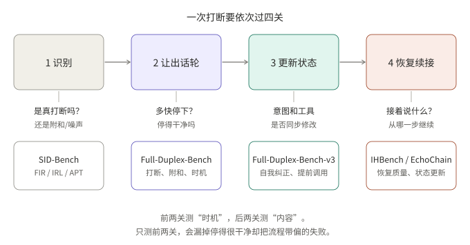
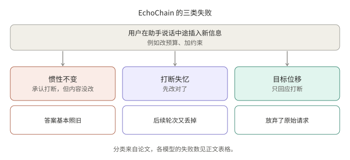

## 摘要

早期的全双工评测主要问一个问题：用户开口时，模型能不能及时停下。2026 年出现的几个基准把问题往两头延伸：停之前，要判断这是不是真打断（SID-Bench）；停之后，要判断模型有没有把新信息用对、有没有回到正确的流程位置（EchoChain、IHBench）；中间还夹着工具调用与自我纠正的交互（Full-Duplex-Bench-v3）。

本文把这四篇放进同一条链路里对照阅读，只依据论文本身。数字均为论文作者报告，未经复现；各基准的模型、数据和评委不同，**不能跨表比较**。

| 环节 | 要回答的问题 | 代表基准 |
|---|---|---|
| 1 识别 | 这是真打断，还是附和、噪声？ | SID-Bench |
| 2 让出话轮 | 多快停下，停得干净吗？ | Full-Duplex-Bench（v1） |
| 3 更新状态 | 意图和工具调用是否同步修改？ | Full-Duplex-Bench-v3 |
| 4 恢复续接 | 接着说什么，从哪一步继续？ | IHBench、EchoChain |

*图 1：前两个环节测“时机”，后两个环节测“内容”。*

## 核心结论

- 只看“多快停下”会漏掉最严重的一类失败：停得很干净，但之后把流程带偏。IHBench 的作者明确把这一点作为出发点。
- 真打断与附和（backchannel）的区分是语义问题。SID-Bench 的结果显示，纯 VAD 方案几乎对任何人声都停下，而纯端到端的 Moshi 又停得很慢。
- 在 EchoChain 的四个闭源模型上，没有一个整体通过率超过 50%，说明“说话中途修改状态”仍是开放问题。
- Full-Duplex-Bench-v3 提示了一个工程权衡：提前发起工具调用能降低延迟，但用户随后的自我纠正会让已提交的参数过期。
- 时机指标与内容指标相对独立。IHBench 报告任务完成度与恢复质量的榜首并不相同。

## 1. 识别：这是真打断吗（SID-Bench）

**结论：把“是否让出话轮”当成语义判断，而不是声学判断。**

论文（Xia 等，arXiv 2603.24144）把打断检测定义为序列分类：真打断是带有新交流意图、值得对方让出话轮的开口；附和只表示在听，不改变对话目标。真值时间取第一个实义词的第一个音素起点，由 LLM 找语义转折点，再用强制对齐定时。

数据来自真实的人人对话（中文、英文，以及 Switchboard 的一个子集），共 3,700 条，包含噪声和静音子集。

指标有三个：

| 指标 | 含义 |
|---|---|
| FIR | 对非打断的发声也停下的比例（误打断率） |
| IRL | 真打断发生后到系统停下的延迟 |
| APT | 综合惩罚时间：真阳性计 IRL，假阳性计整轮时长，假阴性计多说出去的音频时长，真阴性为零 |

论文给出的基线对比（均值，节选）：

| 系统 | IRL (s) | FIR | APT (s) |
|---|---|---|---|
| FSMN-VAD | 0 | 0.840 | 3.627 |
| Freeze-Omni | 0.173 | 0.532 | 2.129 |
| FireRedChat | 1.045 | 0.476 | 2.627 |
| Moshi | 2.517 | 0.118 | 3.192 |
| 论文提出的模型 | 0.389 | 0.124 | 0.711 |

读法：VAD 类方案反应快但误停多，Moshi 误停少但慢；APT 把两类代价放进同一个单位（秒）。论文的模型是一个音频编码器加 Qwen3-0.6B 的二分类器（继续 / 打断），要求连续 3 次判为“打断”才真正停下以抑制抖动。APT 比最佳基线低约三倍（0.711 对 2.129）。

注意两点（论文自述或可从表中看出）：Moshi 的测试协议是作者自定的，跨系统时机对比有方法学不确定性；APT 对少数很长的假阳性惩罚很重，会放大持续噪声下的失败。

## 2. 让出话轮：时机类基准

**结论：这一环节已有较成熟的基准，但它只回答“停没停、多快”。**

Full-Duplex-Bench（Lin 等，arXiv 2503.04721）是这类评测的起点，覆盖停顿处理、附和、话轮切换和打断管理，使用自动指标。IHBench 在引言里把它及其后续工作概括为“测时机”，并据此提出：停下之后说什么，基本没被测量。

## 3. 更新状态：工具调用与自我纠正（Full-Duplex-Bench-v3）

**结论：快速响应与“等用户说完”之间存在直接冲突，自我纠正是最稳定的失败来源。**

v3（Lin 等，arXiv 2604.04847）面向语音智能体：100 个场景，由 12 位真人录制（含非母语者），带真实环境底噪；四个领域（旅行、金融、住房、电商）使用本地模拟 API，输出确定，因此可自动评分。场景按难度分为单步、两步、多步冲突约束三档，并标注五类不流畅现象：错误开头、自我纠正、填充词、停顿、犹豫。其中 21 个场景含自我纠正。

评测了六种配置（五个端到端模型和一个级联管线），作者报告的几个与本文相关的结果：

- 按难度，所有系统的 Pass@1 都随复杂度上升而下降；GPT-Realtime 从 0.750（简单）降到 0.433（困难）。
- 按不流畅类型，自我纠正的 Pass@1 差异很大：GPT-Realtime 为 0.588，级联管线为 0.176；多数系统最弱的类别是停顿。
- 提前工具调用比例：Grok 41.6%，GPT-Realtime 10.8%。论文的案例研究里，一个模型在用户改口之前就调用了工具，锁定了过期的目的地；级联管线则因为 Whisper 在改口出现前就定稿了转写而出错。

论文的结论是：提前提交工具调用有助于速度，但可能锁定过期意图；未来的智能体需要在快速执行和意图变化的灵活性之间取得平衡。

**我的推断（非论文结论）**：如果把工具调用理解为“不可撤回的副作用”，那么提前调用只应限于只读、幂等的查询；会改变业务状态的调用，应等到话轮边界确认之后。这是对论文现象的一种工程解读，论文本身没有给出这个设计建议。

## 4. 恢复续接（IHBench 与 EchoChain）

**结论：停下之后的内容质量，是现有时机类基准看不到的一个独立能力。**

### 4.1 IHBench：流程内的恢复

IHBench（Salimi 等，arXiv 2606.19595）关注结构化工作流中的打断，例如保险理赔这类按阶段推进的对话。

设计要点：

- 10 个企业领域，共 45 段对话、428 个打断点；每段对话由带阶段、跳过、失败、终止条件的状态机驱动。
- 打断被脚本化地放在助手话语的**中间**，而不是检测到的停顿处；用户模拟器只对“已经听到的部分”作出反应。
- 六类打断：普通、不耐烦、纠正、话题切换、附和、反驳。每类的恢复要求不同，例如附和要求从被打断的句子处原样续上。
- 每个打断点的评分细则在任何模型响应出现之前就固定。

评分用两个相互独立的轴，都由 LLM 评委打分：

| 轴 | 做法 |
|---|---|
| 任务完成度（TF） | 评委看细则，在被测模型与一个基线的两个回答之间选胜者；0.50 表示与基线持平 |
| 恢复质量（RQ） | 绝对评分；每个打断点有 2 至 4 条该类型的标准，必须全部满足才算通过 |

作者报告的主要发现：

- TF 榜首是 GPT Realtime 2（0.728），RQ 榜首是带思考的 Gemini 2.5 Flash（0.704）；两个轴的榜首不同，作者据此认为两者部分独立。
- 随对话深度增加，TF 下降；闭源模型平均每轮斜率约 −0.016，开源模型约 −0.053，约 3.3 倍。
- “附和”是许多模型最难的类型：GPT 系列通过率约 7% 至 31%，Gemini 2.5 约 62% 至 68%，Gemini 3.x 则回落到约 13% 至 32%。普通打断和话题切换多数模型处理得不错。
- 开源模型用文本输入比音频输入在 TF 上约高 8 个点；Gemini 的两种输入在统计上无差异。

局限（作者自述）：数据为合成、仅英文；评分只看回答文字，不看韵律和时机。

### 4.2 EchoChain：说话中途修改状态

EchoChain（Modi 等，arXiv 2604.16456）在预先合成的用户音频里插入打断，打断内容是任务相关的新信息，比如新的约束或改变的预算。打断点相对助手语音起点的偏移固定，以保证不同模型之间的时机一致。

论文提出三类失败：

*图 2：EchoChain 的失败分类。*

在 200 段带打断的对话上，四个闭源模型的结果（作者报告）：

| 模型 | 失败总数 | 整段通过率 MPR | 单条标准通过率 MCP |
|---|---|---|---|
| Grok Voice Agent | 103 | 48.5% | 85.5% |
| GPT-realtime-2025-08-28 | 110 | 45.0% | 81.1% |
| Amazon Nova Sonic 2 | 147 | 26.5% | 78.1% |
| Gemini Live 2.5 Flash 原生音频 | 167 | 16.5% | 64.8% |

几个观察：Nova Sonic 2 的 147 次失败中有 73 次是惯性不变；Gemini Live 的失败主要是打断失忆（65 次）和目标位移（64 次）。在 48 段对话的配对比较中，去掉打断后失败从 92 次降到 55 次（下降 40.2%），作者据此认为相当一部分错误来自打断本身，而不是任务难度。

局限（作者自述）：只测任务相关的打断，不含附和、旁人说话和环境噪声；打断时机固定；评分为二值通过；仅评了四个闭源模型。

## 5. 把四篇放在一起看

我的归纳（推断，不是任一论文的结论）：

1. **指标应分层报告。** 识别（FIR/IRL）、状态正确性（Pass@1、MPR）和恢复质量（RQ）反映的是不同问题，合成一个总分会掩盖失败位置。IHBench 里两个轴的榜首不同，是一个支持这一点的证据。
2. **“附和”同时出现在三篇里。** SID-Bench 把它作为误停的来源，IHBench 把“附和后原样续说”作为最难的类型之一，EchoChain 则明确把它排除在外。这个类别在检测和恢复两端都是薄弱点。
3. **各基准覆盖互补，但评委、数据和模型不同。** 数字不可直接比较；若要自己做评测，较稳妥的做法是同时借用它们的分层思路，而不是拼接分数。
4. **共同的局限是合成数据与英文为主。** IHBench、EchoChain 用合成对话与合成语音；SID-Bench 虽然用真实对话，却只覆盖中英文。

## 总结

打断处理是一条链：识别、让出话轮、更新状态、恢复续接。2026 年的这批基准把评测从“停得快不快”扩展到了“停之后做得对不对”。从这些论文看，最大的缺口不在“停”，而在停之后：新信息是否被正确吸收，流程是否回到正确的位置。

## 参考资料

- [Full-Duplex-Bench: A Benchmark to Evaluate Full-Duplex Spoken Dialogue Models on Turn-taking Capabilities（arXiv 2503.04721）](https://arxiv.org/abs/2503.04721)
- [Full-Duplex-Bench-v3: Benchmarking Tool Use for Full-Duplex Voice Agents Under Real-World Disfluency（arXiv 2604.04847）](https://arxiv.org/abs/2604.04847)
- [Semantic-Aware Interruption Detection in Spoken Dialogue Systems: Benchmark, Metric, and Model（arXiv 2603.24144）](https://arxiv.org/abs/2603.24144)
- [EchoChain: A Full-Duplex Benchmark for State-Update Reasoning Under Interruptions（arXiv 2604.16456）](https://arxiv.org/abs/2604.16456)
- [IHBench: Evaluating Post-Interruption Recovery in Voice Agents with Structured Workflows（arXiv 2606.19595）](https://arxiv.org/abs/2606.19595)

相关阅读：[全双工语音模型精读：MiniCPM-o 4.5 与 Realtime-Venus]()。

*说明：所有数字均为论文作者报告，未经独立复现。待核实：Full-Duplex-Bench 一节依据其摘要；SID-Bench 正文与表 I 的样本数口径不完全一致（逐语言还是总计），本文未引用具体样本数以外的数字。*
