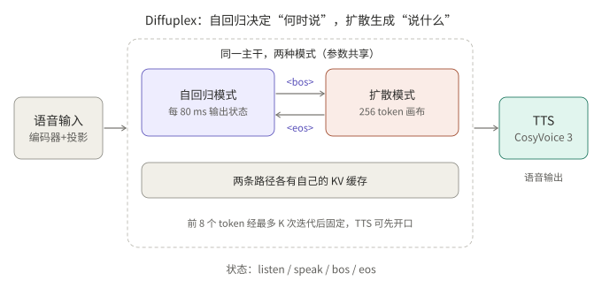
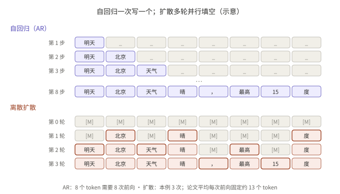
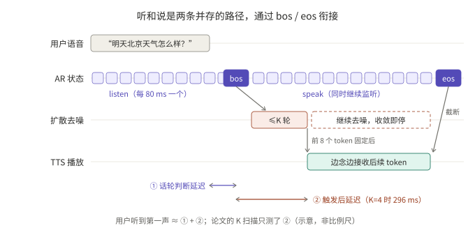
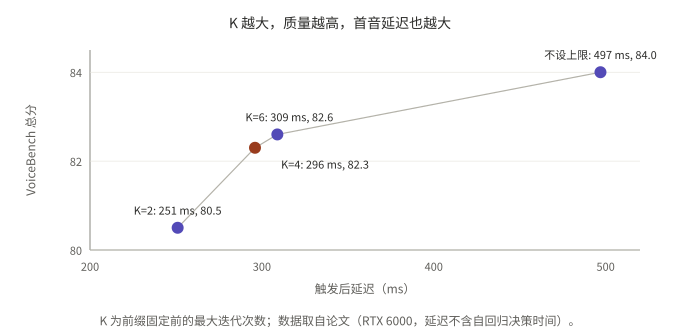

## 摘要

全双工语音模型擅长话轮切换，但在“聪明程度”上落后于同级的自回归（AR）语音模型。Diffuplex（NVIDIA 的 Chen Chen、Pin-Jui Ku、Ankita Pasad、Ante Jukić、Zhehuai Chen、Boris Ginsburg，arXiv 2610.17780）认为原因在结构：现有模型把“何时说”和“说什么”压进同一条 AR 时间线，训练目标互相冲突，语义计算还被绑定在 80 ms 的感知帧率上。

它的做法是把两件事拆开：AR 模式每 80 ms 输出一个交互状态，决定何时说；扩散模式在 256 token 的画布上并行生成回复，决定说什么。两个模式共用一个主干，各有自己的 KV 缓存。

读完论文的表格后，我的判断是：VoiceBench 上的大幅提升主要来自解耦本身，而不是扩散解码。扩散换来的是吞吐，对流式对话的体感延迟帮助有限。整个系统里最值得怀疑的反而是状态预测：论文只给了端到端的对话行为指标，没有逐状态的准确率，而且停顿时容易抢话。

本文只依据论文本身。数字均为作者报告，未经复现；论文称代码和权重“即将发布”，写作时尚未发布。



*图 1：自回归模式负责状态，扩散模式负责内容，TTS 在前缀就绪后即可开始。*

## 核心结论

- 提升主要来自解耦：全双工版本的 VoiceBench 总分为 82.3，表中最强的全双工 AR 基线为 58.1；而同样的拆分改用 AR 解码时得 85.1，比扩散解码（84.1）还高 1 分。
- 扩散换来的是吞吐，不是体感延迟：每次前向约固定 13.0 个 token（AR 为 1.00），吞吐约 1,872 token/s。但流式语音的体感延迟由首包决定，后续 token 只要比 TTS 念得快就够了。
- 首包延迟没有报全：K = 4 时的 296 ms 只是“触发后”的延迟，不包含 AR 判断话轮的时间。话轮切换延迟本身（0.396 / 0.536）比 Moshi（0.265）和 PersonaPlex（0.070）都慢。
- 状态预测只有行为指标：该接话时能接上（TOR 0.93～1.00），但停顿处理（0.38～0.68）明显差于 Nemotron-VC 和 Lychee-FD，也就是用户话说一半停顿时容易抢话。没有 listen / speak / bos / eos 的逐状态准确率或 F1。
- 训练配方很关键：去掉文本锚点降到 66.1，去掉 Stage 1 降到 29.9。状态头只用约 190 h 对话数据训练了 3,000 步。

## 1. 先看懂几个概念

**AR（自回归）**就是常见 LLM 的生成方式：从左到右一次写一个 token，每个新 token 都以前面所有 token 为条件，即 `p(x) = ∏ p(x_t | x_<t)`。GPT、Qwen、Moshi 都属于这一类。

**离散扩散（掩码扩散）语言模型**换了一种做法：先摆出一整块全是 `[MASK]` 的画布，每一轮对所有位置并行预测，只把最有把握的几个位置固定下来，其余留到下一轮，直到整段成形。“扩散”这个名字来自图像生成：从纯噪声开始一轮轮去噪，文本版本把“噪声”换成了“空格”。代表有 LLaDA、Dream，本文的主干是 DiffusionGemma。



*图 2：同一句 8 个 token 的回复，AR 需要 8 次前向，扩散在这个例子里用 3 轮。示意图，不是论文中的例子。*

**四个交互状态**。`bos` / `eos` 在一般的 LLM 里是 begin / end of sequence 的特殊标记，Diffuplex 把它们借来当开关。AR 模式每 80 ms 从四个状态里选一个：

| 状态 | 含义 |
|---|---|
| `<listen>` | 用户在说，继续听 |
| `<bos>` | 拿到话轮，开始回答（触发扩散生成） |
| `<speak>` | 正在说，保持话轮 |
| `<eos>` | 让出话轮：说完了，或者被用户打断 |

## 2. 要解决的问题

**结论：作者认为全双工模型“不够聪明”的原因是结构，而不是数据量。**

在单条 AR 时间线上，模型每个时间步既要决定“现在说不说”，又要决定“说什么”。论文指出两点后果：

1. 训练目标冲突：时序判断和内容生成放在同一个损失里互相拉扯。
2. 计算被帧率绑定：语义计算量受限于感知帧率（80 ms 一步），无法在回复前多花算力思考。

## 3. 架构

**结论：一个文本扩散语言模型作主干，加上轻量的状态头，就得到两种工作模式。没有另外训练一个 AR 模型。**

| 组件 | 内容 |
|---|---|
| 语音前端 | Parakeet 语音编码器，经随机初始化的投影层接入主干的嵌入空间；编码器是因果的，10 秒滑窗，没有 lookahead |
| 主干 | DiffusionGemma（26B-A4B 的 MoE，文本离散扩散语言模型） |
| AR 模式 | 同一主干改用因果注意力，每 80 ms 预测一个状态；新增部分只有状态嵌入、状态头和只作用于语音通路的监听 LoRA |
| 扩散模式 | 以 256 token 为一块画布，条件是语音特征和提示词，并行去噪生成回复 |
| 语音合成 | CosyVoice 3；论文说明设计是模块化的，可替换其他 TTS |

两个模式共享参数，但各自维护 KV 缓存。正因为缓存分开，说话的同时还能继续听（见第 5 节的时间线）。

## 4. 训练：三个阶段

**结论：先对齐模态，再学指令跟随，最后冻结回复生成器、只训状态头。顺序不能反。**

| 阶段 | 做什么 | 要点 |
|---|---|---|
| Stage 1 模态对齐 | 先在 LibriSpeech 约 960 h 上预热投影层，再在英文 ASR 混合数据上联合训练投影层和编码器 | 扩散语言模型冻结；WER 2.3（test-clean）、4.2（test-other） |
| Stage 2 语音指令跟随 | 约 60 万条语音指令数据，外加 5% 的 ASR 回放 | 约 70% 的回复是不带思考的直接回答；用冻结的原始扩散模型当教师做“文本锚点蒸馏” |
| Stage 3 全双工交互 | 冻结回复生成器，训练四状态交互头和监听 LoRA | 约 120 h 干净合成对话和 70 h 内部对话数据；另有加入 Fisher 电话语料的变体；用 DNS5 和 DEMAND 做噪声增强 |

### 4.1 各阶段的损失

- **Stage 2 文本锚点蒸馏**：把同一个问题的文字版输入冻结的原始扩散模型当教师，让学生听语音时的输出分布逼近教师读文字时的分布，用前向 KL 做损失，扩散输出和 AR 输出都做这种匹配。去掉这一项，分数从 84.1 掉到 66.1。
- **Stage 3 状态策略**：逐帧加权交叉熵

```
L_policy = − Σ_t  w(s_t) · log p(s_t | a_≤t, s_<t)
```

`a_≤t` 是截至第 t 帧的语音，`s_<t` 是之前的状态。`<bos>` / `<eos>` 是稀疏的转换事件，权重比 `<listen>` / `<speak>` 大，具体权重值没有给出。

- **标签构造**：`<bos>` / `<eos>` 的位置相对真实话轮边界故意延后一小段“反应时间”，让模型积累足够的声学证据。延后多少没写。
- **超参**：AdamW，峰值学习率 1e-3，50 步预热，余弦衰减到 1e-4，共 3,000 步，全局 batch 32。
- **监听 LoRA 的作用**：附录 B 说，去掉它以后状态头“基本退化成一个声学 VAD”，处理不了停顿，但没有给出数字。

## 5. 推理流程

**结论：AR 和扩散是“触发”关系；说话期间 AR 继续监听，TTS 和去噪在时间上重叠。**

1. AR 策略处理流式音频并输出状态。
2. 收到 `<bos>`，把累积的语音特征和提示词预填进扩散模型，建立缓存。
3. 扩散在 256 token 的画布上去噪，使用熵约束采样器（β = 0.1，最多 48 次迭代），收敛即提前停止。
4. 前缀锚定：最多经过 K 次迭代后，把前 n = 8 个 token 固定下来，TTS 就可以开始合成（报告设置为 K = 4）。
5. 修改后的调度：温度从 0.7 退火到 0.2，收敛阈值 γ 放宽到 0.025，并截断退化循环。
6. 收到 `<eos>` 时截断播放；如果用户在 1 秒内打断，未说出口的画布内容会从上下文中丢弃。



*图 3：用户听到第一声的时间约等于话轮判断延迟加上触发后延迟，论文的 K 扫描只测了后一段。*

K 决定了触发后延迟与质量的权衡（RTX 6000，从给定的话轮边界开始计时，不含 AR 的话轮判断时间）：

| K | 触发后延迟 | VoiceBench 总分 |
|---|---|---|
| 2 | 251 ms | 80.5 |
| 4 | 296 ms | 82.3 |
| 6 | 309 ms | 82.6 |
| 不设上限 | 497 ms | 84.0 |



*图 4：K 从 2 到 4 时延迟增加 45 ms、分数增加 1.8；从 4 到 6 只多 0.3 分。*

## 6. 结果

**结论：智能提升很大；对话行为是“接话准、但慢，而且停顿时爱抢话”。**

### 6.1 智能与效率

- VoiceBench 总分：思考模式 86.9，不思考 84.1（Stage 2），全双工的 Stage 3 为 82.3。
- 效率：13.0 TPF，对比 AR 基线的 1.00 和 DIFFA-2 的 0.37；吞吐约 1,872 token/s，对比 Nemotron-3 Omni 的 394 和 Qwen3-Omni-Thinking 的 300。Diffuplex 的激活参数为 4B，两个对比模型为 3B。
- 同样的训练配方用在 Nemotron-Labs-Diffusion-8B 上，思考模式约 78.7。

### 6.2 对话行为

Full-Duplex-Bench v1 和 v3（v3 是带口吃、犹豫的真人录音）。TOR 越高越好，延迟和停顿分越低越好。论文表格的延迟没有标单位，按秒理解。

| 模型 | TOR-v1 | TOR-v3 | 话轮延迟 | 打断 TOR | 打断延迟 | 停顿（合成） | 停顿（Candor） |
|---|---|---|---|---|---|---|---|
| Freeze-Omni | 0.336 | 0.312 | 0.953 | 0.867 | 1.409 | 0.642 | 0.481 |
| Moshi | 0.941 | 0.925 | 0.265 | 1.000 | 0.257 | 0.985 | 0.980 |
| PersonaPlex | 0.992 | 0.985 | 0.070 | 1.000 | 0.400 | 0.584 | 0.662 |
| Raon-SpeechChat | 0.832 | 0.810 | 1.034 | 0.980 | 1.219 | 0.212 | 0.299 |
| Nemotron-VC | 0.820 | 0.798 | 0.448 | 1.000 | 0.480 | 0.153 | 0.255 |
| Lychee-FD | 0.983 | 0.971 | 0.840 | 0.945 | - | 0.100 | - |
| Diffuplex（带 Fisher） | 0.933 | 0.980 | 0.396 | 0.945 | 0.239 | 0.679 | 0.667 |
| Diffuplex（不带 Fisher） | 1.000 | 0.990 | 0.536 | 1.000 | 0.691 | 0.380 | 0.431 |

读法：

- 接话这一项很好，不带 Fisher 的版本接近满分。
- 话轮延迟比 Moshi、PersonaPlex 都慢；停顿处理明显差于 Nemotron-VC、Lychee-FD。
- Fisher 数据让话轮切换和打断更快，但停顿时更容易抢话，两个版本此消彼长。
- 论文正文说 Diffuplex“在两个版本上话轮切换准确率最强”，这只对不带 Fisher 的版本成立；带 Fisher 的版本在 v1 上低于 PersonaPlex 和 Lychee-FD。

### 6.3 消融（VoiceBench，不思考）

| 设置 | 总分 |
|---|---|
| Diffuplex（语音输入） | 84.1 |
| 文本输入（上界） | 90.1 |
| 用 AR 解码代替扩散 | 85.1 |
| 去掉文本锚点 | 66.1 |
| 去掉 Stage 1 | 29.9 |
| Stage 2 冻结扩散模型 | 64.7 |

作者的结论是：Stage 1 对齐与文本锚点缺一不可，并且需要对主干做受控的适配。AR 解码比扩散解码还高 1 分，说明扩散换来的是速度，不是更高的质量。

## 7. 扩散解码值不值得：从语音智能体的角度看

**结论：对单路流式对话，扩散解码的收益有限；值得借鉴的是解耦和分阶段训练。**

为什么吞吐不等于体感：

- 流式语音里，用户感知的是首包，也就是话轮判断 + prefill + 首段文本 + TTS 首包。之后只要文本生成比 TTS 念得快（每秒几个字），再快也听不出来。所以 1,872 对 394 token/s 的差距，对单路对话的体感几乎没有影响。
- 扩散的首包也未必更快：K = 4 时触发后 296 ms，不设上限是 497 ms。论文没有在同一主干、同一硬件上对比 AR 解码的首包延迟，所以“扩散延迟更低”在文中没有被证明。

扩散可能有价值的场景，都有前提：

1. **开口前需要较长推理**。AR 必须把思考 token 依次生成完才能开口，思考越长首包越慢；扩散可以并行多迭代几轮。这只在“开口前必须推理”的场景成立，常规的问答和业务话术基本用不到。
2. **服务端并发和成本**。每次前向产出更多 token，同一张卡理论上能承载更多路对话。但吞吐是在 GB300 + FP8/NVFP4 上测的，基线用 BF16，口径不同；256 token 画布每一轮的计算量也更大。真实的并发收益要按 P95 延迟自己压测才知道。

可以直接借鉴的部分：

- 把时序决策和内容生成拆成两个头、两份缓存，生成器训好后冻结，只训一个很小的状态头。
- 文本锚点蒸馏：用同一模型读文字时的分布去约束它听语音时的分布。
- 前缀锚定：先尽快固定开头几个 token 让 TTS 开口，后面边生成边念。这个思路对 AR 解码同样适用。

## 8. 局限与待核实

- **状态预测缺少直接指标**：没有逐状态的准确率、F1 或混淆矩阵，也没有 `<bos>` 误触发率、漏触发率。状态头只用约 190 h 对话数据训练，换到其他语言或电话场景需要重新验证。
- **首包延迟不完整**：K 扫描不含 AR 的话轮判断时间，用 RTX 6000 测；吞吐用 GB300 测，且 GB300 使用 FP8/NVFP4 量化，其他 GPU 用 BF16。
- **TPF 口径**：统计的是回答文本 token，与语音 token 或编解码级的多 token 预测方法不能直接比较，论文没有直接的 MTP 基线。
- **Stage 3 掉 1.8 分**：作者认为与流式决策和早期前缀解码有关，但没有拆开验证。
- **依赖主干**：第二个扩散主干得分更低，作者归因于文本能力较弱。
- **表格细节**：表 2 的延迟没有单位；两行 Diffuplex 没有明确标注哪行带 Fisher，本文按正文“Fisher 显著降低话轮和打断延迟”的描述推断第一行为带 Fisher 的版本。
- 闭源实时模型（如 GPT-Realtime）因 API 开销会扭曲延迟而未纳入对比；论文没有单独的局限性章节。

## 总结

Diffuplex 的价值在结构：AR 做轻量的时序决策，离散扩散做并行的内容生成，前缀锚定把两者接起来。按作者的数字，它在 VoiceBench 上大幅缩小了全双工模型与 AR 模型的差距，但消融显示这部分收益主要来自解耦和训练配方，扩散解码本身略逊于 AR 解码，带来的主要是吞吐。对实际的语音智能体，更需要关注的是状态预测：论文没有给出逐状态指标，停顿时抢话的问题也比较明显。代码和权重发布之前，这些都无法复现。

## 参考资料

- [Full-duplex Spoken Language Modeling with Discrete Diffusion（arXiv 2610.17780）](https://arxiv.org/abs/2610.17780)
- [同一篇论文的 HTML 版本](https://arxiv.org/html/2610.17780v1)

相关阅读：[全双工语音模型精读：MiniCPM-o 4.5 与 Realtime-Venus]()、[七个全双工语音方案：架构、结果与演示]()。

*说明：所有数字均为论文作者报告，未经独立复现。*
