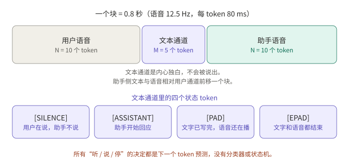
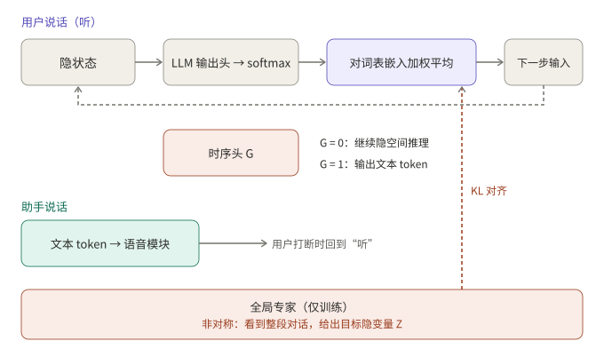

## 摘要

全双工语音模型的难点之一，是用户在说话时模型“在做什么”。两篇 2026 年的论文给出了不同回答：

- **BayLing-Duplex**（arXiv 2606.14528）把“听、说、停”变成文本通道里的四个状态 token，由同一个自回归 LLM 预测，再用一轮轻量 DPO 专门修正时机。
- **FLAIR**（arXiv 2603.17837）认为用户说话的这段时间不该只是填静音或 padding 的空转，而应该在隐空间里继续“想”，并且不增加推理延迟。

前者解决“什么时候开口、什么时候停”，后者解决“听的时候能不能顺便推理”。两条路线并不互斥。

## 核心结论

- BayLing-Duplex 只在词表里加了四个状态 token，没有新模块，决策全部是下一 token 预测；去掉外部 VAD 后，时机的好坏就由训练数据和 loss 权重决定。
- 它的消融显示，token 权重是关键：各 token 等权时，模型几乎一直沉默（轮转成功率 60.3%）；压低 [SILENCE] 的权重后明显恢复。
- FLAIR 在听的阶段用“词表嵌入的 softmax 加权平均”作为连续的隐空间输入，训练时借助一个只在训练中存在的非因果专家提供目标，推理时丢掉专家。
- FLAIR 自己报告的结果是：隐空间推理对知识类问答有小幅提升，对轮转和打断指标没有明显改善，也没有明显损害。
- 两篇论文的训练和评测音频基本都是合成的，数字不能跨论文直接比较，也不能直接外推到有噪声、多人说话的真实场景。

## 1. 问题：听的时间被浪费了

半双工的语音对话把“听”交给 VAD 和 ASR，“说”才交给 LLM。全双工模型把两条流放在同一条时间线上，于是出现两个新问题：

1. **时机**：什么时候该接话，什么时候该闭嘴，被打断时多久停下来。
2. **空转**：用户说话期间，输出侧只能填静音或 padding，这些位置对最终回答没有贡献。

BayLing-Duplex 主要攻第一个问题，FLAIR 主要攻第二个。MiniCPM-o 4.5 这类按固定窗口判断“听或说”的做法见 ；这篇补充的是另外两种设计取向。

## 2. BayLing-Duplex：把时机写进 token

### 2.1 结构

BayLing-Duplex 以公开的 GLM-4-Voice 为起点：语音 tokenizer 把 16 kHz 音频变成 12.5 Hz 的 token（每个 80 ms），中间是 9B 的 decoder-only LLM，后面是语音解码器。改动只有一处：序列的排布和四个新 token。

序列按“块”交错：每块先放 N 个用户语音 token，再放 M 个文本 token，最后放 N 个助手语音 token。论文取 N=10、M=5，一个块 0.8 秒，文本通道约每秒 6.25 个 token。文本通道相当于不会说出口的内心独白，里面除了文字，还有四个状态 token：

*图 1：一个块的排布。助手侧的文本和语音相对用户通道前移一个块；所有轮转决定都是下一 token 预测。*

块的大小是一个取舍：N 太小，文本槽位太少、时序抖动；N 太大，最短响应延迟被抬高（N=10 时下限是 0.8 秒）。论文没有系统扫描这个参数。

推理时逐块解码：输入 N 个用户 token，在只允许文本和状态 token 的掩码下采样 M 个文本 token，再在只允许语音 token 的掩码下采样 N 个语音 token。用户在块中间打断时，已在生成的语音 token 会先播完，下一块才读到新的音频。这意味着打断的响应粒度是块，而不是单个 token。

### 2.2 训练：SFT 加一轮轻量 DPO

- **数据**：以 LLaMA-Omni 2 的 20 万条多轮语音对话为底，合成两类场景各 20 万条，1:1 混合。轮转场景里助手在 0.8 秒间隔后回应；打断场景里用户在助手回应时插话，助手在 0.8 到 2.0 秒的随机延迟后作出反应。
- **SFT**：只在文本和助手语音位置计算交叉熵，并对 [SILENCE] 与 [ASSISTANT]/[EPAD] 使用单独的 token 权重。
- **DPO**：负样本只扰动助手回应的时机，音频和文本与正样本相同。轮转负样本把间隔拉长到 2 到 5 秒，打断负样本把反应延迟拉长到 3 到 5 秒。训练只跑 200 步，学习率 1e-7，β=0.5。

“只改时机、不改内容”的负样本设计是这篇论文最值得借鉴的地方：它把偏好信号严格限定在时机上，避免模型学到别的东西。

### 2.3 结果与消融

下表为论文报告，基线是 Moshi，评测音频为合成：

| 模型 | Llama Q. | Web Q. | 轮转成功率@3s | 打断后停止时间（秒，越低越好） | 打断成功率@2s |
|---|---|---|---|---|---|
| Moshi | 21.0 | 9.2 | 71.9 | 2.07 | 81.9 |
| BayLing-Duplex（SFT） | 44.3 | 18.0 | 88.9 | 1.51 | 91.4 |
| BayLing-Duplex（+DPO） | 46.0 | 18.1 | 92.0 | 1.10 | 100.0 |

token 权重的消融更能说明问题：等权训练时，模型大部分时间保持沉默，轮转成功率只有 60.3%；仅降低 [SILENCE] 的权重可到 82.4%；同时提高角色 token 的权重可到 88.9%。论文也指出，等权那一行的打断成功率 100% 是退化的，因为几乎不说话的模型无需“停下来”。

我的判断（推断，非论文结论）：这说明在状态 token 方案里，静音 token 在序列中占绝对多数，类别不平衡本身就会让模型倾向沉默，权重不是细节，而是方案成立的前提。

## 3. FLAIR：听的时候继续想

### 3.1 动机

论文指出，现有全双工模型在用户说话期间，要么输出重复的 padding 或静音 token，要么如果硬塞显式的文本思维链，又会与流式的因果性冲突：用户说完或打断时，思考内容和语音输出很难同步。FLAIR（论文标题 *The Silent Thought*）选择在连续的隐空间里推理，不需要推理标注，也不增加推理延迟。

### 3.2 做法

*图 2：用户说话阶段，隐状态经输出头和 softmax 后对词表嵌入加权平均，作为下一步输入；时序头 G 决定何时转为输出文本 token。*

- **听的阶段**：把上一步隐状态过 LLM 输出头得到词表分布，再对嵌入矩阵做 softmax 加权平均，得到下一步的输入嵌入。这个循环是因果的、递归的。
- **说的阶段**：时序头（对最终隐状态的 MLP）预测 G。G=0 继续隐空间推理，并给语音模块发 `<SIL>`；G=1 输出文本 token 并回灌其嵌入。用户打断时，回到隐空间推理。
- **全局专家（仅训练）**：一个非因果编码器看到整段对话，输出同样的词表加权形式，作为“目标隐变量”。LLM 在听的阶段的分布用 KL 向它对齐，这相当于让因果的先验去逼近看过全局的后验。推理时专家被丢弃。
- **损失**：回应段的重建损失，加上 KL 正则，加上预测 G 的时序损失，整体是一个 ELBO 形式的 SFT 目标。

训练分四步：普通全双工预训练；只用重建损失的隐空间推理 SFT；加上完整 ELBO 的联合训练；冻结其余部分、只训练语音生成模块。数据包括 53 万小时合成的双人伪对话、7 万小时指令问答、2 万小时由真实 ASR 语料转写生成的问答，并对较长的回应以 10% 概率模拟打断。

### 3.3 结果：有帮助，但很克制

按论文报告，打开隐空间推理（thk）后：

| 基准 | 有 thk | 无 thk |
|---|---|---|
| Llama Questions | 78.0 | 73.0 |
| WebQuestions | 43.0 | 41.7 |
| TriviaQA | 51.2 | 53.8 |
| OpenBookQA | 74.2 | 72.9 |
| MMSU | 56.2 | 50.2 |

多数任务提升，MMSU 提升最大（+6.0），TriviaQA 略有下降。在对话行为上，Full-Duplex-Bench 的轮转接管率为 93.0 对 94.1，打断接管率为 92.0 对 89.0；延迟相近。作者的结论是隐空间推理没有破坏对话动态，而不是改善了它。

论文还提到，部分半双工基线在某些基准上得分更高（例如 Kimi-Audio 在 MMSU 上为 62.2），作者归因于数据差异和自身回答更短。

## 4. 对照

| 维度 | BayLing-Duplex | FLAIR |
|---|---|---|
| 主要问题 | 时机：何时说、何时停 | 听的时间怎么用 |
| 核心手段 | 文本通道里的四个状态 token，块交错 | 隐空间递归输入，加训练期专家 |
| 额外模块 | 无 | 时序头；训练期的全局专家 |
| 偏好优化 | 只扰动时机的 DPO | 论文提到可作为后训练，未做 |
| 打断响应粒度 | 块（0.8 秒），在途语音先播完 | 逐 token，时序头判断 |
| 主要收益 | 轮转与打断指标 | 部分知识类问答 |
| 数据 | 合成、单说话人、近场无噪声 | 合成为主，含加噪与多说话人增强 |

两者可以组合（推断）：状态 token 负责把时机说清楚，隐空间推理负责让听的位置产生有用的计算。但论文没有做这个组合，两种方案对 padding 位置的使用也是互相冲突的，组合需要重新设计序列格式。

## 5. 读这类论文时要注意的地方

1. **合成音频**。BayLing-Duplex 的训练和评测音频全部是合成、单说话人、近场、无噪声，作者自己在局限里写明未测试噪声、混响和多人说话。FLAIR 加了噪声和多说话人增强，但仍以合成数据为主。
2. **基线不同**。BayLing-Duplex 对比 Moshi，FLAIR 对比自己的有无隐空间推理以及若干半双工模型，数字不可跨论文比较。
3. **指标定义**。“打断后停止时间”依赖 VAD 切分；BayLing-Duplex 的评测使用 Silero VAD（仅评测用）。换一套切分，数字会变。
4. **延迟下限**。块式设计有结构性的延迟下限；这是设计选择，不是调参能消除的。

## 6. 总结

把“听”的位置当成可以利用的资源，是这两篇论文共同的出发点：BayLing-Duplex 用它表达控制信号，FLAIR 用它做计算。对要做全双工语音的人来说，前者给出了一套可以直接照着做的时机训练配方（块交错、token 权重、只扰动时机的 DPO），后者给出了一个值得关注、但收益尚不明确的方向。真正决定效果的，仍然是真实环境下的评测，而这恰好是两篇论文共同的缺口。

## 待核实

- FLAIR 的损失权重 α、β 和消融的具体数字，我读到的论文页面没有给出，需回到原文确认。
- FLAIR 的结果表基于 arXiv v5 的页面文本，其中 Full-Duplex-Bench 的数字请以论文为准。

## 参考资料

- [BayLing-Duplex: Native Full-Duplex Speech Dialogue with a Single Autoregressive LLM（arXiv 2606.14528）](https://arxiv.org/abs/2606.14528)
- [The Silent Thought: Modeling Internal Cognition in Full-Duplex Spoken Dialogue Models via Latent Reasoning（arXiv 2603.17837）](https://arxiv.org/abs/2603.17837)

*附注：文中数字均来自上述两篇论文的页面文本，由作者报告，未经我独立复现。*
