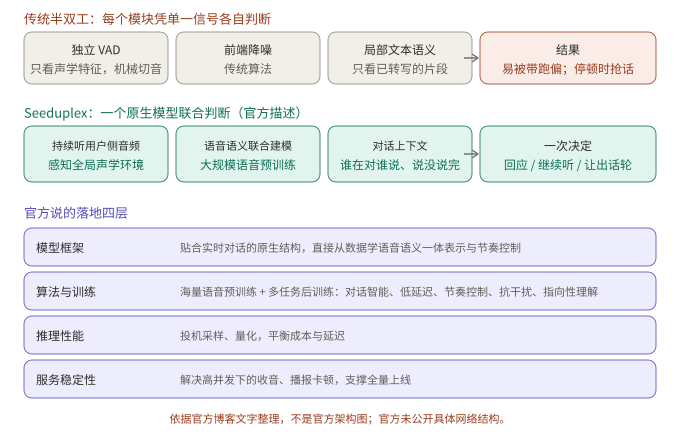
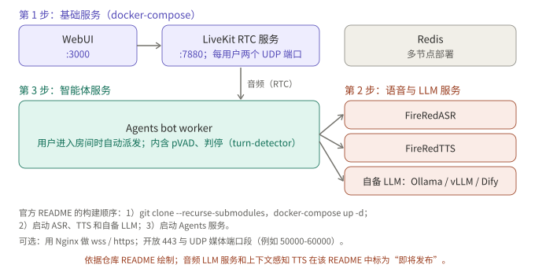

## 摘要

全双工语音系统要回答三个问题：用户说话时模型在做什么，什么时候该开口，被打断时怎么停。本文重点解读已经在豆包 App 全量上线的 **Seeduplex**：它的方案是什么，官方给出的理由是什么，为什么体验比半双工好。其余六个方案简述，每个都给出架构图、关键结果和演示或可得性；其中 **FireRedChat** 是唯一可以自己搭起来的，单独写了搭建步骤。

*图 1：一页速览。图中五行是 Diffuplex、Seeduplex、Dessa、RoboBrain-Audio、FireRedChat；BayLing-Duplex 与 FLAIR 见第 3、4 节。可得性以各官方页面为准。*

## 核心结论

- Seeduplex 好在三点：判定依据从单一信号变成联合建模，模型一直在听用户侧音频，训练目标和工程同时针对抗干扰与判停。这些是官方的说法，官方没有公开网络结构，也没有消融。
- 能体验的只有 Seeduplex（豆包 App 里“打电话”）；能自己搭的只有 FireRedChat，它是在模型之外加控制器，不是原生全双工。
- 论文类方案公开了架构，路线分三类：让原生模型自己预测时机（BayLing-Duplex），改变内容的生成方式（FLAIR、Diffuplex），改变通道排布（FLM-Audio）。
- 所有数字都是作者或厂商自己报告的，基线不同，评测多为合成、主观或内部数据，不能横向比较。

## 1. Seeduplex：重点

### 1.1 它是什么

ByteDance Seed 在 2026 年 4 月 9 日发布的原生全双工语音大模型，已在豆包 App 全量上线，官方称这是全双工技术率先规模化落地。基于自研 LLM 底座，原生端到端建模，“边听边说”。

*图 2：概念图，不是官方架构图。官方只描述了职责划分：原生模型取代独立 VAD 和降噪，决定开始回应、继续倾听还是让出话轮。*

### 1.2 方案：官方披露了什么

- **流式感知，原生建模**：系统对输入音频做特征提取，由底座模型实时处理；模型综合声学特征和对话上下文，自己判断当前该开始回复、继续聆听，还是响应用户打断。
- **大规模语音预训练**：官方称引入大规模语音数据预训练，使模型具备原生的语音语义联合建模能力，能全局理解音频中的语音语义，动态决策对话节奏。
- **多任务后训练**：对话智能、超低延迟、对话节奏控制、抗干扰、指向性理解，五项能力协同优化。
- **推理与服务**：投机采样和量化平衡成本与延迟；重点解决高并发下收音、播报卡顿，保证大流量连续稳定运行。
- 官方说突破了“数据构建、超低时延与模型效果协同优化”等瓶颈，但没有给出模型规模、数据量、网络结构或具体做法。

### 1.3 为什么做得比半双工好

*图 3：依据官方博客文字整理，不是官方架构图。*

官方给出的理由：

1. **判定依据不再单一**。传统半双工依赖级联模块：独立 VAD 机械切音，前端用传统算法降噪，判定依据只有单一声学特征或局部文本语义，所以在复杂环境里容易被带跑偏，或在用户停顿时抢话。Seeduplex 对语音语义联合建模，在一个模型里综合判断。
2. **一直在听**。模型持续接收并理解用户侧音频，感知全局声学环境，判断哪些是真正与模型交互的声音，哪些是干扰。判断靠语义而不是音量：咖啡厅里朋友道别、居家时随口回应门外外卖员，它不会把这些当成指令；多人重叠对话里，它能分辨哪句是对自己说的；甚至会把背景里播放的杭州介绍纳入推理，结合用户去杭州的计划回应。
3. **判停是联合判断**。联合语音和语义特征判断用户是否说完：思考、卡壳、推翻前文时耐心等，话音一落就快速接。官方给的例子包括模拟英文面试里的卡壳，以及快问快答里约 250 ms 的延迟降低。
4. **训练目标就是这些能力**。多任务后训练直接针对抗干扰、判停、打断响应、指向性理解；不是在半双工管线上叠一个新模块。
5. **工程同时到位**。投机采样加量化压延迟，修好高并发下的收音和播报卡顿，这样体验上的提升才不会被卡顿抵消。大规模 A/B 实验验证了通话时长、留存等指标的正向变化。

我的判断（推断，官方未给消融）：收益主要来自“把判定从多个只看单一信号的模块，合并成一个能同时看声学、语义和对话上下文的模型”，这一点在博客的对比和案例里最一致；预训练规模和多任务后训练各自贡献多少，没有公开数据可以拆开。另外，所有对比都是和同一产品的上一代半双工模型，收益里有多少来自全双工本身、多少来自更强的底座，也无法分辨。

### 1.4 官方演示：十个场景

*图 4：按博客文字描述整理的场景，不是视频截图。官方博客里每个场景有视频。*

体验入口：把豆包 App 更新到最新版，在对话框里选“打电话”，进入语音通话界面。我没有试用，演示只转述官方展示的内容。

### 1.5 结果

*图 5：按官方两张柱状图的数值重绘。MOS 为主观评测，博客没有详述评测集，也没有点名对比的其他应用。*

正文给出（对比上一代半双工）：判停 MOS 提高 8%，对话流畅度 MOS 提高 12%；判停延迟快约 250 ms，打断响应快约 300 ms；复杂场景 AI 抢话比例相对下降 40%；复杂声学干扰场景的误回复率和误打断率减半；线上 A/B 整体通话满意度绝对值提升 8.34%，“抢话”“响应慢”“误打断”的反馈明显下降。

官方也坦承：对照真人对话，判停有 8% 的提升，打断响应略好于人人对话的平均水平，但整体对话流畅度仍有不小差距（图 5 下半：44 对 76）。官方列出的后续方向：多人对话与智能硬件、对话节奏多样性、倾听时主动附和、引入视觉、边听边想和边听边搜。

## 2. FireRedChat：可以自己搭

*图 6：按论文图 1 重画。客户端通过 RTC 收发音频；轮转控制器有 pVAD、打断判定和语义判停；交互模块可选级联、半级联或语音到语音；对话管理器管历史、提示词和工具。*

*图 7：按论文图 2 重画。pVAD 检测到打断时同时中断 LLM 和 TTS；EoT 判定“未说完”则继续接收，判定“说完”才交给对话管理器。*

**方案**（arXiv 2509.06502，小红书 FireRed 团队，2025 年 9 月）：不是原生全双工，而是给级联或半级联的半双工管线加一个全双工控制器。控制器含流式个性化 VAD（目标说话人条件，压低背景噪声和非主说话人造成的误打断）和一个微调的多语言 BERT 语义判停分类器。pVAD 的时间戳用于从原始未降噪的音频里切出语音段送 ASR。交互模块：级联是 FireRedASR、Qwen2.5、FireRedTTS-1s；半级联是音频 LLM 直接听用户语音，再接 FireRedTTS-2。对话管理基于 Dify。

**结果**（论文报告，内部评测，延迟只用了 25 条合成语句）：

| 指标 | FireRedChat | LiveKit | Ten |
|---|---|---|---|
| 打断判定 T90 / 误打断率 | 170 ms / 10.2% | 140 ms / 33.4% | 90 ms / 78.1% |
| 判停准确率（中 / 英） | 96.0% / 94.9% | 70.8% / 86.2% | 95.8% / 94.4% |
| 端到端延迟 P50 | 2.341 s | 3.598 s | 3.375 s |

作者说明自己的 T90 比 LiveKit 慢约 30 ms，换来误打断大幅减少；论文里对比的一个工业系统 P50 为 2.075 s。

**体验与搭建**：项目页的演示区是一个演示视频，我的环境打不开它，所以不描述内容。仓库是 FireRedTeam/FireRedChat，README 标注 Apache 2.0；2025 年 9 月 16 日发布了级联系统用的 pVAD、turn-detector、FireRedTTS1 和 FireRedASR 模型与服务。音频 LLM 服务和上下文感知 TTS 在 README 里标为“即将发布”，所以论文里的半级联版本目前还不能完整复现。README 的搭建顺序如下：

*图 8：依据仓库 README 绘制。LLM 需要自备，可以用 Ollama、vLLM 或 Dify；想用 wss/https 要自己配 Nginx 并开放 443 与 UDP 媒体端口段。*

## 3. BayLing-Duplex：把时机写进 token

*图 9：语音 tokenizer、单个 LLM、语音解码器；每个 0.8 秒的块依次放用户语音、文本通道、助手语音 token。*

- 方案（arXiv 2606.14528）：从公开的 GLM-4-Voice 出发，只加四个状态 token（[SILENCE]、[ASSISTANT]、[PAD]、[EPAD]），无新模块。序列按块交错：10 个用户语音 token、5 个文本 token、10 个助手语音 token，一块 0.8 秒。文本通道是不播出的内心独白，所有“听、说、停”的决定都是下一 token 预测。
- 训练：SFT 加 200 步轻量 DPO；DPO 的负样本只扰动助手回应的时机，音频和文本不变。
- 结果（论文报告，基线 Moshi，合成评测音频）：轮转成功率 71.9% 到 92.0%，打断后停止时间 2.07 秒到 1.10 秒，打断成功率 81.9% 到 100%。token 权重是关键：等权训练时轮转成功率只有 60.3%。推断：静音 token 占绝对多数，类别不平衡把模型推向沉默。
- 局限：训练和评测音频全是合成、单说话人、无噪声；块长使最短响应延迟不低于 0.8 秒；打断以块为粒度。

## 4. FLAIR：听的时候继续想

*图 10：左边是流式流水线，右边是同一个 LLM 在听和说时的输入：听时是隐空间嵌入，说时是文本 token；全局专家只在训练中使用。*

- 方案（arXiv 2603.17837）：用户说话时，把上一步隐状态经输出头和 softmax 加权词表嵌入，作为下一步输入，在隐空间继续“想”；时序头 G 决定何时转为输出文本。训练时有一个非因果的全局专家提供目标隐变量，推理时丢弃。
- 结果（论文报告）：开启隐空间推理后 Llama Questions 78.0 对 73.0，MMSU 56.2 对 50.2，TriviaQA 略降；轮转与打断指标没有明显变化，作者的结论是没有破坏对话动态。

## 5. Diffuplex：把“何时说”和“说什么”拆开

*图 11：AR 策略读语音、输出状态；bos 触发后，扩散模式在 256 token 的画布上去噪，前 8 个 token 先送 TTS。*

- 方案（arXiv 2610.17780，NVIDIA）：同一骨干两种模式。自回归策略以 80 ms 为单位预测 listen、speak、bos、eos；bos 后扩散语言模型在 256 token 的画布上并行去噪，前 8 个 token 提交后流式送入 TTS，用户 1 秒内打断则丢弃未播出的画布。
- 结果（论文报告）：每次前向约 13 个 token，自回归基线为 1；单卡 GB300 吞吐最高 1,872 token/s，对比 394 和 300。全双工阶段 VoiceBench 82.3，对比 Nemotron-3 VoiceChat 的 58.1。K 越小首音越快、质量越低（251 ms、80.5 到 497 ms、84.0）。
- 局限：代码与权重“即将发布”，无法独立复现。

## 6. RoboBrain-Audio（FLM-Audio）：通道合并与自然独白

*图 12：时分复用与原生合并、词级对齐与自然独白，以及四个训练阶段。*

- 命名说明：中文媒体把 BAAI 与 Spin Matrix、南洋理工大学合作开源的原生全双工模型称为 RoboBrain-Audio。我找到的对应论文是 FLM-Audio（arXiv 2509.02521，2025 年 9 月），论文没有出现这个名字，对应关系依据媒体报道，请核实；它不是 2026 年才发布的。
- 方案：约 7B 骨干，Moshi 式 RQ-Transformer；每个时间步把文本、听、说三个通道合并成一个输入。文本通道用“自然独白”：输出连续句子，语音没跟上时输出“等待”token，只需句子级对齐。训练时“文本领先”与“文本跟随”两种格式分阶段交替。
- 结果（论文报告）：约 100 万小时语音，据称不到 Moshi 所用音频的 15%；LlamaQuestions 56.3 对 Moshi 的 43.7。论文称将发布代码与模型，中文媒体称已开源，我没有核实到仓库。

## 7. Dessa：只用人类对话从零训练

*图 13：概念图，不是官方架构图。官网只给出信息流和不用的部分。*

- 方案（Block 官网，2026 年 10 月）：音频进、音频出，没有语音转文字；只用人类对话录音从零训练，没有文本，也没有预训练语言模型；自己决定何时插话、何时附和。官网称推理快于实时，可在 M4 Max 或更高配置的 MacBook Pro 上本地运行。参数量、数据来源、内部结构和基准官网都没有给出；“第一个只用人类语音训练的实时对话 AI”是公司自称，未独立验证。
- 演示：官网没有 UI，只有六段真人与 Dessa 的对话录音。可得性：候补名单，限 AI 安全研究者。

*图 14：按页面文字整理，不是截图。*

## 8. 对照

| 方案 | 类型 | 时机怎么决定 | 内容怎么生成 | 可体验性 |
|---|---|---|---|---|
| Seeduplex | 原生，结构未公开 | 模型联合语音、语义与上下文判断 | 未公开 | 豆包 App |
| FireRedChat | 控制器加管线 | pVAD 与语义 EoT | 级联或半级联 | 可自建（部分组件） |
| BayLing-Duplex | 原生，块交错 | 文本通道里的状态 token | 单个 AR LLM | 论文 |
| FLAIR | 原生，隐空间推理 | 时序头 G | AR，听时隐空间推理 | 论文 |
| Diffuplex | 原生，AR 加扩散 | AR 策略四状态 | 扩散画布并行去噪 | 代码未发布 |
| RoboBrain-Audio | 原生，通道合并 | 模型自己决定（Moshi 式） | 自然独白加 RQ-Transformer | 论文称开源 |
| Dessa | 原生，从零训练 | 模型自己学会插话与附和 | 未公开 | 候补名单 |

## 9. 读这些结果时要注意

1. **合成音频**。BayLing-Duplex 和 FLAIR 以合成数据为主；BayLing-Duplex 的作者写明未测试噪声、混响和多人说话。
2. **基线不同**。基线分别是 Moshi、自身开关对照、自回归全模态模型、上一代半双工模型、LiveKit 和 Ten。
3. **评测方式**。Seeduplex 的 MOS 是主观评测；FireRedChat 的延迟只用了 25 条合成语句。
4. **厂商数字**。Seeduplex、Dessa、FireRedChat 的数字都是各自团队报告，没有独立复现。

## 10. 总结

Seeduplex 的启示在于它把“判定”从多个单信号模块收进一个同时看声学、语义和对话上下文的模型，并用多任务后训练和工程优化把这件事做到了线上全量；它是否真的靠这几点取胜，官方没有给出可验证的消融。想自己动手的话，FireRedChat 是目前唯一公开了部署流程的路线，代价是仍然是级联加控制器，而不是原生模型。其余论文提供了三种可以借鉴的思路：状态 token 与只扰动时机的 DPO，听时隐空间推理，以及把内容生成搬出时间线。

## 待核实

- Seeduplex 的架构细节官方未公开，图 2、图 3 是概念图；图 5 的数值来自官方图表，由我读图得到。第 1.3 节“我的判断”是推断。
- Diffuplex 的数字来自论文页面文本，代码与权重尚未发布；FLAIR 的损失权重和完整消融没有读到。
- Dessa 官网未标明发布日期，2026 年 10 月是依据媒体报道；图 13 是概念图。
- RoboBrain-Audio 与 FLM-Audio 的对应关系依据中文媒体报道，我没能打开原文；FLM-Audio 的开源链接未核实。
- FireRedChat 的演示视频我没能打开；仓库许可证以 README 的 Apache 2.0 标记为准，我没有部署过它。
- 所有“演示”只转述官方页面展示的内容，我没有试用任何系统。

## 参考资料

- [Seed 全双工语音大模型发布：懂倾听、抗干扰，走向更自然的交互（ByteDance Seed 官方博客）](https://seed.bytedance.com/zh/blog/introducing-seed-full-duplex-speech-llm-attentive-listening-robust-interference-suppression-enabling-more-natural-interaction)
- [FireRedChat: A Pluggable, Full-Duplex Voice Interaction System with Cascaded and Semi-Cascaded Implementations（arXiv 2509.06502）](https://arxiv.org/abs/2509.06502)
- [FireRedChat 项目演示页](https://fireredteam.github.io/demos/firered_chat/)
- [FireRedChat 仓库（GitHub）](https://github.com/FireRedTeam/FireRedChat)
- [BayLing-Duplex: Native Full-Duplex Speech Dialogue with a Single Autoregressive LLM（arXiv 2606.14528）](https://arxiv.org/abs/2606.14528)
- [The Silent Thought: Modeling Internal Cognition in Full-Duplex Spoken Dialogue Models via Latent Reasoning（arXiv 2603.17837）](https://arxiv.org/abs/2603.17837)
- [Full-duplex Spoken Language Modeling with Discrete Diffusion（arXiv 2610.17780）](https://arxiv.org/abs/2610.17780)
- [FLM-Audio: Natural Monologues Improves Native Full-Duplex Chatbots via Dual Training（arXiv 2509.02521）](https://arxiv.org/abs/2509.02521)
- [Dessa（Block 官网）](https://block.xyz/dessa)

延伸阅读：[全双工语音模型精读：MiniCPM-o 4.5 与 Realtime-Venus]()。

*附注：文中数字均来自上述论文、官方博客、官网和仓库 README，由作者或厂商报告，未经我独立复现。架构图按论文或官方图重画；标注“概念图”的几张不是官方架构图。演示部分只转述官方展示的内容，没有嵌入官方截图或视频。*
