## 摘要

全双工语音系统要回答三个问题：用户说话时模型在做什么，什么时候该开口，被打断时怎么停。本文把七个公开方案放在一起，每个方案都给出自己的架构图、工作方式、报告的结果和官方演示：

- **BayLing-Duplex**：四个状态 token 加块交错序列，决策全是下一 token 预测。
- **FLAIR**：用户说话时在隐空间继续推理。
- **Diffuplex**：自回归策略管时机，扩散模型并行生成内容。
- **RoboBrain-Audio（FLM-Audio）**：三个通道合并成一个输入，文本通道用“自然独白”。
- **Seeduplex**：线上已全量的原生全双工模型，强调抗干扰和动态判停。
- **Dessa**：只用人类对话从零训练的语音到语音模型。
- **FireRedChat**：不换模型，用轮转控制器把半双工管线变成全双工。

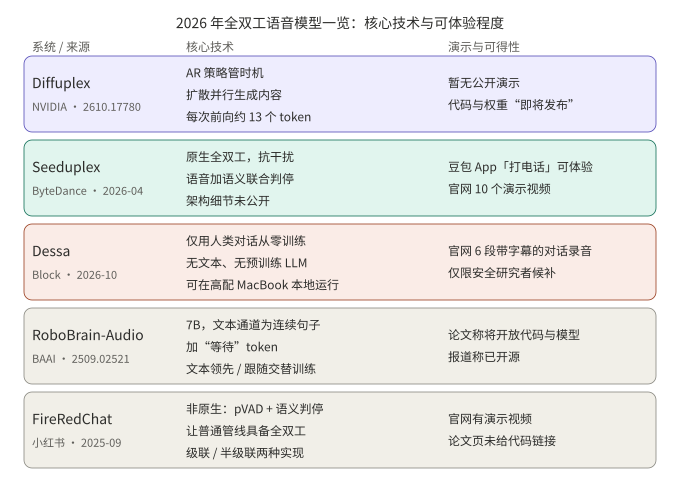

*图 1：一页速览。图中五行是 Diffuplex、Seeduplex、Dessa、RoboBrain-Audio、FireRedChat；BayLing-Duplex 与 FLAIR 见第 1、2 节。可得性以各官方页面为准。*

## 核心结论

- 路线有三类：让原生模型自己预测时机（BayLing-Duplex，以及官方描述中的 Seeduplex），在模型之外加控制器（FireRedChat），改变内容的生成方式（Diffuplex、FLAIR）。
- 论文类方案公开了架构；Seeduplex 和 Dessa 没有公开内部结构，本文给出的是概念图，并已标明。
- 目前能直接体验的只有 Seeduplex（豆包 App 里“打电话”）。Dessa 是候补名单，Diffuplex 代码未发布。
- 所有数字都是作者或厂商自己报告的，基线不同，评测多为合成或内部数据，不能横向比较。

## 1. BayLing-Duplex：把时机写进 token

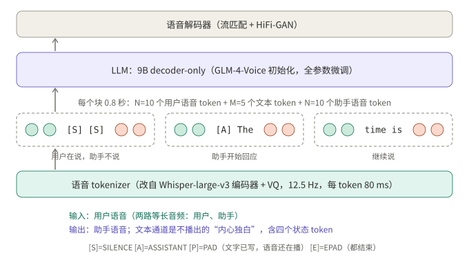

*图 2：语音 tokenizer、单个 LLM、语音解码器。每个 0.8 秒的块依次放用户语音、文本通道、助手语音 token。*

**工作方式**（arXiv 2606.14528）

- 从公开的 GLM-4-Voice 出发：Whisper 编码器加 VQ 的语音 tokenizer（12.5 Hz，每 token 80 ms）、9B decoder-only LLM、流匹配加 HiFi-GAN 的语音解码器。只加了四个状态 token，没有新模块。
- 序列按块交错：N=10 个用户语音 token、M=5 个文本 token、N=10 个助手语音 token，一块 0.8 秒。文本通道是不播出的“内心独白”，其中 [SILENCE]、[ASSISTANT]、[PAD]、[EPAD] 表达听、说、播放中、说完。
- 推理逐块进行：在只允许文本和状态 token 的掩码下采样文本，再在只允许语音 token 的掩码下采样助手语音。用户在块中间打断时，在途语音先播完，下一块才读到新音频，所以打断的响应粒度是块。
- 训练：SFT 加 200 步轻量 DPO。数据是在 LLaMA-Omni 2 的 20 万条对话基础上合成的轮转和打断两类场景，各 20 万条。DPO 的负样本只扰动助手回应的时机，音频和文本与正样本相同。

**结果**（论文报告，基线 Moshi，评测音频为合成）：

| 模型 | Llama Q. | Web Q. | 轮转成功率@3s | 打断后停止（秒） | 打断成功率@2s |
|---|---|---|---|---|---|
| Moshi | 21.0 | 9.2 | 71.9 | 2.07 | 81.9 |
| BayLing-Duplex（SFT） | 44.3 | 18.0 | 88.9 | 1.51 | 91.4 |
| BayLing-Duplex（+DPO） | 46.0 | 18.1 | 92.0 | 1.10 | 100.0 |

消融里 token 权重最关键：等权训练时模型大部分时间沉默，轮转成功率只有 60.3%；降低 [SILENCE] 的权重后到 82.4%，再提高角色 token 的权重到 88.9%。论文也说明等权那行的打断成功率 100% 是退化的。我的判断（推断）：静音 token 在序列里占绝对多数，类别不平衡本身就把模型推向沉默。

局限：训练和评测音频全是合成、单说话人、近场、无噪声；N=10 使最短响应延迟不低于 0.8 秒。

## 2. FLAIR：听的时候继续想

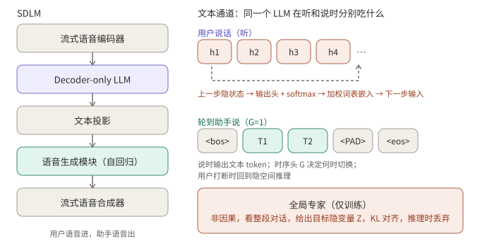

*图 3：左边是流式流水线，右边是同一个 LLM 在听和说时的输入：听时是隐空间嵌入，说时是文本 token；全局专家只在训练中使用。*

**工作方式**（arXiv 2603.17837，论文标题 *The Silent Thought*）

- 动机：现有全双工模型在用户说话期间只能输出 padding 或静音，对回答没有贡献；而显式的文本思维链与流式因果性冲突，用户说完或打断时难以同步。
- 听的阶段：上一步隐状态过输出头得到词表分布，再对词表嵌入做 softmax 加权平均，作为下一步输入，循环因果、递归。
- 说的阶段：时序头（对最终隐状态的 MLP）预测 G；G=1 时输出文本 token，G=0 继续隐空间推理。用户打断时回到隐空间推理。
- 训练：一个非因果的全局专家看到整段对话，给出目标隐变量，LLM 在听阶段的分布用 KL 向它对齐；推理时丢弃专家。损失是重建、KL 和时序三项，ELBO 形式。
- 数据：53 万小时合成双人伪对话、7 万小时指令问答、2 万小时由真实 ASR 语料转写生成的问答。

**结果**（论文报告）：开启隐空间推理后，Llama Questions 78.0 对 73.0，MMSU 56.2 对 50.2，TriviaQA 51.2 对 53.8（略降）。Full-Duplex-Bench 的轮转接管率 93.0 对 94.1，打断接管率 92.0 对 89.0。作者的结论是没有破坏对话动态，而不是改善了它。α、β 等损失权重和完整消融我读到的页面没有给出。

## 3. Diffuplex：把“何时说”和“说什么”拆开

*图 4：同一个骨干两种模式。AR 策略读语音、输出状态；bos 触发后，扩散模式在 256 token 的画布上迭代去噪，前 8 个 token 先送 TTS。*

**工作方式**（arXiv 2610.17780，NVIDIA，*Full-duplex Spoken Language Modeling with Discrete Diffusion*）

- 论点：把“何时说”和“说什么”压进一条自回归时间线会互相争抢，生成速度还被音频帧率绑住。
- AR 策略以 80 ms 为单位读 Parakeet 编码的语音，预测 listen、speak、bos、eos 四种状态。输出 bos 后，语音与文本指令拼接并预填进扩散语言模型，模型在 256 token 的画布上双向去噪。
- 锚定前缀：画布的前 8 个 token 在最多 K 轮内提交，并流式送入 TTS（CosyVoice 3），其余继续去噪。用户 1 秒内打断则丢弃未播出的画布。两种模式共享参数、各有独立 KV 缓存。
- 训练三步：模态对齐（ASR）；口语指令跟随（约 60 万条，以冻结的文本模型做蒸馏）；全双工（冻结生成器，只训练交互头和聆听模式的 LoRA，约 120 小时合成对话加 70 小时对话数据）。

**结果**（论文报告）：每次前向约 13.0 个 token，自回归基线 1.00；单卡 GB300 batch 1 的吞吐最高 1,872 token/s，对比 394 和 300。作者指出吞吐提升小于每次前向的提升，因为一次扩散前向更贵。VoiceBench：口语指令阶段开启思考 86.9、关闭 84.1；全双工阶段（不思考）82.3，对比 Nemotron-3 VoiceChat 的 58.1。首音延迟与质量由 K 权衡：K=2 为 251 ms、80.5，不设上限为 497 ms、84.0（RTX 6000，不含 AR 决定轮转的时间）。去掉文本锚定蒸馏降到 66.1，去掉模态对齐降到 29.9。

局限：代码与权重“即将发布”，无法独立复现；速度和延迟在不同硬件上测得。

## 4. RoboBrain-Audio（FLM-Audio）：通道合并与自然独白

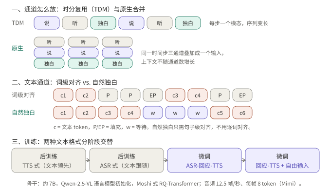

*图 5：对比时分复用与原生合并、词级对齐与自然独白，以及四个训练阶段。*

**命名说明**：中文媒体把 BAAI 与 Spin Matrix、南洋理工大学合作开源的原生全双工模型称为 RoboBrain-Audio。我找到的对应论文是 FLM-Audio（arXiv 2509.02521，2025 年 9 月首次提交），论文没有出现 RoboBrain-Audio 这个名字，对应关系依据媒体报道，请核实。它不是 2026 年才发布的。

**工作方式**

- 约 7B 的骨干，由 Qwen-2.5-VL 的语言模型初始化，采用 Moshi 式的 RQ-Transformer；音频 12.5 帧每秒、每帧 8 个 token，用 Mimi 编解码。
- 每个时间步把文本、听、说三个通道合并成一个输入，上下文长度不随通道数增长，这与时分复用不同。
- “自然独白”：文本通道不做词级对齐加 padding，而是输出连续的句子，语音没跟上时输出“等待”token，只需句子级对齐。训练时“文本领先语音”（类似 TTS，约领先 0 到 2 个 token）和“文本跟随听的通道”（类似 ASR）两种格式分阶段交替，最后加入自由用户输入和打断（概率 0.7，反应延迟 0.5 秒）。

**结果**（论文报告）：第一阶段约 100 万小时语音，据称不到 Moshi 所用音频的 15%；LlamaQuestions 56.3 对 Moshi 的 43.7；含打断的噪声测试中轮转准确率 0.98；5% 数据的受控实验里，自然独白的 WER 为 18.2，词级对齐的 Moshi 式设置为 22.3。论文称将发布代码和模型，中文媒体称已开源；论文页面没有链接，我没有核实到仓库。

## 5. Seeduplex：线上全量的原生全双工

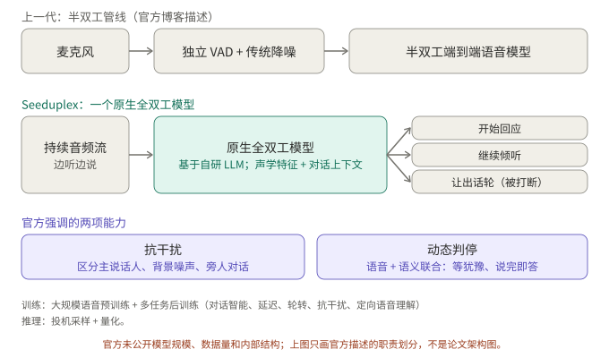

*图 6：概念图，不是官方架构图。官方博客只描述了职责划分：原生模型取代独立 VAD 和降噪，决定开始回应、继续倾听还是让出话轮。*

**工作方式**（ByteDance Seed 官方博客，2026 年 4 月 9 日）

- 基于公司自研 LLM 的原生端到端模型，取代上一代半双工系统里独立的 VAD 和传统降噪；预训练之后做多任务后训练，覆盖对话智能、延迟、轮转、抗干扰、定向语音理解。推理用投机采样和量化。模型规模、数据量和内部结构没有公开。
- 两项重点能力：一是持续聆听，区分主说话人、背景噪声和旁人对话，并判断话是不是对自己说的；二是动态判停，联合语音与语义判断用户是否说完，既等犹豫，又在说完后快速响应。

**官方演示**：博客有 10 个演示视频，按能力分两组：

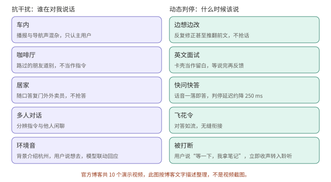

*图 7：按博客文字描述整理的场景，不是视频截图。*

在豆包 App 更新到最新版后，在输入框选“打电话”即可体验。

**结果**（官方报告，对比上一代半双工豆包模型）：

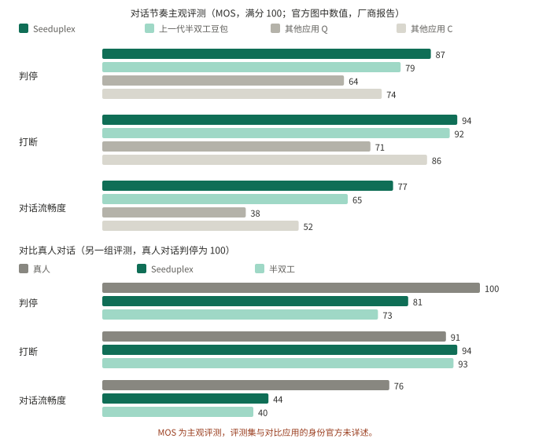

*图 8：按官方两张柱状图的数值重绘。MOS 为主观评测，博客没有详述评测集，也没有点名对比的其他应用。*

此外正文给出：判停延迟快约 250 ms，打断响应快约 300 ms，复杂场景 AI 抢话比例相对下降 40%，嘈杂场景误回复率和误打断率减半，线上 A/B 整体通话满意度绝对值提升 8.34%。官方也承认整体对话流畅度仍落后于真人对话（图 8 下半：44 对 76）。

## 6. Dessa：只用人类对话从零训练

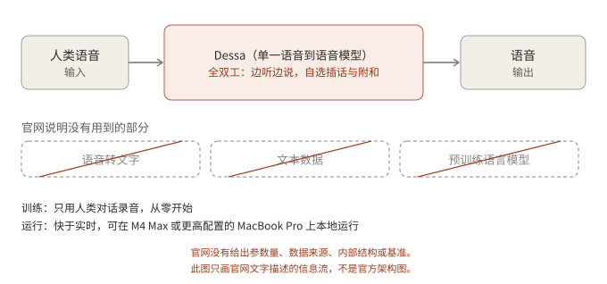

*图 9：概念图，不是官方架构图。官网只给出信息流和不用的部分，没有给出参数量、数据来源或内部结构。*

**工作方式**（Block 官网，2026 年 10 月）

- 官网称这是语音到语音的全双工模型：音频进、音频出，没有语音转文字这一步；只用人类对话录音从零训练，没有文本，也没有预训练语言模型。
- 能自己决定何时插话、何时给出附和（“yeah”“got it”之类）；官网称推理快于实时，可在 M4 Max 或更高配置的 MacBook Pro 上本地运行。
- 官网自称“据我们所知”是第一个只用人类语音训练、可进行真实对话的 AI。这是公司的说法，没有独立验证；官网没有基准或定量评测。

**官方演示**：官网没有 UI，只有六段真人与 Dessa 的实时对话录音（双声道同步播放，字幕为事后添加）：

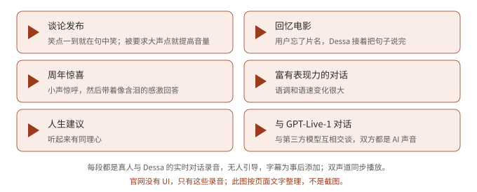

*图 10：按页面文字整理，不是截图。*

可得性：候补名单，抢先体验限用机构邮箱申请的 AI 安全研究者。官网也说明，与 GPT-Live-1 的那段对话中，对方开发者与 Block 无关联。

## 7. FireRedChat：不换模型，加一个轮转控制器

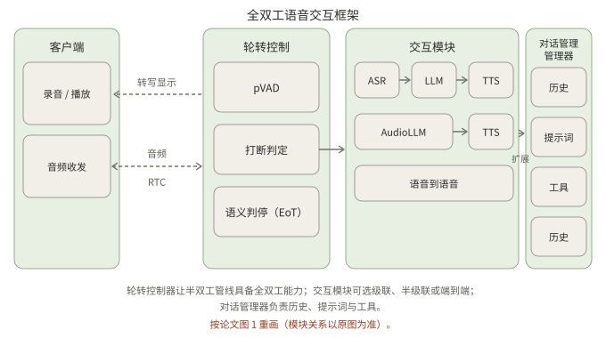

*图 11：按论文图 1 重画。客户端通过 RTC 收发音频；轮转控制器有 pVAD、打断判定和语义判停；交互模块可选级联、半级联或语音到语音；对话管理器管历史、提示词和工具。*

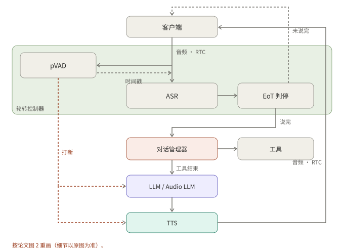

*图 12：按论文图 2 重画。pVAD 检测到打断时同时中断 LLM 和 TTS；EoT 判定“未说完”则继续接收，判定“说完”才交给对话管理器。*

**工作方式**（arXiv 2509.06502，小红书 FireRed 团队，2025 年 9 月）

- 不是原生全双工，而是给级联或半级联的半双工管线加一个全双工控制器。控制器含流式个性化 VAD（目标说话人条件，因果卷积、ECAPA-TDNN 说话人嵌入、GRU），压低背景噪声和非主说话人造成的误打断；以及微调的多语言 BERT 语义判停分类器，基于累积的 ASR 文本判断“继续”或“停止”。
- pVAD 的时间戳用于从原始未降噪的音频里切出语音段送 ASR，pVAD 的输出本身不送入下游。
- 交互模块：级联是 FireRedASR、Qwen2.5、FireRedTTS-1s；半级联是音频 LLM 直接听用户语音，再接 FireRedTTS-2。对话管理基于 Dify，负责工具调用（例如网页搜索）和上下文。

**结果**（论文报告，内部评测）：

| 指标 | FireRedChat | LiveKit | Ten |
|---|---|---|---|
| 打断判定 T90 / 误打断率 | 170 ms / 10.2% | 140 ms / 33.4% | 90 ms / 78.1% |
| 判停准确率（中 / 英） | 96.0% / 94.9% | 70.8% / 86.2% | 95.8% / 94.4% |
| 端到端延迟 P50 / P95 | 2.341 s / 3.015 s | 3.598 s / 4.649 s | 3.375 s / 3.802 s |

作者说明自己的 T90 比 LiveKit 慢约 30 ms，换来误打断大幅减少；对比的一个工业系统 P50 为 2.075 s。延迟评测只用了 25 条合成语句。

**演示**：项目页的演示区是一个演示视频。我的环境打不开这个视频，所以这里不描述视频内容。论文页面没有给出代码链接，我没有核实仓库是否公开。

## 8. 对照

| 方案 | 类型 | 时机怎么决定 | 内容怎么生成 | 可体验性 |
|---|---|---|---|---|
| BayLing-Duplex | 原生，块交错 | 文本通道里的状态 token | 单个 AR LLM | 论文 |
| FLAIR | 原生，隐空间推理 | 时序头 G | AR，听时隐空间推理 | 论文 |
| Diffuplex | 原生，AR 加扩散 | AR 策略四状态 | 扩散画布并行去噪 | 代码未发布 |
| RoboBrain-Audio | 原生，通道合并 | 模型自己决定（Moshi 式） | 自然独白加 RQ-Transformer | 论文称开源 |
| Seeduplex | 原生，结构未公开 | 模型联合语音与语义判停 | 未公开 | 豆包 App |
| Dessa | 原生，从零训练 | 模型自己学会插话与附和 | 未公开 | 候补名单 |
| FireRedChat | 控制器加管线 | pVAD 与语义 EoT | 级联或半级联 | 演示视频 |

## 9. 读这些结果时要注意

1. **合成音频**。BayLing-Duplex 和 FLAIR 以合成数据为主；BayLing-Duplex 的作者自己写明未测试噪声、混响和多人说话。
2. **基线不同**。上面的表和图里，基线分别是 Moshi、自身开关对照、自回归全模态模型、上一代半双工模型、LiveKit 和 Ten。
3. **评测方式**。“打断后停止时间”依赖 VAD 切分；Seeduplex 的 MOS 是主观评测；FireRedChat 的延迟只用了 25 条合成语句。
4. **厂商数字**。Seeduplex、Dessa、FireRedChat 的数字都是各自团队报告，没有独立复现。

## 10. 总结

七个方案在“谁来决定何时开口”上分成三条路：让模型自己预测状态 token（BayLing-Duplex，以及官方描述中的 Seeduplex）、把控制器放在模型之外（FireRedChat）、改变内容的生成方式（Diffuplex、FLAIR）。FLM-Audio 在通道排布上降低对齐成本，Dessa 走的是完全不经过文本的方向。真正决定效果的仍然是真实环境下的评测，这也是这些结果共同的缺口。

## 待核实

- Diffuplex 的数字来自论文页面文本；代码与权重尚未发布。FLAIR 的损失权重 α、β 和完整消融没有读到。
- Seeduplex 的架构细节官方未公开；图 6 是概念图。图 8 的数值来自官方图表，由我读图得到。
- Dessa 官网未标明发布日期，2026 年 10 月是依据媒体报道；图 9 是概念图。
- RoboBrain-Audio 与 FLM-Audio 的对应关系依据中文媒体报道，我没能打开原文核对；FLM-Audio 的开源链接未核实。
- FireRedChat 的演示视频我没能打开；代码是否公开，论文页面没有说明。
- 所有“演示”只转述官方页面展示的内容，我没有试用任何一个系统。

## 参考资料

- [BayLing-Duplex: Native Full-Duplex Speech Dialogue with a Single Autoregressive LLM（arXiv 2606.14528）](https://arxiv.org/abs/2606.14528)
- [The Silent Thought: Modeling Internal Cognition in Full-Duplex Spoken Dialogue Models via Latent Reasoning（arXiv 2603.17837）](https://arxiv.org/abs/2603.17837)
- [Full-duplex Spoken Language Modeling with Discrete Diffusion（arXiv 2610.17780）](https://arxiv.org/abs/2610.17780)
- [FLM-Audio: Natural Monologues Improves Native Full-Duplex Chatbots via Dual Training（arXiv 2509.02521）](https://arxiv.org/abs/2509.02521)
- [Seed 全双工语音大模型发布：懂倾听、抗干扰，走向更自然的交互（ByteDance Seed 官方博客）](https://seed.bytedance.com/zh/blog/introducing-seed-full-duplex-speech-llm-attentive-listening-robust-interference-suppression-enabling-more-natural-interaction)
- [Dessa（Block 官网）](https://block.xyz/dessa)
- [FireRedChat: A Pluggable, Full-Duplex Voice Interaction System with Cascaded and Semi-Cascaded Implementations（arXiv 2509.06502）](https://arxiv.org/abs/2509.06502)
- [FireRedChat 项目演示页](https://fireredteam.github.io/demos/firered_chat/)

延伸阅读：[全双工语音模型精读：MiniCPM-o 4.5 与 Realtime-Venus]()。

*附注：文中数字均来自上述论文、官方博客和官网，由作者或厂商报告，未经我独立复现。架构图按论文或官方图重画；标注“概念图”的两张不是官方架构图。演示部分只转述官方展示的内容，没有嵌入官方截图或视频。*
