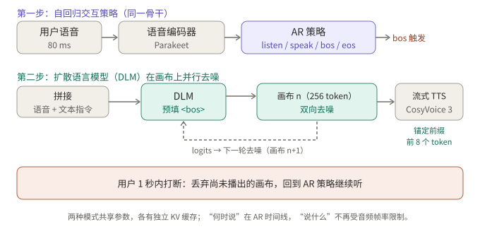
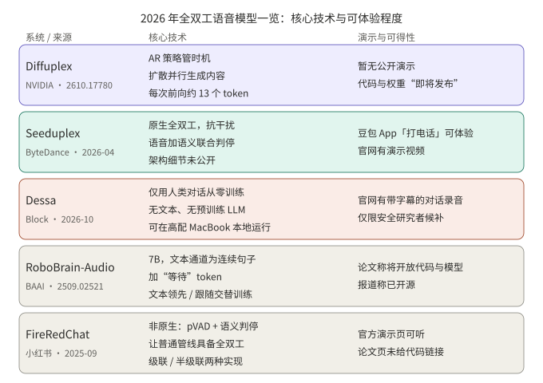

## 摘要

全双工语音模型的难点之一，是用户在说话时模型“在做什么”。三篇 2026 年的论文给出了三种回答：

- **BayLing-Duplex**（arXiv 2606.14528）把“听、说、停”变成文本通道里的四个状态 token，由同一个自回归 LLM 预测，再用一轮轻量 DPO 专门修正时机。
- **FLAIR**（arXiv 2603.17837）认为用户说话的这段时间不该只是填静音或 padding 的空转，而应该在隐空间里继续“想”，并且不增加推理延迟。
- **Diffuplex**（arXiv 2610.17780，NVIDIA）把“何时说”和“说什么”拆开：自回归策略管时机，扩散模型在一块画布上并行生成内容，不再受音频帧率限制。

前两者各解决一个问题：时机，和听的时候能不能顺便推理；Diffuplex 换了一个角度，改变生成内容的方式。后面还有一节速览 2026 年业界发布的几个全双工系统：Seeduplex、Dessa、RoboBrain-Audio 和 FireRedChat。

## 核心结论

- BayLing-Duplex 只在词表里加了四个状态 token，没有新模块，决策全部是下一 token 预测；去掉外部 VAD 后，时机的好坏就由训练数据和 loss 权重决定。
- 它的消融显示，token 权重是关键：各 token 等权时，模型几乎一直沉默（轮转成功率 60.3%）；压低 [SILENCE] 的权重后明显恢复。
- FLAIR 在听的阶段用“词表嵌入的 softmax 加权平均”作为连续的隐空间输入，训练时借助一个只在训练中存在的非因果专家提供目标，推理时丢掉专家。
- FLAIR 自己报告的结果是：隐空间推理对知识类问答有小幅提升，对轮转和打断指标没有明显改善，也没有明显损害。
- Diffuplex 报告每次前向约 13 个 token，是自回归基线的 13 倍，但这是在作者自己的硬件和设置下测得，代码与权重尚未发布。
- 业界发布里，Seeduplex 有官方的工程指标和线上 A/B，Dessa 只有演示，FireRedChat 是级联系统加全双工控制器，并非原生全双工；这些数字都是各自厂商报告。
- 论文的训练和评测音频基本都是合成的，数字不能跨论文直接比较，也不能直接外推到有噪声、多人说话的真实场景。

## 1. 问题：听的时间被浪费了

半双工的语音对话把“听”交给 VAD 和 ASR，“说”才交给 LLM。全双工模型把两条流放在同一条时间线上，于是出现两个新问题：

1. **时机**：什么时候该接话，什么时候该闭嘴，被打断时多久停下来。
2. **空转**：用户说话期间，输出侧只能填静音或 padding，这些位置对最终回答没有贡献。

BayLing-Duplex 主要攻第一个问题，FLAIR 主要攻第二个。MiniCPM-o 4.5 这类按固定窗口判断“听或说”的做法见 ；这篇补充的是另外两种设计取向。

## 2. BayLing-Duplex：把时机写进 token

### 2.1 结构

BayLing-Duplex 以公开的 GLM-4-Voice 为起点：语音 tokenizer 把 16 kHz 音频变成 12.5 Hz 的 token（每个 80 ms），中间是 9B 的 decoder-only LLM，后面是语音解码器。改动只有一处：序列的排布和四个新 token。

序列按“块”交错：每块先放 N 个用户语音 token，再放 M 个文本 token，最后放 N 个助手语音 token。论文取 N=10、M=5，一个块 0.8 秒，文本通道约每秒 6.25 个 token。文本通道相当于不会说出口的内心独白，里面除了文字，还有四个状态 token：

*图 1：一个块的排布。助手侧的文本和语音相对用户通道前移一个块；所有轮转决定都是下一 token 预测。*

块的大小是一个取舍：N 太小，文本槽位太少、时序抖动；N 太大，最短响应延迟被抬高（N=10 时下限是 0.8 秒）。论文没有系统扫描这个参数。

推理时逐块解码：输入 N 个用户 token，在只允许文本和状态 token 的掩码下采样 M 个文本 token，再在只允许语音 token 的掩码下采样 N 个语音 token。用户在块中间打断时，已在生成的语音 token 会先播完，下一块才读到新的音频。这意味着打断的响应粒度是块，而不是单个 token。

### 2.2 训练：SFT 加一轮轻量 DPO

- **数据**：以 LLaMA-Omni 2 的 20 万条多轮语音对话为底，合成两类场景各 20 万条，1:1 混合。轮转场景里助手在 0.8 秒间隔后回应；打断场景里用户在助手回应时插话，助手在 0.8 到 2.0 秒的随机延迟后作出反应。
- **SFT**：只在文本和助手语音位置计算交叉熵，并对 [SILENCE] 与 [ASSISTANT]/[EPAD] 使用单独的 token 权重。
- **DPO**：负样本只扰动助手回应的时机，音频和文本与正样本相同。轮转负样本把间隔拉长到 2 到 5 秒，打断负样本把反应延迟拉长到 3 到 5 秒。训练只跑 200 步，学习率 1e-7，β=0.5。

“只改时机、不改内容”的负样本设计是这篇论文最值得借鉴的地方：它把偏好信号严格限定在时机上，避免模型学到别的东西。

### 2.3 结果与消融

下表为论文报告，基线是 Moshi，评测音频为合成：

| 模型 | Llama Q. | Web Q. | 轮转成功率@3s | 打断后停止时间（秒，越低越好） | 打断成功率@2s |
|---|---|---|---|---|---|
| Moshi | 21.0 | 9.2 | 71.9 | 2.07 | 81.9 |
| BayLing-Duplex（SFT） | 44.3 | 18.0 | 88.9 | 1.51 | 91.4 |
| BayLing-Duplex（+DPO） | 46.0 | 18.1 | 92.0 | 1.10 | 100.0 |

token 权重的消融更能说明问题：等权训练时，模型大部分时间保持沉默，轮转成功率只有 60.3%；仅降低 [SILENCE] 的权重可到 82.4%；同时提高角色 token 的权重可到 88.9%。论文也指出，等权那一行的打断成功率 100% 是退化的，因为几乎不说话的模型无需“停下来”。

我的判断（推断，非论文结论）：这说明在状态 token 方案里，静音 token 在序列中占绝对多数，类别不平衡本身就会让模型倾向沉默，权重不是细节，而是方案成立的前提。

## 3. FLAIR：听的时候继续想

### 3.1 动机

论文指出，现有全双工模型在用户说话期间，要么输出重复的 padding 或静音 token，要么如果硬塞显式的文本思维链，又会与流式的因果性冲突：用户说完或打断时，思考内容和语音输出很难同步。FLAIR（论文标题 *The Silent Thought*）选择在连续的隐空间里推理，不需要推理标注，也不增加推理延迟。

### 3.2 做法

*图 2：用户说话阶段，隐状态经输出头和 softmax 后对词表嵌入加权平均，作为下一步输入；时序头 G 决定何时转为输出文本 token。*

- **听的阶段**：把上一步隐状态过 LLM 输出头得到词表分布，再对嵌入矩阵做 softmax 加权平均，得到下一步的输入嵌入。这个循环是因果的、递归的。
- **说的阶段**：时序头（对最终隐状态的 MLP）预测 G。G=0 继续隐空间推理，并给语音模块发 `<SIL>`；G=1 输出文本 token 并回灌其嵌入。用户打断时，回到隐空间推理。
- **全局专家（仅训练）**：一个非因果编码器看到整段对话，输出同样的词表加权形式，作为“目标隐变量”。LLM 在听的阶段的分布用 KL 向它对齐，这相当于让因果的先验去逼近看过全局的后验。推理时专家被丢弃。
- **损失**：回应段的重建损失，加上 KL 正则，加上预测 G 的时序损失，整体是一个 ELBO 形式的 SFT 目标。

训练分四步：普通全双工预训练；只用重建损失的隐空间推理 SFT；加上完整 ELBO 的联合训练；冻结其余部分、只训练语音生成模块。数据包括 53 万小时合成的双人伪对话、7 万小时指令问答、2 万小时由真实 ASR 语料转写生成的问答，并对较长的回应以 10% 概率模拟打断。

### 3.3 结果：有帮助，但很克制

按论文报告，打开隐空间推理（thk）后：

| 基准 | 有 thk | 无 thk |
|---|---|---|
| Llama Questions | 78.0 | 73.0 |
| WebQuestions | 43.0 | 41.7 |
| TriviaQA | 51.2 | 53.8 |
| OpenBookQA | 74.2 | 72.9 |
| MMSU | 56.2 | 50.2 |

多数任务提升，MMSU 提升最大（+6.0），TriviaQA 略有下降。在对话行为上，Full-Duplex-Bench 的轮转接管率为 93.0 对 94.1，打断接管率为 92.0 对 89.0；延迟相近。作者的结论是隐空间推理没有破坏对话动态，而不是改善了它。

论文还提到，部分半双工基线在某些基准上得分更高（例如 Kimi-Audio 在 MMSU 上为 62.2），作者归因于数据差异和自身回答更短。

## 4. Diffuplex：把“何时说”和“说什么”拆开

### 4.1 想解决什么

论文认为，把“何时说”和“说什么”压进同一条自回归时间线，二者会互相争抢；而且生成速度被音频帧率绑住，推理时的计算量上不去。Diffuplex（*Full-duplex Spoken Language Modeling with Discrete Diffusion*）的做法是让内容生成脱离这条时间线。

### 4.2 做法

*图 3：同一个骨干跑两种模式。自回归策略以 80 ms 为单位读用户语音，预测 listen / speak / bos / eos 四种状态；输出 bos 后，扩散模式在 256 token 的画布上双向去噪，前 8 个 token 提交后先送去流式 TTS。*

- 语音经 Parakeet 编码器和投影层进入骨干。两种模式共享参数，但各有独立的 KV 缓存。
- 触发 bos 时，当前语音上下文被预填入扩散缓存。画布的前 8 个 token（锚定前缀）在最多 K 轮去噪内提交，并流式送入 TTS（CosyVoice 3），其余部分继续去噪。
- 用户在 1 秒内打断时，尚未播出的画布被丢弃，不进入上下文。
- 训练分三步：模态对齐（ASR 数据）；口语指令跟随（约 60 万条，用冻结的文本模型做蒸馏）；全双工（冻结生成器，只训练四状态交互头和一个聆听模式的 LoRA，数据约 120 小时合成对话加 70 小时对话数据）。

### 4.3 结果与代价

按论文报告：

- **速度**：每次前向约 13.0 个 token，自回归基线为 1.00；单卡 GB300、batch 为 1 时吞吐最高 1,872 token/s，对比 394（Nemotron-3 Omni）和 300（Qwen3-Omni-Thinking）。作者指出吞吐提升小于每次前向的 token 数提升，因为一次扩散前向比一次自回归步更贵。
- **质量**：VoiceBench 总分，口语指令阶段开启思考为 86.9、关闭为 84.1；全双工阶段（不思考）为 82.3，对比 Nemotron-3 VoiceChat 的 58.1。
- **首音延迟与质量的取舍**：锚定前缀的轮数 K 越小，首音越快、质量越低。K=2 为 251 ms、得分 80.5；K=4 为 296 ms、82.3；不设上限为 497 ms、84.0（该组在 RTX 6000 上测得，不含自回归策略做轮转决定的时间）。
- **消融**：去掉文本锚定蒸馏后得分降到 66.1，去掉第一阶段的模态对齐只有 29.9，说明语音到文本能力的迁移是这套方案成立的前提。

局限：代码和权重“即将发布”，目前无法独立复现；速度和延迟在不同硬件上测得（GB300 的吞吐使用了量化专家）；全双工阶段比口语指令阶段低 1.8 分，论文归因于流式决策与早期前缀解码，但没有单独隔离验证。

我的判断（推断）：Diffuplex 与前两篇不是竞争关系。BayLing-Duplex 的状态 token 和 FLAIR 的时序头，都是在回答“何时说”，Diffuplex 的自回归策略也在做同一件事，区别在于它不再让内容生成占用这条时间线。

## 5. 2026 年业界发布速览

下图把五个系统放在一起：核心技术，以及能不能体验到。下面的“演示效果”只能转述官方页面和论文里展示的内容，我没有亲自试用过任何一个。

*图 4：一页速览。可得性以各官方页面为准，随时可能变化。*

### 5.1 Seeduplex（ByteDance Seed，2026 年 4 月）

- **技术**：官方博客称其为原生全双工模型，基于公司自研 LLM，取代了上一代半双工系统里独立的 VAD 和传统降噪；预训练之后做多任务后训练，覆盖对话智能、延迟、轮转、抗干扰、定向语音理解。官方强调两点：持续聆听，能区分主说话人与背景噪声和旁人对话；联合语音与语义判断用户是否说完，既等待犹豫，又在说完后快速响应。推理上用了投机采样和量化。模型规模、数据量和详细架构没有公开。
- **公司报告的指标**（对比上一代半双工豆包模型）：嘈杂场景误回复率和误打断率减半；复杂场景下 AI 抢话比例相对下降 40%；判停延迟快约 250 ms；打断响应快约 300 ms；线上 A/B 通话满意度绝对提升 8.34%。官方也承认整体流畅度仍落后于真人对话。
- **演示与试用**：官网有车载指令、咖啡馆多人对话、英语面试模拟、快问快答、古诗词游戏、句中打断等演示视频；豆包 App 更新后，在输入框选“打电话”即可体验。

### 5.2 Dessa（Block，2026 年 10 月）

- **技术**：官网称这是一个语音到语音的全双工模型，只用人类对话录音从零训练，没有文本，也没有预训练语言模型；没有语音转文字这一步，能自己决定何时插话、何时给出附和。官网称推理快于实时，可在 M4 Max 或更高配置的 MacBook Pro 上本地运行。参数量、数据来源和详细设计没有公开，也没有基准或定量评测。
- **演示与试用**：官网有带字幕的对话录音，包括回忆电影名、一段周年纪念的情感对话，以及与另一家公司的模型对话（官网声明与对方无关联）。目前是候补名单，抢先体验仅限用机构邮箱申请的 AI 安全研究者。
- 官方称其为“据我们所知”第一个只用人类语音训练的可实时对话的系统，这是公司的说法，没有独立验证。

### 5.3 RoboBrain-Audio（BAAI 等，对应 FLM-Audio）

- **说明**：中文媒体报道把 BAAI 与 Spin Matrix、南洋理工大学合作开源的原生全双工语音模型称为 RoboBrain-Audio。我找到的对应论文是 FLM-Audio（arXiv 2509.02521，2025 年 9 月首次提交），论文本身没有出现 RoboBrain-Audio 这个名字，二者的对应关系依据的是媒体报道，请核实。它不是 2026 年才发布的。
- **技术**：约 7B 的骨干，初始化自 Qwen-2.5-VL 的语言模型，采用 Moshi 式的 RQ-Transformer；音频 12.5 帧每秒，每帧 8 个 token，用 Mimi 编解码。每个时间步把文本、听、说三个通道合并成一个输入。核心想法是“自然独白”：文本通道不做词级对齐加 padding，而是输出连续的句子，语音还没跟上时输出“等待” token。训练时“文本领先语音”（类似 TTS）和“文本跟随听的通道”（类似 ASR）两种格式分阶段交替。
- **论文报告的结果**：第一阶段约 100 万小时语音，据称不到 Moshi 所用音频的 15%；LlamaQuestions 准确率 56.3，对比 Moshi 的 43.7；在含打断的噪声测试里轮转准确率 0.98；受控实验里，连续独白比词级对齐的 Moshi 式设置更好（5% 数据下 WER 18.2 对 22.3）。
- **演示与试用**：论文称将发布代码与模型；中文媒体称已开源。论文页面没有给出链接，我没有核实到具体仓库。

### 5.4 FireRedChat（小红书 FireRed 团队，2025 年 9 月）

- **技术**：与上面几个不同，它不是原生全双工，而是给级联或半级联的半双工管线加一个全双工控制器。控制器由两部分组成：流式个性化 VAD（目标说话人条件，因果卷积、ECAPA-TDNN 说话人嵌入、GRU），用来压低背景噪声和非主说话人造成的误打断；以及一个微调的多语言 BERT 语义判停分类器。交互模块可以是 FireRedASR、Qwen2.5、FireRedTTS 的级联，也可以是一个音频 LLM 直接接收语音再接 TTS 的半级联。对话管理基于 Dify，用于工具调用和上下文管理。
- **论文报告的内部评测**：打断判定 T90 为 170 ms、误打断率 10.2%；对比 LiveKit 的 140 ms 和 33.4%，Ten 的 90 ms 和 78.1%。作者说明自己比 LiveKit 慢约 30 ms，换来误打断大幅减少。端到端延迟 P50 为 2.341 s，对比一个工业系统的 2.075 s；评测只用了 25 条合成语句。
- **演示与试用**：有官方演示页；论文页没有给出代码链接。我没有核实仓库是否已公开。

### 5.5 小结

按路线分：Seeduplex 和 Dessa 是原生全双工，前者强调工程上的抗干扰与判停，后者强调从人类对话里直接学；FLM-Audio 靠“自然独白”降低对齐成本；FireRedChat 则证明了在不换模型的前提下，把控制器做好也能得到可用的全双工体验；Diffuplex 改的是内容生成方式。厂商给出的数字很难横向比较：基线不同（上一代半双工模型、Moshi、LiveKit），评测集多为内部或合成。

## 6. 对照

三篇论文的对照如下（业界系统见图 4）：

| 维度 | BayLing-Duplex | FLAIR | Diffuplex |
|---|---|---|---|
| 主要问题 | 时机：何时说、何时停 | 听的时间怎么用 | 内容生成怎么脱离时间线 |
| 核心手段 | 文本通道里的四个状态 token，块交错 | 隐空间递归输入，加训练期专家 | 自回归策略加并行扩散画布 |
| 额外模块 | 无 | 时序头；训练期的全局专家 | 扩散模式（同一骨干）、TTS |
| 偏好优化 | 只扰动时机的 DPO | 论文提到可作为后训练，未做 | 未提及 |
| 打断响应粒度 | 块（0.8 秒），在途语音先播完 | 逐 token，时序头判断 | 80 ms；1 秒内打断丢弃未播画布 |
| 主要收益 | 轮转与打断指标 | 部分知识类问答 | 每次前向 token 数、吞吐 |
| 数据 | 合成、单说话人、近场无噪声 | 合成为主，含加噪与多说话人增强 | 合成对话加少量对话数据 |

BayLing-Duplex 与 FLAIR 可以组合（推断）：状态 token 负责把时机说清楚，隐空间推理负责让听的位置产生有用的计算。但论文没有做这个组合，两种方案对 padding 位置的使用也是互相冲突的，组合需要重新设计序列格式。

## 7. 读这类论文和发布稿时要注意的地方

1. **合成音频**。BayLing-Duplex 的训练和评测音频全部是合成、单说话人、近场、无噪声，作者自己在局限里写明未测试噪声、混响和多人说话。FLAIR 加了噪声和多说话人增强，但仍以合成数据为主。
2. **基线不同**。厂商发布的数字（第 5 节）同样如此，且多为内部评测。BayLing-Duplex 对比 Moshi，FLAIR 对比自己的有无隐空间推理以及若干半双工模型，Diffuplex 对比自回归全模态模型，数字不可跨论文比较。
3. **指标定义**。“打断后停止时间”依赖 VAD 切分；BayLing-Duplex 的评测使用 Silero VAD（仅评测用）。换一套切分，数字会变。
4. **延迟下限**。块式设计有结构性的延迟下限；这是设计选择，不是调参能消除的。

## 8. 总结

把“听”的位置当成可以利用的资源，是前两篇论文共同的出发点：BayLing-Duplex 用它表达控制信号，FLAIR 用它做计算；Diffuplex 则把内容生成从时间线上搬走。业界发布方面，原生全双工与“级联加控制器”两条路线并存。对要做全双工语音的人来说，前者给出了一套可以直接照着做的时机训练配方（块交错、token 权重、只扰动时机的 DPO），后者给出了一个值得关注、但收益尚不明确的方向。真正决定效果的，仍然是真实环境下的评测，而这恰好是这几篇论文共同的缺口。

## 待核实

- Diffuplex 的数字来自论文页面文本；代码与权重尚未发布。
- Seeduplex 的指标来自官方博客，均为公司报告；官方未给出基线之外的对比数值。
- Dessa 官网未标明发布日期，2026 年 10 月是依据媒体报道。
- RoboBrain-Audio 与 FLM-Audio 的对应关系来自中文媒体报道（搜索结果中的 Sina、知乎文章），我没能打开原文核对；FLM-Audio 的开源链接也未核实。
- FireRedChat 的代码是否已公开，论文页面没有说明。
- FLAIR 的损失权重 α、β 和消融的具体数字，我读到的论文页面没有给出，需回到原文确认。
- FLAIR 的结果表基于 arXiv v5 的页面文本，其中 Full-Duplex-Bench 的数字请以论文为准。

## 参考资料

- [BayLing-Duplex: Native Full-Duplex Speech Dialogue with a Single Autoregressive LLM（arXiv 2606.14528）](https://arxiv.org/abs/2606.14528)
- [The Silent Thought: Modeling Internal Cognition in Full-Duplex Spoken Dialogue Models via Latent Reasoning（arXiv 2603.17837）](https://arxiv.org/abs/2603.17837)
- [Full-duplex Spoken Language Modeling with Discrete Diffusion（arXiv 2610.17780）](https://arxiv.org/abs/2610.17780)
- [Seed 全双工语音大模型发布：懂倾听、抗干扰，走向更自然的交互（ByteDance Seed 官方博客）](https://seed.bytedance.com/zh/blog/introducing-seed-full-duplex-speech-llm-attentive-listening-robust-interference-suppression-enabling-more-natural-interaction)
- [Dessa（Block 官网）](https://block.xyz/dessa)
- [FLM-Audio: Natural Monologues Improves Native Full-Duplex Chatbots via Dual Training（arXiv 2509.02521）](https://arxiv.org/abs/2509.02521)
- [FireRedChat: A Pluggable, Full-Duplex Voice Interaction System with Cascaded and Semi-Cascaded Implementations（arXiv 2509.06502）](https://arxiv.org/abs/2509.06502)

*附注：文中数字均来自上述论文、官方博客和官网的页面文本，由作者或厂商报告，未经我独立复现；演示效果只是转述官方展示的内容，我没有试用。*
