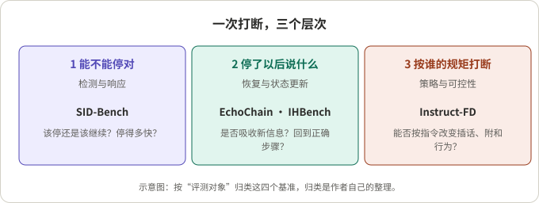
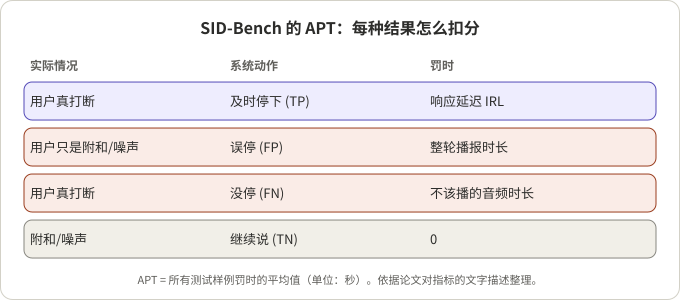
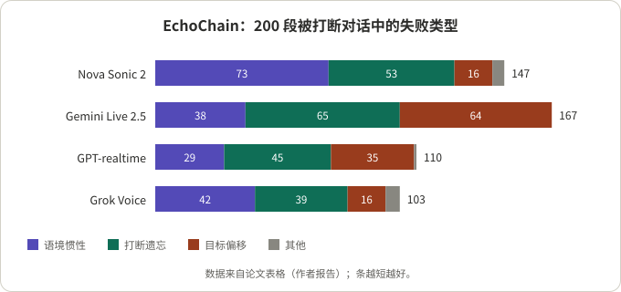

## 摘要

用户在系统说话时插嘴，叫重叠打断（barge-in）。早期评测只问一件事：系统有没有停、停得多快。2026 年出现的几个基准把问题拆得更细：**SID-Bench**（Qwen 团队）测“该不该停”，**EchoChain**（Labelbox）和 **IHBench**（Boson AI）测“停了以后说得对不对”，**Instruct-FD**（Boson AI）测“能不能按指令改变打断行为”。

本文只依据这四篇论文（Instruct-FD 只读了摘要页）。我的读法是：这四个基准测的是打断处理的三个不同层次，数字之间不能互相比较；做语音智能体的人最该看的是第二层，因为“停下来”之后的状态更新才是用户最容易感到别扭的地方。

## 核心结论

- 打断处理至少有三层：检测并停下、恢复并更新状态、遵循策略。四个基准各占一层，没有哪个覆盖全部。
- 只测反应时间会漏掉大部分问题。EchoChain 里没有模型的整段通过率超过 50%（最高 48.5%）；IHBench 里“被打断的半句话能不能接上”最差只有个位数到三成的正确率。
- 两个“恢复”基准都依赖 LLM 评审，评审可信度的验证方式不同：IHBench 做了人类对照，EchoChain 靠人工按细则打分。
- SID-Bench 的 APT 指标把误停和漏停统一成“秒”，好用，但惩罚规则是启发式的，论文自己承认还没和人类主观感受做相关性验证。
- 所有结果都是作者自报，评测对象和协议各不相同，只能看趋势。

## 先看懂几个概念

- **Barge-in（重叠打断）**：系统正在播报时用户开口。系统要决定：是真打断，还是附和（“嗯”“对”）、咳嗽、背景噪声。
- **VAD**（语音活动检测）：只看“有没有声音”，所以对附和和噪声也会触发，SID-Bench 称之为“扳机太灵”。
- **误停 / 漏停**：该继续时停了（FP），该停时没停（FN）。两者代价不同，FP 浪费一轮，FN 让用户对着一段噪音干等。
- **状态更新**：打断常带来新信息（“等等，改成周五”）。系统不仅要停，还要让后续内容反映这条信息。
- **工作流状态机**：多步骤任务（办理、核验、预约）里，系统在第几步、哪些步骤已做过。打断之后要回到正确的一步，而不是从头或跳过。

## 1. 四个基准一览

*图 1：示意图。按“评测对象”归类这四个基准，归类是作者自己的整理。*

| 基准 | 团队 | 测什么 | 规模 | 评分方式 |
|---|---|---|---|---|
| SID-Bench | Qwen 团队 | 语义级打断检测 | 3,700 条（约 10 小时） | FIR、IRL、APT，规则计算 |
| EchoChain | Labelbox | 打断后的状态更新推理 | 200 段被打断对话 | 人工细则 + 通过率 |
| IHBench | Boson AI | 打断后的工作流恢复 | 45 段对话、428 个打断点 | LLM 评审，对照人类 |
| Instruct-FD | Boson AI | 按指令控制话轮行为 | 摘要页未给出 | LLM 评审 |

## 2. SID-Bench：该不该停

**结论**：它把“停得对不对”做成可计算的指标，并给出一个小模型作为参照。

- **数据**：中英文录音，来自专业数据供应商，加上 Switchboard 的英文子集。每种语言各 500 条“开头打断”、600 条“中间打断”、500 条“无打断”，另有 200 条环境噪声和 300 条静音，合计 2×(500+600+500)+500 = 3,700。
- **标注**：用 LLM 在句中插入“第一个实质性词”作为断点，再用 Kaldi 强制对齐得到该词首个音素的起点，作为打断时刻真值。
- **指标**：FIR（误停率）、IRL（打断响应延迟）、APT（平均惩罚时间）。APT 的算法见图 2。

*图 2：依据论文对指标的文字描述整理，单位为秒。*

论文表 2 的平均结果（作者报告）：

| 系统 | 平均 IRL (s) | 平均 FIR | 平均 APT (s) |
|---|---|---|---|
| FSMN-VAD | 0 | 0.840 | 3.627 |
| Freeze-Omni (Silero VAD) | 0.173 | 0.532 | 2.129 |
| FireRedChat (pVAD) | 1.045 | 0.476 | 2.627 |
| Moshi | 2.517 | 0.118 | 3.192 |
| SID-model | 0.389 | 0.124 | 0.711 |

读表：纯 VAD 反应最快但几乎一半以上的非打断声音都会让它停；Moshi 误停少，但停得很慢。SID-model 用音频编码器加一个 0.6B 规模的 LLM 做“打断/继续”二分类，累计 3 次连续“打断”判定才停，代价是 IRL 约 0.39 s，但 APT 降到最佳基线的约三分之一。

**需要保留的地方**（论文自己列出或可由其描述推出）：

- Moshi 是在固定时间点播放音频来测的，VAD 类基线按起始时间计分，协议并不完全等价；Moshi 没有中文结果。
- 标注依赖 LLM 断点，没有和人工标注核对；静音样本是合成拼接的。
- APT 的惩罚设计（例如误停罚整轮时长）是启发式的，与人类评价的相关性留作未来工作。
- 单次运行，无方差；SID-model 的微调数据量没有给出。

## 3. EchoChain：打断后是否真的改了

**结论**：模型多半“听见了”，但没把新信息用对。

- **设计**：由规划模型和用户模拟模型生成对话，用户语音预先用克隆声音合成，所有被测模型听到的音频完全相同。第一轮不打断，之后每次打断都固定在检测到助手开口后的某个偏移处注入，保证各模型时机一致。
- **指标**：MPR（所有细则全过才算过的对话比例）和 MCP（逐条细则通过率）。
- **失败分类**：语境惯性（口头确认但内容没变）、打断遗忘（先改了后来又退回）、目标偏移（只回应打断、丢了原任务）、其他。

*图 3：根据论文表格重绘，作者报告的数字，条越短越好。*

| 模型 | 语境惯性 | 打断遗忘 | 目标偏移 | 其他 | 失败合计 | MPR (%) | MCP (%) |
|---|---|---|---|---|---|---|---|
| Amazon Nova Sonic 2 | 73 | 53 | 16 | 5 | 147 | 26.5 | 78.1 |
| Gemini Live-2.5-flash-native-audio | 38 | 65 | 64 | 0 | 167 | 16.5 | 64.8 |
| GPT-realtime-2025-08-28 | 29 | 45 | 35 | 1 | 110 | 45.0 | 81.1 |
| Grok Voice Agent | 42 | 39 | 16 | 6 | 103 | 48.5 | 85.5 |

我自己核对了一下：每行四类相加等于“失败合计”，而 (200 − 失败合计)/200 恰好等于 MPR（例如 Nova：53/200 = 26.5%）。所以“失败合计”应是失败对话数，且每段失败对话只归入一类。这是对表格的推断，论文正文没有这样写明。

另一个值得注意的设计：在 48 段抽样对话里，被打断的版本有 92 次失败，同内容不被打断的版本有 55 次，相当于打断本身带来约 40% 的额外失败（(92−55)/92 ≈ 40.2%）。这回答了“是任务难还是打断难”。

**局限**（论文自述）：只测与任务相关的打断，不含附和、旁人说话、噪声；固定偏移不一定贴近自然插话点；通过/不通过的细则看不出严重程度；只测了四个闭源模型；不涉及时机和韵律。

## 4. IHBench：能不能回到正确的那一步

**结论**：同样是“恢复”，但它把场景放进多步骤工作流，并且量化了对话越长越差。

- **数据**：45 段合成对话，覆盖 10 个企业场景，共 428 个打断点，平均每段 30.1 条消息。打断类型占比：反驳 24.5%、不耐烦 19.6%、普通 18.9%、换话题 17.1%、填充语 14.0%、纠正 5.8%。
- **指标**：任务完成（TF）是 LLM 评审在被测模型与一个基线回复之间做对比的胜率，0.5 表示持平；恢复质量（RQ）是按打断类型的 2 到 4 条细则全部满足才算过。
- **评审验证**：换一个评审模型，排序相关系数 0.99（TF）和 0.95（RQ）；与人类标注者的一致性 κ 为 0.41 到 0.51，和人类之间互相的 κ（0.43、0.40）相当，模型排序与人类排序的相关系数在 RQ 上为 1.0、TF 上为 0.90。
- **配置**：共 27 种配置，17 个闭源、10 个开源。

主要发现（作者报告）：

- **填充语最难**：用户只说半句“呃……”被打断后，GPT 系列能正确接上被切断话的比例只有 7% 到 31%；Gemini 2.5 为 62% 到 68%，而 Gemini 3.x 降到 13% 到 32%。
- **越往后越差**：TF 平均每多一轮下降 0.030，开源模型的下降速度约为闭源的 3.3 倍（−0.053 对 −0.016）。
- **音频输入从不优于文本**：部分开源模型用文本比用音频高约 8 个 TF 点。
- **TF 与 RQ 只部分相关**：任务完成最好的（GPT Realtime 2，0.728）与恢复质量最好的（Gemini 2.5 Flash，带思考，0.704）不是同一个模型。

**局限**（论文自述）：合成数据、仅英文、仅 10 个场景；细则带有生成模型和评审模型的偏差；只评文本回复，不评韵律。

## 5. Instruct-FD：按谁的规矩打断

我只读了摘要页。它关注的问题是：不同应用对话轮策略不同（主动辅导 vs. 被动倾听），全双工系统能否按指令改变自己的行为。摘要称六个全双工系统中最好的指令遵循率为 64.4%，主动行为（尤其是模型自己附和和打断）最难。数据规模、评审模型、各系统成绩摘要页没有给出，此处不展开。

## 6. 从工程角度看

**各层各自适用的场景**

| 层次 | 适用 | 前提 |
|---|---|---|
| 检测与停止（SID-Bench） | 选择或训练打断判定模块 | 自己的音频与语言要另行验证，数据只含中英文 |
| 恢复（EchoChain、IHBench） | 评估端到端语音模型或语音智能体 | 评审要自己抽样核对；合成数据与真实用户有差距 |
| 策略（Instruct-FD） | 需要不同话轮风格的产品 | 细节待读全文 |

**对比时的注意点**

- 三个基准的“分数”含义完全不同：秒、通过率、胜率，不要放进同一张排行榜。
- 评测对象不同：SID-Bench 测的是判定模块，EchoChain 测的是闭源端到端模型，IHBench 的配置里还包含文本输入对照。
- 评审偏差：两个恢复基准都用到 LLM 评审，IHBench 提供了与人类一致性的数字，可作为参考，EchoChain 主要靠人工细则。

**可以直接借用的做法**

1. 把“漏停”和“误停”折算成同一个单位（APT 的思路），再看分布而不是平均值。
2. 打断固定在“助手开口后 N 秒”，保证各系统时机可比（EchoChain）。
3. 做“被打断 vs. 不被打断”的成对对照，分离任务难度和打断本身的影响。
4. 打断类型分层统计，尤其把“半句话被切断”单独列出来（IHBench 发现它最脆弱）。
5. 对话轮数做深度曲线，别只看第一次打断。

## 总结

重叠打断不是一个指标，而是一串：先停得对，再说得对，最后还要按业务规矩来。2026 年的这批基准把后两层补上了，但各自规模不大（几百个样例），多为合成语音，且主要是英文。它们适合当“体检表”，不适合当排行榜。

## 参考资料

- [SID-Bench：Semantic-Aware Interruption Detection in Spoken Dialogue Systems: Benchmark, Metric, and Model (arXiv 2603.24144)](https://arxiv.org/abs/2603.24144)
- [EchoChain：A Full-Duplex Benchmark for State-Update Reasoning Under Interruptions (arXiv 2604.16456)](https://arxiv.org/abs/2604.16456)
- [IHBench：Evaluating Post-Interruption Recovery in Voice Agents with Structured Workflows (arXiv 2606.19595)](https://arxiv.org/abs/2606.19595)
- [Instruct-FD：Can Your Full-Duplex Speech System Follow Turn-Taking Instructions? (arXiv 2607.20460)](https://arxiv.org/abs/2607.20460)

相关阅读：[七个全双工语音方案：架构、结果与演示]()，[解读 Diffuplex]()。

*说明：所有数字均为论文作者自报，未独立复现；“失败合计”的含义和 40% 的换算是作者对表格的核对。*
