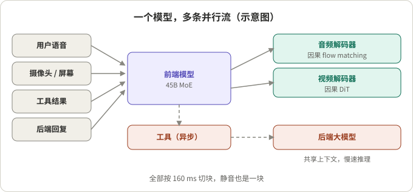
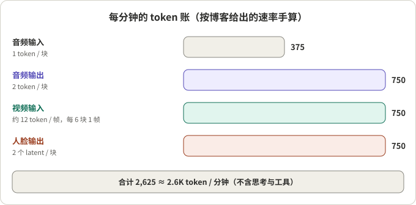

## 摘要

Boson AI 在 2026 年 11 月 5 日发布了 Higgs Realtime Duplex，称其为公司的“首个全双工交互式 omni 模型”：同时听、看、说，有自己的人脸，说话的同时继续思考、调用工具、把难题委派给后端。它不是论文，而是一篇厂商技术博客，页面上没有列出论文、代码或权重，API 在候补名单阶段。

我的阅读：这篇博客最有价值的部分不是基准分数，而是两件事。一是把全双工的成本写成了一笔明白账（每 160 ms 一块，每块几个 token，合计每分钟约 2.6K）；二是在“前端模型自己做大部分事、难题委派给更大的后端”这个选择上，明确站在与另一家交互模型不同的一侧。反过来，它没有给出响应延迟，也没有解释“何时说、何时让”的判断机制，基准表里有一半以上的数字是引用别人的。

## 核心结论

- 设计核心是“按时间切片、不按轮次切片”：所有输入输出流切成 160 ms 的块，静音也是一块，模型每步读一块、写一块。
- 成本靠压缩每块 token 数：音频输入 1 个、输出 2 个，视频每约 0.96 秒 1 帧，人脸输出每块 2 个 latent。我按博客给出的速率手算，合计 2,625 token 每分钟，与博客的“约 2.6K”一致。
- 前端 45B MoE 自己处理大部分对话，难任务异步委派给更大的后端，前端继续说话。博客认为这比“前端把所有推理都交给后台”的做法更容易控制成本，这是厂商自己的判断。
- 基准结果有好有坏：Big Bench Audio 最高（98.9），Full-Duplex-Bench v1.5 只有 75.5，落后于另两个系统。博客自己说结果是“互有胜负”。
- 博客没有说明的：响应延迟、轮次判断的机制、哪些基准数字被复现过。这些在实际选型前都需要自己测。

## 先看懂几个概念

**全双工与按时间切片。** 半双工系统以“一轮”为单位：用户说完，模型再说。全双工系统在每个时间步都同时读入和写出。这里的时间步是 160 ms，一秒有 6.25 步。没有人说话时，每一步写出的是“静音块”。

**前端模型与后端模型。** 前端是直接和用户对话的模型，要快、便宜；后端是更大的模型，接收被委派的任务和共享上下文，慢但更强。前端在后端工作时继续对话，结果回来时再带回。

**MOPD（multi-teacher on-policy distillation）。** 先从同一个基座出发，用强化学习（含 GRPO）训练若干“专科教师”，再把它们蒸馏成一个学生模型。博客列出的教师方向有：自然对话、交互行为、动态委派、任务完成。

**RSI（recursive self-improvement）循环。** 在模拟环境里运行整套智能体系统，复查失败，合成针对性数据，训练，再来一遍。模拟要还原真实的时序和多样性：打断、重叠说话、旁人的谈话、背景噪声。

## 整体架构

*图 1：一个模型，多条并行流（示意图，据博客描述绘制）。*

- 输入：用户语音、摄像头或屏幕、工具结果、后端回复。输出：语音、人脸、后台工作。
- 工具调用是异步的：搜索、知识库、预订、CRM 查询或部署方自定义函数。工具结果可以分阶段返回，每份结果作为载荷进入输入块，没有固定的每块 token 配额，模型可以在完整结果到来之前就开始说话。
- 思考在用户说话时就开始，“通常需要几秒”。
- 声音和人脸在部署时零样本设置：一段参考音频决定声音，一张参考图决定脸，不需要微调。音频解码器是因果 flow-matching 模型，视频解码器是因果 DiT，以参考图和最近两个人脸 latent 为条件，用来保持长会话中的人脸一致。

## 成本：每分钟 2.6K token 是怎么来的

*图 2：每分钟的 token 账（我按博客给出的速率手算，合计与博客一致）。*

| 流 | 速率 | 每分钟 |
|---|---|---|
| 音频输入 | 每块 1 个 token，6.25 token/s | 375 |
| 音频输出 | 每块 2 个 token，12.5 token/s | 750 |
| 视频输入 | 每 6 块 1 帧（约 0.96 秒），每帧约十几个 token | 约 750 |
| 人脸输出 | 每块 2 个 latent | 750 |
| 合计 | | 约 2.6K（2,625） |

我的核对：375 与 750 都能由速率乘以 60 秒得到；视频一栏反推每帧约 12 个 token，与博客“十几个”一致。博客还说加上可选的思考、工具调用与结果，总量约为每分钟 2.6K 到 5K token，前提是对中间推理和工具轨迹做渐进压缩。生产环境里保留最近 5 分钟的音视频流加压缩后的文本，约 13K 到 25K token（5 乘以 2.6K 正好是 13K，上限包含了更多活动）；更早的历史以文本保存，不占这份预算。

博客同时给出一个设计目标：和模型聊一小时的成本，不超过一个人一小时时间成本的十分之一。这是目标，不是报告的结果。

## 与另一种做法的取舍

博客把自己和 Thinking Machines 的交互模型做了对比，描述为：对方让前端把所有推理和工具调用交给后台模型，这样更容易训练，但大的推理模型一次响应可能要十秒以上，成本难以控制。Higgs 的选择是前端自己做大部分事，只把难题委派出去。这是 Boson 对对方设计的概括，我没有核对对方的原文。

## 训练

- 基座：从文本预训练模型出发，继续训练约 2 万亿 token 的文本、音频、视觉数据；文本数据用来保持通用能力。训练在 Boson 自己的 NVIDIA H100 集群上，部分基于 Megatron。
- 前端选 45B MoE：博客说更大的模型分数更高但更贵，而难题可以交给更大的后端，所以选了中等规模。
- 后训练：MOPD 加 RSI。教师学的是何时说或让、何时开启或延长一段推理、何时调工具、何时委派。奖励设计和数据规模博客没有给出。

## 基准：完整表格与我的核对

以下是博客的对比表（厂商报告，其他模型的数字来自已发表报告和排行榜，Boson 称复现了其中“一半以上”，没说是哪些）：

| 基准（指标） | Higgs Duplex 45B MoE | TML Interaction Small 276B MoE | GPT Realtime / Live | Gemini Live |
|---|---|---|---|---|
| Big Bench Audio（准确率） | **98.9** | 96.5 | RT-2 Minimal 72；RT-2 High 97；GPT-Live-1 Astra medium 90 | 3.1 Flash Live Minimal 71；High 97；3.8 Live Ext. Thinking High 98 |
| Audio MultiChallenge（APR） | 44.9 | 43.4 | RT-2 Minimal 37.6；RT-2 xHigh 48.5 | 3.1 Flash Live Minimal 26.8；High 36.1 |
| Full-Duplex-Bench v1.5（平均） | 75.5 | 77.8 | RT-2 Minimal 46.8；RT-2 xHigh 47.8；GPT-Live-1 80.1 | Minimal 54.3；High 45.5 |
| QIVD（流式准确率） | 56.0 | 54.0 | RT-2 Minimal 57.5；RT-2 xHigh 58.2 | Minimal 54.7；High 56.1 |
| ProactiveVideoQA（PAUC@ω=0.5） | 31.9 | 33.5 | RT-2 Minimal 25.0 | 未运行 |
| τ-Voice（任务完成 pass@1，%） | 69.8 | 未运行 | RT-2 Minimal 30.8；RT-2 High 39.8；GPT-Live-1 Astra medium 74.5 | Minimal 26.2；High 37.7；3.8 Live Ext. Thinking High 68.6 |
| IFEval（准确率） | 94.1 | 89.7 | RT-2 Minimal 89.6；RT-2 xHigh 95.2 | Minimal 85.8；High 90.0 |

我对着表核对的几点：

- 博客标出 Big Bench Audio 最高，其余四项“第二高”（Audio MultiChallenge、ProactiveVideoQA、τ-Voice、IFEval）。表中数字与这些标注一致。
- 博客没标的两行不占优：Full-Duplex-Bench v1.5 上 Higgs 75.5，低于 TML 的 77.8 与 GPT-Live-1 的 80.1；QIVD 上 56.0，低于 RT-2 的 57.5 与 58.2，也低于 Gemini 3.1 Flash Live High 的 56.1。这是我数表得到的，博客没有写。
- 各家配置不同（Minimal、High、xHigh 等思考档位），同一行里不同档位不能直接当同一模型比较；博客自己也说 GPT 与 Gemini 通常在高思考档位下得分最好。
- 全双工交互这一行（Full-Duplex-Bench v1.5）恰好是 Higgs 相对较弱的地方，而这正是“全双工”宣传的核心能力。结合博客没有给出轮次判断机制和延迟，这一点值得留意。
- 博客用“前端比 TML 小约 6 倍（45B 对 276B）”来说明数据、架构和训练比规模更重要。比较的是前端；各系统的后端和推理成本不在表里。

## 这个设计值不值得借鉴：从工程角度看

**可以直接借用的。**

- 用“每块 token 数”做成本账：先定块长，再逐流定每块的 token 数，最后乘出每分钟总量。这样成本有明确的上限，不会随着静音时间无限增长。
- 把压缩作为预算的一部分：只保留最近一段时间的原始音视频流，更早的转成文本。
- 把慢事情放到异步通道：工具和后端的结果分阶段回来，前端边听边说，不阻塞对话。
- 评测要看交互行为和任务完成两类指标，不要只看问答分数。

**需要谨慎的。**

- 每步都要走一次前端模型，一秒 6.25 步。我的推断：只有单步在 160 ms 内完成才能保证实时，而博客没有给出单步耗时和激活参数量，所以“便宜”目前只能理解为 token 数少，不是已证明的成本低。
- 没有响应延迟数字。博客提到人类的响应间隔约 200 ms 作为参照，但这不是 Higgs 的测量值。
- 演示视频（会议、口语教练、点餐、免提工程）没有被独立验证；机制层面，“何时说、何时让、何时忽略旁人的话”只给出了训练方法的描述。
- 委派给更大后端的方式“在后端是前沿模型时效果最好”，博客也没有说明后端结果注入的具体格式。

## 总结

这篇博客的价值在成本账和设计取舍：切块、控 token、前后端分工、异步工具，这些都可以拿来对照自己的方案。需要保留的是：它是厂商发布，数字是厂商报告，延迟与机制没有披露，全双工交互基准上并不领先。

## 参考资料

- [Higgs Realtime Duplex（Boson AI 技术博客，2026-11-05）](https://www.boson.ai/blog/higgs-realtime-duplex)
- [Higgs Realtime 文档](https://docs.boson.ai/models/higgs-realtime)：当前已上线的模型，接口与 OpenAI Realtime GA 事件协议兼容，支持 server_vad 与 semantic_vad，用户打断时模型必然停止说话

相关阅读：[七个全双工语音系统：架构、结果与演示]()，[重叠打断评测怎么做]()，[声音只是入口：从 GPT-Live 看语音智能体的三层架构]()。

*说明：所有数字来自 Boson 博客，属厂商报告，未独立复现；每分钟 token 数为我按博客速率手算；“我的推断”处为个人判断。博客在 B 站、小红书上的视频我没有打开，未据其写作。*
