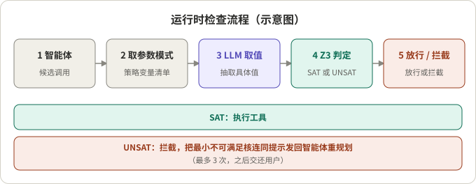
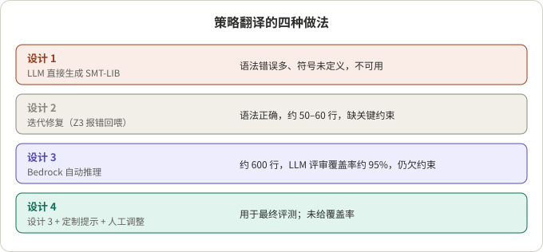

## 摘要

客服类智能体要调用改签、取消、退款这样的写操作工具，而业务策略（几小时内可取消、哪类舱位可改签）通常只以自然语言写在系统提示里。提示词不能保证模型照做。华盛顿大学的 Cailin Winston、Claris Winston 与 René Just 在 2026 年 3 月提出一种办法：把工具使用策略翻译成 SMT-LIB 2.0 约束，在每次写操作执行前，由 LLM 从对话里抽取变量取值，再交给 Z3 判定可满足（放行）还是不可满足（拦截）。

我的阅读是：这个思路把“模型理解策略”拆成了“模型抽取事实”和“求解器做判定”两步，边界清楚、可审计；但论文自己也承认，策略的形式化仍靠人工，取值抽取没有被验证，实验只覆盖一个领域，数值结果主要以图呈现、正文给出的数字很少。适合当作一种可借鉴的架构，不适合当作已经量化证明的方案。

## 核心结论

- 论文把“工具调用是否合规”当作约束满足问题，在执行前检查，而不是在输出后过滤。
- 难点不在求解，而在翻译：四种自然语言到 SMT-LIB 的做法里，只有“自动推理工具 + 定制提示 + 人工调整”的版本用于最终评测。
- 拦截使无效写操作降到全部写操作的 29%，基线中有效与无效写操作“大致各占一半”；代价是正确的写操作也变少了（召回略降）。
- 成功率随重复次数 k 增加而下降的幅度，检查器为 26%，基线为 40%（正文原话，具体 pass^k 数值只在图中）。
- 保证只在“取值抽取正确”且“编码完整”的前提下成立，这两步都不是形式化验证的。

## 先看懂几个概念

**SMT 与 Z3。** SMT（可满足性模理论）求解器判断一组逻辑约束是否能同时成立。Z3 是常用的求解器。给它“策略的约束 + 当前事实”，它回答 SAT（存在一种取值使全部成立，即该调用不违反策略）或 UNSAT（不可能同时成立，即违反）。

**最小不可满足核（unsat core）。** UNSAT 时，求解器能指出是哪几条约束互相冲突。论文把这个核放进重试提示，作为“为什么被拦截”的解释；论文没有说明核的具体格式。

**pass^k。** τ-bench 提出的可靠性指标：同一任务重复 k 次，衡量是否稳定成功。τ-bench 的作者报告，gpt-4o 这类函数调用智能体成功率低于 50%，零售领域 pass^8 低于 25%。

**写操作的精确率与召回。** 论文对写工具调用统计精确率与召回：精确率高意味着发出的写操作多数合规，召回高意味着该做的写操作没有被漏掉。

## 方法

### 策略翻译（人工引导）

专家（借助 LLM 起草）把自然语言策略写成 SMT-LIB 2.0：未解释常量、类似枚举的 sort、谓词和断言，作用于智能体可观察的状态和工具参数。作者只抽取了工具使用策略，其他行为规则放在一边，以便单独观察运行时强制的效果。

每个工具有一份校验模式（schema）：列出它需要的策略变量、类型和一个指定的策略谓词；无条件允许的工具模式为空，不检查。

### 运行时流程

*图 1：运行时检查流程（示意图，据论文描述绘制）。*

1. 智能体给出候选工具调用；
2. 检查器取该工具的模式；
3. LLM 从对话历史和工具参数中抽取具体变量值；
4. 取值被翻译成断言，附加到静态编码后，把策略谓词作为条件交给 Z3；
5. SAT 则执行；UNSAT 则拦截，并把最小不可满足核放进提示让智能体重规划，最多三次，之后把控制权交还用户。

分工很明确：LLM 负责取值和初稿，Z3 负责判定。

## 翻译到底有多难

*图 2：四种设计及论文给出的结果（据论文正文整理）。*

| 设计 | 做法 | 结果 |
|---|---|---|
| 1 | LLM 直接生成 SMT-LIB（Proof-of-Thought 思路） | 语法错误多、符号未定义，认为不可用 |
| 2 | 迭代修复，把 Z3 报错回喂给 LLM | 语法正确，约 50–60 行，但缺关键约束 |
| 3 | AWS Bedrock Automated Reasoning | 约 600 行，LLM 评审“约 95% 覆盖”，仍然欠约束 |
| 4 | 设计 3 + 定制提示 + 人工调整 | 用于最终评测，未给覆盖率 |

论文举的欠约束例子很典型：取消规则写了“24 小时内允许取消”，却没有写“24 小时外禁止”。求解器在没有被禁止的情况下会判可满足，违规调用被放行。这是形式化策略时常见的“隐含否定与互斥没写出来”。

## 实验设置与结果

设置：τ²-bench 的航空领域，50 个任务、13 个工具、1,242 词的策略文档；客户与服务智能体用 GPT-4.1，工具调用校验用 GPT-4o；每任务 k=4 次，报告 pass^1 到 pass^4，以及写工具调用的精确率与召回。

| 问题 | 论文正文给出的结果 |
|---|---|
| 违规写操作 | 基线中有效与无效写操作大致各占一半；加检查后无效写操作占全部写操作的 29% |
| 召回 | 正确的写操作比基线少，作者称为精确率与召回的权衡 |
| 总体成功率 | 两者相近，检查器略好 |
| 随 k 增加的下降 | 检查器 26%，基线 40% |

要注意：论文没有数值表，主要数据在图 3、图 4，正文没有写出基线无效比例和各 pass^k 的数值；“26% 与 40%”的基线定义也没有写清。引用时只能用上表这些说法。

## 对照论文文本的几处核对

- 即使加了检查，仍有 29% 的写操作无效，说明它降低而不是消除违规。我的推断：来源可能是编码欠约束、取值抽取出错，或策略中未被编码的部分，论文没有拆分原因。
- “保持总体准确率”与“召回下降”并存，两者要一起读：拦截会误伤正确操作，由此换来更稳定的行为。
- 论文没有消融实验，设计 1 到 4 的演进是最接近的对照，但它比较的是翻译质量，不是运行时组件的贡献。
- 评测只在一个领域、一套基准、一个人工调好的编码上完成；结论是否迁移，论文没有回答。

## 这个方法值不值得：从工程角度看

**适合的场景（各有前提）。**

- 策略能写成明确的条件，例如时间窗口、状态枚举、金额上限。前提是有人愿意维护形式化编码。
- 写操作代价高、不可回滚（退款、取消），宁可多拦一次。前提是用户能接受偶尔的“再确认一次”。
- 需要审计：为什么放行、为什么拦截，都有约束可查。

**不适合或需要谨慎的场景。**

- 策略含大量模糊判断（“酌情处理”）。这类规则难以编码，只能留给模型，或像近期另一类工作那样专门评估策略歧义（例如 DRIP-R 基准，我只看过检索摘要）。
- 对流式语音智能体，每次写操作前多一次 LLM 抽取加求解，会增加延迟。我的推断：可以只对写操作、且只对带模式的工具启用，只读工具照论文做法跳过。
- 取值抽取是新的单点：抽错了，求解器会基于错误事实“正确地”放行或拦截。

**可以直接借用的做法。**

- 把“抽取事实”和“判定规则”分开，规则放在确定性组件里。
- 每个工具声明所需的策略变量，无条件允许的工具跳过检查。
- 拦截时返回冲突的最小原因，而不是只说“不允许”；限制重规划次数，超限后交还用户。
- 写规则时同时写“允许”和“禁止”两侧，避免隐含否定。
- 评测同时看违规率和召回，并用 pass^k 观察稳定性，而不只看单次成功率。

## 总结

这篇论文的价值在于架构：用求解器把策略合规变成可审计的判定，并把难点明确指向“策略翻译”。它的证据较薄：单一领域、人工调编码、数值多在图里。作为设计参考合适，作为效果结论需要在自己的策略和工具上重新验证。

## 参考资料

- [Solver-Aided Verification of Policy Compliance in Tool-Augmented LLM Agents (arXiv 2603.20449)](https://arxiv.org/abs/2603.20449)，Cailin Winston、Claris Winston、René Just，华盛顿大学
- [τ-bench: A Benchmark for Tool-Agent-User Interaction in Real-World Domains (arXiv 2406.12045)](https://arxiv.org/abs/2406.12045)，Shunyu Yao、Noah Shinn、Pedram Razavi、Karthik Narasimhan
- [DRIP-R (arXiv 2605.07699)](https://arxiv.org/abs/2605.07699)，仅作为“策略歧义”方向的旁证提及

相关阅读：[Parlant 的新方向：从 Guideline 到统一规则]()。

*说明：文中数字均来自论文正文的文字描述，未独立复现；“我的推断”处为个人判断。*
