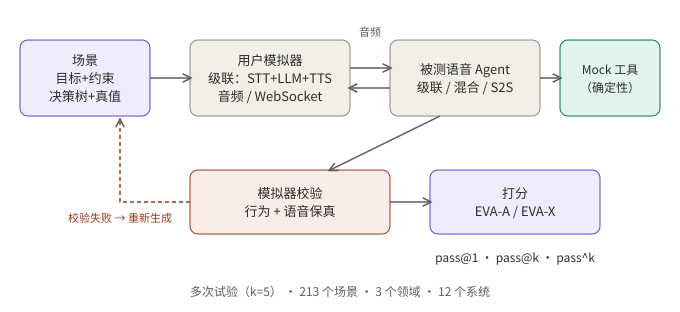
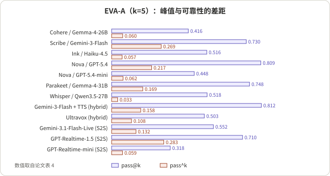
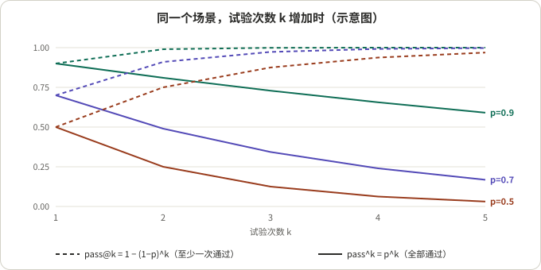

## 摘要

EVA-Bench（Bogavelli 等，ServiceNow AI Research，arXiv 2605.13841）是一个端到端评测语音 Agent 的框架：用一个用户模拟器通过音频与被测系统对话，对话结束后先校验模拟器有没有"演砸"，再用两组综合指标打分，一组管准确（EVA-A），一组管体验（EVA-X）。它评了 12 个系统（7 个级联、2 个混合、3 个语音到语音），每个场景跑 5 次，同时报告 pass@1、pass@k 和 pass^k。

我的阅读：这篇论文最值得带走的不是排行榜，而是**把「一次通过」拆成「至少一次通过」和「每次都通过」两个数，并且把每个场景当作一个有通过概率的对象来测**。对语音 Agent 这种每次对话都带随机性（识别、模拟用户、模型采样、实时时序）的系统，单次分数系统性地高估了可部署的可靠性。排行榜本身则受制于框架差异、默认轮次检测配置和 12 个系统的样本量，只适合看趋势。

## 核心结论

- 没有任何系统在 EVA-A 和 EVA-X 的 pass@1 上同时超过 0.5；只有 GPT-Realtime-1.5（0.47，0.57）两项都超过 0.4。
- 峰值与可靠性差距很大：12 个系统里，EVA-A 的 pass@k 减 pass^k 的中位数是 0.44，EVA-X 是 0.24。我用论文表 4 手算复核过，结果一致。
- 体验分的差距几乎全来自轮次时序（Turn-Taking）：S2S 系统的均值 0.82 到 0.83，级联 0.28 到 0.58，两个混合系统里一个只有 0.019。
- 级联系统里转写关键实体（确认码、日期、金额）的准确率与任务完成强相关（Pearson 0.93），WER 看不出一个字符之差的确认码。
- 评测可信度的做法值得照搬：模拟器校验加自动重生成，评审与两位人工标注者比一致性，用方差分解论证试验次数。
- 所有数字是作者报告的，未复现。

## 先看懂几个概念

- **级联 / 混合 / S2S**：级联是 语音转文字 → LLM → 文字转语音；S2S（语音到语音）是一个模型直接听、直接说；论文里的"混合"是音频直接输入 LLM、输出仍走 TTS。
- **机器人对机器人（bot-to-bot）评测**：真人被一个模拟用户代替。模拟用户有目标、人设和决策树，用 TTS 说话，通过实时音频与被测系统对话。好处是可重复、可并行，代价是模拟器自己会出错。
- **EVA-A / EVA-X**：A 是准确，包含任务完成、忠实度（是否忠于策略与工具结果）、语音保真（说出的实体是否正确）；X 是体验，包含对话推进、简洁度、轮次时序。
- **pass@1 / pass@k / pass^k**：每个场景跑 k 次，每次对话记为通过或不通过（所有指标都达到各自阈值才算通过）。
  - pass@1：所有试验里通过的比例，代表平均水平。
  - pass@k：至少有一次通过的场景比例，代表上限。
  - pass^k：每个场景的通过率 p 取 k 次方再对场景取平均，即"连续 k 次都通过"的概率，代表可靠性。

一个手算例子：某场景 5 次试验通过 4 次，p = 0.8。它对 pass@k 的贡献是 1（至少一次通过），对 pass^k 的贡献是 0.8^5 ≈ 0.328。图 3 画出了几种固定 p 下两者随 k 的变化。

*图 1：示意图，依据论文图 1 简化。*

## 1. 模拟：先保证"考官"不出错

**结论**：把模拟器校验放进评测流程，是这篇论文对"分数到底反映谁"这个问题的回答。

- 数据：3 个企业场景域（航空客服、医疗人力服务、IT 服务管理），共 213 个场景，每个场景含用户目标（带约束）、人设和决策树。
- 对话：模拟用户由一条高质量级联管线驱动，与被测系统通过实时音频连接；工具调用由确定性的执行器处理。
- 校验：每段对话打分前先过两项检查，一是用户行为保真（LLM 评审，看模拟用户有没有偏离目标），二是用户语音保真（音频 LLM 评审，看说出来的内容是否等于想说的）。任一不通过，整段对话重生成。论文称重生成几乎都由用户行为漂移引起，语音保真只占很小一部分。
- 对照：论文把相近工作（Ray 等人的语音基准和 Full-Duplex-Bench v2）归为"有实时多轮模拟，但没有跨试验的模拟器行为自动校验"。

我的推断：如果没有这一步，评测里的失败有一部分其实是"考官说错话"，会被记到被测系统头上。对于要做多次试验的评测，这一步尤其必要，否则模拟器的方差会混进 pass^k。

## 2. 指标：准确与体验各自要"全部达标"

**结论**：通过的定义是合取，这决定了 pass^k 会很低。

- EVA-A 的三项：
  - 任务完成：确定性。比较场景数据库最终状态的 SHA-256 哈希与标准答案，工具调用多一个、少一个、参数错一个都算 0。
  - 忠实度：LLM 评审，是否忠于指令、策略、工具结果和用户输入。
  - 语音保真：音频 LLM 评审，说出的内容是否与目标文本一致，特别看确认码、日期、金额等实体。
- EVA-X 的三项：
  - 对话推进：LLM 评审，是否重复提问、丢上下文、原地打转。
  - 简洁度：LLM 评审，口头回复是否短到听一遍就能跟上。
  - 轮次时序：确定性的时间戳指标。按场景分流：Agent 抢话看重叠时长、插话次数和恢复延迟；用户打断看让出话轮的延迟；无打断的轮次用分段线性的延迟曲线。涉及工具调用的轮次阈值更宽松。
- 诊断指标不进入 EVA-A/EVA-X，只用来定位失败，例如关键实体转写准确率、认证结果、响应延迟。
- 通过：每个指标有自己的阈值，一段对话只有所有指标都达标才算在该维度通过。轮次时序的阈值取 0.8，论文的解释是"五个轮次里至多一个不在合适时间窗内"，并做了阈值扫描，排名基本稳定。其余指标的阈值见论文附录 E，我没有逐一核对。

## 3. 主结果：完整表格

下表整理自论文表 4（干净音频，每场景 5 次试验，k = 5，三个域等权汇总）。我加了"EVA-A 差距"一列（pass@k 减 pass^k），其余为论文数值，已省略置信区间半宽。

| 架构 | 系统 | EVA-A pass@1 | pass@k | pass^k | 差距 | EVA-X pass@1 | pass@k | pass^k | 轮次时序均值 |
|---|---|---|---|---|---|---|---|---|---|
| 级联 | Cohere + Gemma-4-26B + Voxtral | 0.207 | 0.416 | 0.060 | 0.356 | 0.209 | 0.647 | 0.015 | 0.567 |
| 级联 | Scribe + Gemini-3-Flash + Conversational v3 | 0.490 | 0.730 | 0.269 | 0.461 | 0.024 | 0.061 | 0.004 | 0.451 |
| 级联 | Ink-whisper + Haiku-4.5 + Sonic 3 | 0.234 | 0.516 | 0.057 | 0.459 | 0.009 | 0.042 | 0.000 | 0.312 |
| 级联 | Nova-3 + GPT-5.4 + Sonic 3 | 0.504 | 0.809 | 0.217 | 0.592 | 0.007 | 0.031 | 0.000 | 0.283 |
| 级联 | Nova-3 + GPT-5.4-mini + Aura-2 | 0.210 | 0.448 | 0.062 | 0.386 | 0.113 | 0.416 | 0.005 | 0.583 |
| 级联 | Parakeet-1.1 + Gemma-4-31B + Kokoro | 0.403 | 0.748 | 0.169 | 0.579 | 0.010 | 0.035 | 0.000 | 0.308 |
| 级联 | Whisper + Qwen3.5-27B + Voxtral | 0.205 | 0.518 | 0.033 | 0.485 | 0.273 | 0.684 | 0.051 | 0.561 |
| 混合 | Gemini-3-Flash + Gemini-3.1-Flash-TTS | 0.431 | 0.812 | 0.158 | 0.654 | 0.000 | 0.000 | 0.000 | 0.019 |
| 混合 | Ultravox-Realtime | 0.270 | 0.503 | 0.108 | 0.395 | 0.029 | 0.081 | 0.006 | 0.417 |
| S2S | Gemini-3.1-Flash-Live | 0.292 | 0.552 | 0.132 | 0.420 | 0.589 | 0.979 | 0.240 | 0.830 |
| S2S | GPT-Realtime-1.5 | 0.467 | 0.710 | 0.283 | 0.427 | 0.566 | 0.939 | 0.216 | 0.815 |
| S2S | GPT-Realtime-mini | 0.163 | 0.318 | 0.059 | 0.259 | 0.406 | 0.893 | 0.099 | 0.818 |

*图 2：依据上表（论文表 4）重绘的 EVA-A 的 pass@k 与 pass^k。*

读表时要注意的几件事：

- 论文对 EVA-A、EVA-X 的差距只报了中位数（0.44 与 0.24）。我按表手算：EVA-A 的 12 个差距排序后中间两个是 0.427 和 0.459，中位数 0.443；EVA-X 是 0.075 和 0.411，中位数 0.243。与论文一致。
- EVA-X 的差距中位数小，不是因为可靠，而是因为一半系统的 pass@k 本身就接近 0（轮次时序几乎不达标）。可靠性差距要和 pass@k 一起看。
- 摘要里的"没有系统同时超过 0.5"是对的，但要补一句：Nova-3 + GPT-5.4 在 EVA-A 超过 0.5（0.504），代价是 EVA-X 仅 0.007；Gemini-3.1-Flash-Live 的 EVA-X 为 0.589，EVA-A 仅 0.292。
- 同一个系统在 EVA-A 上，pass^k 最高的两个（GPT-Realtime-1.5 的 0.283 和 Scribe 方案的 0.269）也只有约四分之一的场景能连续 5 次通过。

## 4. 峰值与可靠性：为什么要测两个数

**结论**：单次试验的通过率不能回答"这个场景下它稳不稳"。

*图 3：示意图，p 固定时两者随 k 的变化，公式为 pass@k = 1 − (1−p)^k，pass^k = p^k。*

- 同一个 pass@1 可以来自完全不同的行为：一半场景次次通过、一半场景次次失败，或者每个场景通过 50%。前者的 pass@k 与 pass^k 都接近 0.5，后者的 pass@k 接近 1、pass^k 接近 0。
- 论文把这种差距归因于对话轨迹的随机性。在对少数系统做的混合效应方差分解里，试验间随机性占 LLM 评审指标总方差的 40.4% 到 80.4%，评审本身的随机性只占 5.5% 到 37.5%，场景差异占 0.0% 到 47.3%。这说明差距主要来自"同一个场景下系统自己每次表现不一样"，不是评审噪声。
- 论文还检验了试验次数：在干净评测用的 5 次下，逐指标的 95% 区间宽度中位数不超过 0.034。

我的推断：pass^k 用每个场景的通过率估计值取 k 次方，而 k 恰好等于试验数 5。5 次全过的场景得 1，只要有一次失败就掉到 0.8^5 ≈ 0.33 或更低，所以单个场景的贡献很离散。看 pass^k 时应同时看置信区间，论文报告了自助法区间。

## 5. 稳健性与失败模式

- 扰动实验在 90 个场景的子集上做：法语口音、咖啡馆背景噪声、两者叠加。
- 口音：级联系统的任务完成平均下降约 10 个点（最差 17 个点），S2S 在准确维度没有显著下降。
- 噪声：S2S 的体验指标（特别是轮次时序）下降明显；级联的 EVA-X 本来就接近地板，下降空间小，但轮次时序也有显著下降。
- 轮次时序是对扰动最敏感的指标：81% 的测量显示显著下降。
- 实体转写：级联系统的关键实体转写准确率与任务完成相关系数 0.93；转写准确率低于 70% 的系统，任务完成均值 0.37，高于该阈值的是 0.60。
- 语音保真的失败集中在字母数字实体（字符替换、遗漏、发音混淆）。
- S2S 的策略违规对话比例平均高 24.6 个百分点，论文自己指出这可能混杂：没跑完的系统违规的机会也少。
- 级联内部存在准确与体验的取舍：准确度最高的三套在工具调用轮次的平均延迟超过 5 秒，体验较好的两套低于 2.7 秒但准确度较低。没有任何级联系统在两个维度上同时超过 0.25。

## 6. 这套评测值不值得借：从工程角度看

**值得借的前提**：你的系统每次对话都带随机性，且上线后的体验取决于"稳不稳"而不是"最好时能到哪"。

- 值得借：
  - 把通过定义成每个场景可重复的二值结果，然后报告 pass^k。这对客服、预约、认证这类"错一次就出事"的场景最重要。
  - 对话打分前先校验模拟器，失败就重生成，并把重生成比例本身当作一个监控量。
  - 用方差分解决定试验次数，而不是拍脑袋。
  - 保留实体级的转写与语音诊断，不要只看 WER。
  - 评审要和人工比一致性，并报告人工之间的一致性作参照（论文表 3：对话推进的人工二值一致性只有 0.553，评审为 0.664）。
- 不适合直接套用的情形：
  - 开放式闲聊没有可校验的最终状态，任务完成这种哈希比较就用不了。
  - 如果只做模型选型的粗筛，k = 5、213 个场景的成本可能不划算，可以先用 pass@1 缩小范围，再对候选做多次试验。
- 比较口径要小心：
  - 12 个系统通过不同的框架评测（Pipecat、各家原生 SDK、ElevenAgents），都用各自默认的轮次检测配置，轮次时序的差异里有一部分是配置差异，不是模型差异。
  - 通过是所有指标的合取，EVA-X 的 pass@1 基本被轮次时序卡住；换一个阈值，排名可能不变（论文做了扫描，92.4% 的两两顺序保持），但绝对值会变。
  - 扰动实验只用 90 个场景的子集，试验次数也更少，不能与干净条件的数字直接比。
  - 混合架构只有两个系统，"混合不继承 S2S 的时序优势"这个说法样本太少，论文本身也这样提示。

**可以直接借走的检查清单**（我的整理，不是论文的原话）：

1. 每个场景至少跑多次，报告 pass@1、pass@k、pass^k，不要只报平均。
2. 通过必须是二值的、对所有关键指标取合取，并记录哪一项卡住了。
3. 模拟用户要有独立的校验和重生成，记录重生成率。
4. 用方差分解看差距来自场景、轨迹还是评审，再定试验次数。
5. 对实体密集的任务，单独评估转写与语音输出的实体正确率。
6. 比较不同架构时，固定框架与轮次检测配置，或者明说它们不同。

## 总结

EVA-Bench 把语音 Agent 的评测从"一次通过"推进到"多次试验下的可靠性"，并给出了模拟校验、实体级诊断和方差分解这几项可迁移的做法。它的 12 个系统排名受配置与样本量限制，但 EVA-A 上 0.44 的中位差距足以说明：只看 pass@1，会系统性地高估一个语音 Agent 的可部署程度。

关于本站另一篇评测文章，见 [如何评测打断：SID-Bench、EchoChain、IHBench 与 Instruct-FD]()，那篇关注的是打断这一个环节的几层指标，本篇关注的是整段任务对话的准确、体验与可靠性。

## 参考资料

- [EVA-Bench: A New End-to-end Framework for Evaluating Voice Agents (arXiv 2605.13841)](https://arxiv.org/abs/2605.13841)，Tara Bogavelli 等，ServiceNow AI Research
- [EVA-Bench 代码仓库](https://github.com/ServiceNow/eva)（论文脚注给出的地址）

*说明：所有数字为论文作者报告，未独立复现；「差距」一列和两个中位数是我根据论文表 4 手算的，对 pass^k 的估计偏差的讨论是我的推断。*
