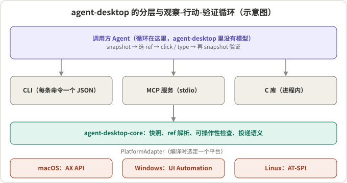
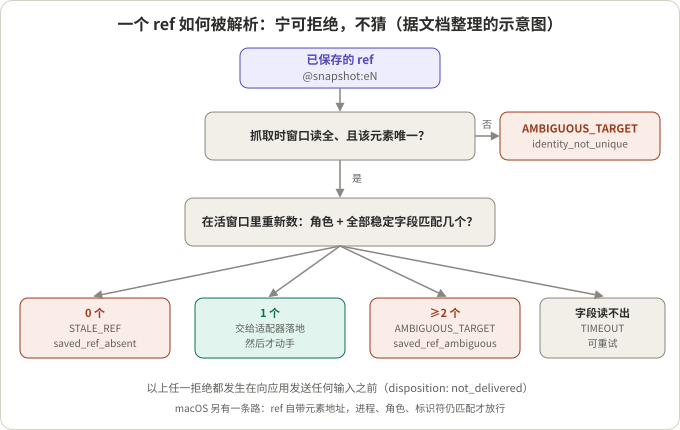
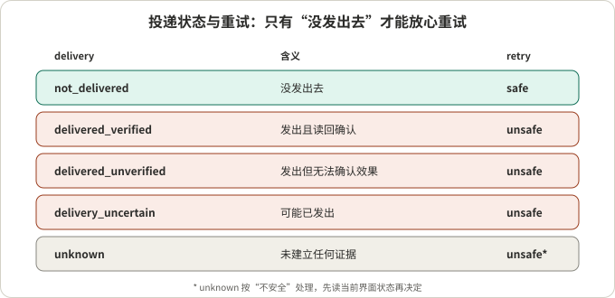

## 摘要

[agent-desktop](https://github.com/vercel-labs/agent-desktop) 是 Vercel Labs 发布的开源项目（Apache-2.0，Rust 工作区），让 AI Agent 在 macOS、Windows、Linux 上“看见并操作”桌面应用。它不用截图和像素匹配，而是读取操作系统的无障碍树（accessibility tree），把界面变成带 ref 的 JSON，Agent 对 ref 点击、输入，再重新读取来验证。项目自己强调：循环在调用方，里面没有模型。我读到的 GitHub 页面是 18.9k stars、1.4k forks；它出现在 Trendshift 的周榜第 2 位，也被多个十一月的热门项目汇总提到，所以我把它算作本周增长最快的开源项目之一（具体周增量没有查到，见文末说明）。

我的阅读：这个项目最有价值的部分不是“又一个 computer use 工具”，而是它把一个常被忽略的问题当成了设计中心：**Agent 看到界面的那一刻和真正动手的那一刻之间，界面可能已经变了**。它的回答是一整套“宁可拒绝，不去猜”的机制：ref 只属于一次快照、解析时按证据重新认人、证据分“已知/不存在/未知”三态、每个错误都带“有没有发出去、能不能重试”的结论。这些做法对任何会操作外部世界的 Agent 运行时都能借鉴。需要保留的是：我只读了文档、README 和技能文件，没有在真实桌面上运行它，所以性能、稳定性和对各类应用的覆盖度我没有判断。

## 核心结论

- 形态：一个 CLI（每条命令输出一个 JSON）、一个 MCP 服务（`agent-desktop mcp`，每条命令是一个工具）和一个 C 库，共用同一个核心，通过 `PlatformAdapter` 接口分别对接 macOS 的 AX、Windows 的 UI Automation、Linux 的 AT-SPI。
- 观察靠无障碍树而不是截图：Agent 拿到的是带角色、名称、可执行动作的结构化节点，每个可操作节点有一个 ref。密集应用先取骨架再下钻。
- ref 解析是全篇的重点：ref 属于一次快照；动手前按“角色 + 全部稳定字段”在活窗口里重新数，恰好一个才放行，零个是 `STALE_REF`，两个及以上是 `AMBIGUOUS_TARGET`，读不出来是可重试的 `TIMEOUT`。
- 投递语义：每个结果都说明输入有没有发到应用，以及能不能安全重试；只有“没发出去”才是安全重试。这比只返回成功/失败信息量大得多。
- 默认无头（headless）：只走无障碍 API，不抢焦点、不动鼠标、不用剪贴板；没有语义路径就失败，而不是悄悄换成物理输入。
- 要小心的地方：依赖应用的无障碍实现质量（我的推断）；快照和截图可能含隐私内容；macOS 需要授予辅助功能权限；我没有运行过它。

## 先看懂几个概念

**无障碍树。** 操作系统为读屏软件等辅助技术暴露的界面结构：窗口里有哪些控件、什么角色（按钮、文本框、列表项）、叫什么、能做什么动作。三个系统的接口不同：macOS 的 AX API、Windows 的 UI Automation、Linux 的 AT-SPI。agent-desktop 把它们翻译成同一套角色和状态词汇。

**快照与 ref。** 快照是某一时刻对无障碍树的一次观察。每个可操作节点在快照里得到一个 ref，形如 `@s8f3k2p9:e8`，前半是快照 ID，后半是节点编号。README 明确说：只带编号的 `@e8` 会被拒绝（`INVALID_ARGS`）。

一个来自 README 的快照片段（精简过）：

```json
{
  "ok": true, "command": "snapshot",
  "data": {
    "app": "Finder", "snapshot_id": "s8f3k2p9", "ref_count": 59, "complete": true,
    "tree": { "role": "window", "name": "Downloads", "children": [
      { "role": "treeitem", "name": "Documents",
        "ref_id": "@s8f3k2p9:e8", "available_actions": ["Click"] } ] }
  }
}
```

**观察-行动-验证循环。** 先 `snapshot`，对 ref 执行 `click`，再次 `snapshot` 看结果。循环写在调用方 Agent 里，agent-desktop 只提供工具。



*图 1：示意图，据 README 的架构说明整理。调用方通过 CLI、MCP 或 C 库进入同一个核心，核心经 `PlatformAdapter` 到一个编译时选定的平台实现。*

**证据三态。** 项目的术语表（CONCEPTS.md）里，适配器读到的每个属性都是 `Known`（已知）、`Absent`（确认不存在）或 `Unknown`（读取失败或不可信），不允许压成两态。原因写得很具体：`Absent` 是一个回答，`Unknown` 是没有回答；如果把“读不出来”当作“没有”，对一个判断取反时就会悄悄把“我不知道”变成“肯定不是”。

**投递语义（delivery semantics）。** 一次动作失败或结果不确定时，输入有没有真正到达应用。它决定能不能重试：没发出去的可以随便重试，可能已经落地的重试可能造成重复提交。

## 整体设计：核心 + 适配器 + 三种入口

- 一个 Cargo 工作区：`core`、`macos`、`windows`、`linux`、`ffi` 和命令行入口（我读的提交是 2026-11-05 的 `b43ac4f`，工作区版本 1.2.0）。
- 核心只通过 `PlatformAdapter` 触碰操作系统；每个二进制只为一个平台编译。
- 60 个命令名，其中 56 个可用，另外 `key-down`、`key-up`、`mouse-down`、`mouse-up` 四个在“能释放按住的输入的守护进程”出现之前拒绝运行。
- 命令分组：观察（`snapshot`、`find`、`get`、`is`、`screenshot`、`list-surfaces`）、对 ref 的动作（`click`、`type`、`set-value`、`select`、`toggle`、`scroll` 等）、键鼠、应用与窗口、通知、剪贴板、`wait`、会话与追踪、系统。
- 平台要求：macOS 13+，Windows 10 1809+，Ubuntu 24.04+（X11 或 Wayland）。

## Q1：ref 是怎么保证“点的就是我看到的那个”的

**结论：靠“抓取时证明唯一，动手前重新数一遍”，任何不确定都拒绝。** 这是我认为项目最值得读的一块。

README 和文档给出的规则可以整理成一张流程图：



*图 2：示意图，据 CONCEPTS.md、`docs/json-output.md` 和技能文件整理。macOS 另有一条路径：ref 自带元素的地址。*

逐步看：

1. **抓取时就要证明唯一。** 在 Windows、Linux（以及 macOS 上拿不到元素地址的情况），一个 ref 只有在“抓取时整个窗口被完整读到，且只有一个元素匹配它的角色加全部稳定字段（原生 ID、稳定的名称、描述）”时才可用。窗口读不全，或者存在长得一模一样的“双胞胎”，这个 ref 一开始就是 `AMBIGUOUS_TARGET`（`details.kind: identity_not_unique`），连应用都不去读。
2. **动手前重新数。** 解析时在活窗口里重新数同样的条件：零个是 `STALE_REF`（`saved_ref_absent`，元素没了）；恰好一个才放行；两个及以上是 `AMBIGUOUS_TARGET`（`saved_ref_ambiguous`，抓取之后出现了一模一样的元素）。
3. **读不出来就不算匹配。** 活窗口里某个字段读取失败，结果是可重试的 `TIMEOUT`（`resolution_identity_unknown`），而不是“匹配”或“不匹配”。这直接对应前面的证据三态。
4. **macOS 的另一条路。** ref 里存着元素自己的无障碍地址（`retained_object`），之后直接还原成那个元素，不用搜索；只有元素还活着，且进程、角色、记录的标识符仍匹配才接受，所以同样的“双胞胎”各自保留自己的 ref。
5. **值和位置从不当作身份。** 术语表写明：可变的控件值（比如文本框内容，包括被提升成无障碍名称的值文本）和边界坐标都不能单独作为身份证据。

还有几个与“时间窗口”有关的细节：

- **窗口身份。** 窗口句柄会被系统回收复用，所以身份是“句柄 + 进程代际令牌”（由进程创建时间推出），窗口标题会变，不算身份。三个平台的令牌各不相同（Windows 的窗口句柄加创建时间，macOS 的窗口号加进程启动时间，Linux 的 X11 客户端 ID 加带开机 ID 的进程启动时间）。
- **在写入前重复校验。** 文档强调：检查和动作如果不是一个原子操作，那么在每次写入前都要重新佐证身份，并且动作自身的成功判断也要带身份，否则句柄在间隙里被回收时会“对着错误的对象报告成功”。
- **身份三明治。** 对耗时的截图类调用，先后各做一次身份检查，中途发生重排就丢弃数据，而不是把字节挂在原来的目标名下返回。

我的推断：这些规则合起来，等于把“检查时间到使用时间”（TOCTOU）问题当成一等公民来处理。它的代价也很清楚：一个页面上有多个一模一样的按钮（比如每行都有“删除”）时，Windows 和 Linux 上这些 ref 会被直接拒绝，文档给出的出路是在容器内换用唯一的控件，或者用 `--headed mouse-click --xy` 按坐标点（会抢前台，且在 Linux 的 Wayland 会话里不可用）。

## Q2：动作失败时，怎么知道能不能重试

**结论：每个结果都带一个 `disposition`，把“发出去没有”和“能否重试”明确写出来。**



*图 3：据 `docs/json-output.md` 整理。`retry` 由 `delivery` 决定：只有 `not_delivered` 是 `safe`，其余已知值都是 `unsafe`。*

要点：

- `delivery` 有五个值：`unknown`、`not_delivered`、`delivery_uncertain`、`delivered_unverified`、`delivered_verified`。
- `ok: true` 只表示命令返回了“已投递”或“已满足”，**不等于应用里的效果被验证过**。只有适配器读回了它声称的后置条件，才是 `delivered_verified`。
- 只读命令和参数错误不会发出任何输入，错误一律是 `not_delivered` + `safe`。
- `TIMEOUT` 这类可能已经落地的操作，保持 `unknown`；文档说明要当作不可自动重试。
- 技能文件里的规则：只有 `disposition.retry` 是 `safe` 才重试或换方案；否则先读当前界面状态（`get`、`is`、新快照）再决定；要根据 `error.code` 和 `error.disposition` 分支，不要依赖提示文本，因为文本可能变。
- 为什么这样分：`toggle` 重复执行会把自己撤销，输入和提交重复执行会出现两次。
- 写路径与读路径用不同的分类表：术语表专门指出，读路径里“可重试的传输类错误码”恰好是写操作可能已经落地的那些错误码，如果写路径复用读表，就会授权一次重复投递。
- Windows 上有一个细节：`SendInput` 返回的“注入事件数”不被当作投递证据，因为这个 API 在“已投递”和“被权限隔离拦下”两种情况下都报告成功；所以物理步骤只报告 `delivered_unverified`。

我的推断：对一个会点“提交”“删除”的 Agent 来说，这个字段比成功/失败重要得多，因为多数 Agent 框架的默认行为是“失败就重试”。

## Q3：动手之前它检查什么

**结论：有一组“可操作性检查”，默认最多等 5 秒，并且对证据不足采取不同的失败方向。**

- **可操作性检查（actionability battery）。** 在适配器分发之前，核心对已解析的元素做一组实时检查：可见、稳定、启用、支持该动作、策略允许、可编辑、能接收事件。
- **自动等待。** 默认开启的有界轮询，直到目标可操作；预算 5000 毫秒（`type` 每个字符再加 30 毫秒），超时是 `TIMEOUT`；`--timeout-ms 0` 恢复“立即执行”。瞬态检查（可见、稳定、启用、遮挡）会轮询，终态检查（是否支持该动作、策略、可编辑）立即失败。
- **遮挡检测的方向。** 三向探测：到达目标、被某元素拦截、未知。遮挡闸门对“未知”是放行（fail open），因为证据不足不应该误杀一个动作；而“被拦截”需要正面证据。这与“解析 ref”时对未知取拒绝相反，两者各自有理由：前者是动作前的体验保护，后者是身份保护。
- **互动租约。** 整台机器上同一时刻只有一个进程能持有桌面输入，避免并发调用方的合成输入互相穿插；租约只覆盖分发，不覆盖等待，否则一个长时间的等待会让整台机器串行化；等待期间解析出来的东西在拿到租约后要重新解析一次，文档称这是正确性的边界，不是多余的工作。
- **默认无头。** 对 ref 的动作走语义无障碍操作，不抢焦点、不移光标、不合成按键、不用剪贴板；没有语义路径就以结构化错误失败。`--headed` 才允许物理输入。技能文件进一步要求：不要为了从无头失败中恢复而切换到有头模式，除非用户明确允许。
- **安全字段。** 被系统标记为密码的字段，读侧不暴露值，写侧可以写入，但不会在步骤、消息、详情里回显尝试值或读到的值，读回无法确认时报告 `verified: None`。
- **受保护进程。** 对会话关键的系统进程，所有入口都拒绝关闭，错误是 `INVALID_ARGS` 加 `not_delivered`。

## Q4：怎么对付大而乱的界面

**结论：不完整是一等公民，必须被标出来。**

- **骨架与下钻。** 密集应用先 `snapshot --skeleton ... -i --compact` 得到浅层地图，被截断的分支带 `children_count`，再用 `--root @ref` 下钻到一个区域。
- **部分观察。** 快照超时不会丢弃已读到的树。从 `json-output` 的 2.2 版起，预算耗尽返回 `ok: true`、`complete: false`、`truncated: true` 和已观察的节点数，每个被截断的节点标 `subtree_truncated: true`，读者可以从根走到每条边界。深度截断知道跳过了多少子节点；预算耗尽不知道，只做标记。
- **只有完整快照才可能是部分的。** 下钻要替换已有映射里的 ref，所以要求原观察是完整的，否则失败而不是销毁无法重新分配的后代。
- **Web 包装层。** Chromium、Electron、WebView 会生成一长串匿名容器。术语表说明：没有名称、值、开发者标识且没有可行动动作的容器只消耗原始深度，不消耗逻辑深度，否则同一个应用能触达的内容会被低估一个数量级。Windows 上这一跳过仅对检测到 Chromium 来源的窗口生效，避免误伤原生控件栈里同样存在的匿名容器。
- **快照里要看 `complete`。** 一个窗口在时限内读不完整，该快照的 ref 无法证明唯一，会带 `identity_unproven: true`，之后相关 ref 在 Windows 和 Linux 上都会被拒绝；处理办法是用更大的 `--timeout-ms` 重拍。

## 值不值得借鉴：从工程角度看

**适合的场景（带前提）。**

- **需要在原生桌面应用里完成任务，且应用的无障碍实现比较完整。** 前提：应用暴露了有意义的角色、名称和动作。
- **想让 Agent 的每一步可审计。** 前提：愿意开会话和追踪；项目的追踪是每个进程一个只追加的 JSONL，带 schema 版本，合并顺序确定，读取时容忍被截断的尾部和损坏行。
- **要把桌面操作接进现有 Agent 框架。** 前提：能接受 CLI 或 MCP 的形式；`agent-desktop skills get desktop` 会输出与二进制版本匹配的使用指南。

**不太适合的场景（我的推断，不是项目声明）。**

- 无障碍信息很差的应用，例如用画布自绘界面的程序：没有节点可读，这时依赖文档里的坐标兜底（`Coordinate Fallback`，需要显式开启）。
- 对延迟极度敏感的流程：每步都要“快照、行动、再快照”，每次返回一个 JSON 树，token 与时间成本取决于应用；文档用骨架加下钻来控制，但我没有测量过实际数字。
- 需要处理大量一模一样的控件的界面（见 Q1）。

**比较时的注意点。** 这类工具与基于截图的 computer use 不在同一个层面比较：无障碍树给出结构和语义，但取决于应用的实现；截图给出外观，但需要视觉模型去定位。两者可以互补，项目自己也保留了 `screenshot` 和坐标兜底。

**可以直接借走的做法。**

- 把“观察”和“行动”之间的时间间隔当成一个正式问题：行动前重新验证目标，而不是相信上一次观察。
- 证据三态：“确认不存在”和“读不出来”分开；对取反的判断尤其要小心。
- 每个错误带“有没有发出去、能否重试”，并让重试策略依赖它而不是依赖错误码或提示文本。
- 写路径和读路径用不同的失败分类表，不要复用重试策略。
- 对不完整的结果显式标记（`complete`、`subtree_truncated`），而不是让调用方猜。
- 默认最小权限：先走语义路径，没有就失败，由用户显式放开物理输入。
- 追踪格式只增不改（additive-only schema），读取方忽略未知字段。

## 总结

agent-desktop 值得读，是因为它把“Agent 操作真实应用时，界面会在你背后变化”当作核心问题来设计：身份按证据重新确认、证据分三态、动作带投递语义、不完整被标出来。你不一定要用它，但它的失败模型是一份很好的清单。需要自己验证的是：在你要操作的应用上无障碍树够不够用，以及延迟和 token 成本是否能接受。

## 参考资料

- [vercel-labs/agent-desktop（GitHub）](https://github.com/vercel-labs/agent-desktop)：README、`CONCEPTS.md`、`docs/json-output.md`、`skills/agent-desktop/SKILL.md`，读取的提交为 `b43ac4f`（2026-11-05）
- [agent-desktop 文档站](https://agent-browser.dev/desktop)：README 中链接的介绍、快照与 ref、错误与恢复等页面（我引用的是仓库里的文档，没有逐页打开文档站）
- [Trendshift 周榜](https://trendshift.io/weekly)：用来判断本周热度，周增量数字页面上没有显示

*说明：本文所有细节来自上述仓库文件的阅读，没有在真实桌面上运行；stars、forks 数字是我读取 GitHub 页面时的读数；“我的推断”处为个人判断。选它为“本周增长最快的开源项目之一”的依据是第三方榜单，我没能直接访问 GitHub Trending 页面核对周增量。*
