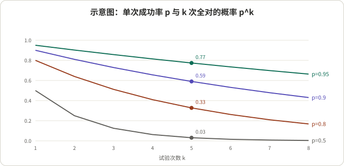
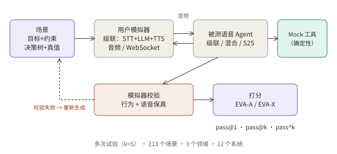
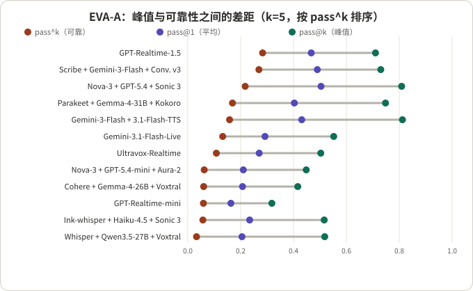

## 摘要

EVA-Bench（Bogavelli 等 13 位作者，ServiceNow AI Research，2026 年 5 月首次提交，9 月的 v3 被 EMNLP 2026 Findings 接收）是一个评测语音 Agent 的端到端框架：让“用户模拟器”和被测 Agent 用音频实时对话，对话先过一道模拟器校验再打分，分数分成准确度（EVA-A）和体验（EVA-X）两组，每个场景重复跑 5 次，用 pass@1、pass@k、pass^k 三个口径报告。论文在 3 个企业领域的 213 个场景上测了 12 个系统（7 个级联、2 个混合、3 个端到端语音）。

我的阅读：这篇论文最值得带走的不是排行榜，而是评测设计的三个选择。第一，把“成功”定义成多个指标同时过线的二值结果，才谈得上“次次成功”。第二，把用户模拟器当成被测对象，先校验再计分。第三，明确区分平均、峰值、可靠三种成绩。反过来，它的 EVA-X 在现有系统上几乎被一个指标（Turn-Taking）决定，一半系统的 EVA-X 压在地板上，这时 pass@k 与 pass^k 的差距反而显得很小，需要小心解读。

| 问题 | 一句话回答 |
|---|---|
| Q1 pass@k 和 pass^k 差在哪 | EVA-A 上的中位差距是 0.44，说明单次成绩系统性地高估可部署的可靠度 |
| Q2 EVA-X 为什么低 | 主要由 Turn-Taking 决定，端到端语音系统明显领先，且阈值被刻意放宽 |
| Q3 用户模拟器会污染分数吗 | 会：12.0% 的试验因模拟器出错被重跑，几乎都是用户行为偏离目标 |
| Q4 需要跑几次 | 方差主要来自试验本身；论文论证 k=3 时模型级估计的误差约 0.03 |

## 核心结论

- “次次成功”才是语音 Agent 上线要看的口径。12 个系统里，EVA-A 的 pass@k 与 pass^k 中位差距为 0.44；pass^5 最高的系统也只有 0.283。
- 三个口径会改变排名。按 pass@1，Nova + GPT-5.4 + Sonic 3 排第一（0.504）；按 pass^5，GPT-Realtime-1.5 排第一（0.283），Nova + GPT-5.4 + Sonic 3 降到第三（0.217）。
- 没有系统在 EVA-A 和 EVA-X 的 pass@1 上同时超过 0.5。级联系统里，准确度高的往往体验差，工具调用轮的平均延迟超过 5 秒。
- 模拟器要先过校验：12.0% 的试验因用户模拟器出错被重新生成。这一步让分数更接近“Agent 的行为”，但我认为它也引入了一个值得追问的选择效应（见 Q3）。
- 评测数字对设置很敏感：全部使用各框架默认的轮次检测，系统提示未调优，Turn-Taking 的延迟分界被刻意放宽；论文自己也说，调优后分数大概率更高。

## 先看懂几个概念

**pass@1、pass@k、pass^k。** 先把每次试验记成通过（1）或不通过（0）。设一个场景跑 k 次，其中通过 c 次。

- pass@1：所有试验里通过的比例，代表“随便跑一次”的平均表现。
- pass@k：k 次里至少一次通过的场景占比，代表“最好情况”。
- pass^k：论文按每个场景的通过率 p̂ = c/k 取 k 次方，再对所有场景求平均，代表“k 次全部通过”的概率。

三者始终满足 pass^k ≤ pass@1 ≤ pass@k。一个手算的例子：某场景单次成功率恒为 p，k=5 时，全部通过的概率是 p^5。

| 单次成功率 p | 5 次全部通过 p^5 | 5 次至少一次通过 1−(1−p)^5 |
|---|---|---|
| 0.95 | 0.774 | 1.000 |
| 0.90 | 0.590 | 1.000 |
| 0.80 | 0.328 | 1.000 |
| 0.50 | 0.031 | 0.969 |

*图 1：示意图，不是论文数据。单次成功率 0.9 看起来不错，连续 5 次都对的概率只有 0.59。*

另一个例子说明为什么只看平均会漏掉信息：甲系统在一半场景上稳定成功、另一半稳定失败；乙系统在所有场景上都是 50% 的概率成功。两者 pass@1 都是 0.5，但按论文公式 pass^5 分别是 0.5 和 0.031。

**用户模拟器（bot-to-bot）。** 评测里扮演“来电用户”的程序。论文里它由语音识别、LLM 和语音合成组成，拿到用户目标、决策树和人设，通过音频连接和被测 Agent 对话。模拟器本身出错（偏离目标、说错话）会被误算成 Agent 的错，所以要先校验。

**级联、混合、端到端。** 级联是“语音识别 → LLM → 语音合成”三段；端到端（S2S）是一个模型直接听进去、说出来；混合是音频直接输入 LLM、输出仍走独立的语音合成。论文中这三类的分组是后面所有对比的基础。

**确定性指标与 LLM 评审指标。** 论文里任务完成、轮次时机是确定性计算，忠实度、对话推进、简洁度由 LLM 评审，语音保真由能听音频的 LLM 评审。两类指标的噪声来源不同。

## 评测怎么搭

*图 2：据论文图 1 重绘。对话先过模拟器校验，失败的重新生成，通过的才进入打分。*

**场景。** 每个场景包含：带约束的用户目标（例如“晚上 10 点前起飞、票价低于某数”）、决策树（消除用户在对话中如何选择的歧义，保证可重复）、人设、供工具查询和修改的数据库，以及“成功之后数据库应处于的状态”。场景刻意包含确认码、姓名、编号等口述时容易听错的关键实体。3 个领域是航空客服、医疗行业的人力服务、企业 IT 服务管理，共 213 个场景，目前只有英文。

**EVA-A（准确度）。**

| 指标 | 怎么算 | 通过条件 |
|---|---|---|
| 任务完成 | 确定性：最终数据库状态的 SHA-256 哈希与标准答案比较，任何多余、缺失或错误的改动都记 0 | = 1.0 |
| 忠实度 | LLM 评审：行为是否忠于指令、策略、工具结果和用户输入 | ≥ 0.5 |
| 语音保真 | 能听音频的 LLM 评审：说出口的话是否准确复述了应说的文本，尤其是确认码、日期、金额 | ≥ 0.95 |

**EVA-X（体验）。**

| 指标 | 怎么算 | 通过条件 |
|---|---|---|
| 轮次时机（Turn-Taking） | 确定性、基于时间戳：每轮按场景分别计分（Agent 抢话、用户打断、正常回复），带工具调用的轮次延迟阈值更宽松 | ≥ 0.8 |
| 对话推进 | LLM 评审：是否重复、是否记得上下文、是否朝解决问题推进 | ≥ 0.5 |
| 简洁度 | LLM 评审：回复对口头表达是否足够短 | ≥ 0.5 |

**把多指标变成一个“通过”。** 一段对话在某一组上通过，当且仅当该组的所有指标同时达标。论文给的理由是：简单求平均会掩盖单个指标上的严重失败。我同意这一点，也有代价：任何一个指标的阈值都会决定整组成绩（Q2 会看到这一点）。

**诊断指标。** 不计入 EVA-A、EVA-X，用来解释失败。例如“关键实体转写准确率”：确认码错一个字符，词错误率几乎不变，但这个码已经没法用。

## Q1：pass@k 与 pass^k 差多少

**结论：很多。** 下表是论文表 4 中 EVA-A 的完整数据（clean 条件、5 次试验、三个领域等权合并；我加了最后一列，是手算的 pass@k − pass^k）。

| 架构 | 系统 | pass@1 | pass@k | pass^k | 差距 |
|---|---|---|---|---|---|
| 级联 | Cohere + Gemma-4-26B + Voxtral | 0.207 | 0.416 | 0.060 | 0.356 |
| 级联 | Scribe + Gemini-3-Flash + Conv. v3 | 0.490 | 0.730 | 0.269 | 0.461 |
| 级联 | Ink-whisper + Haiku-4.5 + Sonic 3 | 0.234 | 0.516 | 0.057 | 0.459 |
| 级联 | Nova-3 + GPT-5.4 + Sonic 3 | 0.504 | 0.809 | 0.217 | 0.592 |
| 级联 | Nova-3 + GPT-5.4-mini + Aura-2 | 0.210 | 0.448 | 0.062 | 0.386 |
| 级联 | Parakeet-1.1 + Gemma-4-31B + Kokoro | 0.403 | 0.748 | 0.169 | 0.579 |
| 级联 | Whisper + Qwen3.5-27B + Voxtral | 0.205 | 0.518 | 0.033 | 0.485 |
| 混合 | Gemini-3-Flash + Gemini-3.1-Flash-TTS | 0.431 | 0.812 | 0.158 | 0.654 |
| 混合 | Ultravox-Realtime | 0.270 | 0.503 | 0.108 | 0.395 |
| 端到端 | Gemini-3.1-Flash-Live | 0.292 | 0.552 | 0.132 | 0.420 |
| 端到端 | GPT-Realtime-1.5 | 0.467 | 0.710 | 0.283 | 0.427 |
| 端到端 | GPT-Realtime-mini | 0.163 | 0.318 | 0.059 | 0.259 |

我把 12 个差距排序后取中间两个（0.427 和 0.459）的平均，得到 0.443，与论文的 0.44 一致。

*图 3：按 pass^k 排序后，pass@k 的顺序并不跟着走。*

读这张表有三点：

- **排名随口径变。** pass@k 最高的是 Gemini-3-Flash + Gemini-3.1-Flash-TTS（0.812），但它的 pass^k 只排第五（0.158）。GPT-Realtime-1.5 在 pass@1 上排第三，在 pass^5 上排第一。
- **“能做到”和“稳定做到”差一个数量级的系统存在。** Whisper + Qwen3.5-27B + Voxtral 的 pass@k 是 0.518，pass^k 只有 0.033。
- **哪怕最好的系统也只有 0.283。** 论文据此认为单次成绩系统性高估了可部署级别的可靠度。这是论文的结论，我认为表里的数据支持它。

**一个需要自己核对的细节。** 论文的 pass^k 是 p̂^k 的平均，其中 p̂ = c/k。当试验次数 n 等于 k 时，这不等于“统计 5 次全对的场景占比”：一个 5 次通过 4 次的场景，按论文公式贡献 0.8^5 ≈ 0.33，按“全对”计数贡献 0。我的推断（凸函数的詹森不等式）：对 n = k，p̂^k 的平均不低于“全对占比”的期望，所以这里的 pass^5 是偏乐观的口径。用在对比不同系统上问题不大，但和别的评测里“全对占比”式的 pass^k 数字不要直接对比。

## Q2：EVA-X 为什么这么低

**结论：几乎全由 Turn-Taking 决定。** 下表是论文表 4 中 EVA-X 的完整数据。

| 架构 | 系统 | pass@1 | pass@k | pass^k | 轮次时机均值 | 简洁度 | 对话推进 |
|---|---|---|---|---|---|---|---|
| 级联 | Cohere + Gemma-4-26B + Voxtral | 0.209 | 0.647 | 0.015 | 0.567 | 0.809 | 0.598 |
| 级联 | Scribe + Gemini-3-Flash + Conv. v3 | 0.024 | 0.061 | 0.004 | 0.451 | 0.774 | 0.804 |
| 级联 | Ink-whisper + Haiku-4.5 + Sonic 3 | 0.009 | 0.042 | 0.000 | 0.312 | 0.784 | 0.710 |
| 级联 | Nova-3 + GPT-5.4 + Sonic 3 | 0.007 | 0.031 | 0.000 | 0.283 | 0.835 | 0.737 |
| 级联 | Nova-3 + GPT-5.4-mini + Aura-2 | 0.113 | 0.416 | 0.005 | 0.583 | 0.835 | 0.428 |
| 级联 | Parakeet-1.1 + Gemma-4-31B + Kokoro | 0.010 | 0.035 | 0.000 | 0.308 | 0.829 | 0.774 |
| 级联 | Whisper + Qwen3.5-27B + Voxtral | 0.273 | 0.684 | 0.051 | 0.561 | 0.685 | 0.612 |
| 混合 | Gemini-3-Flash + Gemini-3.1-Flash-TTS | 0.000 | 0.000 | 0.000 | 0.019 | 0.801 | 0.618 |
| 混合 | Ultravox-Realtime | 0.029 | 0.081 | 0.006 | 0.417 | 0.750 | 0.429 |
| 端到端 | Gemini-3.1-Flash-Live | 0.589 | 0.979 | 0.240 | 0.830 | 0.801 | 0.636 |
| 端到端 | GPT-Realtime-1.5 | 0.566 | 0.939 | 0.216 | 0.815 | 0.801 | 0.679 |
| 端到端 | GPT-Realtime-mini | 0.406 | 0.893 | 0.099 | 0.818 | 0.722 | 0.388 |

要点：

- **轮次时机按架构分层。** 级联均值 0.28–0.58，端到端 0.82–0.83，两组之间没有重叠。简洁度和对话推进没有这样的分层。
- **阈值把差异放大成“有或无”。** 轮次时机的通过线是 0.8（相当于“五轮里至多一轮不合适”），论文在附录里说明任何 0.6–0.8 之间的阈值都会得到同样的 12 个系统的通过/不通过划分。这意味着：轮次时机均值 0.58 的系统 EVA-X pass@1 只有 0.113，均值 0.28 的只有 0.007，两者在通过口径下都很低，均值上的差异大部分被阈值抹掉了。
- **这是我对“差距 0.24”的提醒。** 论文说 EVA-X 上 pass@k 与 pass^k 的中位差距是 0.24，但表里有 6 个系统的 pass@k 本身就低于 0.1，它们的差距必然很小。中位数落在地板效应和高分系统之间，用它来说“EVA-X 的可靠性差距”不太合适。我自己的做法是只在 pass@k 明显大于 0 的系统里比较（EVA-X 里是 6 个系统，差距 0.41–0.79）。
- **延迟分界是刻意放宽的。** 论文指出人类的轮次间隔大约 200 毫秒，目标系统里最快的在非工具轮平均约 1 秒，多数级联为 2–5 秒；它因此把“最佳区间”放宽到现有系统能达到的范围。边界值可以按场景改。
- **级联里准确与体验此消彼长。** 准确度最高的三个级联系统在工具调用轮的平均延迟超过 5 秒；体验较好的两个低于 2.7 秒，但准确度低。论文把它称为“可能存在的能力-延迟张力”，样本只有 7 个级联系统。

另外要注意，论文承认模拟器**不会系统性地生成打断**，所以这套基准对打断处理的压力不足，不能区分擅长处理打断和不擅长的系统。想看打断专项评测，可以看 [这篇关于 Barge-In 基准的梳理]()。

## Q3：用户模拟器会污染分数吗

**结论：会，论文的做法是先校验再计分，但这一步值得追问。**

校验有两项：用户行为保真（LLM 评审，检查模拟器有没有偏离分配的目标）和用户语音保真（能听音频的 LLM 评审，检查模拟器说出口的话是否正确）。任何一项失败，对话会被自动重新生成。在 4 个系统、全部领域上，12.0% 的试验需要重跑，几乎都是行为偏离，语音问题占重跑的不到 4%。

论文还做了两件事来支撑可信度：

- 7 位人工评审对航空领域的 50 段对话从内容真实性、音频自然度、目标忠实度三方面打分，全部通过。
- 评审与人工的一致性：忠实度、对话推进、简洁度、语音保真的二次加权 κ 分别为 0.836、0.845、0.823、0.777，与两位人类标注者之间的一致性（0.740、0.769、0.825、0.754）相当或更高。论文自己指出，人-人一致性是实用上限而非严格上限。

**我的两个疑问，都是推断，不是论文的结论。**

1. 重跑只针对“模拟器出错”，但判定“模拟器出错”的也是一个 LLM 评审。如果某些 Agent 的行为更容易诱发用户模拟器偏离目标（比如反复追问、说得很长），这些系统被重跑的比例会更高，最终保留下来的是“更顺利”的那些对话。论文只报告了 4 个系统的合计重跑率，没有按系统拆开，所以这一点无法判断。
2. 论文也承认：评审可能偏向与自己同一模型家族的输出；模拟器由商业系统搭成，行为会随版本变化；模拟器的流利程度可能低估真实用户的口误和停顿。

## Q4：要跑几次

**结论：方差主要来自试验本身，k=3 对模型级估计够用，但要看你用它做什么。**

论文用线性混合效应模型拆分方差：在评审打分的指标上，试验随机性占总方差的 40.4%–80.4%，评审随机性占 5.5%–37.5%，场景之间的方差占 0.0%–47.3%（论文表 35 的几个区间并不要求相加为 100%，因为是分模型、分指标各拟合一次）。论文用排列检验证明，在 16 个“模型 × 指标”组合上，试验间的波动都显著大于评审的波动。这说明同一个场景重复跑，结果真的会变，而不是评审在抖。

关于试验次数，论文做了子抽样：对每个模型、每个指标，随机抽取 k 次试验，看估计值的 95% 区间宽度。

- 每轮计算的指标（语音保真、简洁度、轮次时机）在 k=1 时区间宽度就小于 0.02。
- 对话级和通过类指标在 k=1 时宽度为 0.05–0.09，到 k=3 约为 0.02–0.03；k=3 时所有指标的中位区间宽度不超过 0.034。
- 因此扰动实验用 k=3（并只抽 90 个场景），clean 条件用 k=5。

我的推断：这个论证针对的是**模型级的汇总分数**。要判断“某个具体场景是否可靠”，每个场景只有 3–5 次试验，场景级的 p̂ 的不确定性大得多，不能照搬这个结论。

## 论文的文字与表格的核对

- “没有系统在两个 pass@1 上同时超过 0.5”：表里成立。唯一接近的是 Nova-3 + GPT-5.4 + Sonic 3，EVA-A 为 0.504，但 EVA-X 只有 0.007；论文另说“只有 GPT-Realtime-1.5（0.47、0.57）同时超过 0.4”，也与表一致。
- “混合系统没有继承端到端的延迟优势”：论文只有两个混合系统，其中一个 EVA-X 为 0.000，另一个 0.029，论文自己写的是“可能”并说明需要更多系统。我同意这个措辞，不应当当成结论引用。
- 端到端系统“策略违规更多（+24.6 个百分点）”：论文自己写明这一比较可能有混杂，因为没有完成对话的系统没有机会违规。不要单独引用这个数字。
- 扰动实验：一种口音（法语）、一种噪声（咖啡馆），并且口音条件混杂了“不同的合成声音”。论文说明了这一点，结论只能说“存在差距”，不能外推到其他口音。
- 论文限制部分：任务完成是二值的，没有部分得分；所有工具都是模拟执行器，不含真实接口的故障、延迟波动和部分响应。

## EVA-Bench 的做法值不值得借鉴：从工程角度看

**适合借鉴的场景（带前提）。**

- **要判断能否放手让 Agent 独立处理一类请求。** 前提：每个场景能自动判定对错（这里靠“最终数据库状态哈希”），才有资格用 pass^k。
- **要比较架构。** 前提：用同一套用户模拟器、同一批场景，且各系统使用同样粒度的配置。
- **模拟器本身需要长期维护。** 前提：愿意为校验和重跑付出成本，论文自己说一次完整评测是大量模型调用。

**不太适合的场景。**

- 需要大量打断、插话、口语停顿的场景：论文自己承认模拟器不生成打断。
- 非英语或方言场景：目前只有英文。
- 判断准确度时只看“最终状态”的任务：二值任务完成会让“只差一步”的系统与完全失败的系统得分相同。

**比较时的注意点。** 各系统运行在不同框架上（部分用厂商 SDK，部分用开源管线，一个用另一个平台），全部使用默认的轮次检测；系统提示未优化；评审与被测系统可能同源；这些都会影响绝对数字。

**可以直接借走的做法。**

- 先定义“通过”（多个指标同时达标），再谈 pass@k 和 pass^k；报告 pass@1、pass@k、pass^k 三个数，并附 95% 置信区间。
- 每个场景至少重复几次，并拆分方差，确认波动来自试验而不是评审。
- 对话先校验用户模拟器再计分，并按系统报告重跑率。
- 对口述的关键实体做专门的指标（转写的关键实体准确率、语音保真），不要只看词错误率。
- 阈值要与现有系统的能力校准，并检查阈值对排名的敏感性，别让一个指标的阈值决定整组成绩。

## 总结

EVA-Bench 的价值在方法：二值通过、多次试验、模拟器校验、三个口径并列。对这套数据，我认为最稳妥的解读是：在这个基准上，没有一个被测系统能让人放心地“次次做对”，而且排名会随口径改变。需要小心的地方是 EVA-X 被一个指标决定、重跑可能引入选择效应，以及 pass^k 用的是偏乐观的估计口径。

## 参考资料

- [EVA-Bench: A New End-to-end Framework for Evaluating Voice Agents (arXiv 2605.13841)](https://arxiv.org/abs/2605.13841)，作者 Tara Bogavelli 等，ServiceNow AI Research；本文引用的表 2–4、附录 A、E、H 与限制部分来自 v3 的 HTML 全文
- [EVA-Bench 代码与数据（GitHub）](https://github.com/ServiceNow/eva)：以开源许可发布，地址取自论文摘要
- [τ-bench: A Benchmark for Tool-Agent-User Interaction in Real-World Domains (Yao 等)](https://arxiv.org/abs/2406.12045)：论文引用的文本 Agent 评测，pass^k 的“k 次全对”思路与之相关

相关阅读：[如何评测 Barge-In（打断）]()、[读 Higgs Realtime Duplex]()。

*说明：所有数字来自论文 v3 的表格和正文，属论文自报，我没有复现；“差距”列、p^5 表以及中位数核对是我手算的；“我的推断”处为个人判断。论文中各系统的详细配置（附录 B）未在本文展开。*
