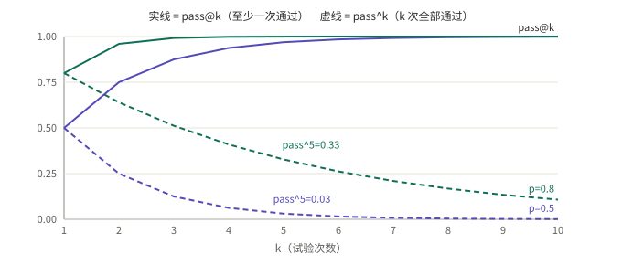
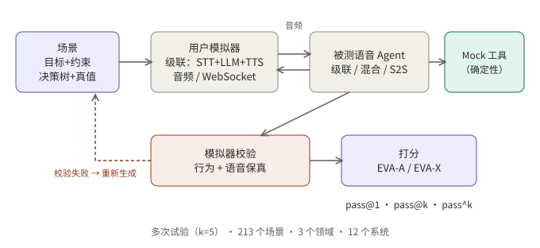
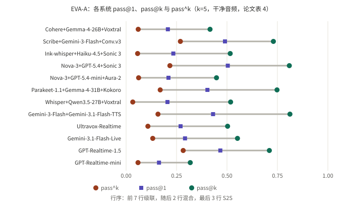

## 摘要

EVA-Bench（[arXiv 2605.13841](https://arxiv.org/abs/2605.13841)，ServiceNow AI Research 的 Tara Bogavelli 等 13 位作者，我读的是 v3，2026-09-09）是一个评测语音 Agent 的框架：让一个“用户机器人”通过音频和被测 Agent 完整打一通电话，场景覆盖航空客服、医疗机构人事服务、企业 IT 服务三个领域，共 213 个场景；对 12 个系统（7 个级联、2 个混合、3 个语音到语音，即 S2S）在干净音频下每个场景重复跑 5 次，再用两个综合指标打分：EVA-A（准确度）和 EVA-X（体验）。

我的阅读：这篇论文最值得带走的不是排行榜，而是它的**报告方式**：同一批试验同时给出 pass@1（平均）、pass@k（五次里至少一次通过）和 pass^k（五次全部通过）。三者放在一起，才看得出“能力上限”和“可交付的稳定性”之间的距离。论文的结论也落在这里：没有系统在两个指标的 pass@1 上同时超过 0.5；EVA-A 上 pass@k 与 pass^k 的中位差是 0.44。需要保留的是：12 个系统不足以推断“某一类架构”；LLM 评审、用户模拟器和默认的轮次检测都有各自的局限，作者在文中也承认了这些。

## 核心结论

- 单次试验的分数会系统性高估可交付的可靠性：EVA-A 的 pass@k 与 pass^k 中位差 0.44，EVA-X 为 0.24（我用表 4 复算，EVA-A 的中位数是 0.443）。
- 没有系统在 EVA-A 与 EVA-X 的 pass@1 上同时超过 0.5。只有 GPT-Realtime-1.5 在两者上都超过 0.4（0.467 与 0.566）。
- 体验差距几乎全来自轮次接管（turn-taking）：级联系统均值 0.28–0.58，S2S 系统 0.82–0.83；两个混合系统落在级联区间。
- 准确度和体验在级联系统内部有取舍：准确度最高的几个级联，工具调用延迟超过 5 秒；体验最好的两个级联，工具延迟低于 2.7 秒但准确度更低。
- 评测本身也有方差：混合效应模型里，“试验随机性”占评审指标方差的 40.4–80.4%，评审随机性只占 5.5–37.5%。多跑几次比多问几次评审更有用（这是我的推论）。
- 用户模拟器会出错：4 个系统上有 12.0% 的试验因模拟器问题被重新生成，几乎都是用户行为偏离脚本。

## 先看懂几个概念

**级联、混合、S2S。** 级联是 STT → LLM → TTS 三段文本管线；S2S 是一个模型直接音频进、音频出；混合在中间，论文里指至少一段直接处理音频但不是端到端的配置（如 Gemini-3-Flash 加 Gemini-3.1-Flash-TTS，以及 Ultravox-Realtime）。

**机器人对机器人（bot-to-bot）评测。** 用户一侧也是一个 Agent：它拿着“目标、约束、决策树、人设、场景数据库和真值终态”，通过 WebSocket 用音频和被测系统对话。好处是两类架构在完全相同的条件下比较，并且可以重复；代价是评测结果要依赖这个模拟器是否像真人，所以才需要下面的校验。

**确定性 Mock 工具执行器。** 被测 Agent 调用的工具不连真实后端，而是由一个确定性的执行器处理；最终任务是否完成，靠比较终态数据库的 SHA-256 哈希与真值是否一致来判定。

**三个 pass 指标。** N 个场景、每个场景 k 次试验，每次试验得到通过/不通过：

```
pass@1 = 全部 N·k 次试验里通过的比例              （平均表现）
pass@k = 至少有一次通过的场景所占比例              （上限）
pass^k = 对每个场景取 (该场景 k 次里的通过率)^k，再对场景求平均   （k 次全过的概率）
```

论文里 k=5（干净音频）。下面用一个小例子说明为什么三者差这么多。假设每次试验独立、通过率都是 p：



*图 2：示意图，由公式 1-(1-p)^k 和 p^k 计算，不是论文数据。p=0.8 时 pass^5 只有 0.33；p=0.5 时只有 0.03，而 pass@5 已经接近 0.97。*

## 评测怎么搭：场景、模拟、校验、打分



*图 1：示意图，据论文第 3 节整理。完成的对话先过模拟器校验，不合格就重新生成，再进入打分。*

- **场景。** 三个领域共 213 个场景，每个场景含用户目标与约束、决策树、人设、场景数据库和真值终态。我读到的文本里没有各领域的场景数量。
- **模拟器校验。** 每段对话打分前先过两道自动检查：用户行为保真（LLM 评审）和用户语音保真（音频大模型评审），不过就重新生成。论文报告 4 个系统上 12.0% 的试验需要重新生成，几乎都是行为偏离，语音问题占重跑的不到 4%。另有 7 位人工评审员听读了 50 段航空领域对话，在内容真实度、音频自然度、目标一致性三项上全部通过。
- **被测系统。** 7 个级联、2 个混合、3 个 S2S；多数通过 Pipecat 接入，GPT-Realtime 和 Gemini Live 用原生 SDK，Scribe 管线用 ElevenAgents；全部使用默认的轮次检测。
- **扰动。** 法语口音、咖啡馆背景噪声、两者叠加，用 90 个场景的子集（每域 30 个），k=3。

## 指标：EVA-A 与 EVA-X 各自怎么判

一段对话要“通过”，需要子指标同时满足阈值：

```
EVA-A 通过 = 任务完成 = 1.0   且  忠实度 ≥ 0.5   且  语音保真 ≥ 0.95
EVA-X 通过 = 轮次接管 ≥ 0.8   且  对话推进 ≥ 0.5   且  简洁度 ≥ 0.5
```

| 子指标 | 判定方式 |
|---|---|
| 任务完成 | 确定性：终态数据库哈希与真值完全一致 |
| 忠实度 | LLM 评审：动作是否有指令、政策、工具结果或用户输入作依据 |
| 语音保真 | 音频大模型评审：口说内容是否如实复述关键实体（编码、日期、金额） |
| 轮次接管 | 确定性，基于时间戳：插话重叠、打断、让出延迟、分段延迟曲线；有工具调用的轮次延迟阈值更宽松 |
| 对话推进 | LLM 评审：重复、上下文保持、拖延 |
| 简洁度 | LLM 评审：回复对口语场景是否足够短 |

评审与人工的一致性（Cohen κ，序数评分用二次加权，语音保真不加权）：

| 指标 | 评审之间 κ | 评审与人工 κ | 二值通过/不通过：评审之间 | 二值：评审与人工 |
|---|---|---|---|---|
| 忠实度 | 0.836 | 0.740 | 0.860 | 0.731 |
| 对话推进 | 0.845 | 0.769 | 0.664 | 0.553 |
| 简洁度 | 0.823 | 0.825 | 0.738 | 0.741 |
| 语音保真 | 0.777 | 0.754 | 0.777 | 0.754 |

我的读法：对话推进的二值一致性最弱（评审与人工 κ 只有 0.553），而它正是 EVA-X 通过条件的一部分。论文没有给每个子指标的假触发率之类的细项，这一点读者需要自己留意。

## Q1：“偶尔做对”和“次次做对”差多少

**结论：很多。** 干净音频、k=5 下 EVA-A 的完整结果（论文表 4，每格另有 ±0.03 到 ±0.07 左右的 bootstrap 置信区间半宽，此处略去）：

| 系统 | 架构 | pass@1 | pass@k | pass^k | 差值 | 任务完成 | 忠实度 | 语音保真 |
|---|---|---|---|---|---|---|---|---|
| Cohere + Gemma-4-26B + Voxtral | 级联 | 0.207 | 0.416 | 0.060 | 0.356 | 0.338 | 0.375 | 0.983 |
| Scribe + Gemini-3-Flash + Conv. v3 | 级联 | 0.490 | 0.730 | 0.269 | 0.461 | 0.736 | 0.457 | 0.977 |
| Ink-whisper + Haiku-4.5 + Sonic 3 | 级联 | 0.234 | 0.516 | 0.057 | 0.459 | 0.374 | 0.518 | 0.983 |
| Nova-3 + GPT-5.4 + Sonic 3 | 级联 | 0.504 | 0.809 | 0.217 | 0.592 | 0.609 | 0.754 | 0.989 |
| Nova-3 + GPT-5.4-mini + Aura-2 | 级联 | 0.210 | 0.448 | 0.062 | 0.386 | 0.465 | 0.270 | 0.974 |
| Parakeet-1.1 + Gemma-4-31B + Kokoro | 级联 | 0.403 | 0.748 | 0.169 | 0.579 | 0.637 | 0.466 | 0.954 |
| Whisper + Qwen3.5-27B + Voxtral | 级联 | 0.205 | 0.518 | 0.033 | 0.485 | 0.417 | 0.546 | 0.913 |
| Gemini-3-Flash + Gemini-3.1-Flash-TTS | 混合 | 0.431 | 0.812 | 0.158 | 0.654 | 0.674 | 0.443 | 0.969 |
| Ultravox-Realtime | 混合 | 0.270 | 0.503 | 0.108 | 0.395 | 0.473 | 0.292 | 0.971 |
| Gemini-3.1-Flash-Live | S2S | 0.292 | 0.552 | 0.132 | 0.420 | 0.473 | 0.238 | 0.995 |
| GPT-Realtime-1.5 | S2S | 0.467 | 0.710 | 0.283 | 0.427 | 0.739 | 0.360 | 0.996 |
| GPT-Realtime-mini | S2S | 0.163 | 0.318 | 0.059 | 0.259 | 0.345 | 0.125 | 0.977 |

“差值”列是我用 pass@k 减 pass^k 算出来的；排序后中间两个值是 0.427 和 0.459，中位数 0.443，与论文报告的 0.44 一致。



*图 3：据论文表 4 重绘。每条灰线的两端是 pass^k 和 pass@k，方块是 pass@1。*

几点读法：

1. **排名会变。** 按 pass@k，最高的是 Gemini-3-Flash 加 TTS 的混合系统（0.812）；按 pass^k，最高的是 GPT-Realtime-1.5（0.283），那个混合系统掉到 0.158。只看 pass@k 会选出一个最不稳定的系统。
2. **差值最大的往往是“平均不错”的系统。** 差值最大的前三个是 0.654、0.592、0.579，pass@1 分别是 0.431、0.504、0.403。
3. **pass@1 到 pass^k 的跌幅不能用“每次独立”来解释。**（我的推论）以 GPT-Realtime-1.5 为例：如果每个场景的通过率都是 0.467，pass^5 应该约为 0.022，pass@5 应该约为 0.96；实际是 0.283 和 0.710。说明场景之间差异很大：有些场景几乎次次通过，有些几乎次次失败。这对实践有意义：pass^k 低，既可能是“同一个场景时好时坏”，也可能是“有一批场景从来做不对”，两种问题的修法不同，需要按场景拆开看通过率。
4. **论文用的 pass^k 是插件估计。** 每个场景的通过率用同样那 k 次试验估计，再取 k 次方（论文附录 A 的公式）。这个估计的偏差我没有检查，k 小的时候读数应当谨慎。

## Q2：为什么没有系统同时超过 0.5

**结论：EVA-X 的通过条件很严，而且被轮次接管一项主导。**

EVA-X 的完整结果（论文表 4，同样略去置信区间）：

| 系统 | 架构 | pass@1 | pass@k | pass^k | 轮次接管 | 简洁度 | 对话推进 |
|---|---|---|---|---|---|---|---|
| Cohere + Gemma-4-26B + Voxtral | 级联 | 0.209 | 0.647 | 0.015 | 0.567 | 0.809 | 0.598 |
| Scribe + Gemini-3-Flash + Conv. v3 | 级联 | 0.024 | 0.061 | 0.004 | 0.451 | 0.774 | 0.804 |
| Ink-whisper + Haiku-4.5 + Sonic 3 | 级联 | 0.009 | 0.042 | 0.000 | 0.312 | 0.784 | 0.710 |
| Nova-3 + GPT-5.4 + Sonic 3 | 级联 | 0.007 | 0.031 | 0.000 | 0.283 | 0.835 | 0.737 |
| Nova-3 + GPT-5.4-mini + Aura-2 | 级联 | 0.113 | 0.416 | 0.005 | 0.583 | 0.835 | 0.428 |
| Parakeet-1.1 + Gemma-4-31B + Kokoro | 级联 | 0.010 | 0.035 | 0.000 | 0.308 | 0.829 | 0.774 |
| Whisper + Qwen3.5-27B + Voxtral | 级联 | 0.273 | 0.684 | 0.051 | 0.561 | 0.685 | 0.612 |
| Gemini-3-Flash + Gemini-3.1-Flash-TTS | 混合 | 0.000 | 0.000 | 0.000 | 0.019 | 0.801 | 0.618 |
| Ultravox-Realtime | 混合 | 0.029 | 0.081 | 0.006 | 0.417 | 0.750 | 0.429 |
| Gemini-3.1-Flash-Live | S2S | 0.589 | 0.979 | 0.240 | 0.830 | 0.801 | 0.636 |
| GPT-Realtime-1.5 | S2S | 0.566 | 0.939 | 0.216 | 0.815 | 0.801 | 0.679 |
| GPT-Realtime-mini | S2S | 0.406 | 0.893 | 0.099 | 0.818 | 0.722 | 0.388 |

读法：

- 简洁度和对话推进在各类架构间没有明显分层，轮次接管才分层。例如 Nova-3 + GPT-5.4 + Sonic 3 的简洁度 0.835、对话推进 0.737 都不差，但轮次接管只有 0.283，EVA-X pass@1 只有 0.007。
- 通过条件是“三项同时达标”，轮次接管的阈值是 0.8。论文对此做了敏感性分析：把阈值从 0.50 扫到 0.95，排名总体稳定，有 3 对系统会换位，它们的 pass@1 差距都在 0.15 以内。
- 因此 EVA-X 的低分在很大程度上是“轮次接管几乎总不达标”造成的，它对延迟敏感，也依赖各系统使用的默认轮次检测（论文承认全部用默认设置、没有优化）。我的推论：这更像是在比较“开箱默认配置”，而不是各架构能做到的最好水平。
- 论文还指出，交互里并未系统性地生成打断，所以轮次接管的鲁棒性是被低估压力的。已发布的[打断评测那一篇]()讲的正是这一块。

## Q3：噪声、口音和实体：失败从哪里来

**结论：级联系统在口音下掉准确度，S2S 在噪声下掉体验；关键实体的转写是级联的瓶颈。**

以下数字是论文对 90 个场景子集（k=3）的报告：

- 口音：级联的任务完成平均下降 10 个百分点（最差的系统 17 个点）；27 个 S2S 的“模型×指标”组合里没有一个出现显著的准确度下降。
- 噪声：S2S 的 EVA-X 平均下降 0.16，轮次接管平均下降 0.076；级联的轮次接管平均下降 0.12，任务完成平均下降 0.10（S2S 为 0.04）。级联的 EVA-X 基线本来就接近 0（0.007–0.273），所以没有太多下降空间。
- 叠加：级联的任务完成平均下降 19 个点，S2S 均值在 5 个点以内。
- 轮次接管是对扰动最敏感的指标：81% 的测量出现显著下降。
- 关键实体：级联系统里，关键实体转写准确率与任务完成的 Pearson 相关系数为 0.93（p=0.002）；转写准确率低于 70% 的系统，任务完成为 0.37，高于 70% 的为 0.60。语音保真的失败集中在编码等字母数字实体上。
- 政策违规：S2S 平均多出 24.6 个百分点的对话被标记为违反政策，但作者提醒这可能是混淆：做不完任务的系统本来就没有机会违反政策。

需要保留的是：相关不等于因果，只有 7 个级联系统；而且口音条件把口音和声音身份混在一起，只测了一种口音、一种噪声。

## Q4：评测本身有多少噪声

**结论：试验之间的随机性比评审的随机性大。**

- 混合效应模型：试验随机性占评审指标总方差的 40.4–80.4%，占确定性指标的 52.7–100.0%；评审随机性占 5.5–37.5%；场景方差 0.0–47.3%。
- 置换检验：在测试的 16 个“模型×评审指标”组合里，试验间的变异都显著大于评审间的变异（p<0.0001）。
- 模拟器：12.0% 的试验需要重新生成。

这说明评测里“把同一场景重复跑”的价值，不亚于“换更强的评审”。我的推论：对自己的语音 Agent 做评测，先把重复次数和模拟器校验做好，比反复调评审提示词回报更高。

## EVA-Bench 值不值得学：从工程角度看

**适合借鉴的地方：**

- 同时报告 pass@1、pass@k、pass^k，并写明 k。上限回答“能不能做到”，pass^k 回答“能不能每次做到”。
- 任务完成用确定性判定（终态数据库哈希），主观部分才交给评审；每个评审指标都和人工小样本比 κ，并分别给出序数与二值的一致性。
- 对话打分前先校验模拟器，并报告重新生成的比例；这个比例本身就是评测可信度的一个指标。
- 通过阈值做敏感性扫描，而不是只给一个数。
- 用子集做扰动（口音、噪声、叠加），并保持所有系统用同一个子集。

**需要小心的地方：**

- 费用：干净音频每个系统 213×5=1065 段完整语音对话，还不含重新生成；复现需要商业 API，论文也这样说。
- 只有英文，用户模拟器可能低估口吃、犹豫等不流畅现象；工具是 mock 的，覆盖不到真实接口的失败方式。
- LLM 评审可能偏爱同一模型族的输出；音频大模型评审可能不如文本评审可靠；任务完成是二值的，没有部分得分。
- 12 个系统、默认轮次检测、未优化的提示词：不能把结果当作“某一类架构”的定论。
- 比较的是各系统的特定版本组合，版本一变分数就会变。

**可以直接带走的做法：** 如果要给自己的语音 Agent 设计评测，至少做到“每个场景重复多次、同时报告平均和全过、先校验模拟用户、通过阈值做敏感性扫描、按场景拆开看通过率”。

## 总结

EVA-Bench 把语音 Agent 评测里两个常被忽略的问题放到了台面上：单次试验的分数会高估可靠性，而“体验”这一半主要由轮次接管决定。最有价值的部分是方法：重复试验、pass^k、模拟器校验、阈值敏感性。最需要克制的部分是排行榜：系统少、默认配置、版本会变。

## 参考资料

- Bogavelli 等，*EVA-Bench*，[arXiv 2605.13841](https://arxiv.org/abs/2605.13841)（v3，2026-09-09），ServiceNow AI Research。
- 代码与场景：[ServiceNow/eva](https://github.com/ServiceNow/eva)（论文称以开源许可发布，具体许可条款我没有核对）。
- 项目页（局限与路线图）：<https://servicenow.github.io/eva/#limitations>

*说明：表中数字取自论文表 4（arXiv HTML 版）；我复算了 EVA-A 差值的中位数。图 1 和图 2 是示意图，图 3 据论文表 4 重绘。表 4 的列标题我按子指标名称（任务完成、忠实度、语音保真；轮次接管、简洁度、对话推进）对应。*
