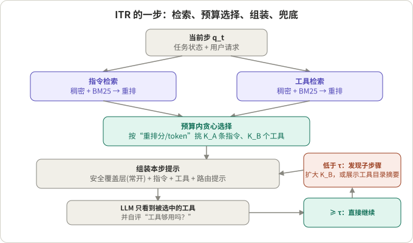
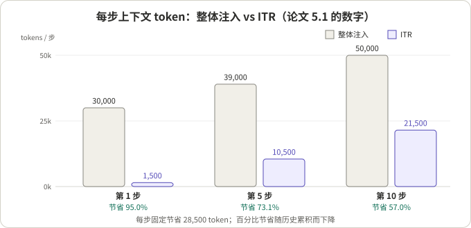
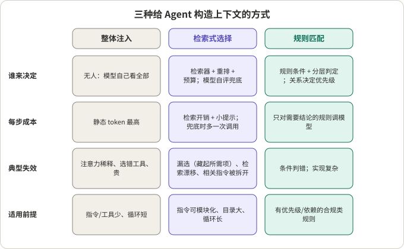

## 摘要

《Dynamic System Instructions and Tool Exposure for Efficient Agentic LLMs》（Uria Franko，单作者，arXiv 2602.17046，PDF 标注 v1 为 2025-12-01，页面未列所属机构）提出 Instruction-Tool Retrieval（ITR）：不再每一步把整份系统提示和全部工具塞给模型，而是把系统提示切成片段、把每个工具写成一份文档，每一步只检索当前需要的几条指令和几个工具，拼成一份临时的系统提示，并在置信度不足时放宽。论文报告：每步上下文 token 降 95%，工具选对的比例从 62% 升到 82%（相对提高 32%），多跳任务的单次 episode 成本降 70%。

我的阅读：**方向是对的，但论文的数字更适合当作“这个机制大致长什么样”的说明，不适合当作可以直接外推的证据。** 作者在摘要里自己把基准称为“数字内部自洽的受控基准”，5.3 节的“内部一致性验证”核对的是百分比能否从表里算出来，不是测量本身是否可靠；论文没有写模型是什么、跑了几次、有没有置信区间。此外正文里有几处说法和自己的表对不上（见 Q3）。机制本身，尤其是“召回优先 + 兜底”“常开的安全覆盖层”“把工具和指令都当成可检索对象”，值得借鉴。

本文还把 ITR 放进“引导式选择”（guideline selection，决定这一轮哪些行为规则生效）的框架里，和整体注入、基于规则的统一匹配（上一篇读过的 Parlant Compass，见 ）放在一起比较，最后给出一张选型表。

| 问题 | 一句话回答 |
|---|---|
| Q1 ITR 每一步做什么 | 双路检索（指令、工具）→ 预算内贪心选择 → 组装提示 → 模型自评“工具够不够”，不够就发现式扩展 |
| Q2 它没有训练什么 | 不训练主模型；重排器、权重、阈值论文都没给 |
| Q3 数字能信多少 | 趋势可信，绝对值要打折；“147 倍循环”“2 到 20 倍”与论文自己的表矛盾 |
| Q4 收益来自哪里 | 省 token 主要来自指令，选对工具的提升主要来自收窄工具 |
| Q5 与另外两种方式怎么选 | 看指令是否可模块化、条目间是否有优先级和依赖、循环多长 |

## 核心结论

- ITR 的核心是把“指令”和“工具”都当成可检索的对象，每步按预算选出最小子集；它本质上是一个**选择器 + 兜底**，不是新模型。
- 论文的 95% 是第 1 步的数字；随历史累积，第 10 步降到 57%，一个 10 步 episode 的累计 token 降 73%（390k → 105k）。固定节省量是每步 28,500 token，百分比会下降。
- 论文正文说“可多跑 147 倍循环”“2 到 20 倍”，但它自己的表 1 只支持约 1.04 到 2.6 倍；“指数级”的说法也没有数据支撑。读这篇论文要以表为准，不以文字为准。
- 按论文自己的单参数模型反推，ITR 隐含的召回率会随工具目录变大而从约 0.88 降到约 0.77，和“ITR 保持性能”并不完全一致。这是我的推导，不是论文的结论。
- 它改变的不只是成本：动态拼系统提示会破坏提供商端的前缀缓存（我的推断），对延迟敏感的流式场景要单独评估。
- 选型上：指令少、循环短，整体注入就够；指令可模块化、目录大、循环长，用检索式；规则之间有优先级、依赖和合规要求，需要规则匹配这种带关系的方案，或者把检索和规则结合起来。

## 先看懂几个概念

**引导式选择。** 一个面向用户的 Agent 通常有很多行为规则（“用户要求退款时先核对订单”“不要承诺未批准的折扣”）和很多工具。每一轮并不是全部都相关。引导式选择就是决定这一轮把哪些规则、哪些工具交给模型。三种常见做法见本文最后一节。

**指令片段与工具文档。** ITR 把系统提示切成 200 到 600 token 的片段，每片有稳定 ID 和元数据（领域、策略类型、时效）；每个工具写成一份文档，含名称、参数、前后置条件、失败模式和少量示例，150 到 800 token。检索的对象是这些片段和文档，不是外部知识。

**混合打分。** 一个候选和当前步的相关度由三项加权：稠密向量的余弦相似度、BM25 词法分数、交叉编码器重排分，即论文式 (3)：

```
S(a_i | q_t) = w1 * cos(E(q_t), E(a_i)) + w2 * BM25(q_t, a_i) + w3 * CE(q_t, a_i)
```

**预算内选择。** 每个候选有 token 成本，总和不能超过预算 B。论文把它写成背包问题（式 4），实际做法是“按重排分除以 token 数，贪心挑选”。

**安全覆盖层。** 一小段永远放进提示的内容（安全、法务类规则），不参与检索，保证激进裁剪时关键规则仍在。

**工具充分性检查与发现式兜底。** 模型自己判断“暴露给我的工具够不够用”；低于阈值 τ 就多做一个“发现”子步骤，扩大工具数 K_B，或者短暂展示工具目录的摘要。

**漏选率（miss-rate）。** 因为正确的工具被藏起来而失败的 episode 比例。它是检索式选择最该盯的指标。



*图 1：示意图，据论文第 3 节和算法 1 整理。*

## Q1：ITR 每一步做什么

**结论：双路检索、预算内贪心、组装、自评、兜底，五步，没有训练主模型。**

1. **建索引。** 指令片段和工具文档各建一份向量索引和 BM25 索引，外加一个轻量交叉编码器作重排。
2. **每步检索。** 用当前步的输入 q_t（任务状态加用户请求）分别对两份索引打分，各取前 M_A、M_B 个，再重排。
3. **预算内选择。** 贪心挑出 K_A 条指令、K_B 个工具。论文给的起步建议是 K_A = 4、K_B = 2。
4. **组装。** 提示的顺序是：常开安全覆盖层、按优先级排序的所选指令、所选工具的模式加 1 到 2 个示例、一条路由提示（让模型别去用没暴露的工具，不够时请求“工具发现”）。
5. **兜底。** 模型自评工具是否够用，低于 τ 就扩展后重跑一次。另外，少数关键工具可以通过领域分类器设成“始终可选”（pinned）。

还有缓存：按任务签名缓存选出来的指令和工具集合，摊薄多轮循环里的检索开销。

**训练与未给出的参数。** ITR 不训练主模型。重排器的训练方式、权重 w1、w2、w3、阈值 τ、M_A、M_B、预算 B 的取值，论文都没有给。式 (4) 里的边际收益 Δ 说可以来自“历史轨迹或 bandit 反馈”，没有展开，实际用的是贪心。

## Q2：它到底在什么条件下测的

**结论：三类任务共 100 个，四个对照，模型和重复次数没写。**

| 任务 | 数量 | 内容 |
|---|---|---|
| T1 结构化 API | 40 | CRM、客服、分析、计费，每任务 1 到 3 个工具 |
| T2 推理加行动 | 30 | 多跳数据分析，每个 episode 约 9 步（正文写作 “5 → 1 → 2 steps”，我按 L≈9 理解） |
| T3 运维/文档 | 30 | 需要选择性读文档，2 到 5 个工具 |

对照：B0 整体注入（全部提示加全部工具）；B1 只用学出来的工具路由器（提示保留全量）；B2 只检索指令片段（工具仍全量暴露）；ITR 两者都检索并带兜底。

指标：每步上下文 token、工具选对率、episode 成功率、成本、p50/p95 延迟、漏选率、随步数的累计 token。

没写的东西：用的是哪个 LLM、每个任务跑几次、有没有方差或置信区间、基准是否公开（我没有检查论文给出的代码仓库里是否带基准）、B0 的“全部工具”在主表里是多少个。5.1 节还提到一个“生产部署”，基线每步约 30,000 token，ITR 降到 1,500，没说是什么系统，只能当作轶事。

## Q3：论文的文字和它自己的表对得上吗

**结论：核心表自洽，但有几处文字说法超出表能支撑的范围。**

先看完整的主表。

表 2：每步 token 与工具选对率（全部任务）

| 方法 | token/步 | 工具选对率 (%) |
|---|---|---|
| B0 整体注入 | 30,000 | 62 |
| B1 只做路由器 | 30,000 | 70 |
| B2 只检索指令 | 11,000 | 66 |
| ITR（K_A = 4，K_B = 2） | 1,500 | 82 |

表 3：T2 episode 结果（L ≈ 9）

| 方法 | 成功率 (%) | 成本/episode ($) | p50 延迟 (s) |
|---|---|---|---|
| B0 整体注入 | 64 | 2.90 | 68 |
| B1 只做路由器 | 70 | 2.55 | 65 |
| B2 只检索指令 | 72 | 1.45 | 51 |
| ITR | 79 | 0.86 | 44 |

表 4：兜底机制对漏选率的作用

| 变体 | 暴露工具数 K_B | 发现兜底 | 漏选率 (%) |
|---|---|---|---|
| ITR naive | 1 | 否 | 6.1 |
| ITR default | 2 | 是 | 2.4 |

表 5：工具选对率随目录大小变化

| 工具数 | B0 (%) | ITR (%) | 差值 (pp) |
|---|---|---|---|
| 8 | 74 | 84 | +10 |
| 40 | 57 | 82 | +25 |
| 120 | 45 | 76 | +31 |

我核对的结果：

1. **算术是对的。** 1.5k/30k = 5%；(82−62)/62 = 32.3%；0.86/2.90 = 29.7%（降 70.3%）；第 10 步 390k 对 105k，省 285k，约 3.7 倍。这就是 5.3 节“内部一致性验证”做的事。它说明数字之间不矛盾，不说明数字是测出来的。
2. **“95%”是最好的一步。** 它是第 1 步的数字（30,000 → 1,500）。第 5 步是 73.1%（39,000 → 10,500），第 10 步是 57.0%（50,000 → 21,500），第 20 步是 39%。一个 10 步 episode 的累计降幅是 73%，不是 95%。摘要的“95%”应读作“静态部分的缩减”。
3. **“70% 成本”只对 T2。** 它来自表 3，是 L≈9 的多跳任务，且按“输入加输出乘费率”计费；论文没有说是否考虑了缓存折扣。
4. **“147 倍循环”与表 1 矛盾。** 5.2 节说 220K 静态 token 对 1.5K，ITR “允许多 147 倍的循环”。147 是静态 token 之比（220/1.5），不是循环数之比。表 1 的数字是：

| 语料规模 | 静态 token | 整体注入最大循环 | ITR 最大循环 | 比值（我算） |
|---|---|---|---|---|
| 50 指令 + 30 工具 | 40K | 480 | 499 | 1.04 |
| 150 + 100 | 110K | 445 | 499 | 1.12 |
| 300 + 200 | 220K | 390 | 499 | 1.28 |
| 500 + 400 | 400K | 300 | 499 | 1.66 |
| 800 + 600 | 620K | 190 | 499 | 2.63 |

   表里的假设是 1M 窗口、每步历史增长 2K。比值是 1.04 到 2.63 倍。摘要里的“2 到 20 倍”、5.6 节的“2 到 5 倍”和正文的“147 倍”三者互不一致，也都和这张表不一致。“指数级”更没有依据：整体注入的最大循环数随静态 token 近似线性下降。
5. **表 5 的图注有笔误。** 它写“表 1 给的是混合目录大小的平均结果”，按内容应指表 2。
6. **表 4 混了两个变量。** naive 与 default 同时改了 K_B（1 → 2）和是否有兜底，所以不能说兜底本身降了多少漏选；正文消融里“K_B 从 1 到 2，漏选率减半”和这里的 6.1 → 2.4（降 61%）也只是大致相符。
7. **单参数模型对不上表 5。** 论文式 (5) 假设“答对概率 = α/(α + β(N−1))”。用 α = 1，把 B0 的三行分别反解 β：N=8 时约 0.050，N=40 时约 0.019，N=120 时约 0.010，下降了约 5 倍，所以“干扰系数 β 是常数”的假设不成立，这个模型只能作定性说明。再按式 (6)，m = K_B = 2、忽略兜底，用同样的 β 反解 ITR 的隐含召回 r：N=8 约 0.88，N=40 约 0.84，N=120 约 0.77。**这是我用论文自己的模型做的推导**：目录越大，隐含召回越低，和“ITR 在大目录上保持性能”的叙述并不完全吻合。

还有一个设计层面的疑问（我的推断）：T3 任务需要 2 到 5 个工具，而默认 K_B = 2，一次只暴露两个工具时，需要三个以上工具的步骤要靠发现兜底；论文没有按任务类型拆开漏选率。

## Q4：收益到底来自哪里

**结论：省 token 主要来自指令，选对工具的提升主要来自收窄工具。** 这是从表 2 手算的。

- B2（只检索指令，工具全量）是 11,000 token，B0 是 30,000，所以指令部分大约占 19,000（假设 B2 与 B0 的用户/历史部分相同）。
- ITR 是 1,500，比 B2 又少了约 9,500，这大致是“全量工具”相对“K_B = 2 个工具”的差。
- 工具选对率：B0 62%，只检索指令的 B2 是 66%（+4 pp），ITR 是 82%（再 +16 pp）。所以工具选对率的提升主要来自收窄工具，不是收窄指令。
- 表 6 的消融：K_A 从 1 到 4，成功率 +6 pp，每步多 220 token；K_B 从 1 到 2，+7 pp，多 180 token；重排器开启 +3 pp，多 60 token；稠密检索改混合检索 +3 pp，不增 token。

B1（学出来的工具路由器、保留全量提示）选对率 70%，说明只做路由就有 +8 pp，ITR 的 +20 pp 里有一部分是别的东西带来的。论文没有说明路由器暴露工具的方式，我不对它做更多推断。

另一个独立数据点来自 Dynamic ReAct（Gaurav 等，arXiv 2509.20386）：它让模型自己写检索查询（`search_tools`），再用 `load_tools` 把选中的工具绑定到上下文，另有几个默认工具始终可用。它在自己的私有工具库上测 Top-5/Top-10 检索准确率：

| 嵌入设置 | Top-5 | Top-10 |
|---|---|---|
| text-embedding-3-large（基线） | 40% | 64% |
| voyage-context-3 | 48% | 68% |
| voyage-3-large | 56% | 68% |
| voyage-context-3 + 用 LLM 丰富工具描述 | 60% | 68% |
| 再加 BM25 | 56% | 72% |

最大的提升来自“用 LLM 补全工具描述”（Top-5 从 40% 到 60%）；加 BM25 提高了 Top-10 但降低了 Top-5。这两篇的设置不同，不能直接比较，但它提示一件事：检索召回 r 远没有到 1，Top-10 也只有 68% 到 72%（该论文未给测试集大小）。这正是 ITR 式 (6) 里 r 的现实：**召回不够时，收窄反而会拉低正确率**。

## Q5：和整体注入、规则匹配怎么选

**结论：看三件事：指令能不能拆成互相独立的片段、条目之间有没有优先级和依赖、循环有多长。**



*图 2：据论文 5.1 节的数字重绘。固定节省 28,500 token/步，百分比随历史增长而下降。*



*图 3：示意图。“规则匹配”一栏据我此前读的 Parlant Compass 源码（尚未发布的开发分支），细节见那篇文章。*

三种方式的差别：

| | 整体注入 | 检索式选择（ITR、Dynamic ReAct） | 规则匹配（Parlant Compass，未发布） |
|---|---|---|---|
| 选择单位 | 全部提示、全部工具 | 指令片段、工具文档 | 带条件的规则，以及规则间的关系 |
| 谁来选 | 没人选，模型自己看 | 检索器加重排加预算；模型自评或自己写检索查询兜底 | 分层：不判定、向量召回、模型排序；关系解析优先级与依赖 |
| 优势 | 实现最简单，不会漏 | 静态 token 小，目录大时工具选对率更高 | 能表达“A 优先于 B”“B 依赖 A”，适合合规 |
| 主要风险 | 注意力稀释、选错工具、成本 | 漏选、检索漂移、相互依赖的指令被拆开 | 条件判错、系统复杂 |
| 对前缀缓存 | 友好（前缀稳定） | 不友好（我的推断，见下） | 依赖提示前缀逐字节稳定，每轮动态内容放缓存断点之后 |

Compass 里的“按效果×重要性分层、有标签/被依赖/有优先级关系的规则强制升到需要本轮结论的那一层”，对应的正是检索式选择不好处理的部分：**独立打分的检索器不知道两条指令是互相依赖的**，可能只取到其中一条。

## ITR 值不值得：从工程角度看

**什么时候值得。**

- 静态部分很大（几万 token 的提示或上百个工具），而且循环多。论文表 5 的趋势是目录越大，收窄的收益越明显（不过隐含召回在下降）。
- 指令能拆成相对独立的片段，工具文档写得好。Dynamic ReAct 的最大收益来自把工具描述写清楚，不是换检索器。
- 你有办法记录“选了什么、漏了什么”，并把漏选率当一等指标；论文的运维建议里也是这么说的。

**什么时候不值得。**

- 提示和工具都不多：整体注入更简单，也没有漏选风险。
- 规则之间有优先级、依赖或互斥：独立检索会把它们拆开（见上）。这时需要规则匹配，或者检索之后再做关系补全。
- 对延迟敏感、需要流式输出的 Agent（例如语音对话）：每步多一次检索，兜底还要多一次模型调用；Dynamic ReAct 自己也承认每次用工具至少多两次 LLM 调用。选择器必须足够便宜，比如只用向量加词法，不引入额外的模型调用，并把兜底放在不影响首包的路径上。

**比较口径。** 论文的 token 与成本节省按原始 token 数计算；如果提供商对缓存前缀有折扣，整体注入的真实成本会比账面低，而动态拼系统提示会让前缀频繁变化（我的推断，论文没有讨论）。折中的做法：把稳定的核心提示放在最前面，动态选出的片段和工具放在后面，让缓存至少覆盖稳定部分。

**可以直接借用的想法。**

- 召回优先，精度交给模型和重排；宁可多给一个工具，也不要藏起所需的那个。
- 常开的安全覆盖层不参与检索。
- 把“漏选率”和“检索是否充分”写进监控，不要只看最终成功率。
- 给工具补全描述（前后置条件、负例），比换嵌入模型更划算。
- 把关键工具设成始终可选，由领域分类器触发。
- 把稳定内容放前面、动态内容放后面，兼顾缓存。

## 总结

ITR 把“每步该给模型看什么”变成一个可以度量的检索问题，这个视角有用。论文给的收益方向可信，量级要打折：它的数字来自一个没有交代模型和重复次数的基准，几处文字结论超出了自己的表。真正能带走的是机制和检查清单：召回优先、安全覆盖、兜底、漏选率、描述质量、缓存友好的提示布局。何时选整体注入、检索或规则匹配，取决于指令能否模块化、条目间有没有关系、循环有多长。

## 参考资料

- Uria Franko, [Dynamic System Instructions and Tool Exposure for Efficient Agentic LLMs (ITR), arXiv:2602.17046](https://arxiv.org/abs/2602.17046)：读了摘要页和 PDF 全文；论文给出的代码仓库为 github.com/uriafranko/ITR，我没有打开
- Nishant Gaurav 等, [Dynamic ReAct: Scalable Tool Selection for Large-Scale MCP Environments, arXiv:2509.20386](https://arxiv.org/html/2509.20386v1)：读了 HTML 版全文
- [上一篇：Parlant 的新方向与 Compass 引擎源码阅读]()

*说明：所有数字均来自上述论文自身，属作者自报；“我算”“我的推断”“我的推导”标注的是我自己的计算或判断。Dynamic ReAct 的结果来自作者的私有工具库，论文未给测试集大小。*
