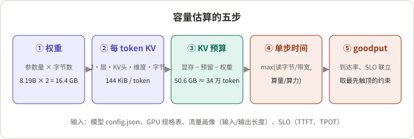
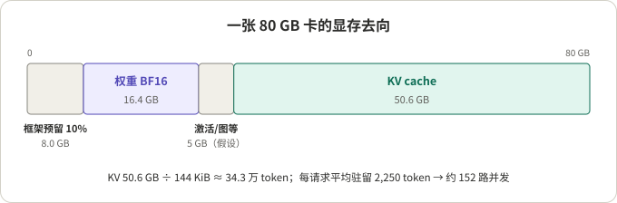
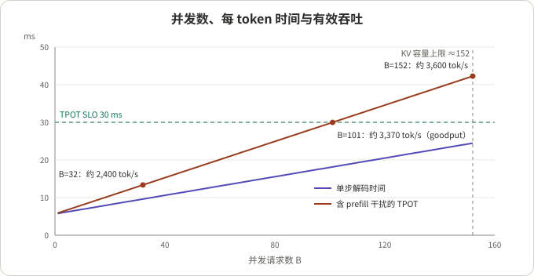
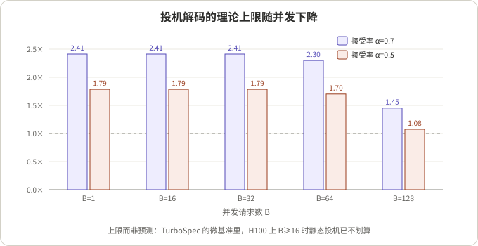

## 摘要

上线一个 LLM 服务前，最常被问的问题是“一张卡能扛多少”。直接压测当然最准，但在选型、报预算、比较方案时，往往需要先有一个能在纸上算出来、每一步都能核对的估计。本文给出一套五步估算法：权重显存、每 token 的 KV cache、KV 预算与并发上限、单步解码时间、在 SLO 约束下的有效吞吐（goodput）。

全文用一个公开模型（Qwen3-8B，参数取自它的 `config.json`）和一张公开规格的卡（H100 SXM 80 GB）做算例，所有数字都能用计算器复核。最后一节用同一套模型解释：为什么投机解码在低负载时很香，负载上来以后可能不划算。

我的看法：手算的价值不在于数字准，而在于告诉你**先撞上的是哪一面墙**（显存、TPOT 还是 prefill 干扰），以及改哪个旋钮最值钱。绝对值要用压测校准。

## 核心结论

- 容量不是一个数，是“在给定 SLO 和流量画像下的 goodput”。同一张卡，提示长度从 2K 变成 8K，按本文模型能服务的请求率会降到约四分之一。
- 解码阶段在中等并发下几乎总是**带宽受限**：每一步要把权重和所有在途请求的 KV cache 读一遍，单步时间近似 `(权重字节 + 并发 × 平均上下文 × 每 token KV 字节) / 有效带宽`。
- 在本文算例里，先触顶的是 TPOT 而不是显存：TPOT ≤ 30 ms 时约 101 路并发、6.7 请求/秒、约 3,370 输出 token/秒；KV 容量要到约 152 路才用满。
- 预填充（prefill）和解码抢同一块 GPU，它对 TPOT 的拖累可以用 `1/(1−ρ)` 近似，ρ 是 prefill 占用率。这正是 DistServe 一类“预填充/解码分离”工作要解决的干扰。
- 投机解码的收益上限随并发下降：当 `并发 × (k+1)` 超过硬件的算力/带宽比，验证步开始变成算力受限。roofline 给的是乐观上限，TurboSpec 的实测里静态投机在 H100、并发 16 以上就已不划算。
- 手算模型漏掉的东西（尾延迟、输出长度方差、调度和内核效率）决定了它只能用来排序方案和定位瓶颈，最终数字要靠压测或模拟器校准。

## 先看懂几个概念

- **Prefill 与 decode**：prefill 一次性处理整段提示并生成第一个 token，算量大、可并行，通常**算力受限**；decode 每步只为每个请求生成一个 token，算量小但要读全部权重和 KV，通常**带宽受限**。
- **TTFT / TPOT**：首 token 延迟（time to first token）和每个输出 token 的间隔（time per output token）。对流式对话，用户感受到的是这两个，而不是总吞吐。
- **KV cache**：注意力层为每个已处理 token 保存的 Key 和 Value。它随上下文长度线性增长，是限制并发的主要显存开销。
- **GQA**（分组查询注意力）：多个 Query 头共享一组 KV 头。Qwen3-8B 是 32 个 Query 头、8 个 KV 头，所以 KV cache 只有标准多头注意力的四分之一。
- **Roofline**：一步计算的耗时近似取 `max(读写字节/带宽, 浮点运算量/算力)`。两者相等时的“算术强度”（FLOP/字节）叫拐点，低于拐点受带宽限制，高于拐点受算力限制。
- **Goodput**：DistServe 把它定义为“在每张 GPU 上，同时满足 TTFT 和 TPOT 约束时能服务的最大请求率”。TurboSpec 用的是另一种口径：单位时间内被接受、进入最终输出的 token 数（被拒绝的草稿 token 不算）。本文前半部分用 DistServe 的口径。

## 1. 五步估算法与算例假设



*图 1：示意图。每一步的输入都来自公开资料，输出喂给下一步。*

算例假设（全部是可替换的参数，不代表任何真实部署）：

| 项目 | 取值 | 来源或理由 |
|---|---|---|
| 模型 | Qwen3-8B，BF16 | `config.json`：36 层，hidden 4096，32 个 Q 头 / 8 个 KV 头，head_dim 128，词表 151,936，`tie_word_embeddings: false` |
| GPU | H100 SXM 80 GB | 规格表：显存 80 GB，带宽 3.35 TB/s，BF16 1,979 TFLOPS（标注为含稀疏） |
| 稠密算力 | ≈ 989 TFLOPS | 推断：规格表的 BF16 数字含 2:4 稀疏，稠密取一半 |
| 有效带宽 | 80%，≈ 2.68 TB/s | 假设 |
| 有效算力 | 50%，≈ 495 TFLOPS | 假设 |
| 流量画像 | 输入 2,000 token，输出 500 token | 假设 |
| SLO | TPOT ≤ 30 ms（均值），TTFT 另行检查 | 假设 |

本文的 GB 指 10⁹ 字节。

## 2. 第一步：权重占多少显存

**结论**：Qwen3-8B 的 BF16 权重约 16.4 GB，每个解码步实际要读约 15.1 GB。

按 `config.json` 逐项算：

```text
每层注意力 = 4096×4096 (Q) + 2×4096×1024 (K,V) + 4096×4096 (O) = 41.9M
每层 MLP   = 3 × 4096 × 12288                                = 151.0M
36 层合计                                                     = 6.95B
词嵌入 + 输出头（不共享）= 2 × 151936 × 4096                    = 1.24B
总计                                                          ≈ 8.19B
```

与模型卡写的 8.2B（非嵌入 6.95B）一致。乘以 2 字节得到 16.4 GB 的驻留显存。解码时词嵌入只按 token 查几行，不需要整表读取，所以每步读的是“非嵌入参数 + 输出头”≈ 7.57B × 2 ≈ 15.1 GB。这个区别在小模型上不可忽略：大词表让嵌入占了总参数的 15%。

## 3. 第二步：每个 token 的 KV cache

**结论**：144 KiB/token。公式只有一行：

```text
KV 字节/token = 2 (K 和 V) × 层数 × KV 头数 × head_dim × 每元素字节
             = 2 × 36 × 8 × 128 × 2 = 147,456 字节 = 144 KiB
```

如果没有 GQA（32 个 KV 头），会是 576 KiB/token，并发上限直接除以 4。换成 FP8 KV cache，则减半到 72 KiB。这一步是决定并发上限最敏感的参数，所以读模型配置时最先看 `num_key_value_heads`。

## 4. 第三步：KV 预算和并发上限

**结论**：约 50.6 GB 的 KV 预算，能放约 34 万个 token，对应约 152 路并发。



*图 2：算例。框架预留 10% 和 5 GB 的激活、CUDA graph 等开销是假设值，实际取决于推理框架和配置。*

```text
KV 预算   = 80 × 0.9 − 16.4 − 5 ≈ 50.6 GB
KV 容量   = 50.6e9 / 147,456    ≈ 343,000 token
并发上限  = 343,000 / 2,250     ≈ 152 路
```

这里用的是每个请求的**平均驻留长度** 2,000 + 500/2 = 2,250，因为同一时刻在途的请求处在不同的解码进度。分页式 KV 管理（如 vLLM 的块分配）按需分配，平均值是合理近似；但如果框架按最大长度预留，就要用 2,500，上限降到约 137。

## 5. 第四步：单步解码时间

**结论**：在本文算例的整个并发范围内，解码都是带宽受限，单步时间随并发线性增长。

```text
t_step(B) = max( (W_read + B × L_avg × kv) / BW_eff ,  B × 2N_active / F_eff )
```

手算几个点（W_read = 15.1 GB，L_avg = 2,250，kv = 147,456 字节）：

| 并发 B | 读的 KV（GB） | 带宽项（ms） | 算力项（ms） | 单步时间（ms） | 解码吞吐（token/s） |
|---|---|---|---|---|---|
| 1 | 0.3 | 5.8 | 0.03 | 5.8 | 173 |
| 16 | 5.3 | 7.6 | 0.5 | 7.6 | 2,100 |
| 64 | 21.2 | 13.6 | 2.0 | 13.6 | 4,720 |
| 128 | 42.5 | 21.5 | 3.9 | 21.5 | 5,960 |

两点值得注意。第一，B=1 时 5.8 ms 几乎全是读权重，这是单请求延迟的下限。第二，B=128 时读 KV 的字节已经是权重的近 3 倍，**长上下文下的解码瓶颈是 KV，不是权重**；这就是 FP8 KV、KV 压缩这类手段对吞吐有效的原因。

算力项一直很小：B=128 时只有 3.9 ms。有效算力和有效带宽之比约为 495e12 / 2.68e12 ≈ 185 FLOP/字节，而解码在只看权重时的算术强度约等于 B，加上 KV 读取后更低，所以要到很大的批次才会碰到算力墙。

## 6. 第五步：把到达率和 SLO 放进来

**结论**：goodput 由最先触顶的约束决定。在本文算例里是 TPOT，在约 101 路并发、6.7 请求/秒处触顶。

先算 prefill。2,000 token 的提示，线性层算量 `2 × 6.95e9 × 2000 ≈ 27.8 TFLOP`，因果注意力约 `2 × P² × 4096 × 36 ≈ 1.2 TFLOP`，合计约 29 TFLOP，在 495 TFLOPS 上约 **59 ms**。

再把 prefill 和 decode 放在同一张卡上。设到达率 λ、每请求 prefill 时间 t_p、输出 D 个 token、并发 B。GPU 每秒有 `ρ = λ × t_p` 的时间在做 prefill，剩下的时间做解码。稳态时“需要的解码 token 数”等于“能产出的解码 token 数”：

```text
λ × D = B × (1 − λ t_p) / t_step(B)
⇒  λ(B) = B / (D × t_step(B) + B × t_p)
    TPOT  = t_step(B) / (1 − ρ)
    TTFT ≈ t_p / (1 − ρ) + ρ t_p / (2(1 − ρ))     （粗估：把 prefill 当作 M/D/1 排队）
```

这里的 `1/(1−ρ)` 就是 prefill 对解码的干扰：一张卡上 40% 的时间在做 prefill，TPOT 就被拉长 1.67 倍。



*图 3：按上述模型对算例的估算，不是实测。紫线是纯解码的单步时间，红线是计入 prefill 干扰后的 TPOT。*

| 并发 B | 单步（ms） | TPOT（ms） | 请求率 λ（/s） | 输出 token/s | ρ | TTFT（ms） | KV 占用 |
|---|---|---|---|---|---|---|---|
| 16 | 7.6 | 9.5 | 3.37 | 1,684 | 0.20 | 80 | 10% |
| 32 | 9.6 | 13.4 | 4.79 | 2,396 | 0.28 | 93 | 21% |
| 64 | 13.6 | 21.1 | 6.08 | 3,038 | 0.36 | 107 | 42% |
| **101** | **18.2** | **30.0** | **6.74** | **3,369** | **0.39** | **116** | **66%** |
| 128 | 21.5 | 36.5 | 7.02 | 3,508 | 0.41 | 120 | 84% |
| 152 | 24.4 | 42.3 | 7.19 | 3,596 | 0.42 | 123 | ≈100% |

复核 B=101 这一行：`t_step = (15.14 + 101×2250×147456/1e9) / 2.68 ≈ 18.2 ms`；`λ = 101 / (500×0.0182 + 101×0.0586) ≈ 6.74`；`ρ = 6.74×0.0586 ≈ 0.39`；`TPOT = 18.2/0.61 ≈ 30 ms`。

读这张表：从 B=101 加到 152，吞吐只多了 7%，TPOT 却从 30 ms 涨到 42 ms。**饱和吞吐和 SLO 下的 goodput 之间的差，就是“为延迟付出的容量”**。

### 6.1 敏感性：哪个旋钮最值钱

| 变化 | 先触顶的约束 | 并发 | 请求率（/s） | 输出 token/s | TTFT（ms） |
|---|---|---|---|---|---|
| 基线（2K 输入，TPOT 30 ms） | TPOT | 101 | 6.74 | 3,369 | 116 |
| TPOT 放宽到 50 ms | KV 容量 | 152 | 7.19 | 3,596 | 123 |
| TPOT 收紧到 15 ms | TPOT | 38 | 5.13 | 2,567 | 96 |
| FP8 KV cache | TPOT | 136 | 9.07 | 4,534 | 158 |
| 输入 8K | TPOT | 24 | 1.65 | 823 | 564 |
| 输入 8K + FP8 KV | TPOT | 32 | 2.15 | 1,076 | 777 |

从这张表能读出三件事（都是本文模型下的推断）：

1. 放宽 TPOT 换来的容量很少（+7%），因为马上撞上 KV 墙；收紧到 15 ms 则损失约四分之一。
2. FP8 KV 带来 +35%，而且不只是因为能放更多请求：解码每步读的 KV 字节减半，单步更快。代价是精度风险，需要单独评测。
3. 输入变长是最大的变量。8K 输入下 prefill 约 263 ms，ρ 和 KV 同时恶化，goodput 掉到基线的约四分之一，TTFT 也开始接近用户能感知的范围。对长提示业务，前缀缓存和预填充/解码分离比任何解码优化都值钱。

## 7. 投机解码：为什么高负载下可能拖累 goodput

**结论**：投机解码用“多算”换“少读”。只要验证步仍是带宽受限，多验证几个 token 几乎免费；一旦并发足够高让验证步变成算力受限，被拒绝的草稿就是纯浪费。

每步草稿 k 个 token、接受率 α 时，每个请求每步期望产出（含额外的 bonus token），TurboSpec 论文给出的公式是：

```text
l(α, k) = (1 − α^(k+1)) / (1 − α)
α = 0.7, k = 3:  l ≈ 2.53
α = 0.5, k = 3:  l ≈ 1.88
```

验证步要为每个请求处理 k+1 个位置，算术强度从约 B 变成约 B×(k+1)。用第 5 节的 roofline，取 512 token 的短上下文（接近 TurboSpec 微基准的设置），草稿开销取单步的 5%：



*图 4：roofline 模型下的理想上限，不是预测。5% 的草稿开销参照 TurboSpec 报告的 prompt lookup 开销；它报告的 Eagle 草稿开销约为 17.7%。*

- B ≤ 32：`B×(k+1) ≤ 128`，仍在拐点（≈185）以下，验证步和普通步一样快，加速比约等于 `l / 1.05`。
- B = 128：`B×(k+1) = 512`，验证步变成算力受限，从 9.3 ms 涨到 15.7 ms，α=0.5 时上限只剩 1.08 倍。

实测比这个上限悲观得多。TurboSpec（Liu、Stoica、Hao Zhang 等，实现在 vLLM 上）在微基准里报告：H100 上并发达到 16 或以上时，静态投机已不高效；端到端实验中，QPS 16 时固定 k=1 让 Vicuna-7B 的平均延迟从 13.7 s 变成 15.9 s。它的做法是在线估计 goodput（此处指被接受的 token 速率），按负载调节投机长度，高负载时直接关掉投机；低负载时报告了最高 3.16 倍的延迟下降。论文给出的原则是**批处理优先于投机**：批次翻倍，产出 token 也翻倍；投机长度翻倍，产出不一定翻倍。

roofline 和实测的差距来自模型没算的东西：小矩阵乘在实际内核里达不到 50% 的算力效率、草稿模型自身的 prefill 和显存、草稿 token 占用的 KV 槽位，以及调度开销。所以 roofline 在这里的用法是**判断方向**：长上下文、低并发、带宽受限时值得开；短上下文、高并发时要看实测，最好像 TurboSpec 一样按负载自动开关。

## 8. 手算模型漏掉了什么

| 漏掉的因素 | 影响方向 | 怎么补 |
|---|---|---|
| 尾延迟（p99 而非均值） | 高估容量 | SLO 按分位数定义，留 20%–30% 余量后再压测 |
| 输出长度方差 | 高估容量 | Little's law 只对均值成立，长尾输出会长期占 KV |
| 内核效率随批次变化 | 方向不定 | 用实测的 t_step(B) 替换公式里的带宽项 |
| 抢占与重算 | 高估容量 | KV 用满前调度器就开始换出或重算，留出水位 |
| 前缀缓存 | 低估容量 | 有共享系统提示时 prefill 大幅缩短，按命中率折算 t_p |
| MoE、张量并行 | 公式需改 | 读权重按激活专家算，另加跨卡通信项 |
| 指标口径 | 可能被“刷” | 见下文 |

关于口径：Wang 等在《Revisiting Service Level Objectives and System Level Metrics in Large Language Model Serving》中指出两种反直觉现象：故意延迟发送部分 token 可以让按请求计的 SLO 变好看；丢弃已经无望达标的请求可以让系统级指标变好看。他们提出 smooth goodput 来同时刻画用户体验和系统性能。做容量规划时，至少要确认 goodput 的定义里，被丢弃和超时的请求是怎么计的。

如果需要比手算更细但又不想全量压测，可以看两类近期工作。BestServe（Hu 等）用改造过的 roofline 加上 CPU-GPU 调度动态做模拟，在单个 CPU 上几分钟内比较合并部署和分离部署的策略，作者报告预测误差在 20% 以内。Cascade（Adnan 等，UBC、Microsoft Azure Research 与 NVIDIA，2026 年 8 月）则把“距离 SLO 还剩多少时间”作为统一信号，同时驱动请求调度和 KV 在 HBM、DRAM、NVMe 之间的分层放置；作者报告相对 vLLM 默认的先到先服务，goodput 最高提升 2.4 倍、SLO 违约减少 40%。这两个数字都是作者自报。

## 9. 一张可以直接套用的检查单

1. 从 `config.json` 抄出层数、KV 头数、head_dim、词表和是否共享嵌入，算出权重字节和每 token KV 字节。
2. 定流量画像：输入、输出长度的均值和 p95；有没有共享前缀。
3. 定 SLO：TTFT 和 TPOT 各自的分位数目标。
4. 算 KV 预算和并发上限（用平均驻留长度，并注明框架是否按最大长度预留）。
5. 用 roofline 算 t_step(B) 和 t_p，代入 `λ(B) = B / (D·t_step + B·t_p)`，扫 B 找出最先触顶的约束。
6. 做敏感性表：输入长度、KV 精度、SLO 各动一下，看哪个旋钮最值钱。
7. 用一次压测校准 t_step(B) 和 t_p，替换掉假设的效率系数，再出最终数字。

## 总结

容量规划的手算版本只需要两张资料（模型配置和硬件规格表）、一张流量画像和一组 SLO。它的输出不是“能扛多少”的定论，而是一张瓶颈地图：在本文算例里，TPOT 先于显存触顶，prefill 干扰吃掉了约 40% 的时间，长输入比任何参数都更伤容量，投机解码只在低并发下才有明显空间。拿着这张地图去压测，能少跑很多无效的组合。

## 参考资料

- [Qwen3-8B 模型卡](https://huggingface.co/Qwen/Qwen3-8B) 与 [config.json](https://huggingface.co/Qwen/Qwen3-8B/blob/main/config.json)
- [NVIDIA H100 产品规格](https://www.nvidia.com/en-us/data-center/h100/)
- [DistServe: Disaggregating Prefill and Decoding for Goodput-optimized Large Language Model Serving (OSDI 2024, arXiv 2401.09670)](https://arxiv.org/abs/2401.09670)
- [TurboSpec: Closed-loop Speculation Control System for Optimizing LLM Serving Goodput (arXiv 2406.14066)](https://arxiv.org/abs/2406.14066)
- [Revisiting Service Level Objectives and System Level Metrics in Large Language Model Serving (arXiv 2410.14257)](https://arxiv.org/abs/2410.14257)
- [BestServe: Serving Strategies with Optimal Goodput in Collocation and Disaggregation Architectures (arXiv 2506.05871)](https://arxiv.org/abs/2506.05871)
- [Cascade: Exploiting SLO-Aware Latency Budget for Fair and High Goodput LLM Inference Serving (arXiv 2608.06557)](https://arxiv.org/abs/2608.06557)
- [vLLM 引擎参数文档](https://docs.vllm.ai/en/latest/configuration/engine_args.html)

相关阅读：[从 SM100 到 SM90：DeepSeek-V4.1 推理栈逐层拆解]()。

*说明：第 2–7 节的数字全部来自本文的手算模型（效率系数、预留显存和流量画像均为假设），不是任何系统的实测；论文中的数字为作者自报。*
