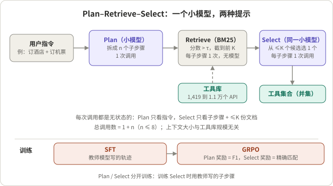
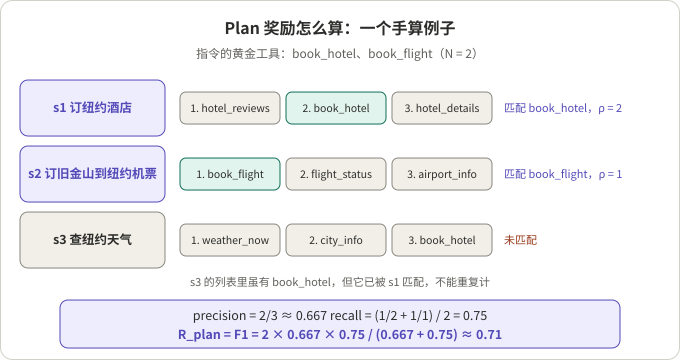
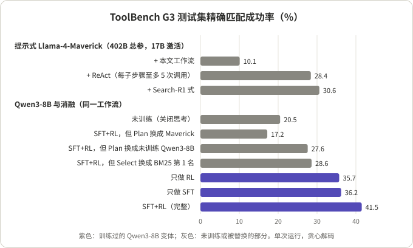

## 摘要

当工具库有上千到上万个 API 时，Agent 不可能把所有工具说明都塞进上下文，「这一步该用哪个工具」就成了执行之前的一道独立决策。论文 *Training Small Language Models for Transferable Tool Selection*（arXiv 2610.31483，2026-10-22）由 Meta 与卡内基梅隆大学的 Zhaoyi Zhou、Akshayaa Magesh、Jeongyeol Kwon、Artem Kuriksha、Daniel Jiang、Andrea Zanette、Ayush Jain 完成。它把这道决策交给一个小模型：先把用户指令拆成子步骤（Plan），每个子步骤用 BM25 检索一次（Retrieve），再从至多 K 个候选里选一个工具（Select）。Qwen3 的 1.7B、4B、8B 先用教师模型写的轨迹做 SFT，再用 GRPO 强化学习，奖励全部由已有的黄金工具集自动算出，不需要额外人工标注。

在 ToolBench G3 测试集上，按「选出的工具集合与黄金集合完全一致」计，8B 模型达到 41.5%，提示式 Llama-4-Maverick 最好的协议是 30.6%。训练好的模型不重训就能用到另外四个基准和另一个检索器上。

我的阅读：这是一篇小而干净的工程论文，价值在于给出了一个可复现的配方（流程、奖励、超参、提示词都写全了），并且通过消融说清楚了增益的主要来源是**训练过的 Plan**，不是模型规模，也不是 RL 本身。需要打折扣的地方是：「超过 402B 模型」比的是提示式基线，而且那个基线同时也是教师；跨域迁移的增益大部分来自 SFT，RL 在新域上只再加 0.5 到 13.6 个点；所有数字是单次运行，模型、数据、代码都没有公开。

## 核心结论

- **判断：值得借鉴的是做法，不是榜单名次。** 把工具选择做成「每次调用无状态、上下文有上限」的小模型子流程，调用数为 1 + n（n 为子步骤数，至多 8），上下文大小与工具库规模无关。
- **增益主要来自训练过的拆解。** 8B 的完整模型是 41.5%；把 Plan 换成 Llama-4-Maverick 掉到 17.2%，换成未训练的 Qwen3-8B 掉到 27.6%；把 Select 换成「取 BM25 第一名」掉到 28.6%。两个阶段都要学，Plan 更关键。
- **SFT 是主力，RL 是加分。** 8B 上 SFT 单独 36.2%，只做 RL 35.7%，两者相当；SFT 之后再 RL 到 41.5%。在四个迁移基准上，SFT 相对未训练模型加了 10.7 到 18.8 个点，RL 再加 1.9 到 6.8 个点（8B）。
- **「超过 Maverick」要看条件。** 同一工作流下是 41.5% 对 10.1%，但 Maverick 没有被微调，又是生成 SFT 数据的教师；它最好的协议（Search-R1 式）是 30.6%。在 TaskBench 上 Maverick 反而高 7.8 个点，不过只有 103 条指令，这个差距大约是 8 条指令。
- **适用前提很窄。** 论文假设每个子步骤恰好对应一个工具、子步骤之间相互独立，只评「选对集合」，不评参数填写和真实执行。有依赖的工具链不在本文范围内。

## 先看懂几个概念

- **工具选择与工具调用。** 工具选择只回答「要用哪些工具」；工具调用还包括填参数、执行、处理返回值。本文只做前者，评测时也只看选出的集合。
- **检索器。** BM25 是词法检索：按查询词在工具文档里出现的情况打分，稀有词权重更高，不需要训练，任何工具库都能直接用。COLT 是稠密检索：用在 ToolBench 上训练过的编码器把指令和工具描述映射到同一向量空间，按相似度排序。检索器只给出相关性排名，不知道任务真正需要哪几个。
- **阈值 τ 与候选上限 K。** 每个子步骤检索后，只保留分数高于 τ 的工具，再截到前 K 个。默认 τ = 3、K = 15（BM25 分数尺度）。K 决定了 Select 阶段要读多少份工具文档。
- **精确匹配成功率。** 一条指令成功，当且仅当选出的工具集合与黄金集合完全相等，多一个、少一个、输出无法解析都算失败。它比检索论文常用的 Recall@K、NDCG@K 严格：那些指标只要求候选列表里「含有」黄金工具。
- **黄金集合的过滤。** ToolBench 的黄金工具来自参考解题轨迹，有些工具在用户指令里根本看不出来，有些是近似重复。论文只保留「仅凭指令就能识别出来」的 (指令, 工具) 对：先用「共享实词」规则筛一遍，剩下的交给教师模型判断。G3 测试集 2,373 条里有 2,124 条（89.5%）在过滤后保留下来，所有 G3 数字都在这个过滤后的集合上算。
- **教师模型与 SFT 热启动。** 直接从基座模型做 RL 起步很慢，因为基座很少能完整走完流程。论文先让 Llama-4-Maverick 生成拆解和选择的理由，用这些轨迹做 SFT，让小模型学会输出格式和基本思路，再做 RL。
- **GRPO。** 一种不需要价值网络的策略梯度方法：同一个提示采样一组回答（这里每组 16 个），用组内奖励的均值和标准差把每个回答的奖励标准化成优势，再做带裁剪和 KL 约束的更新。
- **无状态调用。** 每次调用只包含一个系统提示和一条用户消息，从结构化状态重新渲染，模型看不到不断增长的对话记录。Plan 只看指令，Select 只看当前子步骤和至多 K 个候选。



*图 1：示意图，按论文第 3 节和算法 1 绘制。同一个小模型用两种提示分别承担 Plan 和 Select。*

## 1. 工作流：一个模型、两种提示、1 + n 次调用

**结论：这是一个把上下文成本锁死的设计，代价是只能处理相互独立的子步骤。**

算法很短：

```
输入：指令 x，模型 π，检索器 R，阈值 τ，上限 K
1  π_Plan 把 x 拆成子步骤 s1..sn；T ← ∅
2  对每个 si：
3      R 用 si 给所有工具打分
4      Ci ← 分数 > τ 的工具，截到前 K 个
5      若 Ci 为空，跳过
6      π_Select 从 Ci 里选一个工具 id
7      T ← T ∪ ({id} ∩ Ci)
8  返回 T
```

几个细节值得注意：

- **为什么要先拆。** 检索器拿整条指令打分时，一个请求的词会干扰另一个请求的检索。拆成「订纽约酒店」和「订旧金山到纽约的机票」两条，每条单独检索更准。
- **检索查询直接用子步骤文本。** 模型不另写检索词，每个子步骤也只检索一次。这与 ReAct 式做法不同，后者每轮自己写查询、最多可以搜四次。
- **选择结果和候选集取交集。** `{id} ∩ Ci` 这一步把模型编造的、不在候选里的 id 直接丢掉。
- **Select 提示里保留原始指令。** 附录 D 的 Select 提示开头有一行 `User task: {query}`，用来找回拆解时可能丢掉的细节。

成本上限可以手算：一次 Plan 调用，加上每个子步骤一次 Select 调用，评测时子步骤至多 8 个，所以至多 9 次 LLM 调用；Select 的上下文至多是 K 份工具文档加一条子步骤。工具库从 1,419 个涨到 11,474 个，单次调用的上下文不变。

## 2. 训练：每个阶段做什么、用什么损失

### 2.1 数据构造

全部训练只用 ToolBench G3 的训练集：21,361 条指令、57,836 个 (指令, 黄金工具) 对，平均每条 2.71 个工具。

| 步骤 | 做法 | 留下多少 |
|---|---|---|
| 黄金过滤 | 规则（共享实词）加教师判断「能否仅凭指令识别」 | 54,695 对（94.6%） |
| 拆解 | 教师把指令拆成子步骤，每个子步骤对应一个黄金工具；用不上的黄金工具再删掉 | 再删 1,928 个工具 |
| 丢弃 | 没有黄金工具剩下，或教师三次都没通过输出校验 | 丢 1,268 条（5.9%），剩 20,093 条 |
| 写理由 | Plan 的理由在「已知子步骤」时重写，避免泄露黄金工具；Select 的理由解释为什么在候选里选它 | 19,841 条 Plan 样本、38,293 条 Select 样本 |

理由生成之后有一道校验：如果理由里提到候选集以外的工具，或者泄露了候选编号，就重新生成。

### 2.2 阶段一：SFT

- **训练什么：** 全部参数，Plan 和 Select 两种样本混在一起。
- **标签：** (提示, 理由 + 动作) 对，理由放在 Qwen3 的 `<think>…</think>` 里，后面跟 JSON 动作。
- **损失：** 论文只写「标准 SFT」，即对目标序列做下一个 token 的交叉熵：

```
L_SFT = − Σ_t log π(y_t | prompt, y_<t)
```

  是否只在回答部分计损失，论文没有写。
- **超参：** LLaMA-Factory，DeepSpeed ZeRO-3，bf16；AdamW，学习率 1e-5，余弦调度，3% 线性预热，3 个 epoch，有效批大小 128 条序列，最大长度 4,096（打包），8×A100。

### 2.3 阶段二：GRPO 强化学习

- **训练什么：** 从 SFT 检查点出发，全部参数。为了稳定，Plan 和 Select 拆成两个独立的阶段来训：训练 Select 时用教师写的子步骤，不用模型自己的拆解。每个阶段都是一次无状态调用，有自己的奖励。两个阶段先后训练还是混在同一批里，论文没有写清楚；它只说 RL 的提示集是「每条指令一个 Plan 提示，加上每个教师子步骤一个 Select 提示」。
- **Plan 奖励：** 设黄金工具 N 个，模型拆出 n 个子步骤。按顺序处理每个子步骤，在它的检索结果里从高分往低分找第一个「还没被匹配过」的黄金工具，找到就算匹配，排名记为 ρ。设匹配上的子步骤有 n_cov 个：

```
precision = n_cov / n
recall    = (1/N) · Σ_j 1/ρ_j          # 对匹配上的子步骤求和
R_plan    = F1(precision, recall)
```

  precision 惩罚多余或无效的子步骤，recall 不仅要求覆盖每个黄金工具，还要求它在检索结果里排得靠前。这个奖励是通过检索器算出来的，所以模型学到的是「写出能让 BM25 找到正确工具的子步骤」。

- **Select 奖励：** 精确匹配，只有恰好选中这个子步骤的黄金工具才得 1：

```
R_sel = 1[ selected == {g} ]
```

- **GRPO 本身：** 按 GRPO 原始论文（Shao 等，2024）的定义，每个提示采样 G 个回答，优势为 `A_i = (r_i − mean(r)) / std(r)`，再做带裁剪的比率目标并加 KL 惩罚。本文用 VeRL 实现，vLLM 生成样本。
- **超参：** 学习率 1e-6，恒定；300 步；每批 64 个提示；每个提示 16 个样本；采样温度 0.9；KL 系数 0.001；每批更新 1 次；提示和生成各至多 4,096 token；8×A100。三个规模用同一套超参。
- **没有给出的：** 格式错误时训练奖励记多少（评测时算失败），以及 Plan 与 Select 各训了多少步。



*图 2：示意图，例子是我编的，算法按论文 3.3 节的定义。s1 在第 2 名找到 book_hotel，s2 在第 1 名找到 book_flight，s3 的列表里虽然有 book_hotel，但它已经被 s1 匹配了，所以 s3 未匹配。precision = 2/3，recall = (1/2 + 1) / 2 = 0.75，F1 约 0.71。*

## 3. 结果：完整表格

### 3.1 ToolBench G3（训练域）

测试集 2,124 条指令，工具库 1,419 个 API，BM25，τ = 3，K = 15。所有模型都用贪心解码。

| 方法 | 成功率（%） |
|---|---|
| Llama-4-Maverick（提示式）+ ReAct | 28.4 |
| Llama-4-Maverick + 层级搜索（AnyTool 式） | 8.6 |
| Llama-4-Maverick + Search-R1 式 | 30.6 |
| Llama-4-Maverick + 本文工作流 | 10.1 |
| Qwen3-1.7B（SFT+RL）+ 本文工作流 | 37.6 |
| Qwen3-4B（SFT+RL）+ 本文工作流 | 40.3 |
| Qwen3-8B（SFT+RL）+ 本文工作流 | 41.5 |

Llama-4-Maverick 是 128 个专家的 MoE，总参数 402B，激活参数 17B。论文自己也指出，按激活参数算，它只是 8B 模型的两倍左右。

### 3.2 迁移到新工具库

同一组检查点，不重训，直接在四个基准上评测。ToolBench G2 是同一 RapidAPI 体系里更大的切分（11,474 个工具，约 9% 与 G3 重叠，过滤后 7,238 条）；Gorilla（598 条，三个模型库）和 CRAFT（654 条，数学、表格、视觉问答）都是每条只有一个黄金工具，因此不需要 Plan，主要考 Select；TaskBench（103 条，三个子集，各自 23 到 40 个工具，平均每条 2.6 个工具）同时考 Plan 和 Select。后三个基准用原始黄金标签，不做过滤。

| 方法 | ToolBench G2 | Gorilla | CRAFT | TaskBench |
|---|---|---|---|---|
| Maverick + ReAct | 15.6 | 16.0 | 18.0 | 60.2 |
| Maverick + Search-R1 式 | 20.8 | 15.9 | 41.0 | **80.6** |
| Maverick + 本文工作流 | 4.4 | 9.2 | 47.9 | 36.9 |
| Qwen3-1.7B 未训练 | 0.9 | 5.5 | 44.8 | 5.8 |
| Qwen3-4B 未训练 | 4.4 | 8.7 | 49.7 | 45.6 |
| Qwen3-8B 未训练 | 11.2 | 8.0 | 53.4 | 55.3 |
| Qwen3-1.7B SFT | 21.8 | 17.6 | 64.7 | 54.4 |
| Qwen3-4B SFT | 23.0 | 14.5 | 65.9 | 59.2 |
| Qwen3-8B SFT | 23.9 | 26.8 | 66.4 | 66.0 |
| Qwen3-1.7B SFT+RL | 23.7 | 21.2 | 67.9 | 63.1 |
| Qwen3-4B SFT+RL | 23.5 | 19.7 | 68.2 | 72.8 |
| Qwen3-8B SFT+RL | **25.8** | **29.9** | **69.0** | 72.8 |

我从这张表读出三点：

- **G2 的绝对值很低。** 训练域 G3 上 8B 是 41.5%，G2 上只有 25.8%。论文的解释是工具库大了 8 倍，干扰项更多，黄金工具在 BM25 里排得更靠后。
- **CRAFT 上未训练的小模型已经赢了。** 未训练的 Qwen3-8B 用本文工作流是 53.4%，高于 Maverick 用同一工作流的 47.9%。这说明在单工具、候选少的设定里，Select 本身不难，难的是多工具指令的拆解。
- **TaskBench 的差距要看样本量。** 72.8% 对应 75/103，80.6% 对应 83/103，相差 8 条指令。按二项分布手算，两个比例各自的标准误约 4.4 和 3.9 个点，差值约为合并标准误的 1.3 倍，单次运行下谈不上显著。论文把它解释为「Plan 需要一些领域知识」，这是合理的推测，但证据不强。

### 3.3 换检索器

把 BM25 换成 COLT（一个在 ToolBench G3 上训练过的稠密检索器），阈值改为 τ = 0.6，K 不变，检查点和提示都不变，在 G3 上三个规模的成功率都上升。论文正文没有给出具体数字，只有柱状图，所以这里不引用数值。需要注意的是，这个实验只在训练域 G3 上做，而 COLT 本身就是为 G3 训练的；「新域 + 新检索器」同时变化的情况没有测。

## 4. 增益到底来自哪里

**结论：Plan 的训练是第一位的，Select 的训练是第二位的，RL 在 SFT 之上加分但不是主因。**



*图 3：根据论文表 1 和图 5 重绘，都是 8B 检查点或 Maverick 在 G3 测试集上的结果。*

| 对照 | 成功率（%） | 我的读法 |
|---|---|---|
| 完整 SFT+RL（8B） | 41.5 | 基准 |
| Plan 换成 Llama-4-Maverick | 17.2 | 大模型做拆解反而最差：它的子步骤不是为 BM25 写的 |
| Plan 换成未训练 Qwen3-8B | 27.6 | 拆解训练贡献约 14 个点 |
| Select 换成 BM25 第 1 名 | 28.6 | 选择训练贡献约 13 个点 |
| 只做 SFT | 36.2 | |
| 只做 RL（从基座开始） | 35.7 | 与只做 SFT 相当 |
| 未训练基座（关闭思考） | 20.5 | |
| K 从 5 到 30 | 约 38 到 44 | K = 20 之后不再上升，默认 15 |

几点判断：

- **「训练比规模重要」这句话对 Plan 成立。** Maverick 当 Plan 只有 17.2%，比未训练的 Qwen3-8B 还低 10 个点。我的推断是，Plan 奖励通过 BM25 计算，训练过的模型学会了写「BM25 友好」的子步骤（用词贴近工具文档）；Maverick 写的子步骤更自然，但不一定命中文档里的词。这也意味着 Plan 学到的东西和训练时的检索器有一定绑定，换成 COLT 后仍然变好，说明绑定没有强到破坏迁移。
- **RL 的边际贡献在训练域上是 5.3 个点。** 2,124 条样本下，40% 左右的成功率标准误约 1.1 个点，这个差距是真实的。但只做 RL 与只做 SFT 几乎一样，说明 SFT 的作用主要是让 RL 从一个更好的起点出发。
- **在迁移基准上，SFT 才是主力。** 以 8B 为例，SFT 相对未训练模型在 G2、Gorilla、CRAFT、TaskBench 上分别加了 12.7、18.8、13.0、10.7 个点，RL 再加 1.9、3.1、2.6、6.8 个点。4B 在 G2 上 RL 只加 0.5 个点。

## 5. 文字与表格的核对

- **单位。** 正文说「ReAct 比本文工作流高 18%」「学到的 Select 比取第一名高约 13%」，按表格算分别是 28.4 − 10.1 = 18.3 和 41.5 − 28.6 = 12.9，都是百分点，不是相对百分比。
- **「超过 402B 模型」。** 比的是提示式、少样本、贪心解码的 Maverick，没有给 Maverick 同等的微调；Maverick 同时是生成 SFT 数据和过滤黄金集的教师。按激活参数是 17B 对 8B。TaskBench 上 Maverick 更高，论文正文有承认，摘要没有提。
- **基座对比不完全公平。** 未训练模型在评测时关闭了思考模式（因为原生思考常常耗尽生成预算），训练后的模型开启思考。「Base 到 SFT」的增益里有一部分可能来自这一差别，论文没有拆开。
- **单次运行。** 附录说同一检查点重复跑会有一到两条指令的差异，所有数字都没有置信区间。
- **评测集合被过滤过。** G3、G2 的数字都在教师过滤后的黄金集合上算，约 10% 到 12% 的测试指令被删掉。被删的恰好是黄金工具无法从指令里识别的那部分，所以过滤后的任务比原始 ToolBench 更「干净」，绝对值不能和其他论文的 ToolBench 数字直接比。
- **没有公开产物。** 附录 C 写明整理后的黄金集、SFT 轨迹、检查点和代码都不发布，只给出复现所需的提示词、超参和软件版本。

## 6. 什么时候值得把「选哪个」拆给小模型

**结论：工具多、调用频繁、子任务相互独立时值得拆；工具少、步骤有依赖、拆解需要领域知识时不值得。**

| 情形 | 拆还是不拆 | 前提或理由 |
|---|---|---|
| 工具库上千个，主模型上下文装不下 | 拆 | 本文的核心设定；Select 上下文至多 K 份文档 |
| 工具选择在每轮请求的关键路径上，调用量大 | 拆 | 1 + n 次 8B 调用，可以本地部署；前提是有黄金工具集可用于训练 |
| 有现成的轨迹日志，能还原出「这条指令用了哪些工具」 | 拆 | 奖励全部由黄金集合自动算出，不需要额外标注；但要先像本文一样过滤掉「从指令看不出来」的工具 |
| 工具只有几十个，能直接放进上下文 | 不拆 | 拆出去只增加一次调用和一个失败点 |
| 后一步的工具取决于前一步的返回值 | 不拆，或换方法 | 本文假设子步骤独立，Select 看不到前一步的结果 |
| 拆解需要领域知识（TaskBench 式） | 谨慎 | 论文自己在这里输给了不拆解的 Search-R1 式大模型 |
| 需要同时决定参数和是否调用 | 不够 | 本文只评选对集合，不评参数、不执行 |

比较时要注意的口径：

- **成本口径。** 论文没有报告延迟、吞吐或 token 数，只能从结构推算调用次数。ReAct 式每个子步骤至多 5 次调用，本文是 1 次；但每次调用的生成长度（含 `<think>`）没有给出。
- **对一个流式语音 Agent 来说**，工具选择通常位于用户说完到 Agent 开口之间的关键路径上。我的推断：1 + n 次串行的 8B 调用可以把 Select 并行到各子步骤上（它们本来就相互独立），关键路径缩短为 Plan 一次加 Select 一次；论文没有讨论这一点，也没有测量。

可以直接借用的做法：

- **无状态、可重渲染的调用。** 每次调用只放必要信息，上下文有明确上限。这与「每一步只给 Agent 看它需要的」思路一致，也适用于从大量规则或指南里挑出当前适用的几条，参见[Parlant 的新方向：从 guideline 到统一 Rule]()里的分层匹配。
- **通过下游组件算奖励。** Plan 奖励不比较子步骤文本，而是看它能否让检索器把正确工具排到前面。凡是「LLM 输出喂给一个固定组件」的场景，都可以用这种方式绕开对中间产物的人工标注。
- **候选集取交集。** `{id} ∩ Ci` 一行代码就消除了编造工具名的问题。
- **先过滤标签再训练。** 从轨迹里还原出的「黄金工具」并不都是指令要求的。不先清理，模型会被训练成去选用户没要的东西。
- **用最严格的指标。** 只看集合是否完全相等，多选和漏选都算错，比 Recall@K 更接近真实执行时的代价。

## 总结

这篇论文回答了一个具体的问题：大工具库下的工具选择，能不能从提示一个大模型，改成训练一个小模型。在它设定的范围内（子步骤独立、每步一个工具、只评选择），答案是可以，8B 甚至 1.7B 都能超过提示式的 Maverick。消融显示，主要的增益来自训练过的拆解，而且拆解是围绕检索器学出来的。需要保留的是：对照基线没有微调，迁移增益大多来自 SFT，TaskBench 样本太小，产物没有公开。对做 Agent 运行时的人，更有用的是它的结构：无状态调用、上下文有上限、奖励由下游组件自动计算。

## 参考资料

- Zhou 等，[Training Small Language Models for Transferable Tool Selection](https://arxiv.org/abs/2610.31483)，arXiv 2610.31483，2026（[PDF](https://arxiv.org/pdf/2610.31483)）
- Qin 等，[ToolLLM: Facilitating Large Language Models to Master 16000+ Real-world APIs](https://github.com/OpenBMB/ToolBench)，ICLR 2024（ToolBench）
- Qu 等，Towards Completeness-Oriented Tool Retrieval for Large Language Models，CIKM 2024（COLT，[检查点](https://huggingface.co/Tool-COLT/contriever-base-msmarco-v1-ToolBenchG3)）
- Shao 等，[DeepSeekMath](https://arxiv.org/abs/2402.03300)，arXiv 2402.03300，2024（GRPO）
- Jin 等，[Search-R1](https://openreview.net/forum?id=Rwhi91ideu)，COLM 2025
- Shi 等，[Retrieval Models Aren't Tool-Savvy](https://aclanthology.org/2025.findings-acl.1258/)，Findings of ACL 2025（ToolRet，提供 Gorilla、CRAFT、TaskBench 的统一格式）

**待核对：** ① 论文说过滤后的黄金集合「同时用于训练和评测」，但拆解阶段又删掉了 1,928 个教师认为不必要的黄金工具（附录 A.2 只在训练数据统计里提到），这一步是否也作用于测试集，正文没有写明；② 图 4（换检索器）和图 5b（K 的扫描）只有柱状图和折线图，具体数值未在正文给出，上文 K 的区间是从坐标轴读出的近似值。

*说明：所有成功率来自论文表 1、表 2 和图 5，均为作者报告的单次运行结果，我没有复现；标准误、百分点差值和指令条数为我按论文给出的样本量手算。*
