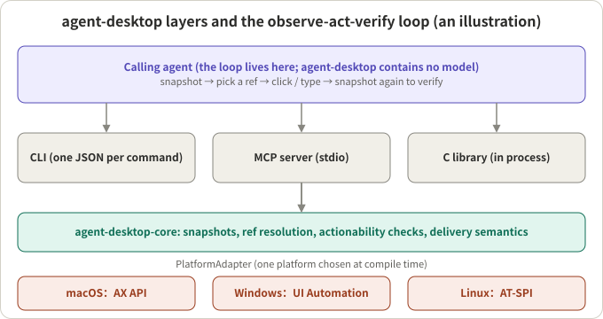
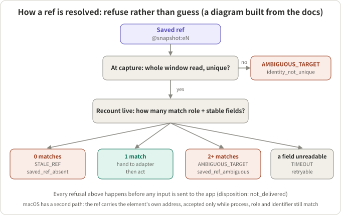
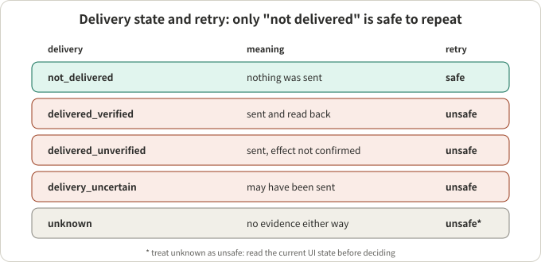

## Summary

[agent-desktop](https://github.com/vercel-labs/agent-desktop) is an open-source project from Vercel Labs (Apache-2.0, a Rust workspace) that lets an AI agent see and operate desktop apps on macOS, Windows and Linux. It uses neither screenshots nor pixel matching: it reads the operating system's accessibility tree and turns the UI into JSON with a ref on every actionable element; the agent clicks or types on a ref, then reads again to verify. The project is explicit that the loop lives in the caller and there is no model inside. The GitHub page I read showed 18.9k stars and 1.4k forks; it was number 2 on Trendshift's weekly list and appears in several November trending round-ups, so I count it among this week's fastest-growing open-source projects (I could not obtain the exact weekly gain; see the note at the end).

My reading: the most valuable part is not "yet another computer-use tool" but that it makes a commonly ignored problem the centre of the design: **between the moment the agent sees the UI and the moment it acts, the UI may have changed**. Its answer is a set of "refuse rather than guess" mechanisms: a ref belongs to one snapshot, resolution re-identifies the element from evidence, evidence has three states (known, absent, unknown), and every error says whether input was sent and whether repeating is safe. These ideas carry over to any agent runtime that touches the outside world. A caveat: I read the docs, README and skill files and did not run it on a real desktop, so I make no judgement on performance, stability or coverage across applications.

## Key conclusions

- Shape: a CLI (one JSON per command), an MCP server (`agent-desktop mcp`, one tool per command) and a C library, sharing one core that talks to macOS AX, Windows UI Automation and Linux AT-SPI through a `PlatformAdapter` interface.
- Observation is the accessibility tree, not screenshots: the agent gets structured nodes with role, name and available actions, and each actionable node has a ref. Dense apps are mapped with a skeleton first and then drilled into.
- Ref resolution is the heart of it: a ref belongs to one snapshot; before acting, the live window is recounted for "role + all stable fields"; exactly one match proceeds, zero is `STALE_REF`, two or more is `AMBIGUOUS_TARGET`, an unreadable field is a retryable `TIMEOUT`.
- Delivery semantics: every result says whether input reached the app and whether repeating is safe; only "not delivered" is safe to retry. That carries far more information than success or failure.
- Headless by default: only accessibility APIs, no focus stealing, no mouse, no clipboard; with no semantic path it fails instead of silently switching to physical input.
- Cautions: it depends on how well the app implements accessibility (my inference); snapshots and screenshots can hold private content; macOS needs the Accessibility permission; I have not run it.

## A few concepts first

**Accessibility tree.** The structure the operating system exposes for assistive technology such as screen readers: which controls a window has, their roles (button, text field, list item), names and actions. The three systems have different interfaces: AX on macOS, UI Automation on Windows, AT-SPI on Linux. agent-desktop translates them into one vocabulary of roles and states.

**Snapshot and ref.** A snapshot is one observation of the accessibility tree at a point in time. Each actionable node gets a ref such as `@s8f3k2p9:e8`: the snapshot ID, then the node number. The README says a bare `@e8` is rejected (`INVALID_ARGS`).

A trimmed snapshot from the README:

```json
{
  "ok": true, "command": "snapshot",
  "data": {
    "app": "Finder", "snapshot_id": "s8f3k2p9", "ref_count": 59, "complete": true,
    "tree": { "role": "window", "name": "Downloads", "children": [
      { "role": "treeitem", "name": "Documents",
        "ref_id": "@s8f3k2p9:e8", "available_actions": ["Click"] } ] }
  }
}
```

**Observe-act-verify loop.** `snapshot`, then `click` on a ref, then `snapshot` again to see the result. The loop is written in the calling agent; agent-desktop only provides tools.



*Figure 1: An illustration based on the README's architecture description. The caller enters through the CLI, MCP or the C library into one core, which reaches one platform implementation chosen at compile time through `PlatformAdapter`.*

**Tri-state evidence.** In the project's glossary (CONCEPTS.md), every property an adapter reads is `Known`, `Absent` (asked and it does not have it) or `Unknown` (the read failed or cannot be trusted), and the three are never collapsed into two. The stated reason is concrete: `Absent` is an answer, `Unknown` is the lack of one; flattening to a boolean is safe only in positive position, and when negated it silently rewrites "I could not tell" as "definitely not".

**Delivery semantics.** When an action fails or is uncertain: did the input actually reach the application? That decides whether retrying is safe: an action that never reached the target can be retried freely; one that may have landed can cause a duplicate.

## Overall design: one core, adapters, three entry points

- A Cargo workspace: `core`, `macos`, `windows`, `linux`, `ffi` and the CLI entry (the commit I read is `b43ac4f` from 2026-11-05, workspace version 1.2.0).
- The core touches the OS only through `PlatformAdapter`; each binary is built for one platform only.
- 60 command names, of which 56 are operational; `key-down`, `key-up`, `mouse-down` and `mouse-up` refuse to run until a daemon that can release held input exists.
- Command groups: observe (`snapshot`, `find`, `get`, `is`, `screenshot`, `list-surfaces`), act on a ref (`click`, `type`, `set-value`, `select`, `toggle`, `scroll`, and more), keyboard and mouse, apps and windows, notifications, clipboard, `wait`, sessions and tracing, system.
- Platform requirements: macOS 13+, Windows 10 1809+, Ubuntu 24.04+ (X11 or Wayland).

## Q1: How does a ref guarantee that the thing clicked is the thing seen?

**Conclusion: uniqueness is proven at capture and recounted before acting; any uncertainty means refusal.** This is the part I think is most worth reading.

The rules in the README and docs can be arranged as a flow:



*Figure 2: A diagram built from CONCEPTS.md, `docs/json-output.md` and the skill file. macOS has a second path in which the ref carries the element's own address.*

Step by step:

1. **Uniqueness must be proven at capture.** On Windows and Linux (and on macOS when no element address is available), a ref is usable only if the whole window was read completely at capture and exactly one element matched its role plus all stable fields (native id, stable name, description). If the window could not be read whole, or an identical "twin" exists, the ref is `AMBIGUOUS_TARGET` from the start (`details.kind: identity_not_unique`), and nothing is read from the application.
2. **Recount before acting.** At resolution time the same predicate is counted over the live window: zero is `STALE_REF` (`saved_ref_absent`, the element is gone); exactly one proceeds; two or more is `AMBIGUOUS_TARGET` (`saved_ref_ambiguous`, an identical element appeared after capture).
3. **An unreadable field is not a match.** If a field in the live read fails, the result is a retryable `TIMEOUT` (`resolution_identity_unknown`), neither match nor mismatch. This follows directly from tri-state evidence.
4. **macOS's other path.** The ref stores the element's own accessibility address (`retained_object`) and later turns it back into that element without searching; it is accepted only while the element is alive and its process, role and recorded identifier still match, so identical twins each keep their own ref.
5. **Values and positions are never identity.** The glossary says mutable control values (such as text-field content, including value text promoted into an accessible name) and bounds cannot identify an element by themselves.

A few details about time windows:

- **Window identity.** Window handles get recycled by the OS, so identity is "handle + process-generation token" (derived from the owning process's creation time); the title may change and is not identity. The tokens differ by platform (Windows: handle plus creation time; macOS: window number plus process start time; Linux: X11 client id plus boot-id-qualified process start time).
- **Re-check before each write.** The docs stress that if check and act cannot be one atomic operation, identity must be corroborated again immediately before each write, and the action's own success check must be identity-qualified too; otherwise a handle recycled in the gap reports success over the wrong resource.
- **Identity sandwich.** Around a long-running capture call, identity is checked before and after, so a mid-capture reorder discards the bytes instead of returning them under the original target's identity.

My inference: together these rules treat time-of-check to time-of-use (TOCTOU) as a first-class problem. The cost is also clear: on a page with several identical buttons (say a "Delete" on every row), those refs are simply refused on Windows and Linux. The documented ways out are to act on a control that is unique in the container, or to click by coordinates with `--headed mouse-click --xy` (which takes the foreground and is unavailable on a Linux Wayland session).

## Q2: When an action fails, how do you know whether to retry?

**Conclusion: every result carries a `disposition` that states whether the input was sent and whether repeating is safe.**



*Figure 3: Based on `docs/json-output.md`. `retry` follows from `delivery`: only `not_delivered` is `safe`; every other known value is `unsafe`.*

Points:

- `delivery` has five values: `unknown`, `not_delivered`, `delivery_uncertain`, `delivered_unverified`, `delivered_verified`.
- `ok: true` only means the command returned a delivered or already-satisfied result, **not that the effect in the application was verified**. `delivered_verified` appears only after the adapter read back the postcondition it names.
- Read-only commands and argument errors send no input, so their errors are always `not_delivered` with `safe`.
- A `TIMEOUT` on an operation that may already have landed keeps `unknown`; the docs say to treat it as not safe to retry automatically.
- Rules from the skill file: retry or substitute an action only when `disposition.retry` is `safe`; otherwise read the live state (`get`, `is`, or a fresh snapshot) and decide from that; branch on `error.code` and `error.disposition`, not on message text, which can change.
- Why it matters: a repeated `toggle` undoes itself, and repeated typing or submit can happen twice.
- Write and read paths use different classification tables: the glossary points out that the retryable transport codes of the read table are exactly the codes a write may already have delivered under, so reusing it would authorise a double dispatch.
- A Windows detail: the injected-event count from `SendInput` is not treated as delivery evidence, because the API reports success both when input is delivered and when it is blocked; physical steps therefore report `delivered_unverified`.

My inference: for an agent that presses "Submit" or "Delete", this field matters far more than success or failure, because the default behaviour of most agent frameworks is "retry on failure".

## Q3: What does it check before acting?

**Conclusion: a battery of actionability checks, an auto-wait of up to 5 seconds by default, and different failure directions for insufficient evidence.**

- **Actionability battery.** Before the adapter dispatches, the core runs live checks on the resolved element: visible, stable, enabled, supported action, policy, editable, receives events.
- **Auto-wait.** A default-on bounded poll until the target becomes actionable; the budget is 5000 ms (`type` adds 30 ms per character), after which it fails with `TIMEOUT`; `--timeout-ms 0` restores act-immediately. Transient checks (visible, stable, enabled, occlusion) are polled; terminal checks (supported action, policy, editability) fail fast.
- **Direction of the occlusion check.** A three-way probe: reaches the target, intercepted by an element, or unknown. The occlusion gate fails open on unknown, because missing evidence should not falsely fail an action; "intercepted" requires positive evidence. This is the opposite of ref resolution, which refuses on unknown; each has its reason: one protects the user experience before an action, the other protects identity.
- **Interaction lease.** Machine-wide exclusivity over desktop input, held by one process at a time so concurrent callers cannot interleave synthetic input. It covers dispatch only, not the waiting, otherwise one long wait would serialise every caller on the machine; whatever was resolved while waiting is re-resolved once the lease is held, which the docs call the correctness boundary, not redundant work.
- **Headless by default.** Ref actions use semantic accessibility operations: no focus stealing, no cursor movement, no synthesised keys, no clipboard; with no semantic path they fail with a structured error. `--headed` is what permits physical input. The skill file adds: do not switch to headed mode to recover from a headless failure unless the user explicitly permits it.
- **Secure fields.** For fields the platform marks as secret, the read side withholds the value; the write side may write but never echoes the attempted or observed value in steps, messages or details, and reports `verified: None` when a re-read cannot confirm.
- **Protected processes.** Session-critical OS processes are refused on every entry point, with `INVALID_ARGS` and `not_delivered`.

## Q4: How does it cope with large, messy UIs?

**Conclusion: incompleteness is first-class and must be marked.**

- **Skeleton and drill-down.** Dense apps start with `snapshot --skeleton ... -i --compact` for a shallow map, cut branches carry `children_count`, and `--root @ref` then drills into one region.
- **Partial observation.** A snapshot that runs out of time does not discard what it saw. Since version 2.2 of the JSON contract, budget exhaustion returns `ok: true`, `complete: false`, `truncated: true` and the number of nodes observed, and every node whose descendants were cut carries `subtree_truncated: true`, so a reader can walk from the root to each boundary. A depth clamp knows how many children it skipped; budget exhaustion does not, and only marks the node.
- **Only a full snapshot may be partial.** A drill-down replaces refs inside an existing map, so it requires a complete observation and fails instead of destroying descendants it cannot re-allocate.
- **Web wrappers.** Chromium, Electron and WebView produce long chains of anonymous containers. The glossary says containers with no name, value or developer identifier and no meaningful action consume raw depth but not logical depth, otherwise the same app understates its reachable content by an order of magnitude. On Windows this skip applies only to windows detected as Chromium, so the anonymous containers that native stacks are full of are not skipped by mistake.
- **Read `complete`.** If a window cannot be read whole in time, the snapshot's refs cannot be proven unique; it carries `identity_unproven: true` and its refs are refused on Windows and Linux; the fix is to retake it with a larger `--timeout-ms`.

## Is it worth borrowing? An engineering view

**Where it pays off (with preconditions).**

- **Finishing tasks inside native desktop apps whose accessibility implementation is reasonably complete.** Precondition: the app exposes meaningful roles, names and actions.
- **Wanting every agent step to be auditable.** Precondition: willingness to use sessions and tracing; the trace is one append-only JSONL file per process with a schema version, a deterministic merge order, and a reader that tolerates truncated tails and corrupt lines.
- **Plugging desktop control into an existing agent framework.** Precondition: accepting the CLI or MCP form; `agent-desktop skills get desktop` prints a usage guide matching the binary's version.

**Where it may not (my inference, not a project claim).**

- Apps with poor accessibility information, for example programs that draw their UI on a canvas: there are no nodes to read, and you depend on the documented coordinate fallback (`Coordinate Fallback`, which must be opted into explicitly).
- Latency-critical flows: every step is "snapshot, act, snapshot", each returning a JSON tree whose token and time cost depends on the app; the docs mitigate this with skeleton plus drill-down, but I have not measured real numbers.
- UIs with many identical controls (see Q1).

**Comparison caveat.** This kind of tool is not compared at the same level as screenshot-based computer use: the accessibility tree gives structure and semantics but depends on the app's implementation; screenshots give appearance but need a vision model to locate things. They can complement each other, and the project itself keeps `screenshot` and a coordinate fallback.

**Ideas that can be borrowed directly.**

- Treat the gap between observation and action as a formal problem: re-verify the target before acting instead of trusting the last observation.
- Tri-state evidence: separate "confirmed absent" from "could not read"; be especially careful with negated checks.
- Put "was it sent, is retry safe" on every error, and make retry policy depend on it, not on error codes or message text.
- Use different failure-classification tables for write and read paths; never reuse a retry policy across them.
- Mark incomplete results explicitly (`complete`, `subtree_truncated`) instead of leaving callers to guess.
- Least privilege by default: semantic path first, fail if none, and let the user opt in to physical input.
- Make the trace format additive-only, with readers that ignore unknown fields.

## Conclusion

agent-desktop is worth reading because it designs around the fact that, when an agent operates a real application, the UI changes behind its back: identity is re-confirmed from evidence, evidence has three states, actions carry delivery semantics, and incompleteness is marked. You need not use it, but its failure model is a good checklist. What you still have to verify yourself: whether the accessibility tree is good enough on the apps you want to drive, and whether latency and token cost are acceptable.

## References

- [vercel-labs/agent-desktop (GitHub)](https://github.com/vercel-labs/agent-desktop): README, `CONCEPTS.md`, `docs/json-output.md`, `skills/agent-desktop/SKILL.md`; the commit read is `b43ac4f` (2026-11-05)
- [agent-desktop documentation site](https://agent-browser.dev/desktop): the introduction, snapshots-and-refs and errors-and-recovery pages linked from the README (I cited the documents in the repository and did not open the site page by page)
- [Trendshift weekly list](https://trendshift.io/weekly): used to judge this week's popularity; the page shows no weekly-gain numbers

*Note: every detail comes from reading the repository files above; I did not run it on a real desktop. The star and fork figures are what I read on the GitHub page; "my inference" marks personal judgement. The basis for calling it one of this week's fastest-growing open-source projects is third-party rankings; I could not reach GitHub's Trending page directly to check the weekly gain.*
