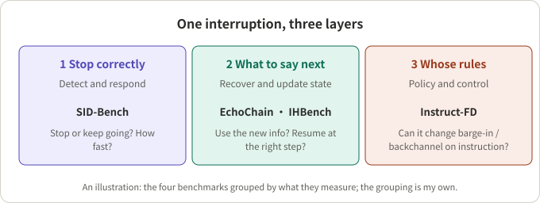
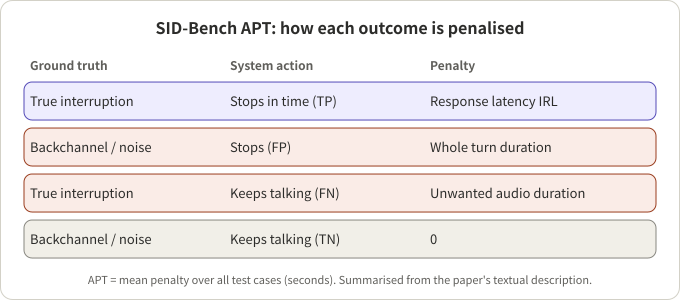
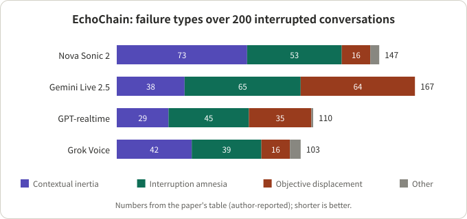

## Summary

Barge-in is when the user speaks while the system is still talking. Early evaluations asked one question: did the system stop, and how fast? Several 2026 benchmarks split the problem further: **SID-Bench** (Qwen team) tests whether the system should stop; **EchoChain** (Labelbox) and **IHBench** (Boson AI) test whether what it says afterwards is right; **Instruct-FD** (Boson AI) tests whether it can change its turn-taking behaviour on instruction.

This note reads those four papers closely and then lists the other common interruption and full-duplex test sets in one table (section 6). My reading is that the four benchmarks measure three different layers of interruption handling, so their numbers cannot be compared with each other. For anyone building a voice agent, the second layer deserves the most attention, because state updates after the stop are where users feel the awkwardness.

## Key conclusions

- Interruption handling has at least three layers: detect and stop, recover and update state, follow policy. Each benchmark covers one; none covers all.
- Measuring reaction time alone misses most of the problem. In EchoChain no model passes more than 50% of conversations in full (best 48.5%); in IHBench, continuing a cut-off half-utterance is correct only 7% to 31% of the time for the GPT family.
- Both "recovery" benchmarks rely on LLM judging, but validate it differently: IHBench compares against human annotators; EchoChain uses human-applied rubrics.
- SID-Bench's APT turns false stops and missed stops into one unit, seconds. It is convenient, but the penalty rules are heuristic and the paper leaves correlation with human judgement to future work.
- Other sets (Full-Duplex-Bench v1 to v3, FD-Bench, FLEXI, HumDial, M3-DuplexBench, Duplex Cue) are in section 6; the same system can score very differently under different scoring conventions (M3-DuplexBench example: 42.3% vs 95.0%).
- All results are author-reported, on different targets and protocols. Read them as trends.

## A few concepts first

- **Barge-in**: the user starts speaking while the system is talking. The system must decide whether it is a real interruption or a backchannel ("uh-huh"), a cough, or background noise.
- **VAD** (voice activity detection): looks only at whether there is sound, so it also fires on backchannels and noise. SID-Bench calls such systems "trigger-happy".
- **False stop / missed stop**: stopping when it should have continued (FP), or continuing when it should have stopped (FN). FP wastes a turn; FN makes the user wait through audio they no longer want.
- **State update**: an interruption often carries new information ("wait, make it Friday"). The system has to stop and also reflect that information afterwards.
- **Workflow state machine**: in multi-step tasks (verification, booking) the system is at some step, with some steps done. After an interruption it should return to the right step, not restart or skip.

## 1. The four benchmarks at a glance

*Figure 1: an illustration. The four benchmarks grouped by what they measure; the grouping is my own.*

| Benchmark | Team | Measures | Size | Scoring |
|---|---|---|---|---|
| SID-Bench | Qwen team | Semantic interruption detection | 3,700 clips (about 10 h) | FIR, IRL, APT, computed |
| EchoChain | Labelbox | State-update reasoning after interruption | 200 interrupted conversations | Human rubrics, pass rates |
| IHBench | Boson AI | Workflow recovery after interruption | 45 conversations, 428 interruption points | LLM judge, checked against humans |
| Instruct-FD | Boson AI | Instructed turn-taking control | 912 cases, 29 scenarios | LLM judge, checked against humans |

## 2. SID-Bench: should it stop?

**Verdict**: it makes "stopping correctly" computable and ships a small reference model.

- **Data**: Chinese and English recordings from a professional data vendor plus an English subset of Switchboard. Per language: 500 "interruption at the start", 600 "interruption in the middle", 500 "uninterrupted"; plus 200 environmental-noise and 300 silence clips. Total: 2×(500+600+500)+500 = 3,700.
- **Labels**: an LLM inserts a break point at the first substantive word; Kaldi forced alignment gives the start of that word's first phoneme as the ground-truth interruption time.
- **Metrics**: FIR (false interruption rate), IRL (interruption response latency), APT (average penalty time). APT is explained in Figure 2.

*Figure 2: summarised from the paper's textual description; unit is seconds.*

Average results from the paper's Table II (author-reported):

| System | Avg IRL (s) | Avg FIR | Avg APT (s) |
|---|---|---|---|
| FSMN-VAD | 0 | 0.840 | 3.627 |
| Freeze-Omni (Silero VAD) | 0.173 | 0.532 | 2.129 |
| FireRedChat (pVAD) | 1.045 | 0.476 | 2.627 |
| Moshi | 2.517 | 0.118 | 3.192 |
| SID-model | 0.389 | 0.124 | 0.711 |

Reading the table: plain VAD reacts fastest but stops on a large share of non-interruptions; Moshi rarely stops falsely but stops slowly. The SID-model feeds an audio encoder into a Qwen3-0.6B LLM that makes an "interrupt / continue" decision, and stops only after three consecutive "interrupt" predictions. It pays about 0.39 s of IRL, but its APT is about a third of the best baseline's.

**Caveats** (stated by the paper or implied by its description):

- Moshi was tested by playing audio at a fixed time during a seeded response, while VAD baselines were scored by onset times, so the protocols are not fully equivalent. Moshi has no Chinese result.
- Labels depend on LLM-generated break points not checked against human annotation; silence clips are synthetic concatenations.
- APT's penalties (e.g. a false stop costs the whole turn) are heuristic; correlation with human judgement is future work.
- Single run, no variance; the SID-model's fine-tuning data size is not given.

## 3. EchoChain: did the update actually happen?

**Verdict**: models mostly hear the interruption but do not use the new information correctly.

- **Design**: a planner model and a user-simulator model generate conversations. User speech is pre-synthesised with cloned voices, so every model hears identical audio. The first exchange is uninterrupted; each later barge-in is injected at a fixed offset from detected assistant speech onset, so timing is the same across models.
- **Metrics**: MPR (share of conversations where every rubric criterion passes) and MCP (share of individual criteria passed).
- **Failure taxonomy**: contextual inertia (acknowledges but content unchanged), interruption amnesia (applies the update, then drops it), objective displacement (answers only the interruption and loses the original task), other.

*Figure 3: redrawn from the paper's table; author-reported numbers, shorter is better.*

| Model | Contextual inertia | Interruption amnesia | Objective displacement | Other | Total failed | MPR (%) | MCP (%) |
|---|---|---|---|---|---|---|---|
| Amazon Nova Sonic 2 | 73 | 53 | 16 | 5 | 147 | 26.5 | 78.1 |
| Gemini Live-2.5-flash-native-audio | 38 | 65 | 64 | 0 | 167 | 16.5 | 64.8 |
| GPT-realtime-2025-08-28 | 29 | 45 | 35 | 1 | 110 | 45.0 | 81.1 |
| Grok Voice Agent | 42 | 39 | 16 | 6 | 103 | 48.5 | 85.5 |

I checked the table by hand: in every row the four categories sum to "Total failed", and (200 − Total failed)/200 equals MPR exactly (Nova: 53/200 = 26.5%). So "Total failed" appears to be the number of failed conversations, each assigned to one category. This is my inference from the table; the text does not spell it out.

One design point worth copying: in 48 sampled conversations, the interrupted versions had 92 failures against 55 for the same content without interruption, about 40% more failures attributable to the interruption ((92−55)/92 ≈ 40.2%). This separates task difficulty from interruption difficulty.

**Limitations** (stated by the paper): only task-relevant interruptions, no backchannels, side speech or noise; fixed offsets may not match natural interruption points; pass/fail rubrics hide severity; only four closed-source models; timing and prosody are not measured.

## 4. IHBench: back to the right step?

**Verdict**: the same "recovery" question, set inside a multi-step workflow, with a measurement of how it degrades as the conversation gets longer.

- **Data**: 45 synthetic conversations over 10 enterprise domains, 428 interruption points, 30.1 messages per conversation on average. Interruption types by share: pushback 24.5%, impatient 19.6%, normal 18.9%, topic switch 17.1%, filler 14.0%, correction 5.8%.
- **Metrics**: task fulfilment (TF) is a comparative LLM-judge win rate between the model's response and a baseline's, with 0.5 meaning parity; recovery quality (RQ) passes only if all 2 to 4 type-specific criteria are met.
- **Judge validation**: a second judge gives Spearman ρ of 0.99 (TF) and 0.95 (RQ); judge–human κ is 0.41 to 0.51, comparable to human–human κ (0.43, 0.40); model rankings agree with humans at ρ = 1.0 on RQ and 0.90 on TF.
- **Configurations**: 27 in total, 17 closed-weight and 10 open-weight.

Main findings (author-reported):

- **Filler is hardest**: after a cut-off "um…", GPT-family models continue the interrupted utterance correctly only 7% to 31% of the time; Gemini 2.5 manages 62% to 68%, while Gemini 3.x falls to 13% to 32%.
- **Later is worse**: TF drops 0.030 per turn on average; open-weight models decline about 3.3× faster than closed-weight ones (−0.053 vs −0.016).
- **Audio never beats text**: some open-weight models score about 8 TF points higher with text input.
- **TF and RQ only partly correlate**: the best on task fulfilment (GPT Realtime 2, 0.728) is not the best on recovery quality (Gemini 2.5 Flash with thinking, 0.704).

**Limitations** (stated by the paper): synthetic, English-only, 10 domains; rubrics inherit generator and judge bias; only response text is judged, not prosody.

## 5. Instruct-FD: whose rules?

**Verdict**: it does not ask how a system interrupts by default, but whether instructions can change it; for most systems they barely do.

- **Behaviours**: proactive (the model acts while the user speaks): backchannel, interrupt, listen. Responsive (the model is speaking and the user overlaps): continue (hold the floor after a short continuer such as "mm-hmm"), acknowledge (yield and adapt to a correction, constraint or redirect).
- **Data**: 29 scenarios (14 proactive, 15 responsive) and 912 test cases from 696 conversations; each conversation is reused under different instructions so only the instruction varies. Cases per instruction: backchannel 120, listen 312, interrupt 120, continue 120, acknowledge 240. Conversations are LLM-generated, TTS-synthesised and ASR-aligned to get ground-truth overlap timestamps.
- **Scoring**: a judge model reads the instruction, a timestamped transcript and a reference transcript, and returns pass or fail. The instruction-adherence score IAS is the mean pass rate for an instruction; sensitivity ΔIAS is IAS with the instruction minus IAS on the same cases without it. The judge agrees with 180 manual annotations at 88.9%; an 11-participant human study reached 89.6% on 1,199 cases.

Overall IAS (author-reported): Gemini 64.4%, PersonaPlex 47.0%, Fun-Audio-Chat 46.2%, MiniCPM-o 36.4%, Moshi 21.1%, Freeze-Omni 10.7%. Per behaviour:

| System | Listen | Backchannel | Interrupt | Continue | Acknowledge |
|---|---|---|---|---|---|
| Freeze-Omni | 7.1 | 0.0 | 5.0 | 40.0 | 9.6 |
| Fun-Audio-Chat | 90.7 | 0.0 | 9.2 | 94.2 | 5.4 |
| Gemini | 72.4 | 50.0 | 5.8 | 71.7 | 86.3 |
| MiniCPM-o | 59.6 | 12.5 | 1.7 | 97.5 | 5.4 |
| Moshi | 12.8 | 1.7 | 11.7 | 88.3 | 12.0 |
| PersonaPlex | 66.7 | 5.8 | 10.0 | 90.0 | 35.8 |

Reading the table: "continue" is at or above 70% for everyone except Freeze-Omni, which suggests many systems simply default to not stopping; "acknowledge" (yield and adapt) is at or below 36% except for Gemini (86.3); "interrupt" never exceeds 12%. Most ΔIAS values are small; the significant gains are few: Gemini on backchannel (+42.5) and acknowledge (+11.7), MiniCPM-o on listen (+10.6), Fun-Audio-Chat on interrupt (+9.2), while Fun-Audio-Chat on acknowledge drops significantly (−11.2). So instructions did not really change behaviour for most systems. The paper also notes that good baseline turn-taking does not guarantee controllability, and that a model can be semantically right but mistimed and fail strict timing criteria.

**Limitations** (stated by the paper): only five instruction types; about two model turns per conversation (user audio is pre-generated and cannot react to the model); English only; GPT-Realtime was excluded because its API needs explicit interruption signals; the judge depends on ASR quality and can misread instructions; backchannel timing shows a mismatch between offline timestamps and human perception.

*Note: this section is based on roughly the first 100,000 characters of the paper's HTML; the last ~20,000 were not read.*

## 6. Other test sets

Beyond the four above, several sets are cited often. The table groups them by what they measure; all numbers come from the respective papers, scales differ, and they cannot be compared across rows.

| Benchmark | Team | Measures | Size and data | Scoring and highlights |
|---|---|---|---|---|
| Full-Duplex-Bench (v1) | NTU, UW, Berkeley et al. | Four turn-taking dimensions: pause handling, backchanneling, turn-taking, interruption | Size not on the abstract page | Automatic, reproducible metrics; specifics not read |
| Full-Duplex-Bench v1.5 | NTU, UW, Berkeley, CMU | Overlap handling: user interruption, user backchannel, talking to others, background speech | 499 synthesised trials: 200 interruptions, 99 backchannels, 100 talking-to-others, 100 background | Behaviour class (respond / resume / uncertain), stop and response latency, prosody; 5 systems |
| Full-Duplex-Bench-v2 | NTU et al. | Multi-turn: an automated examiner pushes staged goals at fast and slow pacing | Four task families: daily, correction, entity tracking, safety | Turn-taking fluency, multi-turn instruction following, task competence; abstract says systems struggle with overlap, handle corrections poorly and lose track of referents |
| Full-Duplex-Bench-v3 | NTU, NVIDIA | Multi-step tool use under real disfluent speech | 100 human recordings, 12 speakers, 4 domains, 5 disfluency types | Tool-selection F1, argument accuracy, Pass@1, latency split; 6 systems |
| FD-Bench | NTU, Alibaba | Interruption handling and response quality | 293 simulated conversations, about 1,200 interruptions, about 40 h | SRR, SIR, EIR, NIR and others; 3 open-source systems |
| FLEXI | Northeastern Univ. et al. | Six scenarios incl. user/model interrupt and user/model backchannel | Synthetic, size not given | Takeover rate, latency and others; 4 systems |
| ICASSP 2026 HumDial (Track II) | ASLP@NPU et al. | Interruption and rejection (backchannel, pause, third-party speech) | 5,000 test utterances, performed by actors | 0.4×interruption + 0.4×rejection + 0.2×first-response delay |
| M3-DuplexBench | NTT | Multi-turn, Japanese and English, chat and QA | About 4.1 h, 158 dialogues | Takeover rate, timing error, stop latency, content scores |
| Duplex Cue | Lu et al. (see paper) | Continue, adapt or yield under overlapping listener speech | 300 human-confirmed cues, 208 pairs kept | Single-model case study: PersonaPlex |

A few details worth noting.

- **Full-Duplex-Bench v1.5**: on interruptions GPT-4o Realtime responds most (0.78) with a 0.23 s stop latency; Gemini and Nova Sonic often keep talking (resume 0.55 and 0.71) and take over 2 s to stop. On backchannels it flips: Nova Sonic (0.98) and Gemini (0.93) ignore them best, while GPT-4o often stops for them. The paper's takeaway: systems that yield fast handle real interruptions well but over-react to incidental speech, and vice versa.
- **Full-Duplex-Bench-v3**: GPT-Realtime has the best Pass@1 (0.600) at 6.89 s latency; Gemini Live 3.1 is fastest (4.25 s) but has the lowest turn-take rate (78.0%); the cascaded baseline takes every turn (100%) but has the highest latency (10.12 s) and the lowest self-correction score (0.176). Self-corrections and hard multi-step scenarios are the most consistent failure points.
- **FD-Bench**: at the easiest setting (gaps of 6 to 10 s) the successful-reply rate SRR is 61.7% for Moshi, 11.3% for Freeze-Omni and 26.9% for VITA-1.5; with denser interruptions (gaps of 2 to 4 s) Moshi falls to 34.1%. Noise also lowers scores.
- **FLEXI**: open-source models often take over too early, and their model-initiated interruptions mostly reflect poor turn control, not real emergency detection; all models are weak at backchanneling.
- **HumDial Track II**: rejection scores are consistently lower than interruption scores; telling valid user turns from background speech is the hard part. The paper summarises a challenge rather than comparing commercial or open-source models.
- **M3-DuplexBench**: scores are sensitive to metric definitions. Moshi's chat turn-shift takeover rate is 42.3% under its scoring and 95.0% under FDB-style scoring; adding 5 s of initial silence raises it from 42.3% to 88.8%. A direct warning for cross-paper comparison.
- **Duplex Cue**: on 66 collaborative samples, human speakers adapt within the turn 68.2% of the time against 34.8% for PersonaPlex (continue unchanged 42.4%, yield 22.7%). A single-model case study, so only a signal.

**Two observations** (my own summary, not the papers' claims):

1. The 2025 sets (Full-Duplex-Bench v1/v1.5, FD-Bench, FLEXI) focus on timing and stopping correctly; the 2026 sets (EchoChain, IHBench, Full-Duplex-Bench-v2/v3, Instruct-FD, Duplex Cue) move to what happens after the stop and whether behaviour can be controlled.
2. Nearly all of them rely on synthetic speech or LLM judging and are mostly English; M3-DuplexBench (with Japanese), SID-Bench and HumDial (with Chinese) are among the exceptions.

## 7. The engineering view

**Where each layer fits**

| Layer | Fits | Precondition |
|---|---|---|
| Detect and stop (SID-Bench) | Choosing or training an interruption detector | Validate on your own audio and language; data covers Chinese and English only |
| Recovery (EchoChain, IHBench) | Evaluating end-to-end speech models or voice agents | Sample-check the judge yourself; synthetic data differs from real users |
| Policy (Instruct-FD) | Products needing different turn-taking styles | English only, about two model turns |

**Comparison caveats**

- The "scores" mean different things: seconds, pass rates, win rates. Do not put them on one leaderboard.
- The targets differ: SID-Bench tests a detection module, EchoChain closed-source end-to-end models, and IHBench includes a text-input control.
- Judge bias: both recovery benchmarks use LLM judging; IHBench gives human-agreement numbers, EchoChain relies mainly on human-applied rubrics.

**Ideas to borrow directly**

1. Convert false stops and missed stops to one unit (the APT idea) and look at distributions, not means.
2. Inject the barge-in at "N seconds after assistant onset" so systems are comparable (EchoChain).
3. Run paired interrupted / uninterrupted controls to separate task difficulty from interruption effect.
4. Break results down by interruption type, and list "cut-off half-utterance" separately (IHBench finds it the most fragile).
5. Plot a depth curve over conversation turns instead of looking only at the first interruption.

## Conclusion

Barge-in is not one metric but a chain: stop correctly, say the right thing next, and follow the business rules. The 2026 benchmarks fill in the last two links, but each is small (hundreds of samples), mostly synthetic speech, and largely English. They work as a checkup, not as a leaderboard.

## References

- [SID-Bench: Semantic-Aware Interruption Detection in Spoken Dialogue Systems: Benchmark, Metric, and Model (arXiv 2603.24144)](https://arxiv.org/abs/2603.24144)
- [EchoChain: A Full-Duplex Benchmark for State-Update Reasoning Under Interruptions (arXiv 2604.16456)](https://arxiv.org/abs/2604.16456)
- [IHBench: Evaluating Post-Interruption Recovery in Voice Agents with Structured Workflows (arXiv 2606.19595)](https://arxiv.org/abs/2606.19595)
- [Instruct-FD: Can Your Full-Duplex Speech System Follow Turn-Taking Instructions? (arXiv 2607.20460)](https://arxiv.org/abs/2607.20460)
- [Full-Duplex-Bench (arXiv 2503.04721)](https://arxiv.org/abs/2503.04721)
- [Full-Duplex-Bench v1.5 (arXiv 2507.23159)](https://arxiv.org/abs/2507.23159)
- [Full-Duplex-Bench-v2 (arXiv 2510.07838)](https://arxiv.org/abs/2510.07838)
- [Full-Duplex-Bench-v3 (arXiv 2604.04847)](https://arxiv.org/abs/2604.04847)
- [FD-Bench (arXiv 2507.19040)](https://arxiv.org/abs/2507.19040)
- [FLEXI (arXiv 2509.22243)](https://arxiv.org/abs/2509.22243)
- [ICASSP 2026 HumDial Challenge (arXiv 2601.05564)](https://arxiv.org/abs/2601.05564)
- [M3-DuplexBench (arXiv 2607.29125)](https://arxiv.org/abs/2607.29125)
- [Continue, Adapt, or Yield: Duplex Cue (arXiv 2609.13117)](https://arxiv.org/abs/2609.13117)
- [Full-Duplex-Bench repository](https://github.com/DanielLin94144/Full-Duplex-Bench)

Related reading: [Seven Full-Duplex Speech Systems]({{ '/en/full-duplex-listening-time/' | relative_url }}), and [Reading Diffuplex]({{ '/en/diffuplex-discrete-diffusion-full-duplex/' | relative_url }}).

*Note: all numbers are author-reported and were not independently reproduced; the reading of "Total failed" and the 40% figure are my own checks of the tables.*
