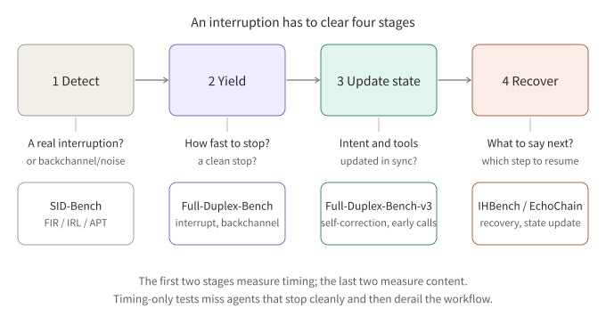
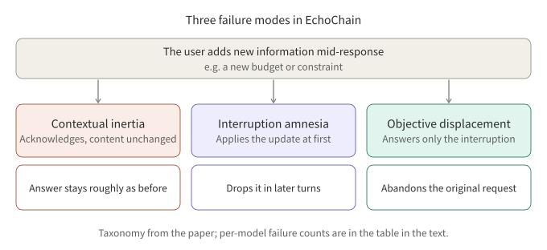

## Summary

Early full-duplex evaluations mostly asked one question: when the user starts talking, does the model stop in time? Several 2026 benchmarks stretch that question in both directions. Before stopping, the system must decide whether this is a real interruption at all (SID-Bench). After stopping, it must use the new information correctly and return to the right place in the workflow (EchoChain, IHBench). In between sit tool calls and self-corrections (Full-Duplex-Bench-v3).

This note reads the four papers along one chain and relies only on the papers themselves. All numbers are author-reported and not reproduced here. The benchmarks use different models, data and judges, so **numbers must not be compared across tables**.

| Stage | Question | Representative benchmark |
|---|---|---|
| 1 Detect | Real interruption, or backchannel/noise? | SID-Bench |
| 2 Yield | How fast does it stop, and cleanly? | Full-Duplex-Bench (v1) |
| 3 Update state | Are intent and tool calls updated in sync? | Full-Duplex-Bench-v3 |
| 4 Recover | What does it say next, from which step? | IHBench, EchoChain |

*Figure 1: the first two stages measure timing; the last two measure content.*

## Key conclusions

- Looking only at "how fast it stops" misses the most serious failure: stopping cleanly and then derailing the workflow. IHBench takes exactly this as its starting point.
- Telling a real interruption from a backchannel is a semantic problem. SID-Bench results show a pure VAD approach stops for almost any human sound, while the end-to-end Moshi stops slowly.
- On EchoChain's four closed-source models, none exceeds a 50% whole-conversation pass rate, so revising state mid-speech is still an open problem.
- Full-Duplex-Bench-v3 exposes an engineering trade-off: calling tools early lowers latency, but a later self-correction by the user can make already-committed arguments stale.
- Timing metrics and content metrics are fairly independent. IHBench reports different leaders for task fulfillment and recovery quality.

## 1. Detect: is it a real interruption (SID-Bench)

**Conclusion: treat "should I yield?" as a semantic judgment, not an acoustic one.**

The paper (Xia et al., arXiv 2603.24144) frames interruption detection as sequential classification. A true interruption is a turn start with new communicative intent that warrants the other side yielding; a backchannel only signals attention. The ground-truth time is the onset of the first phoneme of the first substantive word, found by an LLM at the semantic transition and timed by forced alignment.

The data comes from real human-human conversations (Chinese, English, and a Switchboard subset): 3,700 instances including noise and silence sets.

There are three metrics:

| Metric | Meaning |
|---|---|
| FIR | Share of non-interruptive vocalizations that make the system stop (false interruption rate) |
| IRL | Delay from a real interruption to the system stopping |
| APT | Composite penalty time: true positives cost IRL, false positives cost the whole turn, false negatives cost the unwanted audio that was spoken, true negatives cost zero |

Baseline comparison from the paper (averages, excerpt):

| System | IRL (s) | FIR | APT (s) |
|---|---|---|---|
| FSMN-VAD | 0 | 0.840 | 3.627 |
| Freeze-Omni | 0.173 | 0.532 | 2.129 |
| FireRedChat | 1.045 | 0.476 | 2.627 |
| Moshi | 2.517 | 0.118 | 3.192 |
| Proposed model | 0.389 | 0.124 | 0.711 |

How to read it: VAD-style systems react fast but stop too often; Moshi rarely stops falsely but is slow; APT puts both kinds of cost in one unit (seconds). The proposed model is an audio encoder plus a Qwen3-0.6B binary classifier (continue / interrupt) and requires 3 consecutive "interrupt" predictions before it actually stops, to suppress jitter. Its APT is about three times lower than the best baseline (0.711 vs 2.129).

Two cautions (stated by the authors or visible in the table): the Moshi test protocol is custom, so cross-system timing comparisons carry some methodological uncertainty; and APT penalizes a few very long false positives heavily, which amplifies failures under sustained noise.

## 2. Yield: timing benchmarks

**Conclusion: this stage already has mature benchmarks, but they only answer "did it stop, and how fast".**

Full-Duplex-Bench (Lin et al., arXiv 2503.04721) is the starting point for this family. It covers pause handling, backchanneling, turn-taking and interruption management with automatic metrics. IHBench's introduction summarizes it and its successors as measuring timing, and from that argues that what the agent says after the stop is largely unmeasured.

## 3. Update state: tool calls and self-correction (Full-Duplex-Bench-v3)

**Conclusion: responding fast conflicts directly with waiting for the user to finish, and self-correction is the most consistent source of failure.**

v3 (Lin et al., arXiv 2604.04847) targets voice agents: 100 scenarios recorded by 12 human speakers (including non-native speakers) with real ambient noise. Four domains (travel, finance, housing, e-commerce) use local mock APIs with deterministic outputs, so scoring is automatic. Scenarios fall into three difficulty tiers (single-step, two-step, multi-step with conflicting constraints) and are annotated with five kinds of disfluency: false starts, self-corrections, fillers, pauses and hesitations. 21 of the 100 scenarios contain self-corrections.

Six configurations were evaluated (five end-to-end models and one cascaded pipeline). Results the authors report that matter here:

- By difficulty, every system's Pass@1 falls as complexity rises; GPT-Realtime goes from 0.750 (easy) to 0.433 (hard).
- By disfluency, self-correction Pass@1 varies a lot: 0.588 for GPT-Realtime versus 0.176 for the cascaded pipeline; pauses are the weakest category for most systems.
- Pre-emptive tool-call rate: 41.6% for Grok, 10.8% for GPT-Realtime. In one case study a model called its tool before the user finished and locked in a stale destination; the cascaded pipeline failed because Whisper finalized the transcript before the correction arrived.

The paper concludes that early tool commitment helps speed but can lock in outdated intent, and future agents must balance fast execution with flexibility to changing intent.

**My inference (not a conclusion of the paper):** if a tool call is viewed as an irreversible side effect, early calls should be limited to read-only, idempotent queries, while calls that change business state should wait for confirmation at the turn boundary. This is an engineering reading of the observed behavior; the paper itself does not give that design advice.

## 4. Recover (IHBench and EchoChain)

**Conclusion: content quality after the stop is an independent capability that timing benchmarks cannot see.**

### 4.1 IHBench: recovery inside a workflow

IHBench (Salimi et al., arXiv 2606.19595) looks at interruptions in structured workflows, such as an insurance claim that advances stage by stage.

Design points:

- 10 enterprise domains, 45 conversations and 428 interruption points; each conversation is driven by a state machine with stages, skip, failure and termination conditions.
- Interruptions are scripted **mid-utterance**, not at detected pauses; the user simulator reacts only to the part it would have heard.
- Six interruption types: normal, impatient, correction, topic switch, filler (backchannel) and pushback. Recovery requirements differ; a filler requires resuming the interrupted sentence exactly where it stopped.
- The rubric for each interruption point is fixed before any model response exists.

Scoring uses two independent axes, both by LLM judges:

| Axis | Method |
|---|---|
| Task fulfillment (TF) | The judge sees the rubric and picks a winner between the tested model's response and a baseline's; 0.50 means parity with the baseline |
| Recovery quality (RQ) | Absolute grading; each point has 2 to 4 type-specific criteria that must all be met to pass |

Main findings reported by the authors:

- The TF leader is GPT Realtime 2 (0.728); the RQ leader is Gemini 2.5 Flash with thinking (0.704). Because the leaders differ, the authors consider the two axes partly independent.
- Task fulfillment declines with conversation depth; the mean slope per turn is about −0.016 for closed-weight models and about −0.053 for open-weight ones, roughly 3.3 times.
- Filler is the hardest type for many models: GPT-family pass rates are about 7% to 31%, Gemini 2.5 about 62% to 68%, and Gemini 3.x falls back to about 13% to 32%. Normal and topic-switch interruptions are handled well by most models.
- For open-weight models, text input beats audio input by about 8 points on TF; for Gemini the two are statistically equivalent.

Limitations (stated by the authors): the data is synthetic and English-only; scoring covers only the response text, not prosody or timing.

### 4.2 EchoChain: revising state mid-speech

EchoChain (Modi et al., arXiv 2604.16456) inserts interruptions into pre-synthesized user audio. The interruption carries task-relevant new information, such as a new constraint or a changed budget. The offset from the onset of assistant speech is fixed, so timing is consistent across models.

The paper proposes three failure modes:

*Figure 2: EchoChain's failure taxonomy.*

On 200 interrupted conversations, results for four closed-source models (author-reported):

| Model | Total failures | Whole-conversation pass rate (MPR) | Per-criterion pass rate (MCP) |
|---|---|---|---|
| Grok Voice Agent | 103 | 48.5% | 85.5% |
| GPT-realtime-2025-08-28 | 110 | 45.0% | 81.1% |
| Amazon Nova Sonic 2 | 147 | 26.5% | 78.1% |
| Gemini Live 2.5 Flash native audio | 167 | 16.5% | 64.8% |

Observations: 73 of Nova Sonic 2's 147 failures are contextual inertia; Gemini Live's failures are mainly interruption amnesia (65) and objective displacement (64). In a paired comparison on 48 conversations, removing the interruption lowers failures from 92 to 55 (a 40.2% drop), which the authors read as evidence that a good part of the errors come from the interruption itself rather than task difficulty.

Limitations (stated by the authors): only task-relevant interruptions, with no backchannels, side speech or ambient noise; fixed interruption timing; binary pass/fail grading; only four closed-source models.

## 5. Putting the four together

My synthesis (inference, not a conclusion of any single paper):

1. **Report metrics in layers.** Detection (FIR/IRL), state correctness (Pass@1, MPR) and recovery quality (RQ) answer different questions; folding them into one score hides where a failure occurs. The differing leaders on IHBench's two axes support this.
2. **Backchannels show up in three of the papers.** SID-Bench uses them as the source of false stops, IHBench treats "resume exactly after a filler" as one of the hardest types, and EchoChain explicitly leaves them out. The category is a weak spot at both the detection and the recovery end.
3. **The benchmarks are complementary, but their judges, data and models differ.** The numbers are not comparable; anyone building their own evaluation is better off borrowing the layered approach than stitching scores together.
4. **A shared limitation is synthetic data and a mostly English focus.** IHBench and EchoChain use synthetic dialogues and speech; SID-Bench uses real conversations but covers only Chinese and English.

## Conclusion

Interruption handling is a chain: detect, yield, update state, recover. This batch of 2026 benchmarks extends evaluation from "how fast does it stop" to "does it do the right thing afterwards". Judging from these papers, the biggest gap is not the stop but what follows it: whether the new information is absorbed correctly and the workflow returns to the right place.

## References

- [Full-Duplex-Bench: A Benchmark to Evaluate Full-Duplex Spoken Dialogue Models on Turn-taking Capabilities (arXiv 2503.04721)](https://arxiv.org/abs/2503.04721)
- [Full-Duplex-Bench-v3: Benchmarking Tool Use for Full-Duplex Voice Agents Under Real-World Disfluency (arXiv 2604.04847)](https://arxiv.org/abs/2604.04847)
- [Semantic-Aware Interruption Detection in Spoken Dialogue Systems: Benchmark, Metric, and Model (arXiv 2603.24144)](https://arxiv.org/abs/2603.24144)
- [EchoChain: A Full-Duplex Benchmark for State-Update Reasoning Under Interruptions (arXiv 2604.16456)](https://arxiv.org/abs/2604.16456)
- [IHBench: Evaluating Post-Interruption Recovery in Voice Agents with Structured Workflows (arXiv 2606.19595)](https://arxiv.org/abs/2606.19595)

Related reading: [Reading Full-Duplex Voice Models: MiniCPM-o 4.5 and Realtime-Venus]({{ '/en/minicpm-o-45-realtime-venus/' | relative_url }}).

*Note: all numbers come from the papers' text and tables, are author-reported and were not independently reproduced. For the original Full-Duplex-Bench (2503.04721) only abstract-level information was used; the appendices of IHBench and EchoChain were not read in full.*
