## Summary

DeepInfer, the inference engine open-sourced by DeepSeek, officially supports only NVIDIA SM100 (Blackwell, CUDA 13) and Huawei Ascend 950. A great deal of existing compute is Hopper (H100/H200/H20, SM90), and the community has produced experimental SM90 ports. A natural question follows: **what exactly is hard about moving an inference stack written for Blackwell onto Hopper?**

Answering it means taking the stack apart from top to bottom: how the model structure maps to operators, how operators map to hardware instructions, and why each layer's computation has to be organized the way it is. This article is organized around seven core technical questions:

| # | Question | Components involved |
|---|---|---|
| Q1 | Why can a kernel written for SM100 not run directly on SM90? | Instruction set, tensor cores, compile targets |
| Q2 | With no FP4 tensor cores, how are FP4 weights computed on Hopper, and at what cost? | DeepGEMM, low-precision quantization |
| Q3 | What is the computational structure of attention, and why does it allow blockwise streaming? | FlashAttention, online softmax |
| Q4 | How is attention computed efficiently over a compressed KV cache during decode? | FlashMLA, split-KV |
| Q5 | How does data flow between GPUs in an MoE layer? | DeepSelect, DeepEP, DeepGEMM |
| Q6 | Why does each layer need both an attention and a feed-forward sublayer? | SwiGLU, residual stream |
| Q7 | Why is a 5120-dimensional hidden state enough to carry meaning? | Superposition, scaling laws |

The last section turns this analysis into an executable verification plan for a Hopper port.

## Key conclusions

- **Compiling is not the same as working.** SM90 and SM100 differ in tensor-core instructions (`wgmma` versus `tcgen05`), on-chip memory (no TMEM) and low-precision formats (no FP4). Upstream FlashMLA has dropped Hopper support, and the Hopper build of DeepGEMM lacks the FP4 and UE8M0 branches. These need rewriting, not recompiling.
- **On Hopper, FP4 can be "stored but not computed".** Weights are stored as FP4, dequantized on chip to FP8 and then computed; the conversion is lossless. The bandwidth benefit in decode is kept, and the compute advantage of FP4 is lost in prefill.
- **Online softmax is the mathematical basis of efficient attention.** The softmax-weighted average splits into a numerator and a denominator, both sums, and with after-the-fact correction of the maximum, attention can be computed blockwise within an SM, in segments across SMs, and in shards across GPUs.
- **MLA lets K and V share one compressed vector.** By absorbing the up-projection matrices into the query and output projections, decode reads only one compressed KV, and FlashMLA is designed around this shape.
- **Attention moves, feed-forward processes.** The output of attention is a convex combination of value vectors and creates no new features by itself; the nonlinear feed-forward layer does feature crossing and parametric knowledge retrieval.
- **Representational capacity comes from directions, not dimensions.** The number of nearly orthogonal directions in high-dimensional space grows exponentially with dimension, so with sparse features, 5120 dimensions can carry far more than 5120 features in superposition.

## Overview: how model structure maps to operators

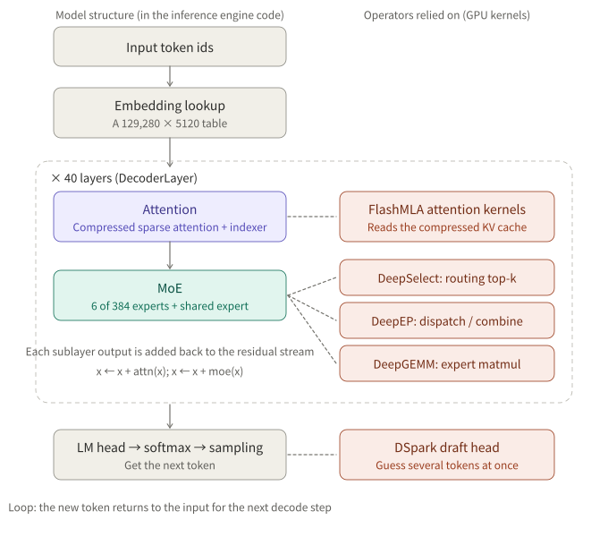

*Figure 1: the left column is the model structure, defined by the inference engine's code (vLLM, DeepInfer and so on); the right column is the GPU operator library each step depends on. Almost all the work of moving from SM100 to SM90 is in the right column.*

The main structural parameters of DeepSeek-V4.1-Flash are below (from the vLLM recipe and public model specs; sources disagree on total parameter count):

| Item | Value |
|---|---|
| Layers / hidden size | 40 / 5120 |
| Active parameters | about 8B per token in prefill, about 16B per token in decode |
| Attention | Sliding window plus compressed sparse attention, two-level indexer, 512 entries kept per query |
| Attention heads | 64 query heads, 1 KV head |
| MoE | 6 of 384 routed experts, plus 1 shared expert |
| Vocabulary | 129,280 |
| Speculative decoding | DSpark multi-token draft head |

---

## Q1: Why can a kernel written for SM100 not run directly on SM90?

### Conclusion

A kernel compiles to machine code tied to a specific architecture. DeepInfer's key operators directly use Blackwell-only tensor-core instructions, on-chip tensor memory and the FP4 data path, none of which has a counterpart on Hopper, so they must be rewritten.

### Mechanism

Hopper (2022, SM90) and Blackwell (2024, SM100/SM103 for data-center parts) are two generations of NVIDIA data-center GPU architecture. The main loop of a high-performance matrix-multiply kernel is roughly:

1. Move a data tile from HBM into the SM's shared memory (done by the TMA hardware on Hopper);
2. Run the matrix multiply-accumulate on the tensor cores (`wgmma` on Hopper, `tcgen05` on Blackwell, which also introduces TMEM to hold accumulators);
3. Write back to HBM when accumulation finishes.

`nvcc` generates machine code for `sm_90a` or `sm_100a`, and the output runs only on the matching architecture. Three kinds of failure can show up during a port:

| Failure type | Symptom | Risk |
|---|---|---|
| Build script does not include `sm_90a` | Compiles without error; at run time "no kernel image available" | Low, easy to spot |
| Source uses SM100-only instructions | `nvcc` fails or a template assertion fails | Low, easy to spot |
| Compiles and runs, but falls into an unverified fallback path | Wrong numbers or odd performance | **High**, found only by correctness tests |

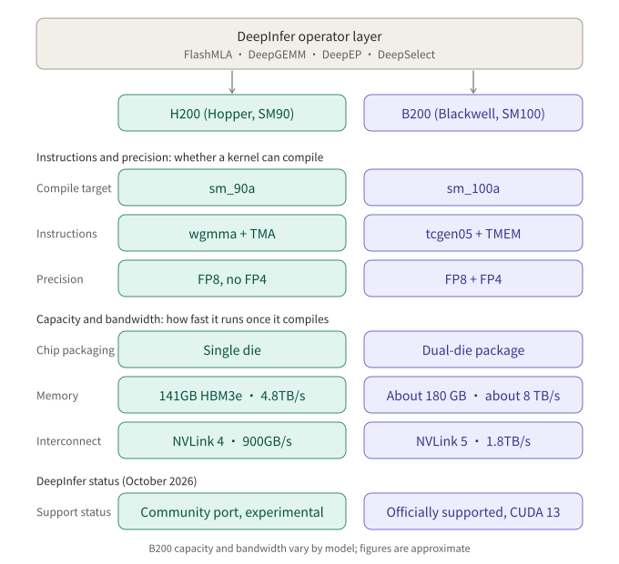

*Figure 2: the upper half decides whether a kernel can compile; the lower half decides the performance ceiling once it does.*

### What this means for a Hopper port

According to public community PRs and tracking issues, the known blockers include:

- **FlashMLA**: upstream removed Hopper support on 30 September 2026, so the SM90 attention kernel must be filled in separately;
- **DeepGEMM**: the Hopper build covers only the FP8 NT layout and FP32 scale factors, and lacks the FP4 branch and the UE8M0 scale format; fused mega-kernels (such as `fp8_fp4_mega_moe`) have no Hopper implementation;
- **DeepSelect**: an `sm_90a` compile target must be added before top-k runs on Hopper;
- **Dependency versions**: one tester found a problem on H200 with the Humming dependency pinned by the community branch.

The community SM90 branch runs end to end on 8 and 4 H20-3e cards, but the FP8 GEMM tile configuration is tuned only for H20 and H200 uses heuristic defaults; there is no public report yet for the full model on H200.

---

## Q2: With no FP4 tensor cores, how are FP4 weights computed on Hopper?

### Conclusion

Use a fused scheme of "FP4 storage, dequantize on chip to FP8 for compute". Memory footprint and decode bandwidth match Blackwell and the conversion is lossless; the cost is that prefill cannot get the doubled compute of FP4.

### Mechanism

FP4 (E2M1) has only 8 non-negative values: 0, 0.5, 1, 1.5, 2, 3, 4, 6. It gets a larger dynamic range from a per-group shared scale: real value = FP4 value × scale. In the DeepSeek V4 series the MoE expert weights are stored as FP4 and the remaining parameters as FP8.

A tensor core can multiply-accumulate only the formats its circuits support. Blackwell has FP4 multiply circuits; Hopper supports only FP8, FP16/BF16, TF32 and INT8, so FP4 weights must first be converted to FP8. Since every FP4 value is exactly representable in FP8, the conversion is lossless.

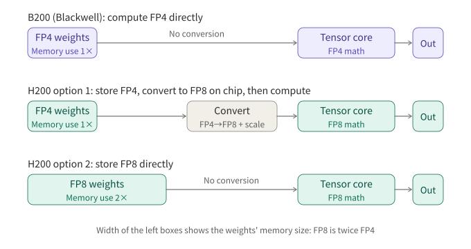

*Figure 3: the width of the left boxes represents the memory footprint of the weights.*

| Scheme | Memory footprint | Compute rate | Cost |
|---|---|---|---|
| B200: compute FP4 directly | 1× | FP4 peak is about 2× FP8 | None |
| H200 option 1: store FP4, convert to FP8 on chip | 1× | FP8 | One extra dequantization per computation |
| H200 option 2: store FP8 directly | 2× | FP8 | Memory capacity and bandwidth cost double |

### What this means for a Hopper port

The community chose option 1 and fused the dequantization into the grouped GEMM (dequant-fused FP8 grouped GEMM): weights are read from HBM at 4-bit size, converted on chip and fed straight to the tensor cores.

The reasoning is that the two inference phases have different bottlenecks. Decode is limited by memory bandwidth, and option 1 keeps the 4-bit traffic, so it is barely affected; prefill is limited by compute, and H200 can only compute at the FP8 rate, a gap set by the hardware. Option 2 doubles the expert-weight volume, and a model that fits on four 141 GB cards might no longer fit.

---

## Q3: What is the computational structure of attention, and why does it allow blockwise streaming?

### Conclusion

For each query, attention computes a softmax-weighted average of the value vectors. Its numerator and denominator are both sums over keys, so they can be accumulated in batches, and the maximum needed for numerical stability can be corrected for all existing accumulators whenever a larger value appears. This is the mathematical basis of FlashAttention and all its variants.

### 3.1 Computational structure

Attention can be understood as a differentiable soft retrieval:

| Retrieval system | Attention |
|---|---|
| Query | The current token's `q` |
| A document's matching field | Each token's `k` |
| A document's returned content | Each token's `v` |
| Relevance | `q · k` |
| Return the top-1 | A weighted average of all `v` by softmax weight |

Soft selection is used instead of top-1 so that the output varies continuously with the scores, letting gradients flow back to the projection parameters.

The input to each layer is every token's hidden state `x` (5120 dimensions in V4.1), projected by three learnable matrices: `q = x·W_Q`, `k = x·W_K`, `v = x·W_V`. In self-attention, token i's query `q_i` comes from `x_i`, and the retrieved `k_j`, `v_j` come from the other tokens' `x_j` in the sequence. For token i:

```
s_ij = q_i · k_j / sqrt(d)                 score
p_ij = exp(s_ij) / Σ_j exp(s_ij)           normalize
o_i  = Σ_j p_ij · v_j                      weighted average
```

Dividing by `sqrt(d)` offsets the growth of the dot-product variance with dimension, so softmax does not become too sharp and kill gradients.

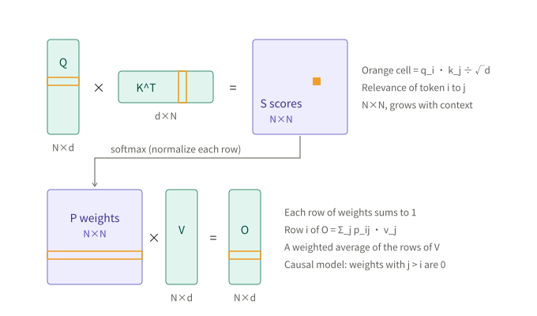

*Figure 4: with N tokens in parallel, the score matrix S = QKᵀ is N×N.*

A few facts that bear directly on the implementation:

- **Causal masking**: in a generative model, scores with `j > i` are set to −∞;
- **Heads and KV heads**: the 64 query heads of V4.1 share 1 KV head;
- **KV cache**: the `k` and `v` of past tokens do not change as later tokens arrive, so they can be cached and reused;
- **Prefill and decode**: prefill processes the whole input at once and is a full N×N computation; decode has a single query per step but must read the entire KV cache, so the bottleneck is memory bandwidth.

### 3.2 The problem: memory traffic of intermediate matrices

GPU memory is split into HBM, large but slow, and on-chip SRAM, only a few hundred KB per SM but much faster. A naive implementation runs scoring, softmax and multiplication by V as three separate operators, and the N×N matrices S and P both make a round trip to memory. With a 100,000-token context, S for a single head in a single layer reaches 20 GB in BF16.

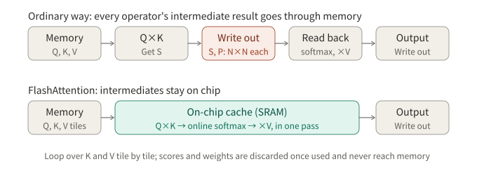

*Figure 5: FlashAttention fuses the three steps on chip, and S and P are never written to memory in full.*

### 3.3 Deriving online softmax

Write the output as:

```
o_i = ( Σ_j exp(s_ij) · v_j ) / ( Σ_j exp(s_ij) )
```

Both numerator and denominator are sums over j and can be accumulated in batches. For each row maintain three quantities:

- `m`: the maximum score seen so far, for numerical stability; the computation actually uses `exp(s − m)`;
- `l`: the denominator accumulator `Σ exp(s − m)`;
- `O`: the numerator accumulator `Σ exp(s − m) · v`.

When a new block of K and V is read in: if a larger score appears, set `m_new = max(m_old, block maximum)`, and multiply the existing `l` and `O` by `exp(m_old − m_new)`, which converts each term from `exp(s − m_old)` to `exp(s − m_new)`; then add this block's contribution and discard the block's scores. After everything is processed, output `O / l`, where `exp(−m)` cancels between numerator and denominator.

Take the scores of one query against 8 keys, 2 keys per block:

| key | 0 | 1 | 2 | 3 | 4 | 5 | 6 | 7 |
|---|---|---|---|---|---|---|---|---|
| score s | 1.2 | 0.3 | 2.1 | −0.5 | 0.8 | 3.0 | 0.1 | 1.5 |
| v | 2 | −1 | 4 | 0 | 3 | 1 | −2 | 5 |

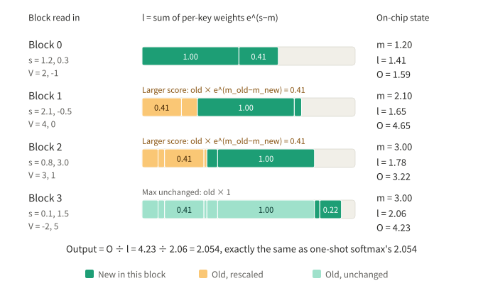

*Figure 6: the total bar length is l. Blocks 1 and 2 bring larger scores, so the old terms are multiplied by 0.41 (the difference happens to be 0.9 all three times); block 3 leaves the maximum unchanged and needs no correction. The final O / l = 2.054, exactly the result of computing softmax in one shot.*

As a cross-check: accumulating `exp(s)` directly with no maximum correction gives a final denominator of 41.34 and numerator of 84.92, with the same ratio 2.054; at every step the online version's `l` and `O` are exactly these two accumulators divided by `exp(current m)`.

### 3.4 Three sources of decomposability

1. **Rows are independent**: row i depends only on `q_i` and all of K and V, so Q can be split by rows across different SMs;
2. **Sums within a row**: numerator and denominator are both sums, so K and V can be streamed in blocks;
3. **Overflow is correctable**: when the maximum changes, the existing accumulators are converted to the new baseline by one scalar multiplication.

Note that the N×N intermediate matrix appears only in prefill. In decode the scores are just 1×N, and the main issue becomes the bandwidth of reading the KV cache, which is the subject of Q4.

---

## Q4: How is attention computed efficiently over a compressed KV cache during decode?

### Conclusion

MLA uses matrix absorption so attention runs directly on the compressed vector, with K and V sharing the same data and all heads sharing one KV. FlashMLA organizes its on-chip loop around this shape, and splits a single request across many SMs with split-KV, then merges the pieces with the online-softmax merge rule.

### 4.1 Matrix absorption in MLA

Take the MLA design published for DeepSeek V3 as the example (the V4 series changes it): the KV cache stores only a compressed vector `c_j` per token (512 dimensions, plus a 64-dimension positional part), with `k_j = W_UK · c_j` and `v_j = W_UV · c_j`. If you restored them first every time, compression would be pointless. Using associativity:

```
q_i · k_j          = (W_UKᵀ · q_i) · c_j
Σ_j p_ij · v_j     = W_UV · ( Σ_j p_ij · c_j )
```

The query is transformed once and then dotted directly with `c_j`; the output is averaged in the compressed space first and multiplied by `W_UV` once at the end. So `c_j` acts as both K and V, and is shared by all heads.

### 4.2 The compute loop inside an SM

In decode, one request has the shape of 64 heads of queries (think 64 rows) against N compressed vectors:

1. TMA moves one page of compressed vectors from HBM into on-chip cache, with page positions given by the page table (paged KV cache);
2. The tensor cores compute the scores of the 64 heads against that page;
3. Each head updates `m`, `l`, `O` by online softmax;
4. The same page of data serves as V in the weighted accumulation: moved once, used twice;
5. Move on to the next page until done.

V4.1 adds an indexer on top: a lightweight auxiliary attention first scores the compressed entries, and each query keeps only the 512 most relevant (with an earlier candidate-filtering level before that), so the kernel must support sparse block-wise reads.

### 4.3 Parallelism across SMs: split-KV

A single decode request has only one row of queries, and if one SM did all of it, the other hundred-odd SMs would sit idle. FlashMLA splits the request's KV cache into segments:

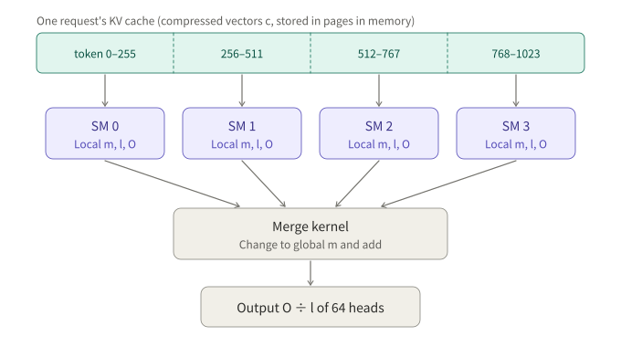

*Figure 7: each SM computes a local m, l, O, and the merge kernel aligns them to the global maximum and adds them.*

This is the same mathematical property as in section 3.3: sequential accumulation becomes parallel computation followed by a merge. FlashMLA's interface calls `get_mla_metadata` before computing and plans the split in advance from the length of each request, to balance load across SMs.

### 4.4 Parallelism across GPUs

In decode, attention is usually data-parallel: each GPU handles some of the requests and holds their complete KV cache, so attention does not exchange K and V across GPUs. When one request's context exceeds a single GPU's capacity, context parallelism (CP) splits the KV cache by token across GPUs, each computes local `m`, `l`, `O`, and they are merged across GPUs by the same rule.

---

## Q5: How does data flow between GPUs in an MoE layer?

### Conclusion

Each MoE layer has four steps, routing, dispatch, expert compute and combine, done by top-k, all-to-all communication, grouped GEMM and reverse communication respectively. The division of labor among experts forms spontaneously during training and needs a load-balancing mechanism to maintain.

### Mechanism

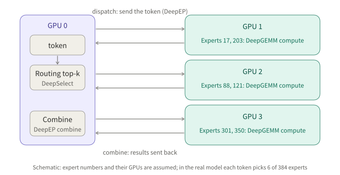

*Figure 8: a schematic; expert numbers and their GPUs are assumed.*

| Step | Content | Operator |
|---|---|---|
| Routing | A linear layer scores the 384 experts, takes the top 6 and computes weights | top-k kernel (DeepSelect, presumed) |
| Dispatch | All-to-all among all GPUs in the batch; NVLink within a node, RDMA across nodes | DeepEP |
| Expert compute | Each GPU groups by expert and runs matrix multiplies of varying sizes | DeepGEMM (grouped GEMM) |
| Combine | Results return along the same path, are summed by routing weight, and the shared expert's output is added | DeepEP |

DeepGEMM cannot be replaced by a generic BLAS for three reasons: the kernel must handle FP8/FP4 and grouped scaling; each expert gets a different number of tokens, so all the grouped matrix multiplies must finish in one launch; and several steps are fused into mega-kernels to cut memory round trips.

Experts are not assigned by hand. The structure specifies only several identical feed-forward networks and a router, with randomly initialized parameters; during training only the selected experts receive gradients, routing and expert ability reinforce each other, and a division of labor gradually forms. To keep a few experts from being over-selected, DeepSeek V3 adds a tunable bias to each expert's routing score, achieving load balancing without an auxiliary loss. The division of labor that actually forms tends to lean toward the lexical and syntactic level rather than clean topical splits.

---

## Q6: Why does each layer need both an attention and a feed-forward sublayer?

### Conclusion

The output of attention is a convex combination of value vectors, so it can only move and mix information among tokens; feature crossing and retrieval of parametric knowledge rely on the nonlinearity of the feed-forward layer. The two alternately write into the same hidden state through the residual stream.

### 6.1 Attention creates no new features

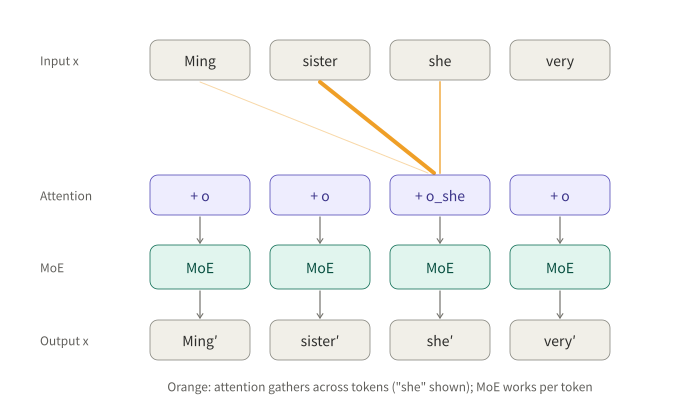

*Figure 9: attention is the only component in the model that exchanges information between tokens; the feed-forward layer computes each token independently.*

`o_i = Σ p_ij · v_j` always lies inside the convex hull spanned by the `v_j`. This brings two limitations:

1. **It cannot express interactions.** Take "not good": attention can let the position of "good" pick up information from "not", but what it gets is a mixture of the two, not a new feature "negative"; if every layer were a linear mixture, depth would be meaningless.
2. **It cannot obtain knowledge outside the context.** Facts that do not appear in the context cannot be retrieved; such knowledge is stored in the parameters, mainly in the feed-forward layers.

### 6.2 What nonlinearity provides

Take sentiment polarity flipping as an example, with p meaning "contains a positive word" and n meaning "contains a negation":

| Phrase | n | p | Sentiment |
|---|---|---|---|
| bad | 0 | 0 | negative |
| good | 0 | 1 | positive |
| not bad | 1 | 0 | positive |
| not good | 1 | 1 | negative |

A linear function `a·p + b·n + c` cannot fit this: the first two rows need `a > 0` and the last two need `a < 0`. This is the XOR problem, for the same reason logistic regression cannot learn feature crosses automatically in CTR prediction.

Introduce ReLU: let `h1 = ReLU(p − n)` and `h2 = ReLU(n − p)`, and output `h1 + h2`; all four cases come out right. The truncation provides the ability to branch conditionally.

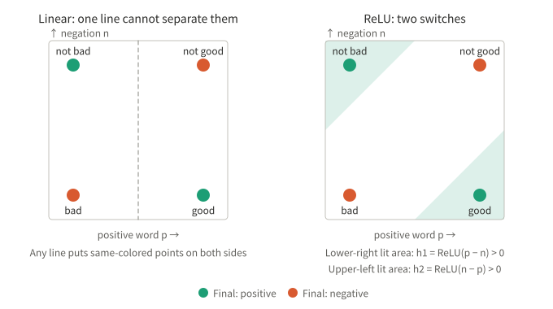

*Figure 10: no straight line separates the diagonal points of the same class; two ReLU units cover the two positive regions.*

Modern models use SwiGLU:

```
FFN(x) = W2 · ( SiLU(W1·x) ⊙ (W3·x) )
```

SiLU provides a smooth switch, and the elementwise product directly implements "A and B": the product is large only when both detectors are active. When loading DeepSeek V4 weights, vLLM merges `w1` and `w3` into `gate_up_proj` so one matrix multiply computes both paths.

### 6.3 The residual stream

```
x ← x + attention(x)
x ← x + ffn(x)
```

The hidden state `x` is the read-write channel shared by all layers: attention writes in information gathered from the context, and the feed-forward layer writes in processed features and knowledge retrieved from the parameters. `o_i` is the context information newly added by this layer, and `x_i` is the accumulated representation up to this layer.

### 6.4 From hidden state to the next token

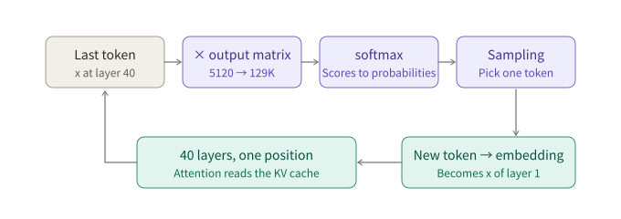

*Figure 11: the LM head is just a 5120 × 129,280 linear layer, and the generation loop relies on the KV cache to compute only the new position.*

The hidden state at the last position is normalized and multiplied by the output matrix to get logits over the vocabulary, then softmax and sampling by greedy, temperature or top-p. The new token is embedded and goes through the 40 layers again, computing only this one position, whose query reads the entire KV cache and appends its own K and V.

DSpark is a multi-token draft head attached to the model: it uses the final hidden state to predict several following tokens at once, the main model verifies them in one pass as new tokens, and keeps the consistent part. The verification mechanism guarantees that the output is identical to running without it. DSpark's parameters live in the same checkpoint as the main model, and adding DSpark to V4 Flash raises the repository's total parameters from 284B to 304B.

---

## Q7: Why is a 5120-dimensional hidden state enough to carry meaning?

### Conclusion

Features are represented by directions, not coordinate axes; the number of nearly orthogonal directions in high-dimensional space grows exponentially with dimension, so if features activate sparsely, far more features than dimensions can be carried in superposition. At the same time, information is distributed across the hidden states at every position and layer, the model parameters and the KV cache, so a single vector only has to serve as working memory. The exact dimension is set by compute budget and engineering constraints, not derived from theory.

### 7.1 Near-orthogonality in high dimensions

For each dimension, sample 20,000 pairs of random directions and compute the cosine of the angle:

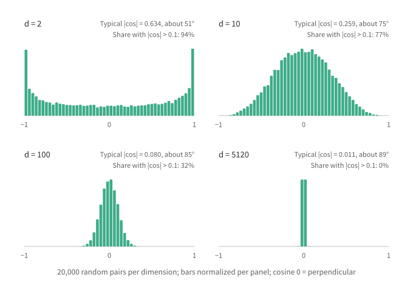

*Figure 12: the higher the dimension, the more random-direction cosines concentrate near 0.*

| Dimension | Typical \|cos\| | Angle | Share with \|cos\| > 0.1 |
|---|---|---|---|
| 2 | 0.634 | about 51° | 94% |
| 10 | 0.259 | about 75° | 77% |
| 100 | 0.080 | about 85° | 32% |
| 5120 | 0.011 | about 89° | 0% |

If a little overlap is allowed, the number of directions that fit grows exponentially with dimension. The model uses this to stack many features in the same space (superposition), and interpretability research has used sparse autoencoders to decompose millions of interpretable features from large models. Superposition holds on the premise of sparsity: only a few features are active at any moment, and natural language happens to satisfy that.

### 7.2 Distributed storage of information

| Location | Content |
|---|---|
| Hidden states at each position and layer | Understanding of the current context (working memory) |
| Model parameters | World knowledge and linguistic regularities (long-term memory) |
| KV cache | K and V of past tokens, retrievable at any time |

A 5120-dimensional BF16 vector has a raw capacity of 81,920 bits, while specifying one word out of 129,280 takes only about 17 bits. That is only an upper bound: later layers can read information only through linear projections and must tolerate the crosstalk that superposition brings, so the effective capacity is far lower. The comparison shows only that capacity is not a bottleneck in order of magnitude.

### 7.3 How the dimension is chosen

Scaling laws (Kaplan et al. 2020; Hoffmann et al. 2022) show that performance is mainly determined by parameter count, data and compute, and is insensitive over a wide range to how it is split between width and depth. Real designs trade off under a compute budget:

| | Wider | Deeper |
|---|---|---|
| Compute per layer | Grows roughly with d² | Unchanged |
| Latency | High parallelism | Serial across layers, grows linearly |
| Multi-GPU split | Easier to split | Longer pipeline |

Dimensions are usually multiples of 128 to match tensor-core tiles, and 5120 = 128 × 40. DeepSeek-V3's hidden size is 7168, and V4.1 Flash, the smallest model in the new architecture family, uses 5120. Too little width shows up as weaker retention of obscure knowledge, hallucination from superposition crosstalk, and loss of long-context detail.

---

## Verification plan for a Hopper port

Based on the analysis above, an H200 test report that would be valuable to upstream maintainers should be organized in layers:

**Environment and reproducibility**

- Driver, CUDA, GCC and Python versions;
- The DeepInfer branch and commit, and the commit SHAs of dependencies such as FlashMLA, DeepGEMM, DeepEP, DeepSelect and Humming;
- GPU count and NVLink topology.

**Layer 1: kernel compilation and unit tests**

- Build each submodule on its own and run its bundled unit tests;
- Record the three failure types from Q1 separately.

**Layer 2: offline inference correctness**

- With fixed input and greedy decoding, compare outputs token by token against H20 or SM100;
- Check scores on a small evaluation set (such as a GSM8K subset).

**Layer 3: DSpark on/off comparison**

- Under greedy decoding the two modes should produce identical output;
- Record draft acceptance rate, throughput and time to first token. Because the verification mechanism guarantees consistency, inconsistent output or an abnormally low acceptance rate is a cheap probe for kernel numerical problems.

**Performance (optional)**

- Tokens/s at different batch sizes and context lengths;
- Confirm whether FP8 GEMM uses the heuristic configuration, and assess the gain from tuning for H200.

## Conclusion

Moving DeepInfer from SM100 to SM90 looks like "adding a compile target" but actually involves rewriting tensor-core instructions, the on-chip memory hierarchy and the low-precision data path as a whole. Understanding why those changes are necessary and how to get them right requires going back to lower-level questions: why attention can be computed in blocks, why MLA lets K and V share one copy of data, how MoE communication and computation are organized, and where the capacity of the hidden state comes from. The answers together set the boundary of correctness and the performance ceiling of an inference stack on new hardware.

---

## References

- [DeepInfer repository and README](https://github.com/deepseek-ai/DeepInfer)
- [DeepInfer PR #92: SM90 (Hopper) running end to end on H20-3e](https://github.com/deepseek-ai/DeepInfer/pull/92)
- [DeepInfer PR #148: add Hopper (SM90) support](https://github.com/deepseek-ai/DeepInfer/pull/148)
- [DeepInfer RFC #47: SM90 support for H20-3E](https://github.com/deepseek-ai/DeepInfer/pull/47)
- [SM90 platform support tracking issue (JianWang97/DeepInfer #4)](https://github.com/JianWang97/DeepInfer/issues/4)
- [vLLM recipe: DeepSeek-V4.1-Flash](https://recipes.vllm.ai/deepseek-ai/DeepSeek-V4.1-Flash)
- [vLLM docs: `deepseek_v4` model implementation](https://docs.vllm.ai/en/latest/api/vllm/models/deepseek_v4/nvidia/model/)
- [ApX: DeepSeek V4.1 Flash specifications](https://apxml.com/models/deepseek-v4-1-flash)
- Dao et al., *FlashAttention: Fast and Memory-Efficient Exact Attention with IO-Awareness*, 2022
- DeepSeek-AI, *DeepSeek-V2* and *DeepSeek-V3* technical reports
- Kaplan et al., *Scaling Laws for Neural Language Models*, 2020; Hoffmann et al., *Training Compute-Optimal Large Language Models*, 2022
- Elhage et al., *Toy Models of Superposition*, 2022

*Note: the description of FlashMLA internals is based on the public design from the DeepSeek V3 era and was not checked against current source; for V4.1 structural parameters, the official model card prevails.*
