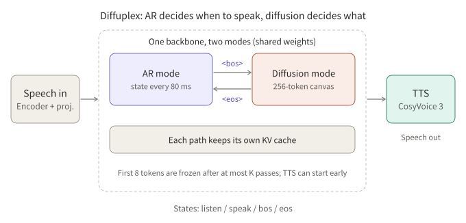
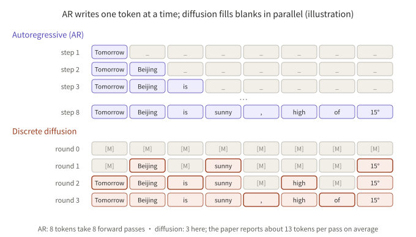
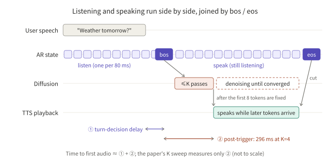
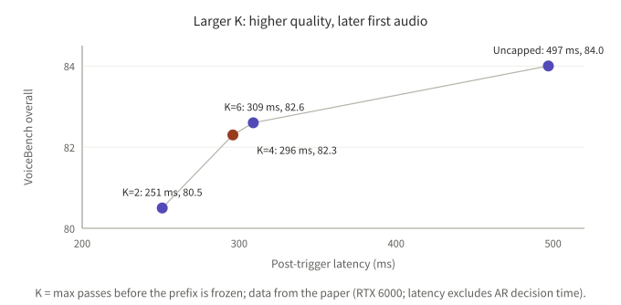

## Summary

Full-duplex spoken models handle turn-taking well but trail autoregressive (AR) spoken models of similar size on intelligence. Diffuplex (Chen Chen, Pin-Jui Ku, Ankita Pasad, Ante Jukić, Zhehuai Chen and Boris Ginsburg of NVIDIA; arXiv 2610.17780) blames the structure: existing models squeeze "when to speak" and "what to say" onto one AR timeline, so the training objectives conflict and semantic computation is tied to an 80 ms perception frame rate.

Its answer is to separate the two jobs. An AR mode emits an interaction state every 80 ms and decides when to speak; a diffusion mode generates the reply in parallel on a 256-token canvas and decides what to say. Both modes share one backbone and keep separate KV caches.

After going through the paper's tables, my reading is that the large VoiceBench gain comes mainly from the decoupling itself, not from diffusion decoding. Diffusion buys throughput, which does little for perceived latency in streaming conversation. The part that deserves the most scrutiny is state prediction: the paper reports only end-to-end conversational behavior, no per-state accuracy, and the model tends to cut in during pauses.

This note relies only on the paper. All numbers are author-reported and not reproduced. The paper says code and checkpoints will be released "soon"; they were not available at the time of writing.



*Figure 1: the AR mode handles state, the diffusion mode handles content, and TTS can start once the prefix is ready.*

## Key conclusions

- The gain comes mainly from decoupling: the full-duplex system scores 82.3 on VoiceBench against 58.1 for the strongest full-duplex AR baseline in the table, and the same split with AR decoding scores 85.1, one point above diffusion decoding (84.1).
- Diffusion buys throughput, not perceived latency: about 13.0 tokens are fixed per forward pass (AR: 1.00), for about 1,872 tokens/s. In streaming speech, perceived latency is set by the first audio; later tokens only need to outpace TTS playback.
- First-audio latency is only partly reported: the 296 ms at K = 4 is post-trigger latency and excludes the AR turn decision. Turn-taking latency itself (0.396 / 0.536) is slower than Moshi (0.265) and PersonaPlex (0.070).
- State prediction has only behavioral metrics: the model takes the turn when it should (TOR 0.93 to 1.00), but pause handling (0.38 to 0.68) is clearly worse than Nemotron-VC and Lychee-FD, meaning it tends to cut in when the user pauses mid-sentence. There is no per-state accuracy or F1 for listen / speak / bos / eos.
- The training recipe matters: removing the text anchor drops the score to 66.1 and removing Stage 1 drops it to 29.9. The state head is trained on about 190 h of conversation for 3,000 updates.

## 1. A few concepts first

**AR (autoregressive)** generation is how ordinary LLMs work: one token at a time from left to right, each conditioned on all earlier tokens, `p(x) = ∏ p(x_t | x_<t)`. GPT, Qwen and Moshi all work this way.

**Discrete (masked) diffusion language models** work differently. They start from a canvas of `[MASK]` tokens, predict every position in parallel in each round, commit only the most confident positions and leave the rest for later rounds until the whole text is formed. The name comes from image generation, which starts from pure noise and denoises step by step; the text version replaces noise with blanks. Examples include LLaDA and Dream; the backbone here is DiffusionGemma.



*Figure 2: the same 8-token reply takes 8 forward passes with AR and 3 rounds with diffusion in this example. An illustration, not an example from the paper.*

**The four interaction states.** In ordinary LLMs `bos` / `eos` are special begin- and end-of-sequence tokens; Diffuplex borrows them as switches. Every 80 ms the AR mode picks one of four states:

| State | Meaning |
|---|---|
| `<listen>` | The user is speaking; keep listening |
| `<bos>` | Take the turn and start answering (triggers diffusion) |
| `<speak>` | Speaking; hold the turn |
| `<eos>` | Yield the turn: finished, or interrupted by the user |

## 2. The problem

**Conclusion: the authors attribute the lack of intelligence in full-duplex models to structure, not to data volume.**

On a single AR timeline, the model must decide at each step both whether to speak now and what to say. The paper points to two consequences:

1. Conflicting objectives: timing decisions and content generation pull on the same loss.
2. Compute tied to the frame rate: semantic computation is bounded by the perception frame rate (one step per 80 ms), so the model cannot spend extra compute thinking before it replies.

## 3. Architecture

**Conclusion: a text diffusion language model as the backbone, plus a light state head, gives two working modes. No separate AR model is trained.**

| Component | Detail |
|---|---|
| Speech front end | Parakeet speech encoder, connected to the backbone's embedding space through a randomly initialized projector; the encoder is causal with a 10-second trailing window and no lookahead |
| Backbone | DiffusionGemma (26B-A4B MoE, a text discrete-diffusion language model) |
| AR mode | The same backbone with causal attention predicts one state every 80 ms; the only additions are a state embedding, a state head and a listening LoRA active only on the speech pathway |
| Diffusion mode | Works on a 256-token canvas, conditioned on speech features and the prompt, and denoises the reply in parallel |
| Speech synthesis | CosyVoice 3; the paper says the design is modular and any TTS can be swapped in |

The two modes share parameters but keep their own KV caches. Because the caches are separate, the model can keep listening while it speaks (see the timeline in section 5).

## 4. Training in three stages

**Conclusion: align the modality first, then learn instruction following, then freeze the response generator and train only the state head. The order cannot be reversed.**

| Stage | What it does | Notes |
|---|---|---|
| Stage 1: modality alignment | Warm up the projector on LibriSpeech (about 960 h), then train projector and encoder jointly on an English ASR mixture | The diffusion LM stays frozen; WER 2.3 (test-clean), 4.2 (test-other) |
| Stage 2: spoken instruction following | About 600K speech-instruction examples plus 5% ASR replay | About 70% of responses are direct answers without thinking; a frozen copy of the original diffusion model acts as teacher for "text-anchored distillation" |
| Stage 3: full-duplex interaction | Freeze the response generator; train the four-state interaction head and the listening LoRA | About 120 h of clean synthetic conversations and 70 h of internal conversational data; a variant adds the Fisher telephone corpus; DNS5 and DEMAND noise augmentation |

### 4.1 Losses by stage

- **Stage 2, text-anchored distillation:** the written version of the same question goes into the frozen original diffusion model as teacher, and the student's output distribution when listening to speech is pulled toward the teacher's distribution when reading text, with a forward-KL loss on both diffusion and AR outputs. Without it, the score drops from 84.1 to 66.1.
- **Stage 3, state policy:** frame-level weighted cross-entropy

```
L_policy = − Σ_t  w(s_t) · log p(s_t | a_≤t, s_<t)
```

`a_≤t` is the speech up to frame t and `s_<t` the earlier states. `<bos>` / `<eos>` are sparse transition events and get larger weights than `<listen>` / `<speak>`; the weight values are not given.

- **Labels:** `<bos>` / `<eos>` targets are deliberately placed a short "reaction delay" after the true turn boundary so that enough acoustic evidence accumulates. The length of the delay is not stated.
- **Hyperparameters:** AdamW, peak learning rate 1e-3, 50 warm-up updates, cosine decay to 1e-4 over 3,000 updates, global batch 32.
- **Role of the listening LoRA:** appendix B says that without it the state head "mainly learns an acoustic voice-activity detector" and does not handle pauses reliably, but gives no numbers.

## 5. Inference

**Conclusion: AR triggers diffusion; the AR mode keeps listening while the model speaks, and TTS overlaps with denoising.**

1. The AR policy consumes streaming audio and emits states.
2. On `<bos>`, accumulated speech features and the prompt are prefilled into the diffusion model to build the cache.
3. Diffusion denoises a 256-token canvas with an entropy-bounded sampler (β = 0.1, up to 48 passes), stopping early on convergence.
4. Prefix anchoring: after at most K passes, the first n = 8 tokens are frozen so TTS can start (K = 4 in the reported setting).
5. Modified schedule: temperature anneals from 0.7 to 0.2, the convergence threshold γ is relaxed to 0.025, and degenerate loops are cut.
6. On `<eos>`, playback is truncated; if the user interrupts within one second, the unspoken part of the canvas is dropped from the context.



*Figure 3: time to first audio is roughly the turn-decision delay plus the post-trigger latency; the paper's K sweep measures only the latter.*

K sets the trade-off between post-trigger latency and quality (RTX 6000, timed from a supplied turn boundary, excluding the AR turn-decision time):

| K | Post-trigger latency | VoiceBench overall |
|---|---|---|
| 2 | 251 ms | 80.5 |
| 4 | 296 ms | 82.3 |
| 6 | 309 ms | 82.6 |
| Uncapped | 497 ms | 84.0 |



*Figure 4: from K=2 to K=4, latency rises 45 ms and the score rises 1.8; from K=4 to K=6 the gain is only 0.3.*

## 6. Results

**Conclusion: a large gain in intelligence; conversational behavior is "takes the turn reliably, but slowly, and cuts in during pauses".**

### 6.1 Intelligence and efficiency

- VoiceBench overall: 86.9 with thinking, 84.1 without (Stage 2), and 82.3 for the full-duplex Stage 3 system.
- Efficiency: 13.0 TPF versus 1.00 for AR baselines and 0.37 for DIFFA-2; throughput of about 1,872 tokens/s versus 394 for Nemotron-3 Omni and 300 for Qwen3-Omni-Thinking. Diffuplex has 4B active parameters against 3B for those two.
- The same recipe on Nemotron-Labs-Diffusion-8B reaches about 78.7 with thinking.

### 6.2 Conversational behavior

Full-Duplex-Bench v1 and v3 (v3 uses human recordings with disfluencies). Higher TOR is better; lower latency and pause scores are better. The paper's table gives no latency units; read them as seconds.

| Model | TOR-v1 | TOR-v3 | Turn latency | Interrupt TOR | Interrupt latency | Pause (synthetic) | Pause (Candor) |
|---|---|---|---|---|---|---|---|
| Freeze-Omni | 0.336 | 0.312 | 0.953 | 0.867 | 1.409 | 0.642 | 0.481 |
| Moshi | 0.941 | 0.925 | 0.265 | 1.000 | 0.257 | 0.985 | 0.980 |
| PersonaPlex | 0.992 | 0.985 | 0.070 | 1.000 | 0.400 | 0.584 | 0.662 |
| Raon-SpeechChat | 0.832 | 0.810 | 1.034 | 0.980 | 1.219 | 0.212 | 0.299 |
| Nemotron-VC | 0.820 | 0.798 | 0.448 | 1.000 | 0.480 | 0.153 | 0.255 |
| Lychee-FD | 0.983 | 0.971 | 0.840 | 0.945 | - | 0.100 | - |
| Diffuplex (with Fisher) | 0.933 | 0.980 | 0.396 | 0.945 | 0.239 | 0.679 | 0.667 |
| Diffuplex (w/o Fisher) | 1.000 | 0.990 | 0.536 | 1.000 | 0.691 | 0.380 | 0.431 |

How to read it:

- Taking the turn works well; the variant without Fisher is close to perfect.
- Turn latency is slower than Moshi and PersonaPlex, and pause handling is clearly worse than Nemotron-VC and Lychee-FD.
- Fisher data makes turn-taking and interruption faster but makes the model more likely to cut in during pauses; the two variants trade one for the other.
- The text says Diffuplex has "the strongest turn-taking accuracy on both benchmark versions". That holds only for the variant without Fisher; the Fisher variant is below PersonaPlex and Lychee-FD on v1.

### 6.3 Ablations (VoiceBench, no thinking)

| Setting | Overall |
|---|---|
| Diffuplex (spoken input) | 84.1 |
| Text input (upper bound) | 90.1 |
| AR decoding instead of diffusion | 85.1 |
| Without text anchor | 66.1 |
| Without Stage 1 | 29.9 |
| Frozen diffusion LM in Stage 2 | 64.7 |

The authors conclude that Stage 1 alignment and the text anchor are both essential, and that controlled adaptation of the backbone is needed. AR decoding scores a point higher than diffusion, so what diffusion buys is speed, not quality.

## 7. Is diffusion decoding worth it for voice agents?

**Conclusion: for a single streaming conversation, the benefit of diffusion decoding is limited; what is worth borrowing is the decoupling and the staged training.**

Why throughput is not perceived latency:

- In streaming speech, the user perceives the first audio: turn decision + prefill + first stretch of text + first TTS chunk. After that, text only needs to be generated faster than TTS speaks it (a few words per second), and any extra speed is inaudible. The gap between 1,872 and 394 tokens/s therefore barely affects how a single conversation feels.
- Diffusion's first audio is not necessarily faster either: 296 ms post-trigger at K = 4 and 497 ms uncapped. The paper does not compare first-audio latency against AR decoding on the same backbone and hardware, so "diffusion has lower latency" is not shown.

Where diffusion may still help, each with a precondition:

1. **Long reasoning before speaking.** AR must emit its thinking tokens one by one before it can speak, so longer thinking means later first audio; diffusion can spend a few extra parallel passes. This only matters when reasoning must happen before the reply; routine Q&A and scripted business dialog rarely need it.
2. **Server-side concurrency and cost.** More tokens per forward pass could let one GPU serve more conversations. But throughput was measured on a GB300 with FP8/NVFP4 against BF16 baselines, and each pass over a 256-token canvas costs more compute. The real concurrency gain has to be measured under load at P95 latency.

What can be borrowed directly:

- Split timing decisions and content generation into two heads with two caches, freeze the generator once trained, and train only a small state head.
- Text-anchored distillation: use the model's own distribution when reading text to constrain its distribution when listening to speech.
- Prefix anchoring: fix the first few tokens as early as possible so TTS can start, then speak while generating the rest. The idea works with AR decoding too.

## 8. Limitations and items to verify

- **No direct metrics for state prediction:** no per-state accuracy, F1 or confusion matrix, and no `<bos>` false-trigger or miss rates. The state head is trained on only about 190 h of conversation; other languages or telephone audio would need fresh validation.
- **Incomplete first-audio latency:** the K sweep excludes the AR turn decision and was measured on an RTX 6000; throughput was measured on a GB300 with FP8/NVFP4 quantization, while other GPUs use BF16.
- **TPF basis:** TPF counts answer-text tokens and is not directly comparable to speech-token or codec-level multi-token-prediction methods; the paper has no direct MTP baseline.
- **Stage 3 loses 1.8 points:** the authors link it to streaming decisions and early-prefix decoding but do not isolate the cause.
- **Backbone dependence:** the second diffusion backbone scores lower, which the authors attribute to weaker text capability.
- **Table details:** table 2 gives no latency units, and the two Diffuplex rows are not explicitly labelled; this note takes the first row as the Fisher variant, based on the text's statement that Fisher "substantially reduces both turn-taking and interruption latency".
- Closed-source real-time models (e.g. GPT-Realtime) are excluded because API overhead would distort latency, and the paper has no dedicated limitations section.

## Conclusion

Diffuplex is interesting for its structure: a light AR policy for timing, discrete diffusion for parallel content, and prefix anchoring to join them. By the authors' numbers it closes much of the VoiceBench gap between full-duplex and AR models, but the ablations show that this gain comes mainly from the decoupling and the training recipe; diffusion decoding itself is slightly behind AR decoding and mainly buys throughput. For a working voice agent, the part that needs the most attention is state prediction: the paper gives no per-state metrics, and cutting in during pauses is a visible weakness. None of this can be reproduced until the code and checkpoints are out.

## References

- [Full-duplex Spoken Language Modeling with Discrete Diffusion (arXiv 2610.17780)](https://arxiv.org/abs/2610.17780)
- [HTML version of the same paper](https://arxiv.org/html/2610.17780v1)

Related reading: [Reading Full-Duplex Voice Models: MiniCPM-o 4.5 and Realtime-Venus]({{ '/en/minicpm-o-45-realtime-venus/' | relative_url }}), and [Seven Full-Duplex Speech Systems]({{ '/en/full-duplex-listening-time/' | relative_url }}).

*Note: all numbers are author-reported and were not independently reproduced.*
