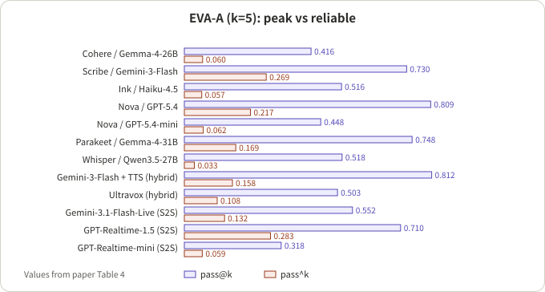
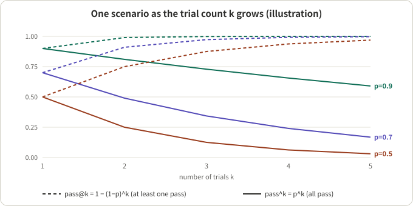

## Summary

EVA-Bench (Bogavelli et al., ServiceNow AI Research, arXiv 2605.13841) is an end-to-end framework for evaluating voice agents. A user simulator talks to the system under test over live audio; after each conversation the framework first checks that the simulator did not misbehave, then scores the conversation with two composite metrics, one for accuracy (EVA-A) and one for experience (EVA-X). It evaluates 12 systems (7 cascade, 2 hybrid, 3 speech-to-speech), runs 5 trials per scenario, and reports pass@1, pass@k and pass^k.

My reading: the most useful takeaway is not the leaderboard but the habit of **splitting "passed once" into "passed at least once" and "passed every time", and treating each scenario as something with a pass probability**. A voice agent adds randomness at every layer (recognition, the simulated user, model sampling, real-time timing), so a single-trial score systematically overstates how reliable it is in deployment. The leaderboard itself is limited by framework differences, default turn-detection settings and only 12 systems, so it is good for trends only.

## Key conclusions

- No system exceeds 0.5 on both EVA-A and EVA-X pass@1. Only GPT-Realtime-1.5 (0.47, 0.57) clears 0.4 on both.
- Peak and reliable performance are far apart. Across the 12 systems the median of pass@k minus pass^k is 0.44 on EVA-A and 0.24 on EVA-X. I recomputed both from the paper's Table 4 and got the same values.
- The experience gap comes almost entirely from turn-taking: mean score 0.82 to 0.83 for S2S, 0.28 to 0.58 for cascade, and 0.019 for one of the two hybrids.
- In cascade systems, accuracy on key entities (confirmation codes, dates, amounts) correlates strongly with task completion (Pearson 0.93). WER cannot see a confirmation code that is off by one character.
- The methodology is worth copying: simulator validation with automatic regeneration, judge agreement checked against two human annotators, and a variance decomposition to justify the number of trials.
- All numbers are author-reported and were not reproduced.

## A few concepts first

- **Cascade / hybrid / S2S**: cascade is speech-to-text, then an LLM, then text-to-speech. S2S (speech-to-speech) is one model that listens and speaks directly. The paper's "hybrid" takes audio directly into an LLM but still outputs through a TTS stage.
- **Bot-to-bot evaluation**: a simulated user replaces the human caller. It has a goal, a persona and a decision tree, speaks through TTS, and talks to the system under test over live audio. It is repeatable and parallel, but the simulator can make mistakes too.
- **EVA-A / EVA-X**: A is accuracy (task completion, faithfulness to policy and tool results, speech fidelity of spoken entities). X is experience (conversation progression, conciseness, turn-taking timing).
- **pass@1 / pass@k / pass^k**: each scenario is run k times, and each conversation is pass or fail (it passes only if every metric meets its own threshold).
  - pass@1: the fraction of all trials that pass. Average performance.
  - pass@k: the fraction of scenarios where at least one trial passes. The ceiling.
  - pass^k: each scenario's pass rate p raised to the k-th power, averaged over scenarios, i.e. the probability of passing k times in a row. Reliability.

A worked example: a scenario passes 4 of 5 trials, so p = 0.8. It contributes 1 to pass@k (at least one pass) and 0.8^5 ≈ 0.328 to pass^k. Figure 3 shows how both move with k for a few fixed values of p.

*Figure 1: an illustration, simplified from the paper's Figure 1.*

## 1. Simulation: make sure the examiner does not err

**Verdict**: putting simulator validation into the loop is the paper's answer to "whose quality does this score reflect?"

- Data: three enterprise domains (airline customer service, healthcare HR service delivery, IT service management), 213 scenarios in total. Each scenario has a user goal with constraints, a persona and a decision tree.
- Conversation: the simulated user is driven by a high-quality cascade pipeline and connects to the system under test over live audio. Tool calls are handled by a deterministic executor.
- Validation: before scoring, every conversation passes two checks: user behavioural fidelity (an LLM judge checks whether the simulated user drifted from its goal) and user speech fidelity (an audio-LLM judge checks that the spoken audio matches the intended content). If either fails, the conversation is regenerated. The paper says regeneration is almost always caused by behavioural drift, with speech fidelity a small share.
- Comparison: the paper groups close prior work (the voice benchmark by Ray et al. and Full-Duplex-Bench v2) as having live multi-turn simulation but no automatic validation of simulator behaviour across trials.

My inference: without this step, some failures are really "the examiner said the wrong thing" and get charged to the system under test. For multi-trial evaluation it matters even more, because simulator variance would otherwise leak into pass^k.

## 2. Metrics: accuracy and experience must each be met in full

**Verdict**: a pass is a conjunction, which is why pass^k ends up low.

- The three EVA-A metrics:
  - Task completion: deterministic. It compares the SHA-256 hash of the scenario database's final state with the ground truth. One extra call, one missing call or one wrong parameter scores 0.
  - Faithfulness: LLM judge. Is the agent grounded in instructions, policy, tool results and user input?
  - Speech fidelity: audio-LLM judge. Does the spoken audio match the intended text, with attention to confirmation codes, dates and amounts?
- The three EVA-X metrics:
  - Conversation progression: LLM judge. Does it repeat questions, lose context or stall?
  - Conciseness: LLM judge. Is a spoken reply short enough to follow without replay?
  - Turn-taking: a deterministic, timestamp-based metric, routed by turn type. Agent-interrupted turns are scored on overlap duration, barge-in count and recovery latency; user-interruption turns on yield latency; uninterrupted turns on a piecewise-linear latency curve. Turns with tool calls get a more lenient threshold.
- Diagnostic metrics are not part of EVA-A or EVA-X. They help locate failures, for example key-entity transcription accuracy, authentication outcome and response latency.
- Pass: each metric has its own threshold, and a conversation passes a dimension only if all of its metrics meet theirs. The turn-taking threshold is 0.8, which the paper explains as "at most one of five turns outside the acceptable timing window", and it sweeps the threshold to show rankings are mostly stable. The other thresholds are in the paper's Appendix E; I did not check them one by one.

## 3. Main results: the full table

The table is adapted from the paper's Table 4 (clean audio, 5 trials per scenario, k = 5, equal-weighted across the three domains). I added a "gap" column for EVA-A (pass@k minus pass^k) and dropped the confidence-interval half-widths; the other numbers are the paper's.

| Arch. | System | EVA-A pass@1 | pass@k | pass^k | Gap | EVA-X pass@1 | pass@k | pass^k | Turn-taking mean |
|---|---|---|---|---|---|---|---|---|---|
| Cascade | Cohere + Gemma-4-26B + Voxtral | 0.207 | 0.416 | 0.060 | 0.356 | 0.209 | 0.647 | 0.015 | 0.567 |
| Cascade | Scribe + Gemini-3-Flash + Conversational v3 | 0.490 | 0.730 | 0.269 | 0.461 | 0.024 | 0.061 | 0.004 | 0.451 |
| Cascade | Ink-whisper + Haiku-4.5 + Sonic 3 | 0.234 | 0.516 | 0.057 | 0.459 | 0.009 | 0.042 | 0.000 | 0.312 |
| Cascade | Nova-3 + GPT-5.4 + Sonic 3 | 0.504 | 0.809 | 0.217 | 0.592 | 0.007 | 0.031 | 0.000 | 0.283 |
| Cascade | Nova-3 + GPT-5.4-mini + Aura-2 | 0.210 | 0.448 | 0.062 | 0.386 | 0.113 | 0.416 | 0.005 | 0.583 |
| Cascade | Parakeet-1.1 + Gemma-4-31B + Kokoro | 0.403 | 0.748 | 0.169 | 0.579 | 0.010 | 0.035 | 0.000 | 0.308 |
| Cascade | Whisper + Qwen3.5-27B + Voxtral | 0.205 | 0.518 | 0.033 | 0.485 | 0.273 | 0.684 | 0.051 | 0.561 |
| Hybrid | Gemini-3-Flash + Gemini-3.1-Flash-TTS | 0.431 | 0.812 | 0.158 | 0.654 | 0.000 | 0.000 | 0.000 | 0.019 |
| Hybrid | Ultravox-Realtime | 0.270 | 0.503 | 0.108 | 0.395 | 0.029 | 0.081 | 0.006 | 0.417 |
| S2S | Gemini-3.1-Flash-Live | 0.292 | 0.552 | 0.132 | 0.420 | 0.589 | 0.979 | 0.240 | 0.830 |
| S2S | GPT-Realtime-1.5 | 0.467 | 0.710 | 0.283 | 0.427 | 0.566 | 0.939 | 0.216 | 0.815 |
| S2S | GPT-Realtime-mini | 0.163 | 0.318 | 0.059 | 0.259 | 0.406 | 0.893 | 0.099 | 0.818 |

*Figure 2: EVA-A pass@k and pass^k redrawn from the table above (the paper's Table 4).*

Things to keep in mind when reading it:

- The paper reports only the medians of the gap (0.44 and 0.24). I recomputed them from the table: the two middle EVA-A gaps are 0.427 and 0.459, median 0.443; for EVA-X they are 0.075 and 0.411, median 0.243. Both match the paper.
- The EVA-X median gap is small not because the systems are reliable, but because half of them have a pass@k close to 0 (turn-taking almost never passes). Read the reliability gap together with pass@k.
- The abstract's "no system above 0.5 on both" is correct, with a caveat: Nova-3 + GPT-5.4 is above 0.5 on EVA-A (0.504) but only 0.007 on EVA-X, and Gemini-3.1-Flash-Live is 0.589 on EVA-X but 0.292 on EVA-A.
- Even the two best EVA-A pass^k values (GPT-Realtime-1.5 at 0.283, the Scribe pipeline at 0.269) mean only about a quarter of scenarios pass five times in a row.

## 4. Peak vs reliable: why measure two numbers

**Verdict**: a single-trial pass rate cannot tell you whether a scenario is stable.

*Figure 3: an illustration of both metrics against k for fixed p, with pass@k = 1 − (1−p)^k and pass^k = p^k.*

- The same pass@1 can hide very different behaviour: half the scenarios always pass and half always fail, or every scenario passes 50% of the time. The first has pass@k and pass^k both near 0.5; the second has pass@k near 1 and pass^k near 0.
- The paper attributes the gap to randomness in conversation trajectories. In a mixed-effects variance decomposition on a subset of systems, trial-to-trial variation accounts for 40.4% to 80.4% of the variance of the judge-graded metrics, judge stochasticity for only 5.5% to 37.5%, and scenario differences for 0.0% to 47.3%. So the gap mostly reflects the system behaving differently from run to run on the same scenario, not judge noise.
- The paper also checks the trial count: with the 5 trials used for the clean runs, the median 95% interval width is at most 0.034 on any metric.

My inference: pass^k raises each scenario's estimated pass rate to the k-th power, and here k equals the number of trials, 5. A scenario that passes all 5 trials scores 1, and a single failure drops it to 0.8^5 ≈ 0.33 or lower, so each scenario's contribution is very discrete. Read pass^k together with its confidence interval; the paper reports bootstrap intervals.

## 5. Robustness and failure modes

- Perturbation runs use a 90-scenario subset: French-accented speech, coffee-shop background noise, and both together.
- Accent: cascade task completion drops about 10 points on average (worst system 17 points); S2S shows no significant accuracy drop.
- Noise: S2S experience metrics (especially turn-taking) drop clearly. Cascade EVA-X is already near the floor, so there is little room to fall, but cascade turn-taking still drops significantly.
- Turn-taking is the most perturbation-sensitive metric: 81% of measurements show a significant drop.
- Entity transcription: for cascade systems, key-entity transcription accuracy correlates with task completion at 0.93. Systems below 70% transcription accuracy average 0.37 task completion, against 0.60 above that line.
- Speech-fidelity failures concentrate on alphanumeric entities (character substitutions, omissions, phonetic confusions).
- S2S systems have about 24.6 percentage points more conversations flagged for policy violations. The paper itself notes a possible confound: systems that do not finish the task have fewer chances to violate a policy.
- Cascade systems show an accuracy-versus-experience trade-off: the three most accurate have tool-call turn latency above 5 s on average; the two with better experience are below 2.7 s but less accurate. No cascade system exceeds 0.25 on both dimensions.

## 6. Is it worth borrowing: an engineering view

**It pays off when** your system is stochastic on every conversation and the deployed experience depends on "steady" rather than "best case".

- Worth borrowing:
  - Define pass as a repeatable binary outcome per scenario, then report pass^k. This matters most for support, booking and authentication flows where one error is costly.
  - Validate the simulator before scoring, regenerate on failure, and track the regeneration rate as a quantity of its own.
  - Use a variance decomposition to choose the number of trials instead of guessing.
  - Keep entity-level transcription and speech diagnostics rather than relying on WER.
  - Check judges against humans and report human-human agreement as a reference (the paper's Table 3: binary agreement between two humans on conversation progression is only 0.553, the judge-human value is 0.664).
- Where it does not transfer directly:
  - Open-ended chat has no verifiable end state, so a hash-comparison task-completion metric does not apply.
  - For coarse model selection, k = 5 over 213 scenarios may not be worth the cost. Use pass@1 to shortlist, then run multi-trial evaluation on the candidates.
- Comparison caveats:
  - The 12 systems were run through different frameworks (Pipecat, vendors' native SDKs, ElevenAgents), each with its default turn-detection configuration. Part of the turn-taking difference is configuration, not model.
  - Pass is a conjunction, so EVA-X pass@1 is mostly gated by turn-taking. The paper's threshold sweep keeps 92.4% of pairwise orderings, but the absolute values would change.
  - Perturbation runs use a 90-scenario subset with fewer trials, so they are not directly comparable to the clean numbers.
  - There are only two hybrid systems, so "hybrids do not inherit the S2S timing advantage" rests on very little data, as the paper itself says.

**A checklist you can borrow directly** (my own summary, not the paper's wording):

1. Run each scenario several times and report pass@1, pass@k and pass^k, not just the mean.
2. Make pass binary, a conjunction over the key metrics, and record which metric blocked it.
3. Validate and regenerate simulated users independently, and log the regeneration rate.
4. Use a variance decomposition to see whether the gap comes from scenarios, trajectories or judges, and then fix the trial count.
5. For entity-heavy tasks, score entity accuracy in transcription and in spoken output separately.
6. When comparing architectures, fix the framework and turn-detection configuration, or state that they differ.

## Conclusion

EVA-Bench moves voice-agent evaluation from "passed once" to reliability over repeated trials, and offers several transferable practices: simulator validation, entity-level diagnostics and variance decomposition. Its ranking of 12 systems is limited by configuration and sample size, but a median EVA-A gap of 0.44 is enough to show that looking only at pass@1 systematically overstates how deployable a voice agent is.

For another evaluation article on this site, see [How to Evaluate Barge-In: SID-Bench, EchoChain, IHBench and Instruct-FD]({{ '/en/barge-in-benchmarks-2026/' | relative_url }}); that piece looks at the layers of one interruption, while this one looks at accuracy, experience and reliability over whole task conversations.

## References

- [EVA-Bench: A New End-to-end Framework for Evaluating Voice Agents (arXiv 2605.13841)](https://arxiv.org/abs/2605.13841), Tara Bogavelli et al., ServiceNow AI Research
- [EVA-Bench code repository](https://github.com/ServiceNow/eva) (the address given in the paper's footnote)

*Note: all numbers are author-reported and were not reproduced; the "gap" column and the two medians are my own calculations from the paper's Table 4, and the discussion of the pass^k estimate is my inference.*
