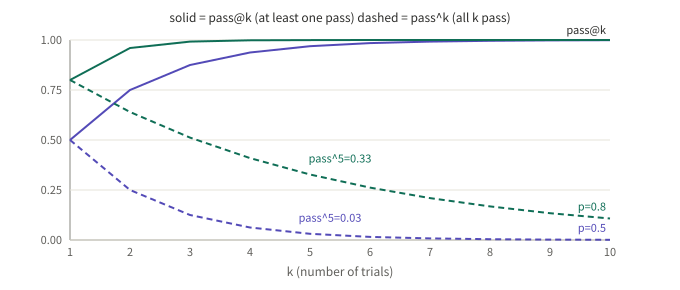
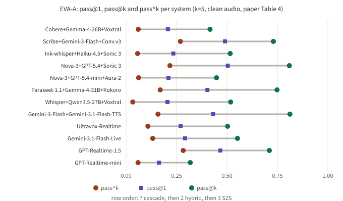

## Summary

EVA-Bench ([arXiv 2605.13841](https://arxiv.org/abs/2605.13841); 13 authors led by Tara Bogavelli, ServiceNow AI Research; I read v3, 2026-09-09) is a framework for evaluating voice agents. A "user bot" holds a full spoken conversation with the agent under test, over audio, across three domains (airline customer service, healthcare HR service delivery, enterprise IT service management) and 213 scenarios. Twelve systems (7 cascades, 2 hybrids, 3 speech-to-speech, S2S) are run five times per scenario on clean audio and scored with two composite metrics: EVA-A (accuracy) and EVA-X (experience).

My reading: what is worth taking away is not the leaderboard but **how results are reported**. The same trials yield pass@1 (average), pass@k (at least one of five passes) and pass^k (all five pass). Side by side they show the distance between what a system can do and what it does reliably. The paper's conclusions land there: no system exceeds 0.5 on both pass@1 metrics, and the median pass@k minus pass^k gap on EVA-A is 0.44. Caveats: twelve systems cannot support claims about "a class of architecture", and the LLM judges, the user simulator and the default turn detection all have limits, which the authors acknowledge.

## Key conclusions

- A single-trial score systematically overstates deployable reliability: the median pass@k minus pass^k gap is 0.44 on EVA-A and 0.24 on EVA-X (I recomputed it from Table 4; the EVA-A median is 0.443).
- No system exceeds 0.5 on both EVA-A and EVA-X pass@1. Only GPT-Realtime-1.5 clears 0.4 on both (0.467 and 0.566).
- The experience gap is almost entirely turn-taking: cascades average 0.28–0.58, S2S systems 0.82–0.83; the two hybrids fall in the cascade range.
- Within cascades, accuracy and experience trade off: the most accurate cascades had tool-call latency above 5 s; the two best-experience cascades had tool latency below 2.7 s but lower accuracy.
- The evaluation itself is noisy: in mixed-effects models, trial stochasticity accounts for 40.4–80.4% of variance on judge-graded metrics, judge stochasticity only 5.5–37.5%. Repeating trials is worth more than asking the judge more often (my inference).
- The user simulator makes mistakes: on four systems, 12.0% of trials had to be regenerated because of simulator errors, almost all of them the user drifting from its script.

## A few concepts first

**Cascade, hybrid, S2S.** A cascade is a text pipeline STT → LLM → TTS. S2S is one model with audio in and audio out. Hybrid sits between: at least one stage handles audio directly but the system is not end to end (here Gemini-3-Flash plus Gemini-3.1-Flash-TTS, and Ultravox-Realtime).

**Bot-to-bot evaluation.** The user side is also an agent. It receives a goal, constraints, a decision tree, a persona, a scenario database and a ground-truth end state, and talks to the system under test by audio over a WebSocket. The upside is that both architectures are compared under identical conditions and the run is repeatable; the cost is that results depend on whether the simulator behaves like a real caller, hence the validation below.

**Deterministic mock tool executor.** Tools called by the agent do not hit a real backend; a deterministic executor handles them, and task completion is decided by comparing the SHA-256 hash of the final database state with the ground truth.

**The three pass metrics.** With N scenarios and k trials each, every trial passes or fails:

```
pass@1 = share of all N·k trials that pass                       (average performance)
pass@k = share of scenarios where at least one trial passes      (ceiling)
pass^k = mean over scenarios of (that scenario's pass rate)^k    (probability all k pass)
```

The paper uses k=5 on clean audio. A small example shows why they differ so much. Suppose every trial is independent with pass rate p:



*Figure 2: An illustration, computed from 1-(1-p)^k and p^k, not paper data. At p=0.8, pass^5 is only 0.33; at p=0.5 it is 0.03 while pass@5 is already near 0.97.*

## How the evaluation is built: scenarios, simulation, validation, scoring


*Figure 1: An illustration based on Section 3 of the paper. Finished conversations pass simulator validation first; failures are regenerated before scoring.*

- **Scenarios.** 213 across three domains, each with a user goal and constraints, a decision tree, a persona, a scenario database and a ground-truth end state. The text I read does not give per-domain counts.
- **Simulator validation.** Before scoring, each conversation passes two automatic checks: user behavioural fidelity (LLM judge) and user speech fidelity (audio-LLM judge). Failures are regenerated. The paper reports 12.0% of trials regenerated on four systems, almost all for behavioural drift; speech issues account for under 4% of reruns. Separately, seven human reviewers read and listened to 50 airline conversations and rated content realism, audio naturalness and goal-correctness; all 50 passed all three.
- **Systems.** 7 cascades, 2 hybrids, 3 S2S; most are wired up with Pipecat, GPT-Realtime and Gemini Live use native SDKs, the Scribe pipeline uses ElevenAgents; all use default turn detection.
- **Perturbations.** French-accented speech, coffee-shop background noise, and both, on a 90-scenario subset (30 per domain), k=3.

## Metrics: how EVA-A and EVA-X decide a pass

A conversation passes only if all its sub-metrics meet their thresholds:

```
EVA-A pass = task completion = 1.0   and  faithfulness ≥ 0.5   and  speech fidelity ≥ 0.95
EVA-X pass = turn-taking ≥ 0.8       and  conversation progression ≥ 0.5   and  conciseness ≥ 0.5
```

| Sub-metric | How it is judged |
|---|---|
| Task completion | Deterministic: final database hash equals ground truth |
| Faithfulness | LLM judge: is each action grounded in instructions, policy, tool results or user input |
| Speech fidelity | Audio-LLM judge: does the spoken audio reproduce key entities (codes, dates, amounts) |
| Turn-taking | Deterministic, timestamp-based: interruption overlap, barge-in, yield latency, piecewise latency curve; turns with tool calls get looser latency thresholds |
| Conversation progression | LLM judge: repetition, context retention, stalling |
| Conciseness | LLM judge: is the reply short enough for speech |

Judge agreement (Cohen κ; quadratic-weighted for ordinal ratings, unweighted for speech fidelity):

| Metric | Judge vs judge κ | Judge vs human κ | Binary pass/fail: judge vs judge | Binary: judge vs human |
|---|---|---|---|---|
| Faithfulness | 0.836 | 0.740 | 0.860 | 0.731 |
| Conv. progression | 0.845 | 0.769 | 0.664 | 0.553 |
| Conciseness | 0.823 | 0.825 | 0.738 | 0.741 |
| Speech fidelity | 0.777 | 0.754 | 0.777 | 0.754 |

My reading: the binary agreement for conversation progression is the weakest (judge vs human κ is 0.553), and it is part of the EVA-X pass condition. The paper does not give finer per-metric numbers such as false-trigger rates, so readers should keep that in mind.

## Q1: How far apart are "right once" and "right every time"

**Conclusion: very far.** Full EVA-A results on clean audio, k=5 (paper Table 4; each cell also carries a bootstrap CI half-width of roughly ±0.03 to ±0.07, omitted here):

| System | Arch. | pass@1 | pass@k | pass^k | Gap | Task completion | Faithfulness | Speech fidelity |
|---|---|---|---|---|---|---|---|---|
| Cohere + Gemma-4-26B + Voxtral | Cascade | 0.207 | 0.416 | 0.060 | 0.356 | 0.338 | 0.375 | 0.983 |
| Scribe + Gemini-3-Flash + Conv. v3 | Cascade | 0.490 | 0.730 | 0.269 | 0.461 | 0.736 | 0.457 | 0.977 |
| Ink-whisper + Haiku-4.5 + Sonic 3 | Cascade | 0.234 | 0.516 | 0.057 | 0.459 | 0.374 | 0.518 | 0.983 |
| Nova-3 + GPT-5.4 + Sonic 3 | Cascade | 0.504 | 0.809 | 0.217 | 0.592 | 0.609 | 0.754 | 0.989 |
| Nova-3 + GPT-5.4-mini + Aura-2 | Cascade | 0.210 | 0.448 | 0.062 | 0.386 | 0.465 | 0.270 | 0.974 |
| Parakeet-1.1 + Gemma-4-31B + Kokoro | Cascade | 0.403 | 0.748 | 0.169 | 0.579 | 0.637 | 0.466 | 0.954 |
| Whisper + Qwen3.5-27B + Voxtral | Cascade | 0.205 | 0.518 | 0.033 | 0.485 | 0.417 | 0.546 | 0.913 |
| Gemini-3-Flash + Gemini-3.1-Flash-TTS | Hybrid | 0.431 | 0.812 | 0.158 | 0.654 | 0.674 | 0.443 | 0.969 |
| Ultravox-Realtime | Hybrid | 0.270 | 0.503 | 0.108 | 0.395 | 0.473 | 0.292 | 0.971 |
| Gemini-3.1-Flash-Live | S2S | 0.292 | 0.552 | 0.132 | 0.420 | 0.473 | 0.238 | 0.995 |
| GPT-Realtime-1.5 | S2S | 0.467 | 0.710 | 0.283 | 0.427 | 0.739 | 0.360 | 0.996 |
| GPT-Realtime-mini | S2S | 0.163 | 0.318 | 0.059 | 0.259 | 0.345 | 0.125 | 0.977 |

The "Gap" column is pass@k minus pass^k, computed by me; the two middle values after sorting are 0.427 and 0.459, a median of 0.443, matching the paper's 0.44.



*Figure 3: Redrawn from paper Table 4. The two ends of each grey line are pass^k and pass@k; the square is pass@1.*

How to read it:

1. **Rankings change.** By pass@k the top system is the Gemini-3-Flash plus TTS hybrid (0.812); by pass^k it is GPT-Realtime-1.5 (0.283), and that hybrid falls to 0.158. Looking only at pass@k would pick the least stable system.
2. **The biggest gaps belong to systems that look good on average.** The three largest gaps are 0.654, 0.592 and 0.579, with pass@1 of 0.431, 0.504 and 0.403.
3. **The drop from pass@1 to pass^k cannot be explained by independent trials.** (My inference.) Take GPT-Realtime-1.5: if every scenario had pass rate 0.467, pass^5 would be about 0.022 and pass@5 about 0.96; the actual values are 0.283 and 0.710. So scenarios differ a lot: some pass almost every time, some almost never. That matters in practice: a low pass^k can mean "the same scenario flips between pass and fail" or "a batch of scenarios is never solved", and the fixes differ, so look at per-scenario pass rates.
4. **The paper's pass^k is a plug-in estimate.** Each scenario's pass rate is estimated from the same k trials and raised to the k-th power (formula in Appendix A). I did not check its bias; read it with care when k is small.

## Q2: Why does no system exceed 0.5 on both

**Conclusion: the EVA-X pass condition is strict and dominated by turn-taking.**

Full EVA-X results (paper Table 4, confidence intervals again omitted):

| System | Arch. | pass@1 | pass@k | pass^k | Turn-taking | Conciseness | Conv. progression |
|---|---|---|---|---|---|---|---|
| Cohere + Gemma-4-26B + Voxtral | Cascade | 0.209 | 0.647 | 0.015 | 0.567 | 0.809 | 0.598 |
| Scribe + Gemini-3-Flash + Conv. v3 | Cascade | 0.024 | 0.061 | 0.004 | 0.451 | 0.774 | 0.804 |
| Ink-whisper + Haiku-4.5 + Sonic 3 | Cascade | 0.009 | 0.042 | 0.000 | 0.312 | 0.784 | 0.710 |
| Nova-3 + GPT-5.4 + Sonic 3 | Cascade | 0.007 | 0.031 | 0.000 | 0.283 | 0.835 | 0.737 |
| Nova-3 + GPT-5.4-mini + Aura-2 | Cascade | 0.113 | 0.416 | 0.005 | 0.583 | 0.835 | 0.428 |
| Parakeet-1.1 + Gemma-4-31B + Kokoro | Cascade | 0.010 | 0.035 | 0.000 | 0.308 | 0.829 | 0.774 |
| Whisper + Qwen3.5-27B + Voxtral | Cascade | 0.273 | 0.684 | 0.051 | 0.561 | 0.685 | 0.612 |
| Gemini-3-Flash + Gemini-3.1-Flash-TTS | Hybrid | 0.000 | 0.000 | 0.000 | 0.019 | 0.801 | 0.618 |
| Ultravox-Realtime | Hybrid | 0.029 | 0.081 | 0.006 | 0.417 | 0.750 | 0.429 |
| Gemini-3.1-Flash-Live | S2S | 0.589 | 0.979 | 0.240 | 0.830 | 0.801 | 0.636 |
| GPT-Realtime-1.5 | S2S | 0.566 | 0.939 | 0.216 | 0.815 | 0.801 | 0.679 |
| GPT-Realtime-mini | S2S | 0.406 | 0.893 | 0.099 | 0.818 | 0.722 | 0.388 |

How to read it:

- Conciseness and conversation progression do not separate the architectures; turn-taking does. For example Nova-3 + GPT-5.4 + Sonic 3 has conciseness 0.835 and progression 0.737, both fine, but turn-taking is 0.283 and EVA-X pass@1 is 0.007.
- A pass needs all three to clear their thresholds, and the turn-taking threshold is 0.8. The paper runs a sensitivity analysis: sweeping the threshold from 0.50 to 0.95 leaves the ranking broadly stable, with three pairs swapping, all within 0.15 pass@1 of each other.
- So a low EVA-X is largely "turn-taking almost never reaches its bar", which depends on latency and on each system's default turn detection (the paper acknowledges that all systems ran with default settings, unoptimised). My inference: this compares out-of-the-box configurations more than the best each architecture can do.
- The paper also notes that interruptions are not systematically generated in the conversations, so turn-taking robustness is under-stressed. The earlier [barge-in benchmarks article]({{ '/en/barge-in-benchmarks-2026/' | relative_url }}) covers exactly that part.

## Q3: Noise, accents and entities: where failures come from

**Conclusion: cascades lose accuracy under accents, S2S loses experience under noise; transcription of key entities is a bottleneck for cascades.**

The numbers below are the paper's report for the 90-scenario subset (k=3):

- Accent: cascade task completion drops by 10 points on average (17 for the worst system); none of 27 S2S model-metric pairs shows a significant accuracy drop.
- Noise: S2S EVA-X drops by 0.16 on average and turn-taking by 0.076; cascade turn-taking drops by 0.12 and task completion by 0.10 (S2S: 0.04). Cascade EVA-X baselines are already near zero (0.007–0.273), so there was little room to fall.
- Combined: cascade task completion drops by 19 points on average; the S2S mean stays within 5 points.
- Turn-taking is the most perturbation-sensitive metric: 81% of measurements show a significant drop.
- Key entities: across cascades, key-entity transcription accuracy correlates with task completion at Pearson r=0.93 (p=0.002); systems below 70% accuracy have task completion 0.37 against 0.60 above. Speech-fidelity failures concentrate on alphanumeric entities such as confirmation codes.
- Policy violations: S2S systems are flagged with violations in 24.6 percentage points more conversations on average, but the authors warn this may be confounded, since a system that cannot finish tasks has fewer chances to violate policy.

Caveats: correlation is not causation, and there are only seven cascades; the accent condition confounds accent with voice identity, and only one accent and one noise condition were tested.

## Q4: How noisy is the evaluation itself

**Conclusion: trial-to-trial randomness exceeds judge randomness.**

- Mixed-effects models: trial stochasticity accounts for 40.4–80.4% of total variance on judge-graded metrics and 52.7–100.0% on deterministic metrics; judge stochasticity 5.5–37.5%; scenario variance 0.0–47.3%.
- Permutation test: in all 16 tested model-by-judged-metric combinations, trial-level variability significantly exceeds judge-level variability (p<0.0001).
- Simulator: 12.0% of trials needed regeneration.

So repeating each scenario is worth at least as much as a stronger judge. My inference: when evaluating a voice agent, getting the number of repeats and the simulator validation right pays back more than repeatedly tuning judge prompts.

## Is EVA-Bench worth learning from: an engineering view

**Worth borrowing:**

- Report pass@1, pass@k and pass^k together and state k. The ceiling answers "can it", pass^k answers "can it every time".
- Decide task completion deterministically (end-state database hash) and leave only the subjective parts to judges; compare each judge metric with a small human sample using κ, ordinal and binary.
- Validate the simulator before scoring and report the regeneration rate; that rate is itself a credibility indicator.
- Sweep pass thresholds instead of giving a single value.
- Run perturbations (accent, noise, both) on a subset, the same subset for every system.

**Be careful about:**

- Cost: on clean audio each system needs 213×5=1065 full spoken conversations, before regeneration; reproduction needs commercial APIs, as the paper says.
- English only; the simulator may under-represent disfluency; tools are mocked and cannot capture how real APIs fail.
- LLM judges may favour outputs from their own model family; audio-LLM judges may be less reliable than text judges; task completion is binary with no partial credit.
- Twelve systems, default turn detection, unoptimised prompts: do not treat the results as verdicts on an architecture class.
- Each row is a specific version combination; scores will move as versions change.

**A practice to take away directly:** when designing an evaluation for a voice agent, at least repeat each scenario several times, report both the average and the all-pass rate, validate the simulated user first, sweep the pass thresholds, and break pass rates down per scenario.

## Conclusion

EVA-Bench puts two commonly ignored problems on the table: single-trial scores overstate reliability, and the "experience" half is mostly decided by turn-taking. The most useful part is the method: repeated trials, pass^k, simulator validation and threshold sensitivity. The part to treat with restraint is the leaderboard: few systems, default configurations, versions that change.

## References

- Bogavelli et al., *EVA-Bench*, [arXiv 2605.13841](https://arxiv.org/abs/2605.13841) (v3, 2026-09-09), ServiceNow AI Research.
- Code and scenarios: [ServiceNow/eva](https://github.com/ServiceNow/eva) (the paper says it is released under an open-source license; I did not check the licence terms).
- Project page (limitations and roadmap): <https://servicenow.github.io/eva/#limitations>

*Note: numbers in the tables come from paper Table 4 (arXiv HTML version); I recomputed the median EVA-A gap. Figures 1 and 2 are illustrations, Figure 3 is redrawn from paper Table 4. I mapped the Table 4 column headers to sub-metric names (task completion, faithfulness, speech fidelity; turn-taking, conciseness, conversation progression).*
