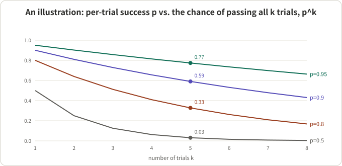
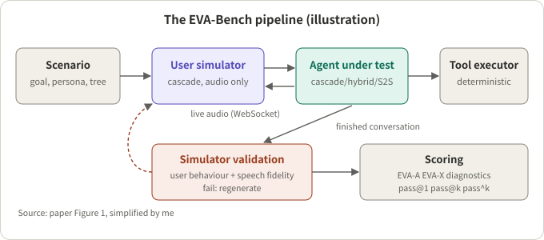
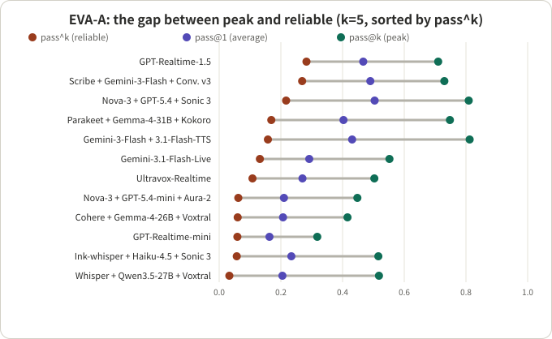

## Summary

EVA-Bench (13 authors led by Tara Bogavelli, ServiceNow AI Research; first submitted May 2026, v3 in September, accepted to EMNLP 2026 Findings) is an end-to-end framework for evaluating voice agents. A "user simulator" talks to the agent under test over live audio, each conversation passes a simulator-validation gate before scoring, scores split into Accuracy (EVA-A) and Experience (EVA-X), every scenario is run 5 times, and results are reported as pass@1, pass@k and pass^k. The paper tests 12 systems (7 cascade, 2 hybrid, 3 speech-to-speech) on 213 scenarios across three enterprise domains.

My reading: what is worth taking away is not the leaderboard but three design choices. First, define "success" as a binary outcome that requires several metrics to clear their bars at once; only then does "succeeds every time" mean something. Second, treat the user simulator as something to be tested, validate it, then score. Third, separate average, peak and reliable performance. On the other side, EVA-X is almost decided by a single metric (Turn-Taking) for today's systems, and half of the systems sit on the floor of EVA-X, so the pass@k to pass^k gap looks small there and needs careful reading.

| Question | One-line answer |
|---|---|
| Q1 How far apart are pass@k and pass^k? | The median EVA-A gap is 0.44: single-run scores systematically overstate deployable reliability |
| Q2 Why is EVA-X so low? | Mostly Turn-Taking; speech-to-speech systems lead clearly, and the thresholds are deliberately lenient |
| Q3 Can the user simulator pollute scores? | Yes: 12.0% of trials were regenerated because of simulator errors, almost all user-behaviour drift |
| Q4 How many trials are needed? | Variance comes mostly from the trials themselves; the paper argues k=3 gives about 0.03 uncertainty for model-level estimates |

## Key conclusions

- "Succeeds every time" is the number to look at before putting a voice agent in front of callers. Across the 12 systems the median EVA-A pass@k to pass^k gap is 0.44, and the best pass^5 is only 0.283.
- The three views reorder the systems. By pass@1, Nova + GPT-5.4 + Sonic 3 is first (0.504); by pass^5, GPT-Realtime-1.5 is first (0.283) and Nova + GPT-5.4 + Sonic 3 drops to third (0.217).
- No system exceeds 0.5 on both EVA-A and EVA-X pass@1. Among cascades, the more accurate systems tend to have worse experience, with mean latency above 5 s on tool-call turns.
- The simulator has to be validated: 12.0% of trials were regenerated for user-simulator errors. That makes scores reflect the agent more, but I think it also introduces a selection effect worth asking about (see Q3).
- The numbers are sensitive to setup: every framework's default turn detection, unoptimised system prompts, and Turn-Taking latency boundaries that were deliberately widened. The paper itself says tuning would likely raise scores.

## A few concepts first

**pass@1, pass@k, pass^k.** Record each trial as pass (1) or fail (0). Say a scenario is run k times and passes c of them.

- pass@1: the fraction of all trials that pass; the average "run it once" performance.
- pass@k: the fraction of scenarios where at least one of the k trials passes; the best case.
- pass^k: the paper takes each scenario's pass rate p̂ = c/k, raises it to the k-th power and averages over scenarios; the probability that all k trials pass.

They always satisfy pass^k ≤ pass@1 ≤ pass@k. A hand-checked example: if a scenario's per-trial success rate is p, then with k=5 the chance that all five pass is p^5.

| Per-trial success p | All 5 pass, p^5 | At least one of 5 passes, 1−(1−p)^5 |
|---|---|---|
| 0.95 | 0.774 | 1.000 |
| 0.90 | 0.590 | 1.000 |
| 0.80 | 0.328 | 1.000 |
| 0.50 | 0.031 | 0.969 |

*Figure 1: An illustration, not paper data. A per-trial success of 0.9 looks fine, yet five clean passes in a row happen only 59% of the time.*

A second example shows what averages hide: system A succeeds always on half of the scenarios and never on the other half; system B succeeds with 50% probability on every scenario. Both have pass@1 = 0.5, but under the paper's formula their pass^5 is 0.5 and 0.031.

**User simulator (bot-to-bot).** The program that plays the caller. In this paper it is built from speech recognition, an LLM and speech synthesis, receives a user goal, a decision tree and a persona, and talks to the agent over an audio connection. If the simulator itself errs (drifts from its goal, says the wrong thing), the error would be charged to the agent, so it must be validated.

**Cascade, hybrid, speech-to-speech.** Cascade is speech recognition → LLM → speech synthesis; speech-to-speech (S2S) is one model that listens and speaks directly; hybrid takes audio straight into an LLM but still uses a separate speech-synthesis stage. The comparisons below all rely on this three-way grouping.

**Deterministic vs. LLM-judged metrics.** Task completion and turn-taking are computed deterministically; faithfulness, conversation progression and conciseness are judged by an LLM; speech fidelity is judged by an LLM that can hear audio. The two kinds have different noise sources.

## How the benchmark is built

*Figure 2: Redrawn from the paper's Fig. 1. A conversation goes through simulator validation first; failures are regenerated, and only passing ones are scored.*

**Scenarios.** Each scenario has: a user goal with constraints (for example "depart before 10 pm, fare under a given amount"), a decision tree (removes ambiguity about how the user chooses, for repeatability), a persona, a database the tools read and modify, and the database state expected after success. Scenarios deliberately include confirmation codes, names and identifiers that are easily misheard when spoken. The three domains are airline customer service, healthcare HR service delivery and enterprise IT service management: 213 scenarios, English only for now.

**EVA-A (accuracy).**

| Metric | How it is computed | Pass condition |
|---|---|---|
| Task completion | Deterministic: SHA-256 hash of the final database state compared with the ground truth; any wrong, missing or extra change scores 0 | = 1.0 |
| Faithfulness | LLM judge: are the agent's actions grounded in instructions, policies, tool results and user input | ≥ 0.5 |
| Speech fidelity | Audio-capable LLM judge: does the spoken audio reproduce the intended text, especially confirmation codes, dates, amounts | ≥ 0.95 |

**EVA-X (experience).**

| Metric | How it is computed | Pass condition |
|---|---|---|
| Turn-Taking | Deterministic, timestamp-based; each turn is scored by type (agent interrupted, user interrupted, normal reply); turns with tool calls get a more lenient latency threshold | ≥ 0.8 |
| Conversation progression | LLM judge: repetition, context retention, driving toward resolution | ≥ 0.5 |
| Conciseness | LLM judge: are replies short enough for spoken delivery | ≥ 0.5 |

**Turning many metrics into one "pass".** A conversation passes a dimension only if every metric in that dimension clears its threshold. The paper's reason: simple averaging can mask serious failures on a single metric. I agree, and it has a cost: one metric's threshold can decide the whole dimension (Q2 shows this).

**Diagnostic metrics.** Not part of EVA-A or EVA-X; they make failures explainable. Example: key-entity transcription accuracy. A confirmation code that is one character off leaves word error rate almost unchanged, but the code is already unusable.

## Q1: How far apart are pass@k and pass^k?

**Conclusion: very far.** The table below is the full EVA-A data from the paper's Table 4 (clean condition, 5 trials, three domains pooled with equal weight; the last column is my own hand calculation of pass@k − pass^k).

| Arch. | System | pass@1 | pass@k | pass^k | Gap |
|---|---|---|---|---|---|
| Cascade | Cohere + Gemma-4-26B + Voxtral | 0.207 | 0.416 | 0.060 | 0.356 |
| Cascade | Scribe + Gemini-3-Flash + Conv. v3 | 0.490 | 0.730 | 0.269 | 0.461 |
| Cascade | Ink-whisper + Haiku-4.5 + Sonic 3 | 0.234 | 0.516 | 0.057 | 0.459 |
| Cascade | Nova-3 + GPT-5.4 + Sonic 3 | 0.504 | 0.809 | 0.217 | 0.592 |
| Cascade | Nova-3 + GPT-5.4-mini + Aura-2 | 0.210 | 0.448 | 0.062 | 0.386 |
| Cascade | Parakeet-1.1 + Gemma-4-31B + Kokoro | 0.403 | 0.748 | 0.169 | 0.579 |
| Cascade | Whisper + Qwen3.5-27B + Voxtral | 0.205 | 0.518 | 0.033 | 0.485 |
| Hybrid | Gemini-3-Flash + Gemini-3.1-Flash-TTS | 0.431 | 0.812 | 0.158 | 0.654 |
| Hybrid | Ultravox-Realtime | 0.270 | 0.503 | 0.108 | 0.395 |
| S2S | Gemini-3.1-Flash-Live | 0.292 | 0.552 | 0.132 | 0.420 |
| S2S | GPT-Realtime-1.5 | 0.467 | 0.710 | 0.283 | 0.427 |
| S2S | GPT-Realtime-mini | 0.163 | 0.318 | 0.059 | 0.259 |

Sorting the 12 gaps and averaging the middle two (0.427 and 0.459) gives 0.443, matching the paper's 0.44.

*Figure 3: Sorted by pass^k, the order of pass@k does not follow.*

Three things to read from the table:

- **Rankings change with the view.** The highest pass@k is Gemini-3-Flash + Gemini-3.1-Flash-TTS (0.812), but its pass^k ranks only fifth (0.158). GPT-Realtime-1.5 is third on pass@1 and first on pass^5.
- **Systems exist where "can do it" and "reliably does it" differ by an order of magnitude.** Whisper + Qwen3.5-27B + Voxtral has pass@k 0.518 and pass^k 0.033.
- **Even the best system reaches only 0.283.** The paper concludes that single-trial scores systematically overstate deployment-grade reliability; I think the table supports that.

**A detail worth checking yourself.** The paper's pass^k is the mean of p̂^k with p̂ = c/k. When the number of trials n equals k, this is not "the share of scenarios where all 5 trials passed": a scenario that passes 4 of 5 contributes 0.8^5 ≈ 0.33 under the paper's formula and 0 under an all-passed count. My inference (Jensen's inequality for a convex function): for n = k, the mean of p̂^k is at least as large as the expected all-passed share, so this pass^5 is the optimistic estimator. That is fine for comparing systems inside this paper, but do not compare it directly with pass^k numbers computed as an all-passed share elsewhere.

## Q2: Why is EVA-X so low?

**Conclusion: it is almost entirely Turn-Taking.** Below is the full EVA-X data from the paper's Table 4.

| Arch. | System | pass@1 | pass@k | pass^k | Turn-Taking mean | Conciseness | Conv. progression |
|---|---|---|---|---|---|---|---|
| Cascade | Cohere + Gemma-4-26B + Voxtral | 0.209 | 0.647 | 0.015 | 0.567 | 0.809 | 0.598 |
| Cascade | Scribe + Gemini-3-Flash + Conv. v3 | 0.024 | 0.061 | 0.004 | 0.451 | 0.774 | 0.804 |
| Cascade | Ink-whisper + Haiku-4.5 + Sonic 3 | 0.009 | 0.042 | 0.000 | 0.312 | 0.784 | 0.710 |
| Cascade | Nova-3 + GPT-5.4 + Sonic 3 | 0.007 | 0.031 | 0.000 | 0.283 | 0.835 | 0.737 |
| Cascade | Nova-3 + GPT-5.4-mini + Aura-2 | 0.113 | 0.416 | 0.005 | 0.583 | 0.835 | 0.428 |
| Cascade | Parakeet-1.1 + Gemma-4-31B + Kokoro | 0.010 | 0.035 | 0.000 | 0.308 | 0.829 | 0.774 |
| Cascade | Whisper + Qwen3.5-27B + Voxtral | 0.273 | 0.684 | 0.051 | 0.561 | 0.685 | 0.612 |
| Hybrid | Gemini-3-Flash + Gemini-3.1-Flash-TTS | 0.000 | 0.000 | 0.000 | 0.019 | 0.801 | 0.618 |
| Hybrid | Ultravox-Realtime | 0.029 | 0.081 | 0.006 | 0.417 | 0.750 | 0.429 |
| S2S | Gemini-3.1-Flash-Live | 0.589 | 0.979 | 0.240 | 0.830 | 0.801 | 0.636 |
| S2S | GPT-Realtime-1.5 | 0.566 | 0.939 | 0.216 | 0.815 | 0.801 | 0.679 |
| S2S | GPT-Realtime-mini | 0.406 | 0.893 | 0.099 | 0.818 | 0.722 | 0.388 |

Points:

- **Turn-Taking stratifies by architecture.** Cascade means are 0.28–0.58, S2S 0.82–0.83, with no overlap. Conciseness and conversation progression show no such split.
- **The threshold turns a difference into "all or nothing".** The Turn-Taking pass line is 0.8 (roughly "at most one off-time turn in five"), and the appendix says any threshold between 0.6 and 0.8 gives the same pass/fail partition of the 12 systems. So a system with a Turn-Taking mean of 0.58 has EVA-X pass@1 of only 0.113, and one with 0.28 has 0.007: under the pass view both are low, and most of the difference in the mean is erased by the threshold.
- **A caution about the "0.24 gap".** The paper reports a median EVA-X pass@k to pass^k gap of 0.24, but six systems have pass@k below 0.1 in the table, so their gaps are necessarily tiny. The median falls between the floored systems and the high scorers, so it is not a good summary of "EVA-X reliability". My own approach: compare only systems whose pass@k is clearly above zero (six systems in EVA-X, gaps 0.41–0.79).
- **The latency boundaries are deliberately widened.** The paper notes human turn gaps are around 200 ms, the fastest evaluated systems answer in about 1 s on non-tool turns and most cascades take 2–5 s, so it widened the "sweet spot" to what current systems can achieve. The boundary values can be changed for a use case.
- **Accuracy and experience trade off among cascades.** The three most accurate cascades have mean latency above 5 s on tool-call turns; the two with better experience are below 2.7 s but less accurate. The paper calls this a "potential capability–latency tension"; the sample is seven cascades.

Note also that the paper admits the simulator **does not systematically generate interruptions**, so the benchmark under-stresses interruption handling and cannot separate systems that handle it well from those that do not. For interruption-specific evaluation, see [this survey of barge-in benchmarks]({{ '/en/barge-in-benchmarks-2026/' | relative_url }}).

## Q3: Can the user simulator pollute scores?

**Conclusion: yes; the paper validates before scoring, but this step deserves follow-up questions.**

Validation has two checks: user behavioural fidelity (an LLM judge checks whether the simulator drifted from its assigned goal) and user speech fidelity (an audio-capable LLM judge checks whether what the simulator said aloud was correct). If either fails, the conversation is regenerated. Across four systems and all domains, 12.0% of trials needed a rerun, almost all for behavioural drift; speech problems account for under 4% of reruns.

The paper adds two supports for credibility:

- Seven human reviewers rated 50 airline-domain conversations on content realism, audio naturalness and goal faithfulness; all 50 passed.
- Judge–human agreement: quadratic-weighted κ of 0.836, 0.845, 0.823 and 0.777 for faithfulness, conversation progression, conciseness and speech fidelity, comparable to or above agreement between two human annotators (0.740, 0.769, 0.825, 0.754). The paper itself notes that human–human agreement is a practical, not strict, ceiling.

**My two questions, both inference rather than the paper's claims.**

1. Reruns target "simulator errors", but the decision that the simulator erred is made by an LLM judge as well. If some agents' behaviour makes the simulator more likely to drift (repeated questions, long answers), those systems get rerun more often, and what remains are the smoother conversations. The paper reports only a pooled rerun rate over four systems, not per system, so this cannot be judged.
2. The paper also acknowledges that judges may favour outputs from their own model family, that the simulator is built on commercial systems whose behaviour may change across versions, and that its fluency may under-represent real callers' disfluencies.

## Q4: How many trials?

**Conclusion: variance comes mostly from the trials themselves; k=3 is enough for model-level estimates, but it depends on what you use it for.**

The paper decomposes variance with linear mixed-effects models: on judge-graded metrics, trial stochasticity accounts for 40.4%–80.4% of total variance, judge stochasticity for 5.5%–37.5%, and scenario variance for 0.0%–47.3% (the ranges need not add to 100% because each model and metric is fitted separately). A permutation test shows that trial-to-trial variability exceeds judge variability for all 16 model × metric combinations tested. So re-running the same scenario really does change the outcome; it is not the judge wobbling.

For trial counts, the paper subsamples: for each model and metric it draws k of the available trials and measures the 95% interval width of the estimate.

- Per-turn metrics (speech fidelity, conciseness, Turn-Taking) have interval width below 0.02 already at k=1.
- Conversation-level and pass metrics have width 0.05–0.09 at k=1, about 0.02–0.03 at k=3; at k=3 the median interval width is at most 0.034 for every metric.
- Hence the perturbation experiments use k=3 (and a 90-scenario subset), and the clean condition uses k=5.

My inference: this argument is about **model-level aggregate scores**. To judge whether one specific scenario is reliable, you have only 3–5 trials per scenario, the uncertainty in the scenario-level p̂ is much larger, and the conclusion does not transfer.

## Checking the paper's text against its tables

- "No system exceeds 0.5 on both pass@1": holds in the table. The closest is Nova-3 + GPT-5.4 + Sonic 3 with EVA-A 0.504 but EVA-X 0.007; the paper's other claim, that only GPT-Realtime-1.5 (0.47, 0.57) clears 0.4 on both, also matches.
- "Hybrid systems do not inherit the latency advantage of S2S": there are only two hybrids, with EVA-X of 0.000 and 0.029; the paper says "may" and that more systems are needed. I agree with that wording, and it should not be quoted as a finding.
- S2S systems "have more policy violations (+24.6 percentage points)": the paper itself says the comparison may be confounded, since a system that never completes a conversation has fewer chances to violate a policy. Do not quote this number on its own.
- Perturbation experiments: one accent (French), one noise type (coffee shop), and the accent condition is confounded with a different synthetic voice. The paper states this; the conclusion can only be "there are gaps", not generalisation to other accents.
- Limitations section: task completion is binary with no partial credit; all tools are mock executors, so real-API failures, latency variance and partial responses are not covered.

## Is the EVA-Bench approach worth borrowing? An engineering view

**Where it pays off (with preconditions).**

- **Deciding whether an agent can be left alone with a class of requests.** Precondition: each scenario can be judged automatically (here via the final-state database hash); only then is pass^k meaningful.
- **Comparing architectures.** Precondition: the same user simulator, the same scenarios, and configurations of comparable depth for every system.
- **Maintaining a simulator over time.** Precondition: willingness to pay for validation and reruns; the paper itself says a full run is many model calls.

**Where it does not.**

- Scenarios heavy on interruptions, talking over, and spoken disfluency: the paper admits the simulator does not generate interruptions.
- Non-English or dialect scenarios: English only for now.
- Tasks where only the "final state" matters for accuracy: binary task completion scores a system that misses by one step the same as one that fails entirely.

**Comparison caveats.** Systems run on different frameworks (some on vendor SDKs, some on an open-source pipeline, one on another platform), all with default turn detection; system prompts were not optimised; judge and system under test may share a model family; all of this affects absolute numbers.

**Ideas that can be borrowed directly.**

- Define "pass" first (several metrics clearing their bars together), then talk about pass@k and pass^k; report pass@1, pass@k and pass^k with 95% confidence intervals.
- Repeat each scenario several times and decompose variance to confirm the fluctuation comes from trials, not the judge.
- Validate the user simulator before scoring and report the rerun rate per system.
- Give spoken key entities their own metrics (key-entity transcription accuracy, speech fidelity) instead of relying on word error rate.
- Calibrate thresholds to what current systems can do, and check how sensitive the ranking is to them, so one metric's threshold does not decide a whole dimension.

## Conclusion

The value of EVA-Bench is in its method: binary pass, repeated trials, simulator validation, and three views side by side. On this data, the safest reading is that no evaluated system can be trusted to be right every time, and that rankings change with the view. The places to be careful are EVA-X being decided by one metric, reruns possibly introducing a selection effect, and pass^k using the optimistic estimator.

## References

- [EVA-Bench: A New End-to-end Framework for Evaluating Voice Agents (arXiv 2605.13841)](https://arxiv.org/abs/2605.13841), Tara Bogavelli et al., ServiceNow AI Research; Tables 2–4, Appendices A, E, H and the limitations section cited here come from the v3 HTML full text
- [EVA-Bench code and data (GitHub)](https://github.com/ServiceNow/eva): released under an open-source licence; the address is taken from the paper's abstract
- [τ-bench: A Benchmark for Tool-Agent-User Interaction in Real-World Domains (Yao et al.)](https://arxiv.org/abs/2406.12045): the text-agent benchmark the paper cites; the "all k trials pass" idea behind pass^k is related

Related reading: [How to Evaluate Barge-In]({{ '/en/barge-in-benchmarks-2026/' | relative_url }}), [Reading Higgs Realtime Duplex]({{ '/en/higgs-realtime-duplex/' | relative_url }}).

*Note: all numbers come from the paper's v3 tables and text and are author-reported, not reproduced by me; the "Gap" column, the p^5 table and the median check are my own hand calculations; "my inference" marks personal judgement. The per-system configurations (Appendix B) are not covered here.*
