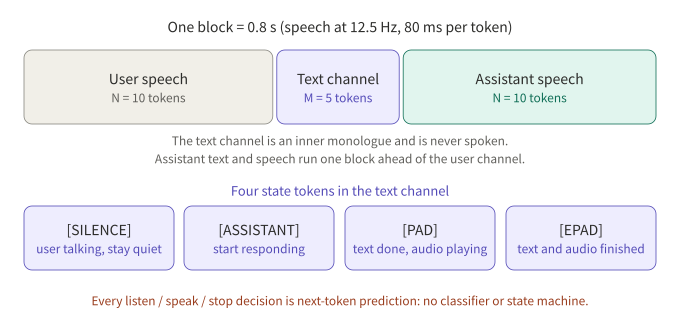
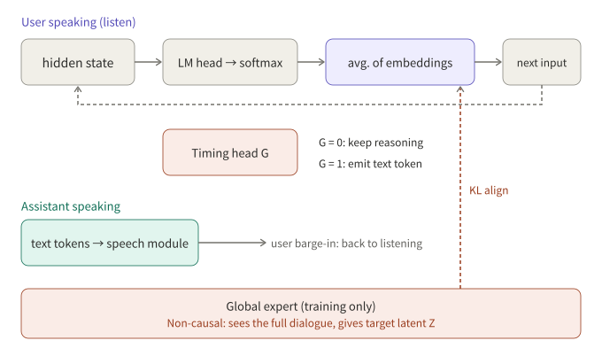

## Summary

One hard question for full-duplex speech models is what the model is doing while the user is talking. Two 2026 papers answer it differently:

- **BayLing-Duplex** (arXiv 2606.14528) turns "listen, speak, stop" into four state tokens in a text channel, predicted by the same autoregressive LLM, and adds a light DPO stage aimed only at timing.
- **FLAIR** (arXiv 2603.17837) argues that the user's speaking time should not be spent on idle silence or padding. The model should keep reasoning in latent space, without adding inference latency.

The first tackles when to speak and when to stop. The second tackles whether listening time can do useful computation. The two ideas are not mutually exclusive.

## Key conclusions

- BayLing-Duplex adds only four state tokens to the vocabulary, with no new modules. Every decision is next-token prediction, so once the external VAD is gone, timing quality is decided by training data and loss weights.
- Its ablation shows token weights are decisive: with uniform weights the model stays almost permanently silent (60.3% turn-taking success). Lowering the [SILENCE] weight restores most of the behavior.
- During listening, FLAIR feeds back a softmax-weighted average of vocabulary embeddings as a continuous latent input. A training-only, non-causal expert provides the target; it is dropped at inference.
- FLAIR's own results: latent reasoning gives small gains on knowledge-style QA and neither clearly improves nor clearly hurts turn-taking and barge-in.
- Training and evaluation audio in both papers is largely synthetic. The numbers are not comparable across papers and should not be extrapolated to noisy, multi-speaker real conditions.

## 1. The problem: listening time is wasted

A half-duplex voice pipeline hands listening to VAD and ASR and only gives speaking to the LLM. A full-duplex model puts both streams on one timeline, which raises two new problems:

1. **Timing**: when to take the turn, when to stay quiet, and how fast to stop when interrupted.
2. **Idle slots**: while the user talks, the output side can only emit silence or padding, and those positions contribute nothing to the eventual answer.

BayLing-Duplex mostly addresses the first problem and FLAIR the second. For the fixed-window "listen or speak" approach of MiniCPM-o 4.5, see [the earlier article]({{ '/en/minicpm-o-45-realtime-venus/' | relative_url }}); this one covers two other design directions.

## 2. BayLing-Duplex: writing timing into tokens

### 2.1 Structure

BayLing-Duplex starts from the public GLM-4-Voice: a speech tokenizer turns 16 kHz audio into 12.5 Hz tokens (80 ms each), a 9B decoder-only LLM sits in the middle, and a speech decoder follows. The only change is how the sequence is laid out, plus four new tokens.

The sequence is interleaved in blocks: N user speech tokens, then M text tokens, then N assistant speech tokens. The paper uses N=10 and M=5, so a block is 0.8 s and the text channel runs at about 6.25 tokens per second. The text channel acts as an inner monologue that is never spoken. Besides text, it carries four state tokens:

*Figure 1: Block layout. Assistant text and speech run one block ahead of the user channel; every turn-taking decision is next-token prediction.*

Block size is a trade-off. A small N leaves too few text slots and makes timing jittery; a large N raises the minimum response latency (0.8 s at N=10). The paper does not sweep it systematically.

Inference decodes block by block: take N user tokens, sample M text tokens under a mask that allows only text and state tokens, then sample N speech tokens under a mask that allows only speech tokens. If the user barges in mid-block, speech tokens already being generated finish first, and only the next block sees the new audio. So the granularity of barge-in response is the block, not the token.

### 2.2 Training: SFT plus a light DPO round

- **Data**: built on the 200K multi-turn speech dialogues from LLaMA-Omni 2, with 200K synthesized samples for each of two scenarios, mixed 1:1. In turn-taking samples the assistant answers after a 0.8 s gap. In interruption samples the user cuts in during the response and the assistant reacts after a random delay of 0.8 to 2.0 s.
- **SFT**: cross-entropy only at text and assistant-speech positions, with separate token weights for [SILENCE] and for [ASSISTANT]/[EPAD].
- **DPO**: negatives perturb only the timing of the assistant's response; audio and text are identical to the positive. Turn-taking negatives stretch the gap to 2 to 5 s, and interruption negatives stretch the reaction delay to 3 to 5 s. Training runs only 200 steps at learning rate 1e-7 with β=0.5.

The "change timing, not content" negative is the most reusable idea here. It confines the preference signal to timing, so the model cannot learn anything else from it.

### 2.3 Results and ablation

Reported by the paper, against Moshi, on synthetic evaluation audio:

| Model | Llama Q. | Web Q. | Turn-taking SR@3s | Time to stop after barge-in (s, lower is better) | Interruption SR@2s |
|---|---|---|---|---|---|
| Moshi | 21.0 | 9.2 | 71.9 | 2.07 | 81.9 |
| BayLing-Duplex (SFT) | 44.3 | 18.0 | 88.9 | 1.51 | 91.4 |
| BayLing-Duplex (+DPO) | 46.0 | 18.1 | 92.0 | 1.10 | 100.0 |

The token-weight ablation is more telling. With uniform weights the model stays silent most of the time and turn-taking success is 60.3%. Lowering only the [SILENCE] weight gives 82.4%. Also raising the role-token weight gives 88.9%. The paper itself notes that the 100% interruption success in the uniform row is degenerate: a model that rarely speaks has nothing to stop.

My reading (inference, not a paper claim): in a state-token design, silence tokens dominate the sequence, so class imbalance alone pushes the model toward silence. The weights are not a detail; the design depends on them.

## 3. FLAIR: keep thinking while listening

### 3.1 Motivation

The paper notes that existing full-duplex models either emit repeated padding or silence tokens while the user speaks, or, if one forces explicit text chain-of-thought into that time, it conflicts with streaming causality: when the user finishes or interrupts, the thinking and the speech output are hard to synchronize. FLAIR (paper title *The Silent Thought*) reasons in continuous latent space instead, with no reasoning annotations and no added inference latency.

### 3.2 Method

*Figure 2: While the user speaks, the hidden state goes through the LM head and softmax, and a weighted average of vocabulary embeddings becomes the next input. A timing head G decides when to switch to emitting text tokens.*

- **Listening**: the previous hidden state goes through the LLM head to get a vocabulary distribution, and a softmax-weighted average over the embedding matrix gives the next input embedding. The loop is causal and recurrent.
- **Speaking**: a timing head (an MLP on the final hidden state) predicts G. With G=0 the model keeps reasoning in latent space and sends `<SIL>` to the speech module; with G=1 it emits a text token and feeds its embedding back. On barge-in it returns to latent reasoning.
- **Global expert (training only)**: a non-causal encoder sees the whole dialogue and produces the same kind of vocabulary-weighted target. The LLM's distribution on listening frames is aligned to it with a KL term, so the causal prior is pulled toward a posterior that has seen the full context. The expert is discarded at inference.
- **Loss**: a reconstruction loss on response segments, a KL regularizer, and a timing loss for G, forming an ELBO-style SFT objective.

Training has four steps: ordinary full-duplex pre-training; latent-reasoning SFT with reconstruction loss only; joint training with the full ELBO; and finally freezing everything but the speech generation module. Data includes 530K hours of synthetic two-speaker pseudo-dialogues, 70K hours of instruction QA, and 20K hours of QA built from real ASR corpus transcripts, with a 10% chance of a simulated barge-in on longer responses.

### 3.3 Results: helpful, but modest

As reported, with latent reasoning (thk) on versus off:

| Benchmark | With thk | Without thk |
|---|---|---|
| Llama Questions | 78.0 | 73.0 |
| WebQuestions | 43.0 | 41.7 |
| TriviaQA | 51.2 | 53.8 |
| OpenBookQA | 74.2 | 72.9 |
| MMSU | 56.2 | 50.2 |

Most tasks improve, MMSU the most (+6.0), and TriviaQA drops slightly. On conversational behavior, Full-Duplex-Bench turn-taking takeover rate is 93.0 vs. 94.1 and barge-in takeover rate is 92.0 vs. 89.0, with similar latency. The authors conclude that latent reasoning leaves conversational dynamics intact, not that it improves them.

The paper also notes that some half-duplex baselines score higher on certain benchmarks (for example Kimi-Audio at 62.2 on MMSU), which the authors attribute to data mismatch and their own shorter answers.

## 4. Side by side

| Dimension | BayLing-Duplex | FLAIR |
|---|---|---|
| Main problem | Timing: when to speak, when to stop | How to use listening time |
| Core mechanism | Four state tokens in a text channel, block interleaving | Recurrent latent input, plus a training-time expert |
| Extra modules | None | Timing head; training-only global expert |
| Preference optimization | DPO that perturbs only timing | Mentioned as possible post-training, not done |
| Barge-in granularity | Block (0.8 s); in-flight speech finishes first | Per token, via the timing head |
| Main gains | Turn-taking and barge-in metrics | Some knowledge-style QA |
| Data | Synthetic, single speaker, near-field, noise-free | Mostly synthetic, with noise and multi-speaker augmentation |

The two could be combined (inference): state tokens make timing explicit and latent reasoning makes listening positions compute something useful. The papers do not try this, and the two schemes use the padding positions in conflicting ways, so a combination would need a redesigned sequence format.

## 5. Caveats when reading this kind of paper

1. **Synthetic audio.** BayLing-Duplex trains and evaluates on fully synthetic, single-speaker, near-field, noise-free audio, and its authors say noise, reverberation and competing speakers are untested. FLAIR adds noise and multi-speaker augmentation but is still mostly synthetic.
2. **Different baselines.** BayLing-Duplex compares with Moshi; FLAIR compares its own on/off variants and several half-duplex models. Numbers do not transfer across papers.
3. **Metric definitions.** "Time to stop after barge-in" depends on VAD segmentation; BayLing-Duplex uses Silero VAD for evaluation only. A different segmenter changes the numbers.
4. **Latency floor.** A block design has a structural latency floor. It is a design choice, not something tuning removes.

## 6. Conclusion

Both papers treat the listening positions as a resource. BayLing-Duplex uses them to carry control signals; FLAIR uses them to compute. For anyone building full-duplex voice, the first offers a recipe that can be followed directly (block interleaving, token weights, timing-only DPO), and the second a direction worth watching whose benefit is not yet clear. What will really decide quality is evaluation in real conditions, which is exactly the gap both papers share.

## To verify

- FLAIR's loss weights α and β and the exact ablation numbers were not in the paper page I read; check the original.
- FLAIR's tables come from the page text of arXiv v5; for Full-Duplex-Bench numbers, rely on the paper.

## References

- [BayLing-Duplex: Native Full-Duplex Speech Dialogue with a Single Autoregressive LLM (arXiv 2606.14528)](https://arxiv.org/abs/2606.14528)
- [The Silent Thought: Modeling Internal Cognition in Full-Duplex Spoken Dialogue Models via Latent Reasoning (arXiv 2603.17837)](https://arxiv.org/abs/2603.17837)

*Note: all numbers come from the page text of the two papers above, as reported by their authors, and were not reproduced by me.*
