## Summary

A full-duplex speech system has to answer three questions: what the model does while the user talks, when it should speak, and how it stops when interrupted. This article puts seven public systems side by side. Each one gets its own architecture figure, how it works, the results it reports and its official demos:

- **BayLing-Duplex**: four state tokens in a block-interleaved sequence; every decision is next-token prediction.
- **FLAIR**: keep reasoning in latent space while the user speaks.
- **Diffuplex**: an autoregressive policy handles timing, a diffusion model generates content in parallel.
- **RoboBrain-Audio (FLM-Audio)**: three channels merged into one input, with a "natural monologue" text channel.
- **Seeduplex**: a native full-duplex model fully rolled out in a consumer app, stressing interference robustness and dynamic end-of-turn.
- **Dessa**: a speech-to-speech model trained from scratch on human conversation only.
- **FireRedChat**: keeps the models and adds a turn-taking controller that makes a half-duplex pipeline full duplex.

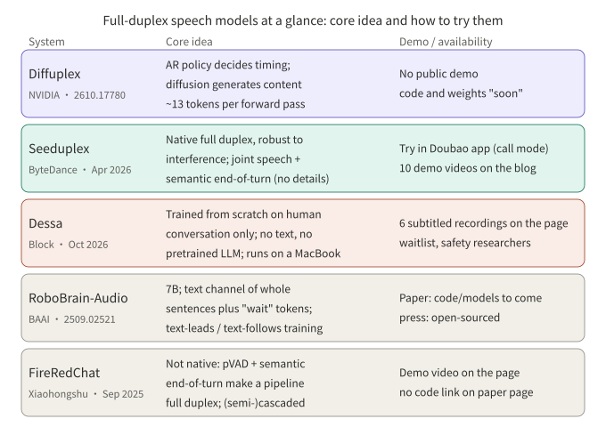

*Figure 1: One-page overview. The five rows are Diffuplex, Seeduplex, Dessa, RoboBrain-Audio and FireRedChat; BayLing-Duplex and FLAIR are in sections 1 and 2. Availability follows each official page.*

## Key conclusions

- Three routes: let a native model predict timing itself (BayLing-Duplex, and Seeduplex as officially described), add a controller outside the model (FireRedChat), or change how content is generated (Diffuplex, FLAIR).
- The papers publish their architectures. Seeduplex and Dessa do not publish internals, so the figures for them here are conceptual and are labeled as such.
- Only Seeduplex can be tried directly today (the call mode in the Doubao app). Dessa is waitlist-only and Diffuplex has no released code.
- All numbers are self-reported by authors or vendors, with different baselines and mostly synthetic or internal evaluation data. They cannot be compared across systems.

## 1. BayLing-Duplex: writing timing into tokens

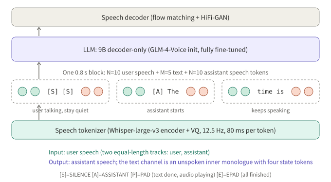

*Figure 2: Speech tokenizer, a single LLM and a speech decoder. Each 0.8-second block holds user speech, text-channel and assistant speech tokens in turn.*

**How it works** (arXiv 2606.14528)

- Starts from the public GLM-4-Voice: a speech tokenizer (Whisper encoder plus VQ; 12.5 Hz, 80 ms per token), a 9B decoder-only LLM, and a flow-matching plus HiFi-GAN speech decoder. The only change is four state tokens; no new modules.
- The sequence is interleaved in blocks: N=10 user speech tokens, M=5 text tokens, N=10 assistant speech tokens, 0.8 s per block. The text channel is an unspoken inner monologue; [SILENCE], [ASSISTANT], [PAD] and [EPAD] express listening, speaking, playing and finished.
- Inference runs block by block: sample text under a mask allowing only text and state tokens, then assistant speech under a mask allowing only speech tokens. If the user barges in mid-block, in-flight speech finishes first and only the next block sees the new audio, so barge-in granularity is the block.
- Training: SFT plus a 200-step light DPO. Data are synthesized turn-taking and interruption scenarios, 200K each, built on 200K dialogues from LLaMA-Omni 2. DPO negatives perturb only the timing of the assistant's response; audio and text match the positive.

**Results** (paper-reported, baseline Moshi, synthetic evaluation audio):

| Model | Llama Q. | Web Q. | Turn-taking SR@3s | Time to stop (s) | Interruption SR@2s |
|---|---|---|---|---|---|
| Moshi | 21.0 | 9.2 | 71.9 | 2.07 | 81.9 |
| BayLing-Duplex (SFT) | 44.3 | 18.0 | 88.9 | 1.51 | 91.4 |
| BayLing-Duplex (+DPO) | 46.0 | 18.1 | 92.0 | 1.10 | 100.0 |

In the ablation, token weights are decisive: with uniform weights the model stays silent most of the time (60.3% turn-taking success); lowering the [SILENCE] weight gives 82.4%, and also raising the role-token weight gives 88.9%. The paper notes the 100% interruption success in the uniform row is degenerate. My reading (inference): silence tokens dominate the sequence, so class imbalance alone pushes the model toward silence.

Limitations: training and evaluation audio is fully synthetic, single-speaker, near-field and noise-free; N=10 puts a 0.8 s floor on response latency.

## 2. FLAIR: keep thinking while listening

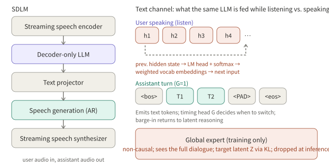

*Figure 3: Left, the streaming pipeline. Right, what the same LLM is fed while listening (latent embeddings) and speaking (text tokens). The global expert is used only in training.*

**How it works** (arXiv 2603.17837, paper title *The Silent Thought*)

- Motivation: existing full-duplex models emit only padding or silence while the user speaks, which contributes nothing to the answer; explicit text chain-of-thought conflicts with streaming causality and is hard to synchronize when the user finishes or interrupts.
- Listening: the previous hidden state goes through the LM head to a vocabulary distribution, and a softmax-weighted average over the embedding matrix becomes the next input. The loop is causal and recurrent.
- Speaking: a timing head (an MLP on the final hidden state) predicts G; with G=1 it emits a text token, with G=0 it keeps reasoning latently. On barge-in it returns to latent reasoning.
- Training: a non-causal global expert sees the whole dialogue and provides target latents; the LLM's listening-time distribution is KL-aligned to it, and the expert is dropped at inference. The loss has reconstruction, KL and timing terms in an ELBO form.
- Data: 530K hours of synthetic two-speaker pseudo-dialogues, 70K hours of instruction QA, 20K hours of QA built from real ASR transcripts.

**Results** (paper-reported): with latent reasoning on, Llama Questions 78.0 vs. 73.0, MMSU 56.2 vs. 50.2, TriviaQA 51.2 vs. 53.8 (slightly lower). On Full-Duplex-Bench, turn-taking takeover rate is 93.0 vs. 94.1 and barge-in takeover rate 92.0 vs. 89.0. The authors conclude it leaves conversational dynamics intact rather than improving them. The loss weights α and β and the full ablation were not in the page I read.

## 3. Diffuplex: separating "when to speak" from "what to say"

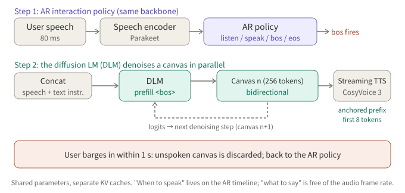

*Figure 4: One backbone, two modes. The AR policy reads speech and emits states; on bos, the diffusion mode iteratively denoises a 256-token canvas and the first 8 tokens go to TTS early.*

**How it works** (arXiv 2610.17780, NVIDIA, *Full-duplex Spoken Language Modeling with Discrete Diffusion*)

- Argument: squeezing "when" and "what" onto one autoregressive timeline makes them compete, and generation speed is tied to the audio frame rate.
- The AR policy reads Parakeet-encoded speech in 80 ms chunks and predicts one of listen, speak, bos, eos. On bos, speech and text instructions are concatenated and prefilled into the diffusion language model, which denoises a 256-token canvas bidirectionally.
- Anchored prefix: the first 8 tokens of the canvas are committed within at most K passes and streamed to TTS (CosyVoice 3) while the rest keeps denoising. If the user interrupts within one second, the unspoken canvas is discarded. The two modes share parameters and keep separate KV caches.
- Training has three steps: modality alignment (ASR); spoken instruction following (about 600K examples, distilled from a frozen text model); and full duplex (generator frozen; only the interaction head and a listening-mode LoRA trained, on about 120 hours of synthetic dialogue plus 70 hours of conversational data).

**Results** (paper-reported): about 13.0 tokens per forward pass versus 1.00 for autoregressive baselines; up to 1,872 tokens/s at batch 1 on one GB300, versus 394 and 300. The authors note the throughput gain is smaller than the per-pass gain because a diffusion pass costs more. VoiceBench: 86.9 with thinking and 84.1 without at the instruction-following stage; the full-duplex stage (no thinking) scores 82.3 against 58.1 for Nemotron-3 VoiceChat. First-audio latency trades off against quality through K: K=2 gives 251 ms and 80.5, uncapped gives 497 ms and 84.0 (RTX 6000, excluding the AR turn decision). Removing text-anchored distillation drops the score to 66.1, and removing modality alignment to 29.9.

Limitations: code and weights are "coming soon", so nothing is independently reproducible; speed and latency were measured on different hardware.

## 4. RoboBrain-Audio (FLM-Audio): channel merging and natural monologue

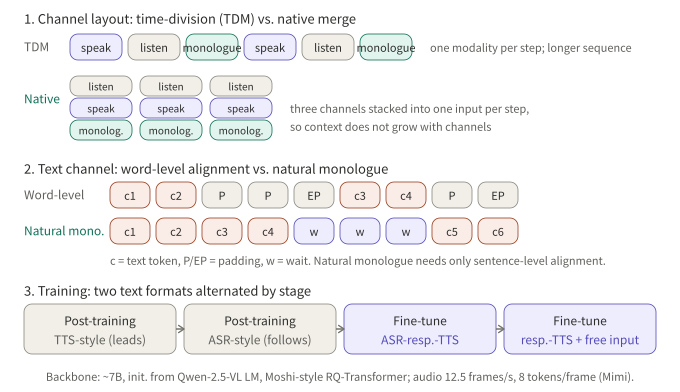

*Figure 5: TDM vs. native channel merge, word-level alignment vs. natural monologue, and the four training stages.*

**A naming note**: Chinese press calls the native full-duplex model that BAAI open-sourced with Spin Matrix and Nanyang Technological University "RoboBrain-Audio". The paper I found for it is FLM-Audio (arXiv 2509.02521, first submitted September 2025). The paper itself does not use the name RoboBrain-Audio, so the correspondence rests on press coverage; please verify. It was not released in 2026.

**How it works**

- A roughly 7B backbone initialized from the language model of Qwen-2.5-VL with a Moshi-style RQ-Transformer; audio at 12.5 frames per second with 8 tokens per frame, coded by Mimi.
- At each time step the text, listening and speaking channels are merged into one input, so context length does not grow with the number of channels, unlike time-division multiplexing.
- "Natural monologue": instead of word-level alignment with padding, the text channel carries continuous sentences and emits "wait" tokens while speech catches up, needing only sentence-level alignment. Training alternates "text leads speech" (TTS-like, about 0 to 2 tokens ahead) and "text follows the listening channel" (ASR-like) across stages, ending with free user input and interruptions (probability 0.7, 0.5 s reaction delay).

**Results** (paper-reported): stage 1 uses about 1M hours of speech, reportedly under 15% of the audio Moshi used; LlamaQuestions 56.3 vs. 43.7 for Moshi; turn-taking accuracy 0.98 on a noisy test with interruptions; in a controlled comparison at 5% of the data, natural monologue gets WER 18.2 against 22.3 for a word-aligned Moshi-style setup. The paper says code and models will be released and Chinese press says they are open-sourced; the paper page gives no links and I did not verify a repository.

## 5. Seeduplex: a native full-duplex model fully rolled out

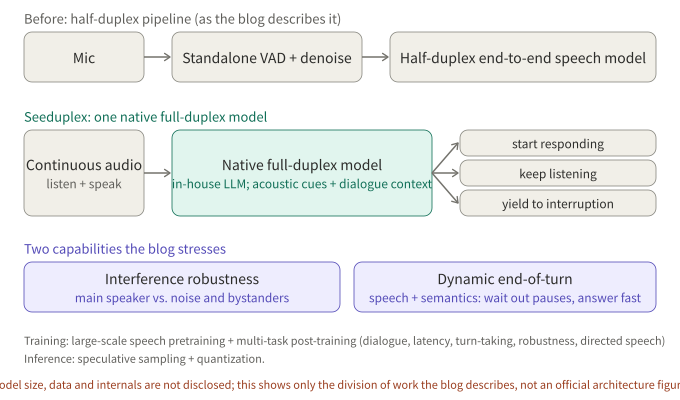

*Figure 6: Conceptual, not an official architecture figure. The official blog describes only the division of work: a native model replaces standalone VAD and denoising and decides whether to respond, keep listening or yield.*

**How it works** (ByteDance Seed official blog, April 9, 2026)

- A native end-to-end model on the company's in-house LLM, replacing the standalone VAD and conventional denoising of the previous half-duplex system. After speech pretraining it is post-trained on multiple tasks: dialogue quality, latency, turn-taking, interference robustness and directed-speech understanding. Speculative sampling and quantization are used at inference. Model size, data volume and internals are not disclosed.
- Two stressed capabilities: continuous listening that separates the main speaker from background noise and nearby conversations and tells whether speech is addressed to it; and dynamic end-of-turn, which uses speech and semantics jointly to wait through hesitation yet answer quickly once the user is done.

**Official demos**: the blog has 10 demo videos in two groups:

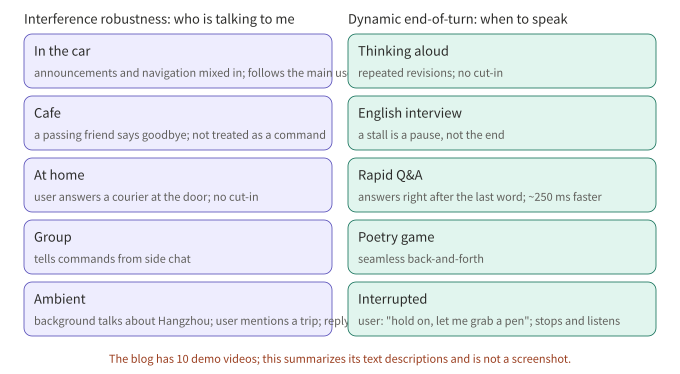

*Figure 7: Scenarios summarized from the blog's text, not video screenshots.*

In the updated Doubao app, choose the call option in the chat box to try it.

**Results** (officially reported, against the previous half-duplex Doubao model):

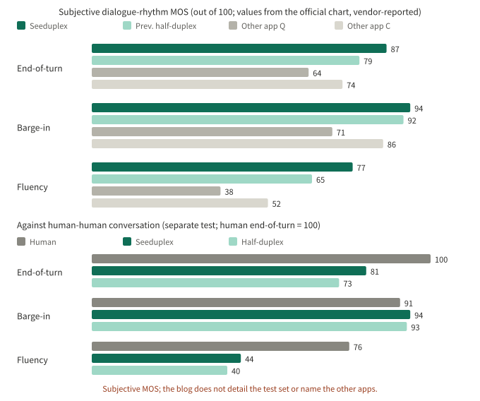

*Figure 8: Redrawn from the values in the two official bar charts. MOS is a subjective evaluation; the blog does not detail the test set or name the other apps.*

The text also gives: end-of-turn latency about 250 ms faster, interruption response about 300 ms faster, AI cut-in ratio down 40% relative in complex scenes, false replies and false interruptions halved in noisy scenes, and overall call satisfaction up 8.34 points absolute in an online A/B test. The blog also admits overall fluency still trails human conversation (lower half of Figure 8: 44 vs. 76).

## 6. Dessa: trained from scratch on human conversation only

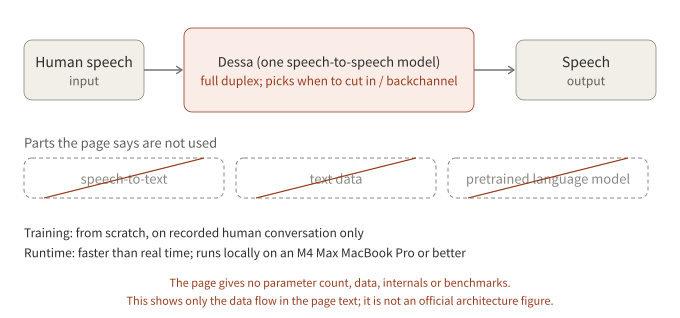

*Figure 9: Conceptual, not an official architecture figure. The page gives the data flow and what is not used, but no parameter count, data sources or internals.*

**How it works** (Block page, October 2026)

- The page describes a speech-to-speech full-duplex model: audio in, audio out, no speech-to-text step; trained from scratch on recorded human conversation only, with no text and no pretrained language model.
- It decides for itself when to cut in and when to backchannel ("yeah", "got it"); the page says inference is faster than real time and the model runs locally on an M4 Max MacBook Pro or better.
- The page says "as far as we know" it is the first AI trained only on human speech that you can hold a realistic live conversation with. This is the company's claim and is not independently verified; there are no benchmarks or quantitative evaluations.

**Official demos**: the page has no UI, only six live recordings of a person talking to Dessa (two synchronized tracks, subtitles added afterward):

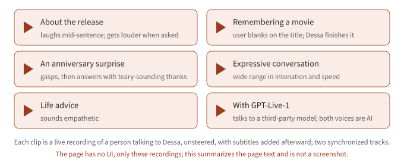

*Figure 10: Summarized from the page text, not a screenshot.*

Availability: waitlist; early access is limited to AI safety researchers applying with an institutional email. The page also states that in the GPT-Live-1 recording, that model's developer is not affiliated with Block.

## 7. FireRedChat: keep the models, add a turn-taking controller

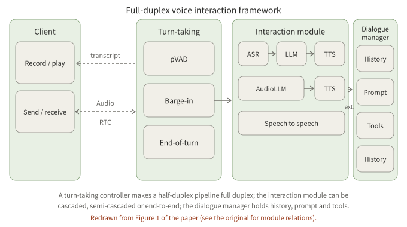

*Figure 11: Redrawn from Figure 1 of the paper. The client exchanges audio over RTC; the turn-taking controller has pVAD, barge-in and end-of-turn; the interaction module is cascaded, semi-cascaded or speech-to-speech; the dialogue manager handles history, prompt and tools.*

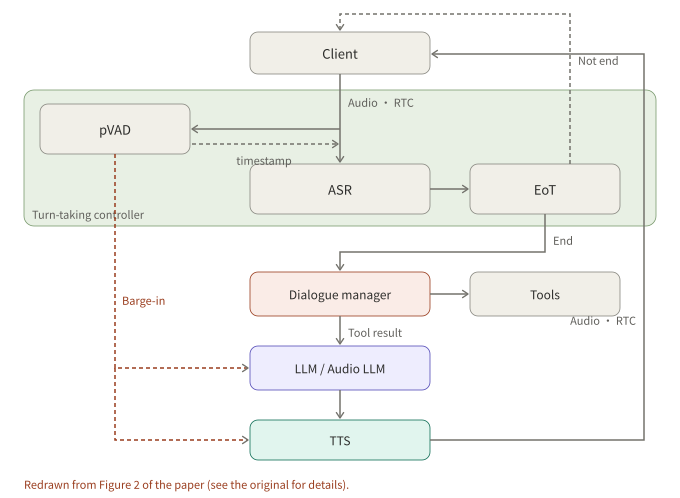

*Figure 12: Redrawn from Figure 2 of the paper. On barge-in, pVAD interrupts both the LLM and TTS; EoT's "not end" keeps listening and only "end" hands over to the dialogue manager.*

**How it works** (arXiv 2509.06502, Xiaohongshu FireRed team, September 2025)

- Not native full duplex: a full-duplex controller is added to a cascaded or semi-cascaded half-duplex pipeline. The controller has a streaming personalized VAD (target-speaker conditioning; causal convolutions, ECAPA-TDNN speaker embedding, GRU) that suppresses false barge-ins from background noise and non-primary speakers, and a fine-tuned multilingual BERT end-of-turn classifier that decides "continue" or "stop" from accumulated ASR text.
- pVAD timestamps are used to cut segments from the original, non-denoised audio for ASR; pVAD output itself is not passed downstream.
- Interaction module: cascaded is FireRedASR, Qwen2.5 and FireRedTTS-1s; semi-cascaded is an audio LLM that takes user speech directly, then FireRedTTS-2. Dialogue management is built on Dify for tool calls (for example web search) and context.

**Results** (paper-reported, internal evaluation):

| Metric | FireRedChat | LiveKit | Ten |
|---|---|---|---|
| Barge-in T90 / false barge-in rate | 170 ms / 10.2% | 140 ms / 33.4% | 90 ms / 78.1% |
| End-of-turn accuracy (zh / en) | 96.0% / 94.9% | 70.8% / 86.2% | 95.8% / 94.4% |
| End-to-end latency P50 / P95 | 2.341 s / 3.015 s | 3.598 s / 4.649 s | 3.375 s / 3.802 s |

The authors note their T90 is about 30 ms slower than LiveKit's, in exchange for far fewer false barge-ins; an industrial system they compare against has a P50 of 2.075 s. The latency evaluation used only 25 synthetic utterances.

**Demo**: the demo section of the project page is a video. I could not open the video from my environment, so I do not describe its content. The paper page gives no code link and I did not verify whether a repository is public.

## 8. Side by side

| System | Type | How timing is decided | How content is generated | Can you try it |
|---|---|---|---|---|
| BayLing-Duplex | Native, block-interleaved | State tokens in the text channel | Single AR LLM | Paper |
| FLAIR | Native, latent reasoning | Timing head G | AR, latent reasoning while listening | Paper |
| Diffuplex | Native, AR plus diffusion | AR policy, four states | Parallel denoising on a canvas | Code not released |
| RoboBrain-Audio | Native, channel merge | The model itself (Moshi-style) | Natural monologue plus RQ-Transformer | Paper says open-source |
| Seeduplex | Native, structure undisclosed | Joint speech and semantic end-of-turn | Undisclosed | Doubao app |
| Dessa | Native, from scratch | The model learned to cut in and backchannel | Undisclosed | Waitlist |
| FireRedChat | Controller plus pipeline | pVAD and semantic EoT | Cascaded or semi-cascaded | Demo video |

## 9. Caveats when reading these results

1. **Synthetic audio.** BayLing-Duplex and FLAIR rely mostly on synthetic data; BayLing-Duplex's authors say noise, reverberation and competing speakers are untested.
2. **Different baselines.** In the tables and figures above the baselines are Moshi, the system's own on/off variant, autoregressive omni models, a previous half-duplex model, LiveKit and Ten.
3. **Evaluation method.** "Time to stop after barge-in" depends on VAD segmentation; Seeduplex's MOS is subjective; FireRedChat's latency used only 25 synthetic utterances.
4. **Vendor numbers.** The Seeduplex, Dessa and FireRedChat numbers are reported by the teams themselves and have not been independently reproduced.

## 10. Conclusion

On "who decides when to speak", the seven systems split into three routes: let the model predict state tokens itself (BayLing-Duplex, and Seeduplex as officially described), put the controller outside the model (FireRedChat), or change how content is generated (Diffuplex, FLAIR). FLM-Audio lowers alignment cost through its channel layout, and Dessa takes the direction of never passing through text. What will really decide quality is evaluation in real conditions, which is the gap these results share.

## To verify

- Diffuplex's numbers come from the paper's page text; code and weights are not yet released. FLAIR's loss weights α and β and the full ablation were not read.
- Seeduplex's architecture is not disclosed; Figure 6 is conceptual. The values in Figure 8 come from the official charts and were read by me from the images.
- Dessa's page states no release date; October 2026 is based on press coverage. Figure 9 is conceptual.
- The RoboBrain-Audio / FLM-Audio correspondence rests on Chinese press coverage that I could not open and check; FLM-Audio's open-source links are unverified.
- I could not open FireRedChat's demo video; the paper page does not say whether the code is public.
- All "demo" notes relay only what the official pages show; I did not try any of the systems.

## References

- [BayLing-Duplex: Native Full-Duplex Speech Dialogue with a Single Autoregressive LLM (arXiv 2606.14528)](https://arxiv.org/abs/2606.14528)
- [The Silent Thought: Modeling Internal Cognition in Full-Duplex Spoken Dialogue Models via Latent Reasoning (arXiv 2603.17837)](https://arxiv.org/abs/2603.17837)
- [Full-duplex Spoken Language Modeling with Discrete Diffusion (arXiv 2610.17780)](https://arxiv.org/abs/2610.17780)
- [FLM-Audio: Natural Monologues Improves Native Full-Duplex Chatbots via Dual Training (arXiv 2509.02521)](https://arxiv.org/abs/2509.02521)
- [Seed full-duplex speech LLM announcement (ByteDance Seed official blog, Chinese)](https://seed.bytedance.com/zh/blog/introducing-seed-full-duplex-speech-llm-attentive-listening-robust-interference-suppression-enabling-more-natural-interaction)
- [Dessa (Block)](https://block.xyz/dessa)
- [FireRedChat: A Pluggable, Full-Duplex Voice Interaction System with Cascaded and Semi-Cascaded Implementations (arXiv 2509.06502)](https://arxiv.org/abs/2509.06502)
- [FireRedChat project demo page](https://fireredteam.github.io/demos/firered_chat/)

Further reading: [Reading Full-Duplex Voice Models: MiniCPM-o 4.5 and Realtime-Venus]({{ '/en/minicpm-o-45-realtime-venus/' | relative_url }}).

*Note: all numbers come from the papers, the official blog and the web pages above, as reported by their authors or vendors, and were not reproduced by me. Architecture figures are redrawn from the papers or official figures; the two marked "conceptual" are not official architecture figures. Demo notes relay only what the official pages show; no official screenshots or videos are embedded.*
