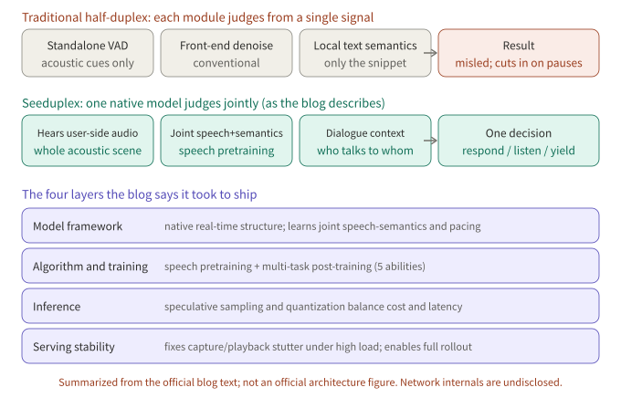
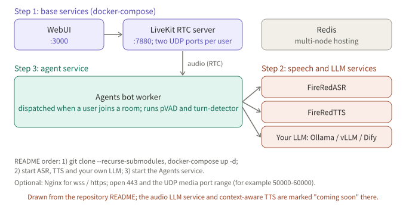

## Summary

A full-duplex speech system has to answer three questions: what the model does while the user talks, when it should speak, and how it stops when interrupted. This article looks closely at **Seeduplex**, which is fully rolled out in the Doubao app: what its approach is, what reasons the official blog gives, and why it feels better than a half-duplex system. The other six systems get short notes, each with an architecture figure, key results and a demo or availability note. **FireRedChat** is the only one you can build yourself, so it also gets its build steps.

*Figure 1: One-page overview. The five rows are Diffuplex, Seeduplex, Dessa, RoboBrain-Audio and FireRedChat; BayLing-Duplex and FLAIR are in sections 3 and 4. Availability follows each official page.*

## Key conclusions

- Seeduplex is good, according to its blog, in three ways: judgment moves from a single signal to joint modeling, the model keeps hearing user-side audio, and both the training objectives and the engineering target interference robustness and end-of-turn. These are the vendor's statements; the network structure and any ablation are not published.
- Only Seeduplex can be tried (the call mode in the Doubao app), and only FireRedChat can be self-hosted. FireRedChat adds a controller around the models; it is not native full duplex.
- The papers publish their architectures, in three routes: let a native model predict timing itself (BayLing-Duplex), change how content is generated (FLAIR, Diffuplex), or change the channel layout (FLM-Audio).
- All numbers are self-reported by authors or vendors, with different baselines and mostly synthetic, subjective or internal evaluation data. They cannot be compared across systems.

## 1. Seeduplex: the main subject

### 1.1 What it is

A native full-duplex speech LLM released by ByteDance Seed on April 9, 2026 and fully rolled out in the Doubao app; the blog says full duplex has left the lab and been deployed at scale. It is built on the company's in-house LLM, trained end to end, and listens while speaking.

*Figure 2: Conceptual, not an official architecture figure. The blog describes only the division of work: a native model replaces standalone VAD and denoising and decides whether to respond, keep listening or yield.*

### 1.2 The approach: what the blog discloses

- **Streaming perception, native modeling**: the system extracts features from the input audio and a base model processes them in real time; the model combines acoustic features and dialogue context and decides by itself whether to start replying, keep listening, or yield to an interruption.
- **Large-scale speech pretraining**: the blog says large-scale speech data is used for pretraining, giving the model native joint speech-semantic modeling, so it understands the speech and semantics of the whole audio and decides pacing dynamically.
- **Multi-task post-training**: dialogue quality, very low latency, pacing control, interference robustness and directed-speech understanding are optimized together.
- **Inference and serving**: speculative sampling and quantization balance cost and latency; the team fixed capture and playback stutter under high concurrency so the model runs continuously at scale.
- The blog says it broke through bottlenecks in "data construction, ultra-low latency and model quality co-optimization", but gives no model size, data volume, network structure or concrete method.

### 1.3 Why it works better than half-duplex

*Figure 3: Summarized from the official blog text; not an official architecture figure.*

The reasons the blog gives:

1. **Judgment no longer rests on a single signal.** Traditional half-duplex systems use cascaded modules: a standalone VAD cuts audio mechanically, a conventional front end denoises, and the decision rests on a single acoustic feature or local text semantics, so the system is easily misled in complex environments or cuts in when the user pauses. Seeduplex models speech and semantics jointly and judges within one model.
2. **It keeps listening.** The model continuously receives and understands user-side audio, senses the whole acoustic environment, and decides which sounds are really addressed to it and which are interference. The judgment is semantic, not volume-based: a friend saying goodbye in a cafe, or a reply to a courier at the door, is not taken as a command; in overlapping multi-person talk it can tell which sentence is addressed to it; it can even use a background clip about Hangzhou, combined with the user's plan to go there, in its reply.
3. **End-of-turn is a joint judgment.** It combines speech and semantic features to tell whether the user is done: it waits through thinking, stalls and self-corrections, and answers quickly once the user finishes. The blog's examples include a stall in a mock English interview and about 250 ms lower latency in rapid Q&A.
4. **The training objectives are these abilities.** Multi-task post-training targets interference robustness, end-of-turn, interruption response and directed-speech understanding directly; it is not a new module bolted onto a half-duplex pipeline.
5. **Engineering keeps pace.** Speculative sampling and quantization cut latency, and capture and playback stutter under high load was fixed, so the gains are not eaten by glitches. A large-scale A/B test confirmed positive changes in call duration and retention.

My reading (inference; the blog gives no ablation): the gain most plausibly comes from replacing several single-signal modules with one model that sees acoustics, semantics and dialogue context together, which is the point the blog's comparison and cases agree on most; how much comes from pretraining scale versus multi-task post-training cannot be separated from public data. Also, every comparison is against the previous half-duplex model of the same product, so how much of the gain comes from full duplex itself and how much from a stronger base model cannot be told apart.

### 1.4 Official demos: ten scenarios

*Figure 4: Scenarios summarized from the blog's text, not video screenshots. Each scenario has a video in the official blog.*

To try it, update the Doubao app to the latest version, choose the call option in the chat box and enter the voice call screen. I did not try it; the demo notes relay only what the official blog shows.

### 1.5 Results

*Figure 5: Redrawn from the values in the two official bar charts. MOS is a subjective evaluation; the blog does not detail the test set or name the other apps.*

The text gives (against the previous half-duplex model): end-of-turn MOS up 8% and dialogue fluency MOS up 12%; end-of-turn latency about 250 ms faster and interruption response about 300 ms faster; AI cut-in ratio down 40% relative in complex scenes; false replies and false interruptions halved in complex acoustic-interference scenes; overall call satisfaction up 8.34 points absolute in an online A/B test, with complaints about cut-ins, slow replies and false interruptions down noticeably.

The blog also admits that against human-human conversation, end-of-turn improves 8% over half-duplex and interruption response is slightly better than the human average, but overall fluency still lags by a wide margin (lower half of Figure 5: 44 vs. 76). Directions it lists next: multi-person and smart-hardware scenarios, more varied pacing, backchanneling while listening, vision, and listening while thinking or searching.

## 2. FireRedChat: you can build it yourself

*Figure 6: Redrawn from Figure 1 of the paper. The client exchanges audio over RTC; the turn-taking controller has pVAD, barge-in and end-of-turn; the interaction module is cascaded, semi-cascaded or speech-to-speech; the dialogue manager handles history, prompt and tools.*

*Figure 7: Redrawn from Figure 2 of the paper. On barge-in, pVAD interrupts both the LLM and TTS; EoT's "not end" keeps listening and only "end" hands over to the dialogue manager.*

**Approach** (arXiv 2509.06502, Xiaohongshu FireRed team, September 2025): not native full duplex, but a full-duplex controller added to a cascaded or semi-cascaded half-duplex pipeline. The controller has a streaming personalized VAD (target-speaker conditioning, suppressing false barge-ins from noise and non-primary speakers) and a fine-tuned multilingual BERT end-of-turn classifier. pVAD timestamps are used to cut segments from the original, non-denoised audio for ASR. The interaction module is either FireRedASR, Qwen2.5 and FireRedTTS-1s (cascaded) or an audio LLM that hears the user directly followed by FireRedTTS-2 (semi-cascaded). Dialogue management is built on Dify.

**Results** (paper-reported, internal evaluation; latency used only 25 synthetic utterances):

| Metric | FireRedChat | LiveKit | Ten |
|---|---|---|---|
| Barge-in T90 / false barge-in rate | 170 ms / 10.2% | 140 ms / 33.4% | 90 ms / 78.1% |
| End-of-turn accuracy (zh / en) | 96.0% / 94.9% | 70.8% / 86.2% | 95.8% / 94.4% |
| End-to-end latency P50 | 2.341 s | 3.598 s | 3.375 s |

The authors note their T90 is about 30 ms slower than LiveKit's, in exchange for far fewer false barge-ins; an industrial system they compare against has a P50 of 2.075 s.

**Trying it and building it**: the demo section of the project page is a video, which I could not open from my environment, so I do not describe it. The repository is FireRedTeam/FireRedChat, marked Apache 2.0 in its README. On September 16, 2025 it released the pVAD and turn-detector models and the FireRedTTS1 and FireRedASR services for the cascaded system. The audio LLM service and context-aware TTS are marked "coming soon" in the README, so the paper's semi-cascaded version cannot yet be fully reproduced. The README's build order is:

*Figure 8: Drawn from the repository README. You bring your own LLM (Ollama, vLLM or Dify); for wss/https you configure Nginx yourself and open 443 and the UDP media port range.*

## 3. BayLing-Duplex: writing timing into tokens

*Figure 9: Speech tokenizer, a single LLM and a speech decoder; each 0.8-second block holds user speech, text-channel and assistant speech tokens in turn.*

- Approach (arXiv 2606.14528): starts from the public GLM-4-Voice and adds only four state tokens ([SILENCE], [ASSISTANT], [PAD], [EPAD]), with no new modules. The sequence is interleaved in blocks of 10 user speech tokens, 5 text tokens and 10 assistant speech tokens, 0.8 s per block. The text channel is an unspoken inner monologue, and every listen / speak / stop decision is next-token prediction.
- Training: SFT plus 200 steps of light DPO; DPO negatives perturb only the timing of the assistant's response, leaving audio and text unchanged.
- Results (paper-reported, baseline Moshi, synthetic evaluation audio): turn-taking success 71.9% to 92.0%, time to stop after barge-in 2.07 s to 1.10 s, interruption success 81.9% to 100%. Token weights are decisive: with uniform weights turn-taking success is only 60.3%. Inference: silence tokens dominate, so class imbalance pushes the model toward silence.
- Limitations: training and evaluation audio is fully synthetic, single-speaker and noise-free; block length puts a 0.8 s floor on response latency; barge-in granularity is the block.

## 4. FLAIR: keep thinking while listening

*Figure 10: Left, the streaming pipeline. Right, what the same LLM is fed while listening (latent embeddings) and speaking (text tokens). The global expert is used only in training.*

- Approach (arXiv 2603.17837): while the user speaks, the previous hidden state goes through the LM head and softmax, and a weighted average of vocabulary embeddings becomes the next input, so the model keeps reasoning in latent space; a timing head G decides when to switch to emitting text. In training a non-causal global expert supplies target latents and is dropped at inference.
- Results (paper-reported): with latent reasoning on, Llama Questions 78.0 vs. 73.0, MMSU 56.2 vs. 50.2, TriviaQA slightly lower; turn-taking and barge-in metrics do not change clearly, and the authors conclude it leaves conversational dynamics intact.

## 5. Diffuplex: separating "when to speak" from "what to say"

*Figure 11: The AR policy reads speech and emits states; on bos the diffusion mode denoises a 256-token canvas and the first 8 tokens go to TTS early.*

- Approach (arXiv 2610.17780, NVIDIA): one backbone, two modes. An autoregressive policy predicts listen, speak, bos or eos every 80 ms; on bos a diffusion language model denoises a 256-token canvas in parallel, the first 8 committed tokens stream to TTS, and a barge-in within one second discards the unspoken canvas.
- Results (paper-reported): about 13 tokens per forward pass versus 1 for autoregressive baselines; up to 1,872 tokens/s on one GB300 versus 394 and 300. The full-duplex stage scores 82.3 on VoiceBench against 58.1 for Nemotron-3 VoiceChat. A smaller K gives faster first audio and lower quality (251 ms and 80.5 to 497 ms and 84.0).
- Limitations: code and weights are "coming soon", so nothing is independently reproducible.

## 6. RoboBrain-Audio (FLM-Audio): channel merging and natural monologue

*Figure 12: TDM vs. native channel merge, word-level alignment vs. natural monologue, and the four training stages.*

- A naming note: Chinese press calls the native full-duplex model that BAAI open-sourced with Spin Matrix and Nanyang Technological University "RoboBrain-Audio". The paper I found for it is FLM-Audio (arXiv 2509.02521, September 2025). The paper itself does not use that name, so the correspondence rests on press coverage; please verify. It was not released in 2026.
- Approach: a roughly 7B backbone with a Moshi-style RQ-Transformer; at each time step the text, listening and speaking channels are merged into one input. The text channel uses "natural monologue": continuous sentences plus "wait" tokens while speech catches up, needing only sentence-level alignment. Training alternates "text leads" and "text follows" formats across stages.
- Results (paper-reported): about 1M hours of speech, reportedly under 15% of the audio Moshi used; LlamaQuestions 56.3 vs. 43.7 for Moshi. The paper says code and models will be released and Chinese press says they are open-sourced; I did not verify a repository.

## 7. Dessa: trained from scratch on human conversation only

*Figure 13: Conceptual, not an official architecture figure. The page gives the data flow and what is not used.*

- Approach (Block page, October 2026): audio in, audio out, no speech-to-text step; trained from scratch on recorded human conversation only, with no text and no pretrained language model; it decides for itself when to cut in and when to backchannel. The page says inference is faster than real time and the model runs locally on an M4 Max MacBook Pro or better. It gives no parameter count, data sources, internals or benchmarks; "the first AI trained only on human speech that you can hold a realistic live conversation with" is the company's own claim, not independently verified.
- Demo: the page has no UI, only six recordings of a person talking to Dessa. Availability: waitlist, limited to AI safety researchers.

*Figure 14: Summarized from the page text, not a screenshot.*

## 8. Side by side

| System | Type | How timing is decided | How content is generated | Can you try it |
|---|---|---|---|---|
| Seeduplex | Native, structure undisclosed | Joint judgment over speech, semantics and context | Undisclosed | Doubao app |
| FireRedChat | Controller plus pipeline | pVAD and semantic EoT | Cascaded or semi-cascaded | Self-hostable (some components) |
| BayLing-Duplex | Native, block-interleaved | State tokens in the text channel | Single AR LLM | Paper |
| FLAIR | Native, latent reasoning | Timing head G | AR, latent reasoning while listening | Paper |
| Diffuplex | Native, AR plus diffusion | AR policy, four states | Parallel denoising on a canvas | Code not released |
| RoboBrain-Audio | Native, channel merge | The model itself (Moshi-style) | Natural monologue plus RQ-Transformer | Paper says open-source |
| Dessa | Native, from scratch | The model learned to cut in and backchannel | Undisclosed | Waitlist |

## 9. Caveats when reading these results

1. **Synthetic audio.** BayLing-Duplex and FLAIR rely mostly on synthetic data; BayLing-Duplex's authors say noise, reverberation and competing speakers are untested.
2. **Different baselines.** The baselines are Moshi, the system's own on/off variant, autoregressive omni models, a previous half-duplex model, LiveKit and Ten.
3. **Evaluation method.** Seeduplex's MOS is subjective; FireRedChat's latency used only 25 synthetic utterances.
4. **Vendor numbers.** The Seeduplex, Dessa and FireRedChat numbers are reported by the teams themselves and have not been independently reproduced.

## 10. Conclusion

What Seeduplex shows is a shift of judgment from several single-signal modules into one model that sees acoustics, semantics and dialogue context, backed by multi-task post-training and engineering until it ships at full scale; whether it wins because of exactly these points, the blog gives no verifiable ablation. If you want to build something yourself, FireRedChat is the only route with a published deployment flow, at the cost of still being a cascade plus a controller rather than a native model. The other papers offer three ideas worth borrowing: state tokens with timing-only DPO, latent reasoning while listening, and moving content generation off the timeline.

## To verify

- Seeduplex's architecture is not disclosed, so Figures 2 and 3 are conceptual; the values in Figure 5 come from the official charts and were read by me from the images. The "my reading" paragraph in section 1.3 is inference.
- Diffuplex's numbers come from the paper's page text, and code and weights are not yet released; FLAIR's loss weights and full ablation were not read.
- Dessa's page states no release date; October 2026 is based on press coverage. Figure 13 is conceptual.
- The RoboBrain-Audio / FLM-Audio correspondence rests on Chinese press coverage that I could not open and check; FLM-Audio's open-source links are unverified.
- I could not open FireRedChat's demo video; its license follows the Apache 2.0 mark in the README, and I have not deployed it.
- All "demo" notes relay only what the official pages show; I did not try any of the systems.

## References

- [Seed full-duplex speech LLM announcement (ByteDance Seed official blog, Chinese)](https://seed.bytedance.com/zh/blog/introducing-seed-full-duplex-speech-llm-attentive-listening-robust-interference-suppression-enabling-more-natural-interaction)
- [FireRedChat: A Pluggable, Full-Duplex Voice Interaction System with Cascaded and Semi-Cascaded Implementations (arXiv 2509.06502)](https://arxiv.org/abs/2509.06502)
- [FireRedChat project demo page](https://fireredteam.github.io/demos/firered_chat/)
- [FireRedChat repository (GitHub)](https://github.com/FireRedTeam/FireRedChat)
- [BayLing-Duplex: Native Full-Duplex Speech Dialogue with a Single Autoregressive LLM (arXiv 2606.14528)](https://arxiv.org/abs/2606.14528)
- [The Silent Thought: Modeling Internal Cognition in Full-Duplex Spoken Dialogue Models via Latent Reasoning (arXiv 2603.17837)](https://arxiv.org/abs/2603.17837)
- [Full-duplex Spoken Language Modeling with Discrete Diffusion (arXiv 2610.17780)](https://arxiv.org/abs/2610.17780)
- [FLM-Audio: Natural Monologues Improves Native Full-Duplex Chatbots via Dual Training (arXiv 2509.02521)](https://arxiv.org/abs/2509.02521)
- [Dessa (Block)](https://block.xyz/dessa)

Further reading: [Reading Full-Duplex Voice Models: MiniCPM-o 4.5 and Realtime-Venus]({{ '/en/minicpm-o-45-realtime-venus/' | relative_url }}).

*Note: all numbers come from the papers, the official blog, the web pages and the repository README above, as reported by their authors or vendors, and were not reproduced by me. Architecture figures are redrawn from the papers or official figures; those marked "conceptual" are not official architecture figures. Demo notes relay only what the official pages show; no official screenshots or videos are embedded.*
