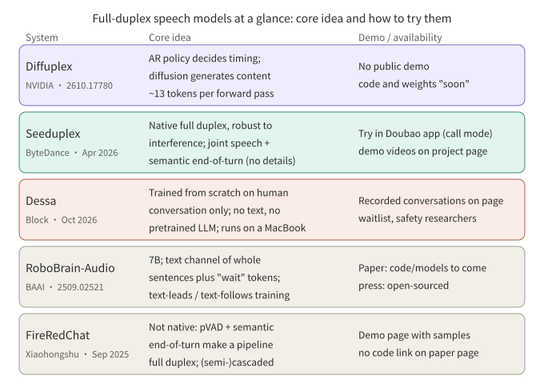

## Summary

One hard question for full-duplex speech models is what the model is doing while the user is talking. Three 2026 papers answer it in three ways:

- **BayLing-Duplex** (arXiv 2606.14528) turns "listen, speak, stop" into four state tokens in a text channel, predicted by the same autoregressive LLM, and adds a light DPO stage aimed only at timing.
- **FLAIR** (arXiv 2603.17837) argues that the user's speaking time should not be spent on idle silence or padding. The model should keep reasoning in latent space, without adding inference latency.
- **Diffuplex** (arXiv 2610.17780, NVIDIA) separates "when to speak" from "what to say": an autoregressive policy handles timing while a diffusion model generates the content in parallel on a canvas, free of the audio frame rate.

The first two each take one problem: timing, and whether listening time can do useful computation. Diffuplex changes how the content is generated. A later section surveys four full-duplex systems released in the same period: Seeduplex, Dessa, RoboBrain-Audio and FireRedChat.

## Key conclusions

- BayLing-Duplex adds only four state tokens to the vocabulary, with no new modules. Every decision is next-token prediction, so once the external VAD is gone, timing quality is decided by training data and loss weights.
- Its ablation shows token weights are decisive: with uniform weights the model stays almost permanently silent (60.3% turn-taking success). Lowering the [SILENCE] weight restores most of the behavior.
- During listening, FLAIR feeds back a softmax-weighted average of vocabulary embeddings as a continuous latent input. A training-only, non-causal expert provides the target; it is dropped at inference.
- FLAIR's own results: latent reasoning gives small gains on knowledge-style QA and neither clearly improves nor clearly hurts turn-taking and barge-in.
- Diffuplex reports about 13 tokens per forward pass against 1.00 for autoregressive baselines, measured on the authors' own hardware and setup; code and weights are not yet released.
- Among the industry releases, Seeduplex has official engineering metrics and an online A/B test, Dessa has only demos, and FireRedChat is a cascaded system plus a full-duplex controller rather than a native model. All of these numbers are vendor-reported.
- Training and evaluation audio in the papers is largely synthetic. The numbers are not comparable across papers and should not be extrapolated to noisy, multi-speaker real conditions.

## 1. The problem: listening time is wasted

A half-duplex voice pipeline hands listening to VAD and ASR and only gives speaking to the LLM. A full-duplex model puts both streams on one timeline, which raises two new problems:

1. **Timing**: when to take the turn, when to stay quiet, and how fast to stop when interrupted.
2. **Idle slots**: while the user talks, the output side can only emit silence or padding, and those positions contribute nothing to the eventual answer.

BayLing-Duplex mostly addresses the first problem and FLAIR the second. For the fixed-window "listen or speak" approach of MiniCPM-o 4.5, see [the earlier article]({{ '/en/minicpm-o-45-realtime-venus/' | relative_url }}); this one covers two other design directions.

## 2. BayLing-Duplex: writing timing into tokens

### 2.1 Structure

BayLing-Duplex starts from the public GLM-4-Voice: a speech tokenizer turns 16 kHz audio into 12.5 Hz tokens (80 ms each), a 9B decoder-only LLM sits in the middle, and a speech decoder follows. The only change is how the sequence is laid out, plus four new tokens.

The sequence is interleaved in blocks: N user speech tokens, then M text tokens, then N assistant speech tokens. The paper uses N=10 and M=5, so a block is 0.8 s and the text channel runs at about 6.25 tokens per second. The text channel acts as an inner monologue that is never spoken. Besides text, it carries four state tokens:

*Figure 1: Block layout. Assistant text and speech run one block ahead of the user channel; every turn-taking decision is next-token prediction.*

Block size is a trade-off. A small N leaves too few text slots and makes timing jittery; a large N raises the minimum response latency (0.8 s at N=10). The paper does not sweep it systematically.

Inference decodes block by block: take N user tokens, sample M text tokens under a mask that allows only text and state tokens, then sample N speech tokens under a mask that allows only speech tokens. If the user barges in mid-block, speech tokens already being generated finish first, and only the next block sees the new audio. So the granularity of barge-in response is the block, not the token.

### 2.2 Training: SFT plus a light DPO round

- **Data**: built on the 200K multi-turn speech dialogues from LLaMA-Omni 2, with 200K synthesized samples for each of two scenarios, mixed 1:1. In turn-taking samples the assistant answers after a 0.8 s gap. In interruption samples the user cuts in during the response and the assistant reacts after a random delay of 0.8 to 2.0 s.
- **SFT**: cross-entropy only at text and assistant-speech positions, with separate token weights for [SILENCE] and for [ASSISTANT]/[EPAD].
- **DPO**: negatives perturb only the timing of the assistant's response; audio and text are identical to the positive. Turn-taking negatives stretch the gap to 2 to 5 s, and interruption negatives stretch the reaction delay to 3 to 5 s. Training runs only 200 steps at learning rate 1e-7 with β=0.5.

The "change timing, not content" negative is the most reusable idea here. It confines the preference signal to timing, so the model cannot learn anything else from it.

### 2.3 Results and ablation

Reported by the paper, against Moshi, on synthetic evaluation audio:

| Model | Llama Q. | Web Q. | Turn-taking SR@3s | Time to stop after barge-in (s, lower is better) | Interruption SR@2s |
|---|---|---|---|---|---|
| Moshi | 21.0 | 9.2 | 71.9 | 2.07 | 81.9 |
| BayLing-Duplex (SFT) | 44.3 | 18.0 | 88.9 | 1.51 | 91.4 |
| BayLing-Duplex (+DPO) | 46.0 | 18.1 | 92.0 | 1.10 | 100.0 |

The token-weight ablation is more telling. With uniform weights the model stays silent most of the time and turn-taking success is 60.3%. Lowering only the [SILENCE] weight gives 82.4%. Also raising the role-token weight gives 88.9%. The paper itself notes that the 100% interruption success in the uniform row is degenerate: a model that rarely speaks has nothing to stop.

My reading (inference, not a paper claim): in a state-token design, silence tokens dominate the sequence, so class imbalance alone pushes the model toward silence. The weights are not a detail; the design depends on them.

## 3. FLAIR: keep thinking while listening

### 3.1 Motivation

The paper notes that existing full-duplex models either emit repeated padding or silence tokens while the user speaks, or, if one forces explicit text chain-of-thought into that time, it conflicts with streaming causality: when the user finishes or interrupts, the thinking and the speech output are hard to synchronize. FLAIR (paper title *The Silent Thought*) reasons in continuous latent space instead, with no reasoning annotations and no added inference latency.

### 3.2 Method

*Figure 2: While the user speaks, the hidden state goes through the LM head and softmax, and a weighted average of vocabulary embeddings becomes the next input. A timing head G decides when to switch to emitting text tokens.*

- **Listening**: the previous hidden state goes through the LLM head to get a vocabulary distribution, and a softmax-weighted average over the embedding matrix gives the next input embedding. The loop is causal and recurrent.
- **Speaking**: a timing head (an MLP on the final hidden state) predicts G. With G=0 the model keeps reasoning in latent space and sends `<SIL>` to the speech module; with G=1 it emits a text token and feeds its embedding back. On barge-in it returns to latent reasoning.
- **Global expert (training only)**: a non-causal encoder sees the whole dialogue and produces the same kind of vocabulary-weighted target. The LLM's distribution on listening frames is aligned to it with a KL term, so the causal prior is pulled toward a posterior that has seen the full context. The expert is discarded at inference.
- **Loss**: a reconstruction loss on response segments, a KL regularizer, and a timing loss for G, forming an ELBO-style SFT objective.

Training has four steps: ordinary full-duplex pre-training; latent-reasoning SFT with reconstruction loss only; joint training with the full ELBO; and finally freezing everything but the speech generation module. Data includes 530K hours of synthetic two-speaker pseudo-dialogues, 70K hours of instruction QA, and 20K hours of QA built from real ASR corpus transcripts, with a 10% chance of a simulated barge-in on longer responses.

### 3.3 Results: helpful, but modest

As reported, with latent reasoning (thk) on versus off:

| Benchmark | With thk | Without thk |
|---|---|---|
| Llama Questions | 78.0 | 73.0 |
| WebQuestions | 43.0 | 41.7 |
| TriviaQA | 51.2 | 53.8 |
| OpenBookQA | 74.2 | 72.9 |
| MMSU | 56.2 | 50.2 |

Most tasks improve, MMSU the most (+6.0), and TriviaQA drops slightly. On conversational behavior, Full-Duplex-Bench turn-taking takeover rate is 93.0 vs. 94.1 and barge-in takeover rate is 92.0 vs. 89.0, with similar latency. The authors conclude that latent reasoning leaves conversational dynamics intact, not that it improves them.

The paper also notes that some half-duplex baselines score higher on certain benchmarks (for example Kimi-Audio at 62.2 on MMSU), which the authors attribute to data mismatch and their own shorter answers.

## 4. Diffuplex: separating "when to speak" from "what to say"

### 4.1 What it tries to fix

The paper argues that squeezing "when to speak" and "what to say" onto one autoregressive timeline makes them compete, and that tying generation to the audio frame rate caps the compute available at test time. Diffuplex (*Full-duplex Spoken Language Modeling with Discrete Diffusion*) takes content generation off that timeline.

### 4.2 Method

*Figure 3: One backbone, two modes. The autoregressive policy reads user audio in 80 ms chunks and predicts one of listen / speak / bos / eos. On bos, the diffusion mode denoises a 256-token canvas bidirectionally, and the first 8 committed tokens go to streaming TTS.*

- Speech enters the backbone through a Parakeet encoder and a projection layer. The two modes share parameters but keep separate KV caches.
- When bos fires, the current speech context is prefilled into the diffusion cache. The first 8 tokens of the canvas (the anchored prefix) are committed within at most K denoising passes and streamed to TTS (CosyVoice 3) while the rest keeps denoising.
- If the user interrupts within one second, the unspoken part of the canvas is discarded and does not enter the context.
- Training has three stages: modality alignment on ASR data; spoken instruction following (about 600K examples, distilled from a frozen text copy of the model); and full duplex (generator frozen, only the four-state interaction head and a listening-mode LoRA trained, on about 120 hours of synthetic dialogue plus 70 hours of conversational data).

### 4.3 Results and costs

As reported by the paper:

- **Speed**: about 13.0 tokens per forward pass versus 1.00 for autoregressive baselines; up to 1,872 tokens/s at batch 1 on one GB300, versus 394 (Nemotron-3 Omni) and 300 (Qwen3-Omni-Thinking). The authors note the throughput gain is smaller than the per-pass gain because one diffusion pass costs more than one autoregressive step.
- **Quality**: VoiceBench overall is 86.9 with thinking and 84.1 without at the instruction-following stage; the full-duplex stage (no thinking) scores 82.3 against 58.1 for Nemotron-3 VoiceChat.
- **First-audio latency vs. quality**: a smaller K gives faster first audio and lower quality. K=2 gives 251 ms and 80.5; K=4 gives 296 ms and 82.3; uncapped gives 497 ms and 84.0 (measured on an RTX 6000, excluding the time the autoregressive policy takes to decide the turn).
- **Ablation**: removing text-anchored distillation drops the score to 66.1, and dropping the stage-1 modality alignment leaves 29.9. Transferring speech-to-text ability is a precondition for this design.

Limitations: code and weights are "coming soon", so nothing is independently reproducible; speed and latency were measured on different hardware (the GB300 throughput uses quantized experts); the full-duplex stage scores 1.8 points below the instruction-following stage, which the paper attributes to streaming decisions and early-prefix decoding without isolating the cause.

My reading (inference): Diffuplex is not a rival to the first two. The state tokens in BayLing-Duplex and the timing head in FLAIR both answer "when to speak", and so does Diffuplex's autoregressive policy; the difference is that it stops content generation from occupying that timeline.

## 5. The 2026 industry releases at a glance

The figure below puts five systems side by side: the core idea, and whether you can try it. The "demo" notes only relay what the official pages and papers show. I have not tried any of them.

*Figure 4: One-page overview. Availability follows each official page and may change.*

### 5.1 Seeduplex (ByteDance Seed, April 2026)

- **Technique**: the official blog describes a native full-duplex model on the company's in-house LLM, replacing the standalone VAD and conventional noise suppression of the previous half-duplex system. After large-scale speech pretraining it is post-trained on multiple tasks: dialogue quality, latency, turn-taking, interference robustness and directed-speech understanding. Two points are stressed: continuous listening that separates the main speaker from background noise and nearby conversations, and joint speech-and-semantic end-of-turn judgment that waits through hesitation but answers quickly once the user is done. Speculative sampling and quantization are used at inference. Model size, data volume and detailed architecture are not disclosed.
- **Company-reported metrics** (against the previous half-duplex Doubao model): false replies and false interruptions halved in noisy scenes; AI cut-in ratio down 40% relative in complex scenes; end-of-turn latency about 250 ms faster; interruption response about 300 ms faster; overall call satisfaction up 8.34 points absolute in an online A/B test. The post also admits overall fluency still trails human conversation.
- **Demo and trying it**: the project page has videos for in-car commands, a cafe with several speakers, a mock English interview, rapid Q&A, a classical-poetry game and mid-sentence interruption. In the updated Doubao app, choose the call option in the chat box to try it.

### 5.2 Dessa (Block, October 2026)

- **Technique**: the official page describes a speech-to-speech full-duplex model trained from scratch on recorded human conversation only: no text and no pretrained language model. There is no speech-to-text step, and it decides for itself when to interject and when to backchannel. The page says inference is faster than real time and the model runs locally on an M4 Max MacBook Pro or better. Parameter count, data sources and design details are not given, and there are no benchmarks or quantitative evaluations.
- **Demo and trying it**: the page has subtitled recordings, including recalling a movie title, an emotional anniversary conversation, and an exchange with another company's model (the page states Block is not affiliated with it). Access is by waitlist; early access is limited to AI safety researchers applying with an institutional email.
- The page calls it possibly the first system trained only on human speech that you can hold a live conversation with, "as far as we know". This is the company's claim and is not independently verified.

### 5.3 RoboBrain-Audio (BAAI and others; corresponds to FLM-Audio)

- **A naming note**: Chinese press coverage calls the native full-duplex model that BAAI open-sourced with Spin Matrix and Nanyang Technological University "RoboBrain-Audio". The paper I found for it is FLM-Audio (arXiv 2509.02521, first submitted September 2025). The paper itself does not use the name RoboBrain-Audio, so the correspondence rests on press coverage; please verify. It was not released in 2026.
- **Technique**: a roughly 7B backbone initialized from the language model of Qwen-2.5-VL, with a Moshi-style RQ-Transformer; audio at 12.5 frames per second with 8 tokens per frame, coded by Mimi. At each time step the text, listening and speaking channels are merged into one input. The key idea is "natural monologues": instead of word-level alignment with padding, the text channel carries continuous sentences and emits "wait" tokens while speech catches up. Training alternates a "text leads speech" format (TTS-like) and a "text follows the listening channel" format (ASR-like) across stages.
- **Paper-reported results**: stage 1 uses about 1M hours of speech, reportedly under 15% of the audio Moshi used; LlamaQuestions accuracy 56.3 vs. 43.7 for Moshi; turn-taking accuracy 0.98 on a noisy test with interruptions; in a controlled comparison, contiguous monologues beat a word-aligned Moshi-style setup (WER 18.2 vs. 22.3 at 5% of the data).
- **Demo and trying it**: the paper says code and models will be released and Chinese press says they are open-sourced. The paper page gives no links, and I did not verify a repository.

### 5.4 FireRedChat (Xiaohongshu FireRed team, September 2025)

- **Technique**: unlike the systems above, it is not native full duplex. It adds a full-duplex controller to a cascaded or semi-cascaded half-duplex pipeline. The controller has two parts: a streaming personalized VAD (target-speaker conditioning; causal convolutions, ECAPA-TDNN speaker embedding, GRU) that suppresses false barge-ins from background noise and non-primary speakers, and a fine-tuned multilingual BERT classifier for semantic end-of-turn. The interaction module is either a cascade of FireRedASR, Qwen2.5 and FireRedTTS, or a semi-cascade where an audio LLM takes speech directly and feeds TTS. Dialogue management is built on Dify for tool calls and context.
- **Paper-reported internal evaluation**: barge-in T90 of 170 ms with a 10.2% false barge-in rate, versus 140 ms and 33.4% for LiveKit and 90 ms and 78.1% for Ten. The authors note they are about 30 ms slower than LiveKit in exchange for far fewer false barge-ins. End-to-end latency P50 is 2.341 s against 2.075 s for an industrial system, measured on only 25 synthetic utterances.
- **Demo and trying it**: there is an official demo page; the paper page gives no code link, and I did not verify whether a repository is public.

### 5.5 Reading across them

By route: Seeduplex and Dessa are native full duplex, the first stressing engineered interference robustness and end-of-turn detection, the second learning directly from human conversation; FLM-Audio lowers alignment cost with natural monologues; FireRedChat shows that a good controller gives a usable full-duplex experience without changing the model; Diffuplex changes how content is generated. Vendor numbers are hard to compare across systems: the baselines differ (a previous half-duplex model, Moshi, LiveKit) and the evaluation sets are mostly internal or synthetic.

## 6. Side by side

The three papers compared (industry systems are in Figure 4):

| Dimension | BayLing-Duplex | FLAIR | Diffuplex |
|---|---|---|---|
| Main problem | Timing: when to speak, when to stop | How to use listening time | Taking content generation off the timeline |
| Core mechanism | Four state tokens in a text channel, block interleaving | Recurrent latent input, plus a training-time expert | Autoregressive policy plus a parallel diffusion canvas |
| Extra modules | None | Timing head; training-only global expert | Diffusion mode (same backbone), TTS |
| Preference optimization | DPO that perturbs only timing | Mentioned as possible post-training, not done | Not mentioned |
| Barge-in granularity | Block (0.8 s); in-flight speech finishes first | Per token, via the timing head | 80 ms; within 1 s the unspoken canvas is discarded |
| Main gains | Turn-taking and barge-in metrics | Some knowledge-style QA | Tokens per forward pass, throughput |
| Data | Synthetic, single speaker, near-field, noise-free | Mostly synthetic, with noise and multi-speaker augmentation | Synthetic dialogue plus a small amount of conversational data |

BayLing-Duplex and FLAIR could be combined (inference): state tokens make timing explicit and latent reasoning makes listening positions compute something useful. The papers do not try this, and the two schemes use the padding positions in conflicting ways, so a combination would need a redesigned sequence format.

## 7. Caveats when reading papers and release posts

1. **Synthetic audio.** BayLing-Duplex trains and evaluates on fully synthetic, single-speaker, near-field, noise-free audio, and its authors say noise, reverberation and competing speakers are untested. FLAIR adds noise and multi-speaker augmentation but is still mostly synthetic.
2. **Different baselines.** BayLing-Duplex compares with Moshi; FLAIR compares its own on/off variants and several half-duplex models; Diffuplex compares with autoregressive omni models. Vendor numbers (section 5) have the same problem and are mostly internal evaluations. Numbers do not transfer across papers.
3. **Metric definitions.** "Time to stop after barge-in" depends on VAD segmentation; BayLing-Duplex uses Silero VAD for evaluation only. A different segmenter changes the numbers.
4. **Latency floor.** A block design has a structural latency floor. It is a design choice, not something tuning removes.

## 8. Conclusion

The first two papers treat the listening positions as a resource: BayLing-Duplex uses them to carry control signals and FLAIR uses them to compute. Diffuplex moves content generation off the timeline altogether. On the industry side, native full duplex and "cascade plus controller" coexist. For anyone building full-duplex voice, the first offers a recipe that can be followed directly (block interleaving, token weights, timing-only DPO), and the second a direction worth watching whose benefit is not yet clear. What will really decide quality is evaluation in real conditions, which is exactly the gap these papers share.

## To verify

- Diffuplex's numbers come from the paper's page text; code and weights are not yet released.
- Seeduplex's metrics come from the official blog and are company-reported; the post gives no numeric scores beyond the listed relative changes.
- Dessa's page does not state a release date; October 2026 is based on press coverage.
- The RoboBrain-Audio / FLM-Audio correspondence rests on Chinese press coverage (Sina and Zhihu articles surfaced by search) that I could not open and check; FLM-Audio's open-source links are also unverified.
- The FireRedChat paper page does not say whether the code is public.
- FLAIR's loss weights α and β and the exact ablation numbers were not in the paper page I read; check the original.
- FLAIR's tables come from the page text of arXiv v5; for Full-Duplex-Bench numbers, rely on the paper.

## References

- [BayLing-Duplex: Native Full-Duplex Speech Dialogue with a Single Autoregressive LLM (arXiv 2606.14528)](https://arxiv.org/abs/2606.14528)
- [The Silent Thought: Modeling Internal Cognition in Full-Duplex Spoken Dialogue Models via Latent Reasoning (arXiv 2603.17837)](https://arxiv.org/abs/2603.17837)
- [Full-duplex Spoken Language Modeling with Discrete Diffusion (arXiv 2610.17780)](https://arxiv.org/abs/2610.17780)
- [Seed full-duplex speech LLM announcement (ByteDance Seed official blog, Chinese)](https://seed.bytedance.com/zh/blog/introducing-seed-full-duplex-speech-llm-attentive-listening-robust-interference-suppression-enabling-more-natural-interaction)
- [Dessa (Block)](https://block.xyz/dessa)
- [FLM-Audio: Natural Monologues Improves Native Full-Duplex Chatbots via Dual Training (arXiv 2509.02521)](https://arxiv.org/abs/2509.02521)
- [FireRedChat: A Pluggable, Full-Duplex Voice Interaction System with Cascaded and Semi-Cascaded Implementations (arXiv 2509.06502)](https://arxiv.org/abs/2509.06502)

*Note: all numbers come from the page text of the papers, blog post and web page above, as reported by their authors or vendors, and were not reproduced by me. Demo notes only relay what the official pages show; I did not try the systems.*
