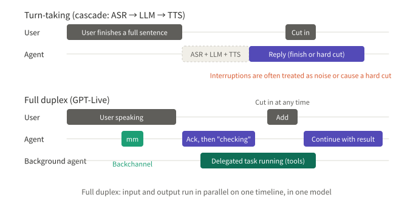
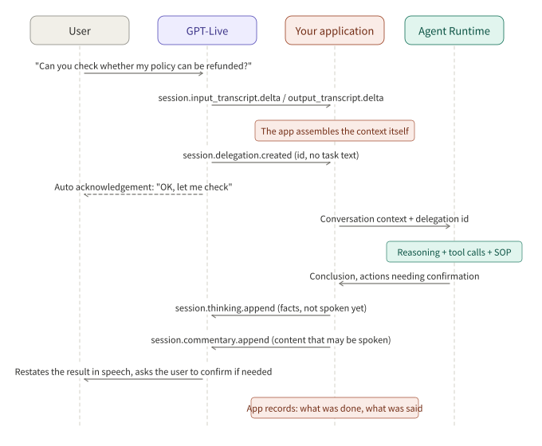
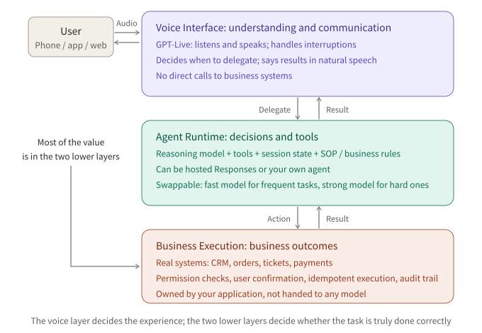

## Summary

In July 2026 OpenAI put the full-duplex voice model GPT-Live into ChatGPT, and in September it opened an API under the name GPT-Live-1. What draws the most attention is that it "listens and speaks at the same time", but from an engineering view another design choice matters more: **the voice model handles only conversation, and reasoning, tool calls and business actions are handed to a back end through delegation**. The back end can be a model hosted by OpenAI or the developer's own agent (Client Delegation).

This design cuts a voice agent cleanly into three layers:

**Voice Interface → Agent Runtime → Business Execution**

The Voice Interface understands and communicates, the Agent Runtime decides and runs tools, and Business Execution produces real business outcomes. Voice is only the interaction layer; the commercial value of a voice agent ultimately depends on whether the agent behind it completes the task correctly.

This article is organized around five questions:

| # | Question |
|---|---|
| Q1 | What is full duplex, and how does it differ from traditional turn-taking voice systems? |
| Q2 | What does GPT-Live hand to the back end? |
| Q3 | What does the data flow look like under Client Delegation? |
| Q4 | Why split into three layers, and what is each layer responsible for? |
| Q5 | Why is this more strategic than a purely end-to-end voice model, and what must be solved to ship it? |

## Key conclusions

- **Full duplex solves "talking like a person".** Input and output run in parallel on one timeline, so the model can backchannel, be interrupted, and keep listening while the user adds more. A turn-taking cascade cannot do this structurally.
- **GPT-Live deliberately does not try to be a universal model.** It hands reasoning and tools to the back end and focuses on real-time conversation; the back end can be swapped by task difficulty.
- **Client Delegation gives control back to the developer.** Context, execution and returned content are all in your application's hands. The price is that you must maintain conversation state and keep "what was said" consistent with "what was done".
- **The business value is in the two lower layers.** The voice layer decides the experience; the Agent Runtime and Business Execution decide whether the task is actually completed, compliant and traceable.
- **The voice model is becoming an entry point.** The same voice layer can connect to different business agents, which turns a voice agent from "a model" into "a platform".

---

## Q1: What is full duplex?

### Conclusion

Full duplex means the agent can **listen and speak at the same time**. It can say "mm-hm" while the user talks, the user can cut in or add something while it speaks, and the model reasons over the incoming and outgoing audio together. GPT-Live handles all of this in a single model instead of relying on an external voice activity detector to switch "whose turn it is".

### Turn-taking versus full duplex

*Figure 1: the top half is a traditional cascade, which must wait for the user to finish and then goes through recognition, reasoning and synthesis before speaking, so interruptions are often treated as noise or cut off hard. The bottom half is full duplex, where backchannels, interruptions and background tasks all run in parallel on one timeline.*

Most traditional voice agents are an ASR → LLM → TTS cascade, which is turn-taking at heart:

- They must decide "has the user finished?"; decide too early and they talk over the user, too late and there is dead air.
- While the agent speaks it cannot hear or heed the user, so on an interruption it either finishes or cuts off hard.
- Background noise and backchannels such as "mm" or "yeah" are easily mistaken for a new turn of input.

Full duplex handles these inside one model. According to OpenAI, in early evaluations by the language-learning app Speak, interruptions fell by nearly 80% compared with the previous turn-taking system; on Full Duplex Bench it scores 30 points higher than the previous-generation GPT-Realtime-2.1, with clearly lower turn-switch latency. These are the vendor's own numbers, but the direction is clear.

### Hear it for yourself

Text can hardly convey what full duplex feels like. OpenAI's [GPT-Live-1 launch page](https://openai.com/index/introducing-gpt-live-1-in-the-api/) has a **"Try GPT-Live-1"** area near the top where you can hold a time-limited voice-only conversation with the model (you must agree to OpenAI's terms and privacy policy). A few things worth trying:

- Cut in suddenly while it is speaking and see how it picks up;
- Say a sentence, pause, then add half a sentence, and see whether it talks over you;
- Speak with background noise, or stay silent for a while on purpose.

These few tries show the difference between full duplex and turn-taking better than any description.

---

## Q2: What does GPT-Live hand to the back end?

### Conclusion

GPT-Live does only three things: listen, speak, and decide when to delegate. Reasoning and tool calls are done by the back end; permissions, confirmations and business records are the application's responsibility.

### Three roles

According to OpenAI's developer documentation, a system built on GPT-Live has three roles:

| Role | Responsibility |
|---|---|
| GPT-Live | Handles spoken conversation: listens, speaks, and decides when to delegate a task |
| Back end (model, agent or service) | Handles the delegated task, calls tools, and returns results for GPT-Live to say |
| Your application | Checks permissions, obtains user confirmation, runs functions that touch your own systems, and stores task progress |

In ChatGPT, for web search or harder reasoning, GPT-Live hands the question to a stronger model in the background (GPT-5.5 at launch), keeps talking to the user, and weaves the result into the conversation naturally when it returns.

### Two delegation modes

The mode is chosen when the session is created and cannot be switched afterwards; to change it you open a new session:

| | Responses Delegation | Client Delegation |
|---|---|---|
| Who is the back end | A Responses model hosted by OpenAI | Your own model, agent framework or service |
| Configuration | `delegation.type = "responses"`, specifying model, instructions, tools and so on | `delegation.type = "client"`, with optional `acknowledgement_delay_ms` |
| Hosted tools | Web search, file search, code interpreter and so on run automatically | You handle all of them |
| Custom functions | Your application executes and returns the result | Your application executes |
| Context | OpenAI passes it between voice layer and back end | You maintain it |

The combination suggested on the launch page is a fast model for frequent simple tasks and a strong-reasoning model for complex questions; third-party models can also be connected. On billing, the voice layer is charged per minute ($0.05 per minute), and the back-end model and tools are charged separately.

---

## Q3: What does the data flow look like under Client Delegation?

### Conclusion

Under Client Delegation, GPT-Live only tells you "a delegation is needed" and **does not tell you what the task is**. Your application must assemble the conversation context from the transcript stream, hand it to your own agent, and append the result back to the voice layer split into "things to say" and "plain facts".

### Event sequence

*Figure 2: four swim lanes: the user, GPT-Live, your application, and your agent runtime.*

The key steps:

1. **Maintain context.** The application keeps receiving `session.input_transcript.delta` and `session.output_transcript.delta` and assembles the full conversation record itself. These increments have no turn-end event, so how turns are split is up to the application.
2. **Delegation starts.** You receive `session.delegation.created`, which carries a delegation ID and `target: "client"` but no task text.
3. **While waiting.** After a delay (`acknowledgement_delay_ms`), GPT-Live can automatically say an acknowledgement such as "OK, let me check". If you do not want that, send an empty `session.thinking.append` before the delay expires; any thinking or commentary append cancels the pending acknowledgement.
4. **Execution.** The application passes the context to its own agent, which does the reasoning, tool calls and business-rule judgments.
5. **Return the result**, in one of three kinds of append, each at most 500 tokens:

| Event | Meaning |
|---|---|
| `session.commentary.append` | Content you want GPT-Live to say; it may rephrase it |
| `session.thinking.append` | Facts for later replies; not spoken immediately on arrival |
| `session.instructions.append` | Session-level guidance, usually not tied to a specific delegation |

6. **Acknowledgement.** The matching `session.*.appended` receipt only means the content reached the voice layer's context; it **does not mean it has been said to the user**.

### An easily overlooked fact

The documentation stresses that voice and back end run independently. A finished back-end task does not mean the user has heard the answer; and if the user cuts in while a task runs, the back-end task may keep going, and whether to finish or cancel it is up to your application.

This means three timelines exist in the system at once: **what the user said, what the agent said, and what the back end did**. In customer service and sales, keeping these consistent bears directly on compliance risk, for example "the agent has told the user the refund succeeded, but the back end has not actually executed it".

---

## Q4: Why split into three layers?

### Conclusion

The three layers correspond to three different kinds of problem: conversation experience, task decisions and business consequences. Split apart, each layer can be optimized, replaced and evaluated independently, and the lines of responsibility are clearer.

*Figure 3: the user interacts only with the voice layer; when decisions and tools are needed it delegates to the Agent Runtime; actions that truly change business state are executed by Business Execution under permission, confirmation and recording constraints.*

| Layer | Responsible for | Typical failures | How to evaluate |
|---|---|---|---|
| Voice Interface | Understanding, speaking clearly, natural turns, handling interruptions and noise | Talking over the user, dead air, mishearing numbers, wrong tone | Interruption rate, turn latency, recognition accuracy, subjective experience |
| Agent Runtime | Understanding intent, deciding by SOP, calling tools, maintaining task state | Choosing the wrong flow, missing rules, wrong tool calls | Decision accuracy, SOP compliance rate, task completion rate |
| Business Execution | Executing in real systems while guaranteeing permissions, confirmation, idempotency and traceability | Unauthorized actions, double charges, no record to check | Execution correctness, audit completeness |

The table also explains why "the business value is in the two lower layers": however good the voice layer is, if the agent picks the wrong flow or the execution layer places the order twice, the call has failed; conversely, if the voice experience is slightly worse but the matter is handled correctly, users mostly accept it.

### Why the execution layer must be held by the application

OpenAI's documentation is explicit under both delegation modes that permissions, confirmation and business records are your application's responsibility. This is not a technical limit but a division of responsibility. Any model can be wrong, and actions that change business state (refunds, orders, profile changes) must go through a deterministic code path: check permissions, have the user confirm verbally when needed, make sure a repeated request does not execute twice, and record every step.

---

## Q5: Why is this more strategic than an end-to-end voice model?

### Conclusion

A purely end-to-end voice model squeezes understanding, decision and expression into one model. The experience can be excellent, but business correctness is hard to guarantee and no single part can be swapped out. GPT-Live plus delegation turns the voice model into **an entry point that can connect to different business agents**.

### Four reasons

**1. Capabilities can evolve separately.** A voice model pursues low latency and naturalness, a reasoning model pursues correctness, and their optima differ greatly. Once split, upgrading the voice layer does not affect business logic, and the business agent can be swapped for a stronger or cheaper model at any time. The launch page itself suggests pairing the back end with different models by task difficulty.

**2. Business logic stays in the developer's hands.** SOPs, business rules, knowledge bases and tool permissions are the most central part of every company and the part it most needs to control. Client Delegation keeps all of it inside your own Agent Runtime, with the voice layer as just a caller. This matters especially for private deployment and regulated industries.

**3. One entry point, many agents.** The same voice layer can dispatch tasks to different business agents depending on the conversation: inquiries, after-sales, sales, complaints. A voice agent goes from "a model" to "the front end of a platform".

**4. Evaluable and traceable.** With three layers, each has its own metrics and logs. When something goes wrong you can tell whether it was "misheard", "misjudged" or "mis-executed", which is almost impossible with an end-to-end model.

OpenAI reports that GPT-Live-1 with a strong-reasoning back end ranks first on Tau3, a benchmark of end-to-end voice agent tasks, and that one customer cut its code by 80% after moving from a cascade architecture. The first suggests that "voice layer plus strong back end" works for task completion; the second suggests the voice layer itself absorbs a lot of turn-management logic that used to be hand-written.

### Costs and counterarguments

The design has clear costs that deserve attention:

- **One more hop of latency.** Complex tasks wait on the back end, and the voice layer can only fill the wait with acknowledgements or small talk. How long users will tolerate waiting and what to say meanwhile is a new design problem.
- **The burden of syncing context.** Under Client Delegation the application maintains conversation state itself; transcripts lag and have no turn boundaries, so assembling context is itself error-prone.
- **Consistency.** As noted above, "what was said" and "what was done" are two independent timelines and need a dedicated mechanism to align them.
- **End-to-end models keep improving.** If future end-to-end models become reliable enough at tool calls and business correctness, the advantage of layering weakens. The long-term value of a layered architecture lies more in controllability and replaceability than in today's capability gap.

### Engineering checklist for shipping

If you build a customer-service or sales voice agent on Client Delegation, you need to solve at least these:

1. **Conversation state machine.** Maintain turns and context from the transcript stream, and define when to trigger a delegation and when to ignore a backchannel.
2. **SOP in the runtime.** Flow nodes and business rules are judged by the Agent Runtime; the voice layer only says the conclusion.
3. **A ledger of saying and doing.** Record each delegation's input, the agent's decision, the execution result, and what the agent actually said to the user, for reconciliation and audit.
4. **Confirmation and idempotency.** Confirm verbally before any action that changes business state, and make execution idempotent.
5. **Interruption policy.** When the user cuts in during a task, decide by task type whether to continue, cancel or update parameters.
6. **Waiting scripts.** Based on the back end's expected duration, choose between an automatic acknowledgement, progress updates via `session.commentary.append`, or quietly setting context with `session.thinking.append`.
7. **Layered evaluation.** Experience metrics for the voice layer, decision and SOP compliance for the runtime, correctness and audit completeness for execution, each regression-tested separately.

---

## Conclusion

The most visible thing about GPT-Live is full duplex, but what it really changes is the division of labor in voice agents: the voice model makes the conversation natural, reasoning and tools go to a replaceable back end, and business consequences stay in the developer's own deterministic code.

In the chain **Voice Interface → Agent Runtime → Business Execution**, voice is the entry point, the agent is the brain, and the execution layer is the boundary of responsibility. For teams building voice agents, competitiveness lies not in training a model that speaks better, but in whether the agent behind it can finish every call's task correctly under real business constraints.

---

## References

- [OpenAI: Introducing GPT-Live-1 in the API (includes the "Try GPT-Live-1" area)](https://openai.com/index/introducing-gpt-live-1-in-the-api/)
- [OpenAI developer docs: Getting started with GPT-Live](https://developers.openai.com/api/docs/guides/live)
- [OpenAI developer docs: Delegation and tools in GPT-Live](https://developers.openai.com/api/docs/guides/live-delegation)
- [OpenAI developer docs: Live conversations](https://developers.openai.com/api/docs/guides/live-conversations)
- [OpenAI developer docs: GPT-Live-1 model page](https://developers.openai.com/api/docs/models/gpt-live-1)
- [The Next Web: OpenAI's new GPT-Live lets ChatGPT listen and speak at the same time](https://thenextweb.com/news/openai-gpt-live-chatgpt-voice-full-duplex)

*Note: all performance figures in this article were published by OpenAI and its customers and have not been independently verified; for API details, the latest OpenAI documentation prevails.*
