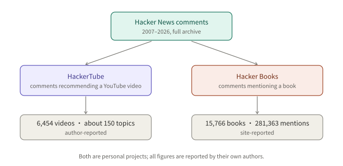
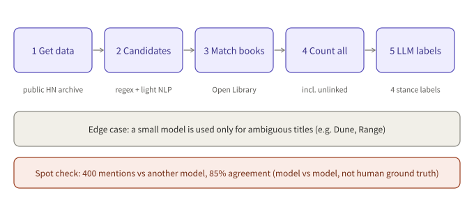

## Summary

Hacker News has an old habit: someone asks for a good book or a video worth watching, and others answer seriously. Those answers are scattered across twenty years of comments and are hard to search.

Two recent projects pull them together. HackerTube, published by Andrej Karpathy on October 31, lists only the YouTube videos recommended in HN comments. Hacker Books, built by roansh, turns the books mentioned in HN comments into a bookshelf and separates "mentioned" from "recommended".

Both do the same thing: **use an LLM to turn a pile of noisy human comments into a list you can use directly**. This article covers how each one works, what it is good for, and the question most people skip: whether you can reuse the data.

---

## Key findings

- **The two share one approach.** Take the full HN comment archive, find candidates with rules, ask a model whether each comment is really a recommendation, then put the result behind a browsable site.
- **HackerTube's headline is speed.** As reported, the author built it in about two hours with Claude Code and Opus 5.5, ending with 6,454 videos across about 150 topics. These figures are author-reported. I could not open the original post; the details come from a secondary article.
- **Hacker Books' headline is the mention/recommend split.** It reports 15,766 books and 281,363 mentions, and labels each mention as recommend, neutral, critical or off-topic.
- **The labels are not ground truth.** Hacker Books states that its labels agreed with another model 85% of the time on 400 mentions. That is model-to-model agreement, not a human standard.
- **Reusing the data has to be judged piece by piece.** Book metadata comes from Open Library (CC0); comment text belongs to its authors; videos belong to their creators; I found no explicit data licence on either site. Personal reading and reference are fine; check before building a commercial product on it. This is not legal advice.

---

## 1. What they are

### 1.1 HackerTube

HackerTube (hackertube.org) looks like YouTube but holds one kind of video: those recommended in HN comments between 2007 and 2026.

According to the secondary article, the build went roughly like this:

1. Opus 5.5, running in Claude Code, downloaded every HN comment and ran the whole pipeline.
2. Sonnet, through Claude Code's Workflow feature, filtered comments in bulk and removed spam, leaving about 40K comments that recommend a video.
3. A YouTube-style interface was added, with metadata from the YouTube API.
4. Claude deployed the site to a VPS and hardened it.

A few product details: thumbnails use the frame at the 50% mark rather than the uploader's cover; "For You" needs no account and keeps state only in the local browser; the dataset can be exported so others can hand it to their own agent and build a variant.

The author's own manual steps were three: creating a YouTube API key in the Google Cloud console, booting the VPS, and buying the domain.

### 1.2 Hacker Books

Hacker Books (hackerbooks.org) is a bookshelf of books mentioned in HN comments from 2007 to 2026. The site reports 15,766 books, 281,363 mentions, 225,861 comments and 57,773 commenters.

It was inspired by HackerTube but is independent; the page states it is not affiliated with Y Combinator or Hacker News. It is built by roansh, with Claude Code according to the page.

Its question is: **mentioning a book is not recommending it.** So every mention is labelled recommend, neutral, critical or off-topic, and "recommended by" counts distinct people, so one enthusiastic commenter cannot dominate.

*Figure 1: Same raw material, different filter. All figures are reported by each project's author.*

---

## 2. The Hacker Books pipeline

This is the part I could check against a primary page, so I go into more detail.

1. **Get the data.** Start from the public archive of every HN item and comment.
2. **Find candidates.** Regexes and light NLP find likely book references: quoted titles, "by Author", Amazon, Goodreads and Open Library links, ISBNs.
3. **Match books.** Candidates are matched to Open Library works, giving a stable ID, authors, first-publish year, cover and subjects.
4. **Count corpus-wide.** Each resolved title is searched across the whole corpus, so mentions without links are counted too.
5. **Label with a model.** Claude Sonnet 5.5 labels each mention. Separately, a small model is used only for ambiguous titles (the page's examples are Dune, Influence and Range) to check the comment is really about the book.

The page adds that keyword rules, sentiment scoring and a TF-IDF classifier were tried first and were less accurate.

*Figure 2: Rules find candidates; the model makes the judgment calls.*

That division of labour is worth remembering. Rules are cheap and fast but miss and misfire; models are accurate but costly. So rules narrow the field and the model is called only where meaning matters. HackerTube follows the same idea: bulk filtering goes to the smaller Sonnet, orchestration to Opus.

---

## 3. What they are good for

What follows is my judgment, not the authors' claims.

**As a reading and watching list.** The obvious use. HN recommenders are often people with years in a field, and their picks can fit better than an algorithmic chart.

**As a dataset of human recommendations.** Such data is rare: large, spanning twenty years, timestamped, with a written reason behind each pick. It could support research on how a book or video gets recommended into prominence, or serve as evaluation material for recommender systems.

**As a template for data products.** Both are "a big corpus, one filtering question, one display layer". Change the community or the question and the recipe runs again: tools recommended in a forum, papers recommended in a community.

**But mind the bias.** HN's users are unusual: likely skewed toward tech workers (my inference; I did not look up its user makeup). This is "what HN users recommend", not "what people recommend".

---

## 4. Can you use the data?

I checked this specifically. Conclusion: **personal browsing and reference are fine; for redistribution or commercial use, verify each part first.**

| Part | Status |
|---|---|
| Book metadata and covers (Open Library) | Open Library data is released under CC0 |
| Comment text | The page says it belongs to its authors and links back to the thread |
| YouTube videos | Copyright rests with the creators; HackerTube only lists links and metadata |
| Hacker Books CSV | Downloadable (generated 2026-11-02); the page states no specific licence |
| HackerTube export | The secondary article says it can be exported; I found no licence statement |

Two more notes: Hacker Books' book pages carry Amazon affiliate links, so purchases may earn the site a commission (the page says so itself); and HN's own terms for its data should be read separately.

If you want to build on them, a safer route is to rerun the process yourself on public metadata rather than redistributing someone else's export.

---

## Conclusion

Both projects rest on one plain idea: comment threads hold plenty of good material and only lack a sieve. LLMs cut the cost of that sieve to a day, or two hours.

Keep the results in proportion, though: the figures are author-reported, the labels disagree with a reference model about one time in seven, and the sample comes from a very particular community. Good for finding books and videos; if you want a serious conclusion, spot-check first.

What I could not verify: Karpathy's original post (the blog refused access, so details come from a secondary article), the HackerTube site itself, and the licence of either site's export.

---

## References

- [About Hacker Books](https://hackerbooks.org/about): scale, pipeline, labels, agreement figure, data sources and privacy notes
- [Karpathy builds HackerTube in about 2 hours with Claude Code and Opus 5.5 (AICoder)](https://aicoder.com/news/news-20261031-karpathy-hackertube-youtube-clone-hn-recommended-videos-claude-code-opus-5-5-two-hours): HackerTube figures, pipeline and the author's setup (secondary)
- [Karpathy's original post, HackerTube](https://karpathy.bearblog.dev/hacker-tube/): publication date taken from a GitHub issue that indexes the link; I could not read the body

*Compiled from public web pages; figures are author-reported and not independently reproduced.*
