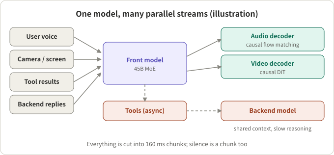
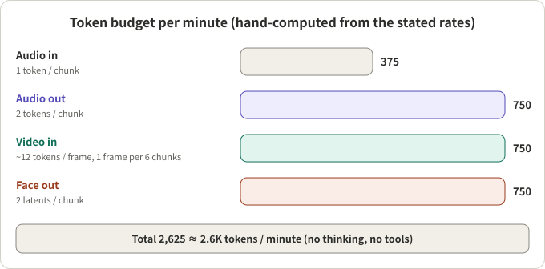

## Summary

On 5 November 2026 Boson AI announced Higgs Realtime Duplex, which it calls the company's "first full-duplex interactive omni model": it listens, watches and talks at the same time, has its own face, and keeps thinking, calling tools and delegating hard work to a backend while the conversation goes on. This is a vendor blog post, not a paper; the page lists no paper, code or weights, and the API is at the waitlist stage.

My reading: the most useful parts are not the benchmark scores but two things. First, it writes the cost of full duplex as a plain ledger (one chunk every 160 ms, a few tokens per chunk, about 2.6K per minute in total). Second, it takes a clear side on a design choice: the front model handles most of the work itself and only hard tasks go to a larger backend. What it does not give is response latency or the mechanism behind "when to speak, when to yield", and over half of the numbers in its benchmark table are quoted from other sources.

## Key conclusions

- The core design is "slice time, not turns": all input and output streams are cut into 160 ms chunks, silence is a chunk too, and each step reads one chunk and writes one.
- Cost comes from cutting tokens per chunk: 1 audio token in, 2 out, one video frame about every 0.96 s, and 2 face latents out per chunk. From the stated rates I computed 2,625 tokens per minute, matching the post's "about 2.6K".
- A 45B MoE front model handles most of the conversation and delegates hard tasks asynchronously to a larger backend while it keeps talking. The post argues this keeps cost more controllable than a design where the front model hands all reasoning to a background model; that is the vendor's own judgement.
- Results are mixed: highest on Big Bench Audio (98.9), but 75.5 on Full-Duplex-Bench v1.5, behind two other systems. The post itself says the results "trade blows".
- Not stated: response latency, the turn-taking mechanism, and which benchmark numbers were reproduced. Test these yourself before choosing.

## A few concepts first

**Full duplex and time slicing.** A half-duplex system works in turns: the user finishes, then the model speaks. A full-duplex system reads and writes at every time step. Here a step is 160 ms, so 6.25 steps per second. When nobody speaks, each step writes a "silence chunk".

**Front model and backend model.** The front model talks to the user directly and must be fast and cheap. The backend is a larger model that receives delegated tasks with the shared context; it is slower and stronger. The front model keeps talking while the backend works and brings the result back when it arrives.

**MOPD (multi-teacher on-policy distillation).** Starting from one base model, several specialist teachers are trained with reinforcement learning (including GRPO), then distilled into a single student. The post lists teacher areas: natural conversation, interactive behaviour, dynamic delegation, task completion.

**RSI (recursive self-improvement) loop.** Run the whole agent system in simulated environments, review failures, synthesise targeted data, train, repeat. The simulation must reproduce real timing and variety: interruptions, overlapping speech, side conversations, background noise.

## Architecture

*Figure 1: One model, many parallel streams (an illustration drawn from the post's description).*

- Inputs: user voice, camera or screen, tool results, backend replies. Outputs: voice, face, background work.
- Tool calls are asynchronous: search, knowledge bases, booking, CRM lookups or deployment-defined functions. Results can return in stages; each enters an input chunk as a payload with no fixed per-chunk token quota, and the model can start speaking before a full result is ready.
- Thinking starts while the user is still speaking and "usually takes seconds".
- Voice and face are set zero-shot at deployment: a reference audio clip sets the voice, a reference image sets the face, no fine-tuning. The audio decoder is a causal flow-matching model; the video decoder is a causal DiT conditioned on the reference image and the two most recent face latents, which keeps the face consistent across long sessions.

## Cost: where 2.6K tokens per minute comes from

*Figure 2: Token budget per minute (hand-computed from the stated rates; the total matches the post).*

| Stream | Rate | Per minute |
|---|---|---|
| Audio in | 1 token per chunk, 6.25 tokens/s | 375 |
| Audio out | 2 tokens per chunk, 12.5 tokens/s | 750 |
| Video in | 1 frame per 6 chunks (~0.96 s), about a dozen tokens per frame | ~750 |
| Face out | 2 latents per chunk | 750 |
| Total | | ~2.6K (2,625) |

My check: 375 and 750 follow from the rates times 60 s; the video row implies about 12 tokens per frame, consistent with "a dozen". The post adds that with optional thinking, tool calls and results the total is roughly 2.6K to 5K tokens per minute, assuming progressive compaction of intermediate reasoning and tool traces. In production the model keeps the last five minutes of audio and visual streams plus compacted text, about 13K to 25K tokens (five times 2.6K is exactly 13K; the upper end includes more activity). Older history is kept as text outside this budget.

The post also states a design target: an hour with the model should cost at most one tenth of an hour of a person's time. That is a target, not a reported result.

## Trade-off against the other approach

The post contrasts itself with Thinking Machines' interaction model, describing it as handing all reasoning and tool use from the front model to a background model, which is simpler to train, but a large reasoning model can take ten seconds or more per response and cost is hard to control. Higgs lets the front model do most of the work and delegates only hard tasks. This is Boson's summary of the other design; I did not check the other source.

## Training

- Base: starts from a text-pretrained model and continues on about 2 trillion tokens of text, audio and visual data; the text keeps general ability. Training ran on Boson's own NVIDIA H100 cluster, partly based on Megatron.
- Why a 45B MoE front: the post says larger models score higher but cost more, and hard questions can go to a larger backend, so it picked a mid-sized front model.
- Post-training: MOPD plus RSI. The teachers learn when to speak or yield, when to start or extend a reasoning thread, when to call a tool and when to delegate. Reward design and data scale are not given.

## Benchmarks: the full table and my checks

The post's comparison table (vendor-reported; other models' scores come from published reports and leaderboards, and Boson says it reproduced "more than half" of them without saying which):

| Benchmark (metric) | Higgs Duplex 45B MoE | TML Interaction Small 276B MoE | GPT Realtime / Live | Gemini Live |
|---|---|---|---|---|
| Big Bench Audio (accuracy) | **98.9** | 96.5 | RT-2 Minimal 72; RT-2 High 97; GPT-Live-1 Astra medium 90 | 3.1 Flash Live Minimal 71; High 97; 3.8 Live Ext. Thinking High 98 |
| Audio MultiChallenge (APR) | 44.9 | 43.4 | RT-2 Minimal 37.6; RT-2 xHigh 48.5 | 3.1 Flash Live Minimal 26.8; High 36.1 |
| Full-Duplex-Bench v1.5 (average) | 75.5 | 77.8 | RT-2 Minimal 46.8; RT-2 xHigh 47.8; GPT-Live-1 80.1 | Minimal 54.3; High 45.5 |
| QIVD (streaming accuracy) | 56.0 | 54.0 | RT-2 Minimal 57.5; RT-2 xHigh 58.2 | Minimal 54.7; High 56.1 |
| ProactiveVideoQA (PAUC@ω=0.5) | 31.9 | 33.5 | RT-2 Minimal 25.0 | Not run |
| τ-Voice (task completion pass@1, %) | 69.8 | Not run | RT-2 Minimal 30.8; RT-2 High 39.8; GPT-Live-1 Astra medium 74.5 | Minimal 26.2; High 37.7; 3.8 Live Ext. Thinking High 68.6 |
| IFEval (accuracy) | 94.1 | 89.7 | RT-2 Minimal 89.6; RT-2 xHigh 95.2 | Minimal 85.8; High 90.0 |

What I checked against the table:

- The post marks Big Bench Audio as highest and four others as "2nd highest" (Audio MultiChallenge, ProactiveVideoQA, τ-Voice, IFEval). The numbers agree with those labels.
- Two rows the post does not label are not favourable: on Full-Duplex-Bench v1.5, Higgs scores 75.5, below TML's 77.8 and GPT-Live-1's 80.1; on QIVD, 56.0, below RT-2's 57.5 and 58.2 and below Gemini 3.1 Flash Live High's 56.1. This is from my own reading of the table; the post does not say it.
- Configurations differ (Minimal, High, xHigh thinking levels), so different levels within a row are not the same model; the post itself notes GPT and Gemini usually score best at high thinking.
- The interaction row (Full-Duplex-Bench v1.5) is where Higgs is relatively weak, and interaction is the core of the "full duplex" pitch. Together with the missing turn-taking mechanism and latency, this deserves attention.
- The post uses "the front model is about six times smaller than TML's (45B vs 276B)" to argue data, architecture and training matter more than scale. That compares front models; each system's backend and serving cost are not in the table.

## Worth borrowing? An engineering view

**Ideas to borrow directly.**

- Do the cost ledger per chunk: fix the chunk length, set tokens per chunk for each stream, and multiply out per minute. Cost then has a clear ceiling that does not grow with silence.
- Make compaction part of the budget: keep raw audio and video only for a recent window, and turn older history into text.
- Put slow work on asynchronous channels: tool and backend results return in stages while the front model listens and talks, never blocking the conversation.
- Evaluate both interaction behaviour and task completion, not question-answering scores alone.

**Where to be careful.**

- Every step runs the front model once, 6.25 times per second. My inference: real-time only holds if a step finishes within 160 ms, and the post gives neither step time nor active parameters, so "cheap" currently means "few tokens", not proven low cost.
- There is no response-latency number. The post cites about 200 ms as a human reference gap; that is not a Higgs measurement.
- The demos (meeting, spoken-English tutor, drive-thru, hands-free engineering) are not independently verified; on mechanism, "when to speak, yield or ignore side remarks" is described only through the training method.
- Delegation "works best when the backend is a frontier model", and the post does not say how backend results are injected.

## Conclusion

The post's value is the cost ledger and the design trade-offs: chunking, token control, front/backend split, asynchronous tools. All of these can be set against your own design. What to keep in mind: it is a vendor release, the numbers are vendor-reported, latency and mechanism are undisclosed, and it does not lead on the full-duplex interaction benchmark.

## References

- [Higgs Realtime Duplex (Boson AI blog, 2026-11-05)](https://www.boson.ai/blog/higgs-realtime-duplex)
- [Higgs Realtime docs](https://docs.boson.ai/models/higgs-realtime): the currently available model; its event protocol is compatible with OpenAI's GA Realtime API, it supports server_vad and semantic_vad, and the model always stops when the user interrupts

Related reading: [Seven Full-Duplex Speech Systems]({{ '/en/full-duplex-listening-time/' | relative_url }}), [How to Evaluate Barge-In]({{ '/en/barge-in-benchmarks-2026/' | relative_url }}), [Voice Is Just the Entry Point]({{ '/en/gpt-live-voice-agent-architecture/' | relative_url }}).

*Note: all numbers come from Boson's post and are vendor-reported, not independently reproduced; per-minute token counts are my own calculation from the stated rates; "my inference" marks personal judgement. I did not open the post's Bilibili or Xiaohongshu videos and did not write from them.*
