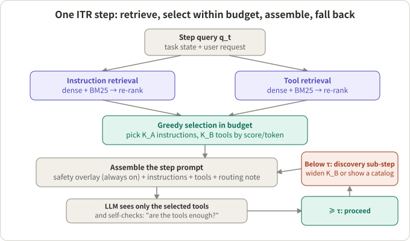
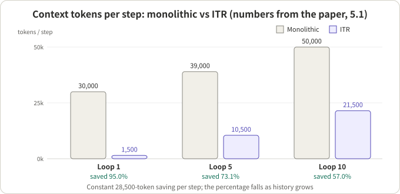
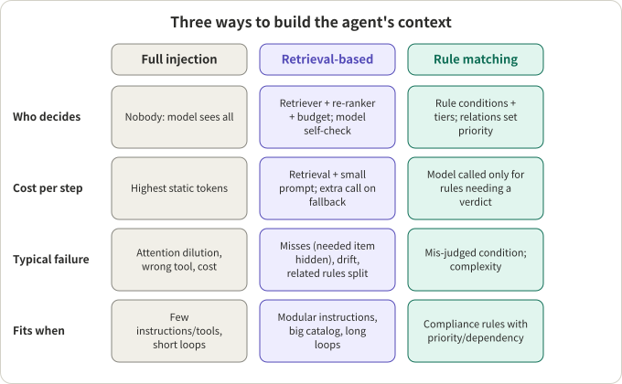

## Summary

*Dynamic System Instructions and Tool Exposure for Efficient Agentic LLMs* (Uria Franko, single author, arXiv 2602.17046; the PDF stamps v1 as 2025-12-01; no affiliation is listed on the page) proposes Instruction-Tool Retrieval (ITR). Instead of giving the model the whole system prompt and every tool at each step, it chops the prompt into fragments, writes one document per tool, retrieves only the few instructions and tools the current step needs, assembles a temporary system prompt from them, and widens the selection when confidence is low. The paper reports 95% fewer context tokens per step, tool-selection accuracy up from 62% to 82% (32% relative), and a 70% lower cost per episode on multi-hop tasks.

My reading: **the direction is right, but the paper's numbers are better used as an illustration of the mechanism than as evidence to extrapolate.** The abstract itself calls the benchmark "controlled, with internally consistent numbers"; the "internal consistency validation" in section 5.3 checks that the percentages follow from the tables, not that the measurements are reliable. The paper does not name the model, the number of runs or any confidence interval, and several statements in the text disagree with its own tables (see Q3). The mechanism, in particular recall-first retrieval with a fallback, an always-on safety overlay, and treating both instructions and tools as retrievable objects, is worth borrowing.

The article also places ITR inside the frame of *guideline selection* (deciding which behaviour rules apply this turn) and compares it with full injection and with rule-based unified matching (the Parlant Compass engine read in [the earlier article]({{ '/en/parlant-compass-engine-walkthrough/' | relative_url }})), ending with a selection table.

| Question | One-line answer |
|---|---|
| Q1 What does ITR do per step | Dual retrieval (instructions, tools) → greedy selection in budget → assemble → model self-checks tool sufficiency, discovery fallback if not |
| Q2 Under what conditions was it tested | 100 tasks, four systems; model and run count not given |
| Q3 Do the text and tables agree | Arithmetic yes; several claims go beyond the tables |
| Q4 Where does the gain come from | Token savings mostly from instructions, tool-accuracy gain mostly from narrowing tools |
| Q5 How to choose among the three approaches | Depends on instruction modularity, dependencies between rules, and loop length |

## Key conclusions

- ITR treats instructions and tools as retrievable objects and picks a minimal subset within a budget each step. It is a **selector plus a fallback**, not a new model.
- The 95% figure is the loop-1 number. As history accumulates it falls to 57% at loop 10, and the cumulative saving over a 10-step episode is 73% (390k → 105k). The absolute saving is a constant 28,500 tokens per step; the percentage declines.
- The text claims "147× more loops" and "2–20×", but the paper's own Table 1 supports only about 1.04–2.6×, and the "exponential" wording has no data behind it. Trust the tables, not the prose.
- Using the paper's own one-parameter model, the recall that ITR implies falls from about 0.88 to about 0.77 as the tool catalog grows, which does not fully fit "ITR maintains performance". That is my derivation, not the paper's claim.
- It changes more than cost: building the system prompt dynamically breaks provider-side prefix caching (my inference), which matters for latency-sensitive streaming settings.
- Selection: with few instructions and short loops, full injection is enough; with modular instructions, a big catalog and long loops, use retrieval; when rules have priority, dependency and compliance requirements, use rule matching with relations, or combine retrieval with rules.

## A few concepts first

**Guideline selection.** A customer-facing agent typically has many behaviour rules ("check the order before a refund", "never promise an unapproved discount") and many tools. Not all of them are relevant on every turn. Guideline selection decides which rules and tools the model sees this turn. The three common approaches are compared in the last section.

**Instruction fragments and tool documents.** ITR splits the system prompt into 200–600-token fragments with stable IDs and metadata (domain, policy type, recency); each tool becomes a document with name, arguments, pre/postconditions, failure modes and a few examples, 150–800 tokens. What is retrieved is these fragments and documents, not external knowledge.

**Hybrid scoring.** Relevance of a candidate to the current step is a weighted sum of dense cosine similarity, a BM25 lexical score and a cross-encoder re-rank score, the paper's equation (3):

```
S(a_i | q_t) = w1 * cos(E(q_t), E(a_i)) + w2 * BM25(q_t, a_i) + w3 * CE(q_t, a_i)
```

**Selection within a budget.** Every candidate has a token cost and the total must stay within a budget B. The paper writes this as a knapsack problem (equation 4); in practice it picks greedily by re-rank score per token.

**Safety overlay.** A small block that is always placed in the prompt (safety and legal rules). It does not take part in retrieval, so critical rules survive aggressive pruning.

**Tool sufficiency check and discovery fallback.** The model rates whether the exposed tools are enough. Below a threshold τ, a "discovery" sub-step widens the tool count K_B or briefly shows a summary of the catalog.

**Miss-rate.** The share of episodes that fail because the correct tool was hidden. It is the metric retrieval-based selection should watch most closely.



*Figure 1: an illustration based on section 3 and Algorithm 1 of the paper.*

## Q1: What does ITR do per step

**Conclusion: dual retrieval, greedy selection in budget, assembly, self-check, fallback. Five steps, and the main model is not trained.**

1. **Index.** Fragments and tool documents each get a vector index and a BM25 index, plus a lightweight cross-encoder for re-ranking.
2. **Retrieve per step.** The step input q_t (task state plus user request) is scored against both indices; the top M_A and M_B are kept and re-ranked.
3. **Select in budget.** Greedily pick K_A instructions and K_B tools. The paper's suggested starting point is K_A = 4, K_B = 2.
4. **Assemble.** The prompt order is: the always-on safety overlay, the selected instructions ordered by policy priority, the selected tools with schemas and 1–2 examples, and a routing note (do not use hidden tools; ask for "tool discovery" if the exposed ones are insufficient).
5. **Fall back.** The model rates whether the tools suffice; below τ the selection is widened and the step re-run. A few critical tools can also be made "always eligible" (pinned) through domain classifiers.

There is also caching: the selected sets are cached per task signature to amortize retrieval across loops.

**Training and parameters not given.** ITR trains nothing in the main model. How the re-ranker is trained, the weights w1, w2, w3, the threshold τ, M_A, M_B and the budget B are not given. The marginal gain Δ in equation (4) is said to come from "historical traces or bandit feedback" without detail; the practical recipe is the greedy one.

## Q2: Under what conditions was it tested

**Conclusion: 100 tasks of three types, four systems; the model and run count are not stated.**

| Task | Count | Content |
|---|---|---|
| T1 Structured API | 40 | CRM, support, analytics, billing; 1–3 tools per task |
| T2 Reason + Act | 30 | Multi-hop data analysis, about 9 steps per episode (the text reads "5 → 1 → 2 steps"; I assume L ≈ 9) |
| T3 DevOps/Docs | 30 | Selective doc reading, 2–5 tools |

Baselines: B0 monolithic (full prompt and all tools); B1 a learned tool router only (full prompt kept); B2 prompt retrieval only (all tools still exposed); ITR retrieves both and has fallbacks.

Metrics: prompt tokens per step, tool-correct rate, episode success, cost, p50/p95 latency, miss-rate, and cumulative tokens against step count.

Not stated: which LLM was used, how many runs per task, any variance or confidence interval, whether the benchmark is public (I did not check whether the repository the paper links contains it), and how many tools "all tools" means in the main table. Section 5.1 also mentions a "production deployment" with a baseline of about 30,000 tokens per step reduced to 1,500, without saying what system it was; treat it as an anecdote.

## Q3: Do the text and the paper's own tables agree

**Conclusion: the core tables are self-consistent, but several claims in the prose go beyond what the tables support.**

First the main tables in full.

Table 2: tokens per step and tool-correct rate (all tasks)

| Method | Tokens/step | Tool-correct (%) |
|---|---|---|
| B0 Monolithic | 30,000 | 62 |
| B1 Router-only | 30,000 | 70 |
| B2 Prompt-RAG | 11,000 | 66 |
| ITR (K_A = 4, K_B = 2) | 1,500 | 82 |

Table 3: T2 episode results (L ≈ 9)

| Method | Success (%) | Cost/episode ($) | p50 latency (s) |
|---|---|---|---|
| B0 Monolithic | 64 | 2.90 | 68 |
| B1 Router-only | 70 | 2.55 | 65 |
| B2 Prompt-RAG | 72 | 1.45 | 51 |
| ITR | 79 | 0.86 | 44 |

Table 4: effect of the fallback on miss-rate

| Variant | Tools exposed K_B | Discovery fallback | Miss-rate (%) |
|---|---|---|---|
| ITR naive | 1 | No | 6.1 |
| ITR default | 2 | Yes | 2.4 |

Table 5: tool-correct rate against catalog size

| Tools | B0 (%) | ITR (%) | Gain (pp) |
|---|---|---|---|
| 8 | 74 | 84 | +10 |
| 40 | 57 | 82 | +25 |
| 120 | 45 | 76 | +31 |

What I found when checking:

1. **The arithmetic holds.** 1.5k/30k = 5%; (82−62)/62 = 32.3%; 0.86/2.90 = 29.7% (a 70.3% reduction); at loop 10, 390k against 105k saves 285k, about 3.7×. This is what the "internal consistency validation" in 5.3 does. It shows the numbers do not contradict each other, not that they were measured well.
2. **"95%" is the best step.** It is the loop-1 figure (30,000 → 1,500). Loop 5 is 73.1% (39,000 → 10,500), loop 10 is 57.0% (50,000 → 21,500), loop 20 is 39%. The cumulative reduction over a 10-step episode is 73%, not 95%. Read the abstract's 95% as "reduction of the static part".
3. **"70% cost" is for T2 only.** It comes from Table 3, a multi-hop task with L ≈ 9, priced as input plus output at model rates; the paper does not say whether cache discounts were considered.
4. **"147× more loops" contradicts Table 1.** Section 5.2 says that with 220K static tokens against 1.5K, ITR "permits 147× more agent loops". 147 is the ratio of static tokens (220/1.5), not of loops. Table 1 gives:

| Corpus | Static tokens | Monolithic max loops | ITR max loops | Ratio (mine) |
|---|---|---|---|---|
| 50 instr + 30 tools | 40K | 480 | 499 | 1.04 |
| 150 + 100 | 110K | 445 | 499 | 1.12 |
| 300 + 200 | 220K | 390 | 499 | 1.28 |
| 500 + 400 | 400K | 300 | 499 | 1.66 |
| 800 + 600 | 620K | 190 | 499 | 2.63 |

   The assumptions are a 1M window and 2K of history growth per step. The ratio runs from 1.04 to 2.63. The abstract's "2–20×", section 5.6's "2–5×" and the text's "147×" disagree with each other and with this table. "Exponential" has no support either: the monolithic maximum falls roughly linearly with static tokens.
5. **Table 5's caption has a slip.** It says "Table 1 shows averaged results across mixed catalog sizes"; by content it should refer to Table 2.
6. **Table 4 changes two variables.** Naive and default differ in both K_B (1 → 2) and the fallback, so the drop cannot be credited to the fallback alone. The ablation text's "K_B from 1 to 2 halves the miss-rate" also only roughly matches 6.1 → 2.4 (a 61% reduction).
7. **The one-parameter model does not fit Table 5.** Equation (5) says P(correct) = α/(α + β(N−1)). With α = 1 and solving for β from B0's three rows gives about 0.050 at N = 8, 0.019 at N = 40 and 0.010 at N = 120, a five-fold drop, so "the interference coefficient β is constant" does not hold and the model is only qualitative. Then applying equation (6) with m = K_B = 2, ignoring the fallback, and solving for the implied recall r from the ITR column gives about 0.88 at N = 8, 0.84 at N = 40 and 0.77 at N = 120. **This is my derivation from the paper's own model**: the larger the catalog, the lower the implied recall, which does not fully match the claim that ITR holds up on large catalogs.

A design question (my inference): T3 tasks need 2–5 tools while the default K_B is 2, so steps needing three or more tools rely on the discovery fallback; the paper does not break miss-rate down by task type.

## Q4: Where does the gain come from

**Conclusion: the token savings come mostly from instructions; the tool-accuracy gain comes mostly from narrowing tools.** This is computed by hand from Table 2.

- B2 (instructions retrieved, tools all exposed) uses 11,000 tokens against B0's 30,000, so the instruction part is roughly 19,000 (assuming B2 and B0 share the same user/history part).
- ITR uses 1,500, about 9,500 fewer than B2, which is roughly the gap between "all tools" and "K_B = 2 tools".
- Tool-correct: B0 62%, B2 (instructions only) 66% (+4 pp), ITR 82% (another +16 pp). So the tool-accuracy gain comes mainly from narrowing tools, not from narrowing instructions.
- Table 6 ablations: K_A 1 → 4 gives +6 pp success for 220 more tokens per step; K_B 1 → 2 gives +7 pp for 180 more; turning the re-ranker on gives +3 pp for 60 more; dense-only → hybrid retrieval gives +3 pp with no extra tokens.

B1 (a learned tool router with the full prompt kept) reaches 70%, so routing alone gives +8 pp, and part of ITR's +20 pp comes from something else. The paper does not say how the router exposes tools, so I do not infer more.

A separate data point is Dynamic ReAct (Gaurav et al., arXiv 2509.20386). It has the model write retrieval queries itself (`search_tools`), then bind the chosen tools into context with `load_tools`, with a few default tools always available. It measures Top-5/Top-10 retrieval accuracy on the authors' private tool registry:

| Embedding setup | Top-5 | Top-10 |
|---|---|---|
| text-embedding-3-large (baseline) | 40% | 64% |
| voyage-context-3 | 48% | 68% |
| voyage-3-large | 56% | 68% |
| voyage-context-3 + LLM-enriched tool descriptions | 60% | 68% |
| plus BM25 | 56% | 72% |

The largest gain comes from enriching tool descriptions with an LLM (Top-5 from 40% to 60%); adding BM25 raised Top-10 but lowered Top-5. The two papers' setups differ and cannot be compared directly, but the point stands: retrieval recall r is far from 1, with Top-10 at only 68–72% (the paper does not report the test-set size). That is what r means in ITR's equation (6): **when recall is low, narrowing can lower accuracy instead of raising it.**

## Q5: How to choose among full injection, retrieval and rule matching

**Conclusion: three questions decide it: can the instructions be split into independent fragments, do the entries have priority and dependency between them, and how long are the loops.**



*Figure 2: redrawn from the numbers in section 5.1 of the paper. A constant 28,500 tokens saved per step; the percentage falls as history grows.*



*Figure 3: an illustration. The "rule matching" column follows my earlier reading of the Parlant Compass source (an unreleased development branch); see that article for details.*

How the three differ:

| | Full injection | Retrieval-based (ITR, Dynamic ReAct) | Rule matching (Parlant Compass, unreleased) |
|---|---|---|---|
| Unit of selection | Whole prompt, all tools | Instruction fragments, tool documents | Rules with conditions, and relations between rules |
| Who selects | Nobody; the model sees all | Retriever + re-ranker + budget; model self-check or model-written queries as fallback | Tiers: no judging, embedding recall, model ranking; relations resolve priority and dependency |
| Strength | Simplest, nothing is missed | Small static tokens, better tool accuracy on large catalogs | Can express "A over B", "B depends on A"; suits compliance |
| Main risk | Attention dilution, wrong tool, cost | Misses, retriever drift, dependent instructions split apart | Mis-judged conditions, complexity |
| Prefix caching | Friendly (stable prefix) | Unfriendly (my inference, see below) | Relies on a byte-stable prompt prefix, with per-turn content after the cache breakpoint |

In Compass, tiers by effort and weight, and the forced promotion of rules that have labels, are depended on or have priority relations to the tier that produces a verdict for this turn, address exactly what retrieval-based selection handles poorly: **a retriever that scores independently does not know two instructions depend on each other** and may fetch only one.

## Is ITR worth it: an engineering view

**Where it pays off.**

- The static part is large (tens of thousands of prompt tokens or over a hundred tools) and loops are long. Table 5 shows the gain from narrowing growing with catalog size (though the implied recall falls).
- Instructions split into relatively independent fragments and tool documents are well written. Dynamic ReAct's largest gain came from writing clearer tool descriptions, not from changing the retriever.
- You can log what was selected and what was missed and treat miss-rate as a first-class metric, which is also the paper's operational advice.

**Where it does not.**

- Few prompts and tools: full injection is simpler and has no miss risk.
- Rules with priority, dependency or exclusion: independent retrieval splits them (see above). Use rule matching, or add relation completion after retrieval.
- A latency-sensitive, streaming agent (for example a voice agent): retrieval adds a step per turn and the fallback adds a model call; Dynamic ReAct itself says each tool use costs at least two extra LLM calls. The selector must be cheap, for example embeddings plus lexical scoring with no extra model call, and the fallback should sit off the path to the first audio.

**Comparison caveat.** The paper's token and cost savings are in raw tokens. If a provider discounts a cached prefix, the real cost of full injection is lower than the paper's books show, while a dynamically built system prompt changes the prefix often (my inference; the paper does not discuss it). A middle path: put the stable core prompt first and the dynamically selected fragments and tools after it, so the cache covers at least the stable part.

**Ideas that can be borrowed directly.**

- Recall first, precision left to the model and re-ranker; better to expose one tool too many than hide the one needed.
- A small always-on safety overlay that does not take part in retrieval.
- Put miss-rate and "was retrieval sufficient" into monitoring, not just final success.
- Enrich tool descriptions (pre/postconditions, negative examples); it is a better buy than swapping the embedding model.
- Pin critical tools as always eligible, triggered by a domain classifier.
- Stable content first, dynamic content last, to stay cache-friendly.

## Conclusion

ITR turns "what should the model see at this step" into a measurable retrieval problem, and that framing is useful. The direction of the paper's gains is believable and the magnitudes need a discount: the numbers come from a benchmark that does not state the model or the number of runs, and several textual claims exceed the paper's own tables. What is worth taking away is the mechanism and the checklist: recall first, a safety overlay, a fallback, miss-rate, description quality and a cache-friendly prompt layout. Whether to use full injection, retrieval or rule matching depends on whether the instructions are modular, whether entries have relations between them and how long the loops are.

## References

- Uria Franko, [Dynamic System Instructions and Tool Exposure for Efficient Agentic LLMs (ITR), arXiv:2602.17046](https://arxiv.org/abs/2602.17046): I read the abstract page and the full PDF; the code repository the paper links is github.com/uriafranko/ITR, which I did not open
- Nishant Gaurav et al., [Dynamic ReAct: Scalable Tool Selection for Large-Scale MCP Environments, arXiv:2509.20386](https://arxiv.org/html/2509.20386v1): I read the HTML version
- [Earlier article: Parlant's new direction and a walkthrough of the Compass engine]({{ '/en/parlant-compass-engine-walkthrough/' | relative_url }})

*Note: all numbers come from the papers above and are author-reported; "mine", "my inference" and "my derivation" mark my own calculation or judgement. Dynamic ReAct's results come from the authors' private tool registry and the paper does not report the test-set size.*
