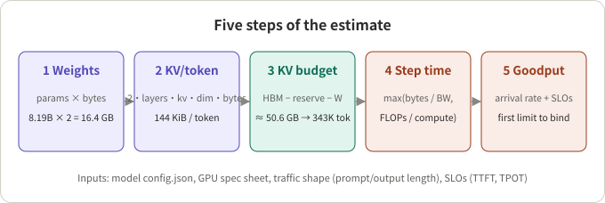
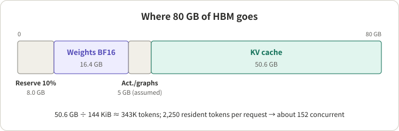
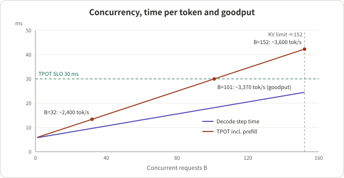
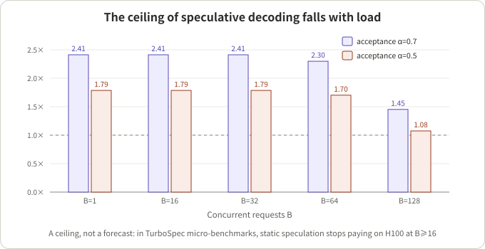

## Summary

The first question before launching an LLM service is usually "how much can one GPU carry?" A load test is the most accurate answer, but when choosing hardware, writing a budget or comparing designs, you often need an estimate you can work out on paper and check step by step first. This article gives a five-step method: weight memory, KV cache per token, KV budget and the concurrency ceiling, decode step time, and goodput under SLO constraints.

The worked example uses a public model (Qwen3-8B, parameters from its `config.json`) and a GPU with public specs (H100 SXM 80 GB). Every number can be rechecked with a calculator. The last part uses the same model to explain why speculative decoding shines at low load and may stop paying once load rises.

My view: the value of a hand estimate is not that the numbers are right, but that it tells you **which wall you hit first** (memory, TPOT, or prefill interference) and which knob is worth turning. The absolute values need a load test to calibrate.

## Key conclusions

- Capacity is not one number; it is goodput under a given SLO and traffic shape. On the same GPU, moving from 2K-token to 8K-token prompts cuts the servable request rate to about a quarter in this model.
- Decode at moderate concurrency is almost always **bandwidth-bound**: each step reads the weights plus the KV cache of every in-flight request, so step time is roughly `(weight bytes + concurrency × average context × KV bytes per token) / effective bandwidth`.
- In the worked example, TPOT binds before memory does: at TPOT ≤ 30 ms the GPU runs about 101 concurrent requests, 6.7 requests/s and about 3,370 output tokens/s; KV capacity only fills at about 152.
- Prefill and decode compete for the same GPU, and the TPOT penalty can be approximated as `1/(1−ρ)`, where ρ is the prefill share of GPU time. This is the interference that prefill/decode disaggregation work such as DistServe sets out to remove.
- The ceiling of speculative decoding falls with concurrency: once `concurrency × (k+1)` exceeds the hardware's compute-to-bandwidth ratio, the verification step becomes compute-bound. Roofline gives an optimistic ceiling; in TurboSpec's measurements, static speculation was already inefficient on H100 at a batch size of 16 or more.
- What the hand model leaves out (tail latency, output-length variance, scheduler and kernel efficiency) means it is for ranking designs and locating bottlenecks; final numbers need a load test or a simulator.

## A few concepts first

- **Prefill and decode**: prefill processes the whole prompt in one pass and produces the first token; it is compute-heavy and parallel, usually **compute-bound**. Decode produces one token per request per step; it does little arithmetic but reads all the weights and KV, usually **bandwidth-bound**.
- **TTFT / TPOT**: time to first token and time per output token. For streaming chat, these are what users feel, not total throughput.
- **KV cache**: the Keys and Values the attention layers keep for every processed token. It grows linearly with context length and is the main memory cost that limits concurrency.
- **GQA** (grouped-query attention): several query heads share one KV head. Qwen3-8B has 32 query heads and 8 KV heads, so its KV cache is a quarter of standard multi-head attention.
- **Roofline**: a step takes roughly `max(bytes moved / bandwidth, FLOPs / compute)`. The arithmetic intensity (FLOP per byte) where the two are equal is the ridge point; below it you are bandwidth-bound, above it compute-bound.
- **Goodput**: DistServe defines it as "the maximum request rate that can be served within both TTFT and TPOT constraints on each GPU". TurboSpec uses a different basis: tokens per unit time that make it into the final output (rejected draft tokens excluded). The first half of this article uses the DistServe basis.

## 1. The five steps and the assumptions



*Figure 1: An illustration. Each step's inputs come from public material, and its output feeds the next step.*

Assumptions for the worked example (all replaceable parameters; they describe no real deployment):

| Item | Value | Source or reason |
|---|---|---|
| Model | Qwen3-8B, BF16 | `config.json`: 36 layers, hidden 4096, 32 Q heads / 8 KV heads, head_dim 128, vocabulary 151,936, `tie_word_embeddings: false` |
| GPU | H100 SXM 80 GB | Spec sheet: 80 GB memory, 3.35 TB/s bandwidth, BF16 1,979 TFLOPS (marked "with sparsity") |
| Dense compute | ≈ 989 TFLOPS | Inference: the spec-sheet BF16 figure includes 2:4 sparsity, so dense is half |
| Effective bandwidth | 80%, ≈ 2.68 TB/s | Assumption |
| Effective compute | 50%, ≈ 495 TFLOPS | Assumption |
| Traffic shape | 2,000 input tokens, 500 output tokens | Assumption |
| SLO | TPOT ≤ 30 ms (mean); TTFT checked separately | Assumption |

GB here means 10⁹ bytes.

## 2. Step 1: how much memory the weights take

**Conclusion**: Qwen3-8B's BF16 weights take about 16.4 GB, and each decode step reads about 15.1 GB of them.

From `config.json`, term by term:

```text
attention per layer = 4096×4096 (Q) + 2×4096×1024 (K,V) + 4096×4096 (O) = 41.9M
MLP per layer       = 3 × 4096 × 12288                                = 151.0M
36 layers                                                             = 6.95B
embedding + output head (untied) = 2 × 151936 × 4096                  = 1.24B
total                                                                 ≈ 8.19B
```

This matches the model card's 8.2B (6.95B non-embedding). Two bytes per parameter gives 16.4 GB resident. During decode the embedding table is only looked up a few rows at a time, so each step reads "non-embedding parameters + output head" ≈ 7.57B × 2 ≈ 15.1 GB. The difference matters for small models: the large vocabulary puts 15% of all parameters in embeddings.

## 3. Step 2: KV cache per token

**Conclusion**: 144 KiB per token. The formula is one line:

```text
KV bytes/token = 2 (K and V) × layers × KV heads × head_dim × bytes per element
              = 2 × 36 × 8 × 128 × 2 = 147,456 bytes = 144 KiB
```

Without GQA (32 KV heads) it would be 576 KiB per token, and the concurrency ceiling would drop by 4×. An FP8 KV cache halves it to 72 KiB. This is the parameter the concurrency ceiling is most sensitive to, so `num_key_value_heads` is the first thing to read in a model config.

## 4. Step 3: KV budget and concurrency ceiling

**Conclusion**: about 50.6 GB of KV budget holds about 343,000 tokens, or about 152 concurrent requests.



*Figure 2: Worked example. The 10% framework reserve and 5 GB for activations, CUDA graphs and the like are assumptions; real values depend on the serving framework and its settings.*

```text
KV budget     = 80 × 0.9 − 16.4 − 5 ≈ 50.6 GB
KV capacity   = 50.6e9 / 147,456    ≈ 343,000 tokens
concurrency   = 343,000 / 2,250     ≈ 152 requests
```

This uses the **average resident length** per request, 2,000 + 500/2 = 2,250, because in-flight requests are at different points of their decode. Paged KV management (such as vLLM's block allocation) allocates on demand, so the average is a fair approximation; if a framework reserves the maximum length up front, use 2,500 and the ceiling falls to about 137.

## 5. Step 4: decode step time

**Conclusion**: across the whole concurrency range of the example, decode is bandwidth-bound and step time grows linearly with concurrency.

```text
t_step(B) = max( (W_read + B × L_avg × kv) / BW_eff ,  B × 2N_active / F_eff )
```

A few points by hand (W_read = 15.1 GB, L_avg = 2,250, kv = 147,456 bytes):

| Concurrency B | KV read (GB) | Bandwidth term (ms) | Compute term (ms) | Step time (ms) | Decode throughput (tokens/s) |
|---|---|---|---|---|---|
| 1 | 0.3 | 5.8 | 0.03 | 5.8 | 173 |
| 16 | 5.3 | 7.6 | 0.5 | 7.6 | 2,100 |
| 64 | 21.2 | 13.6 | 2.0 | 13.6 | 4,720 |
| 128 | 42.5 | 21.5 | 3.9 | 21.5 | 5,960 |

Two things stand out. First, the 5.8 ms at B=1 is almost all weight reads; it is the floor for single-request latency. Second, at B=128 the KV bytes read are nearly 3× the weight bytes: **with long contexts the decode bottleneck is the KV cache, not the weights**. That is why FP8 KV and KV compression help throughput.

The compute term stays small: 3.9 ms at B=128. The ratio of effective compute to effective bandwidth is about 495e12 / 2.68e12 ≈ 185 FLOP/byte, while decode's arithmetic intensity is about B when counting only weights, and lower once KV reads are included, so only very large batches reach the compute wall.

## 6. Step 5: bringing in arrival rate and SLOs

**Conclusion**: goodput is set by the first constraint to bind. In the example it is TPOT, at about 101 concurrent requests and 6.7 requests/s.

Prefill first. For a 2,000-token prompt, the linear layers need `2 × 6.95e9 × 2000 ≈ 27.8 TFLOP` and causal attention about `2 × P² × 4096 × 36 ≈ 1.2 TFLOP`, about 29 TFLOP in total, or about **59 ms** at 495 TFLOPS.

Now put prefill and decode on the same GPU. Let the arrival rate be λ, prefill time per request t_p, output length D and concurrency B. The GPU spends `ρ = λ × t_p` of each second on prefill and the rest on decode. In steady state, decode tokens needed equal decode tokens produced:

```text
λ × D = B × (1 − λ t_p) / t_step(B)
⇒  λ(B) = B / (D × t_step(B) + B × t_p)
    TPOT  = t_step(B) / (1 − ρ)
    TTFT ≈ t_p / (1 − ρ) + ρ t_p / (2(1 − ρ))     (rough: prefill treated as an M/D/1 queue)
```

The `1/(1−ρ)` term is prefill interfering with decode: if 40% of the GPU's time goes to prefill, TPOT stretches by 1.67×.



*Figure 3: An estimate from the model above for the worked example, not a measurement. The purple line is the pure decode step time; the red line is TPOT including prefill interference.*

| Concurrency B | Step (ms) | TPOT (ms) | Request rate λ (/s) | Output tokens/s | ρ | TTFT (ms) | KV used |
|---|---|---|---|---|---|---|---|
| 16 | 7.6 | 9.5 | 3.37 | 1,684 | 0.20 | 80 | 10% |
| 32 | 9.6 | 13.4 | 4.79 | 2,396 | 0.28 | 93 | 21% |
| 64 | 13.6 | 21.1 | 6.08 | 3,038 | 0.36 | 107 | 42% |
| **101** | **18.2** | **30.0** | **6.74** | **3,369** | **0.39** | **116** | **66%** |
| 128 | 21.5 | 36.5 | 7.02 | 3,508 | 0.41 | 120 | 84% |
| 152 | 24.4 | 42.3 | 7.19 | 3,596 | 0.42 | 123 | ≈100% |

Checking the B=101 row: `t_step = (15.14 + 101×2250×147456/1e9) / 2.68 ≈ 18.2 ms`; `λ = 101 / (500×0.0182 + 101×0.0586) ≈ 6.74`; `ρ = 6.74×0.0586 ≈ 0.39`; `TPOT = 18.2/0.61 ≈ 30 ms`.

Reading the table: going from B=101 to 152 adds only 7% throughput but raises TPOT from 30 to 42 ms. **The gap between saturated throughput and goodput under the SLO is the capacity you pay for latency.**

### 6.1 Sensitivity: which knob is worth turning

| Change | First constraint to bind | Concurrency | Request rate (/s) | Output tokens/s | TTFT (ms) |
|---|---|---|---|---|---|
| Baseline (2K input, TPOT 30 ms) | TPOT | 101 | 6.74 | 3,369 | 116 |
| TPOT relaxed to 50 ms | KV capacity | 152 | 7.19 | 3,596 | 123 |
| TPOT tightened to 15 ms | TPOT | 38 | 5.13 | 2,567 | 96 |
| FP8 KV cache | TPOT | 136 | 9.07 | 4,534 | 158 |
| 8K input | TPOT | 24 | 1.65 | 823 | 564 |
| 8K input + FP8 KV | TPOT | 32 | 2.15 | 1,076 | 777 |

Three readings (all inferences within this model):

1. Relaxing TPOT buys little capacity (+7%) because the KV wall comes right after; tightening it to 15 ms costs about a quarter.
2. FP8 KV gives +35%, and not only because more requests fit: each decode step reads half the KV bytes, so steps are faster. The cost is accuracy risk, which needs its own evaluation.
3. Input length is the biggest variable. With 8K inputs prefill takes about 263 ms, ρ and KV both get worse, goodput falls to about a quarter of baseline, and TTFT starts to approach what users notice. For long-prompt workloads, prefix caching and prefill/decode disaggregation are worth more than any decode optimisation.

## 7. Speculative decoding: why it can hurt goodput under load

**Conclusion**: speculative decoding trades extra compute for fewer reads. As long as the verification step stays bandwidth-bound, verifying a few more tokens is almost free; once concurrency is high enough that verification becomes compute-bound, rejected drafts are pure waste.

With k draft tokens per step and acceptance rate α, the expected output per request per step (including the bonus token), as given in the TurboSpec paper, is:

```text
l(α, k) = (1 − α^(k+1)) / (1 − α)
α = 0.7, k = 3:  l ≈ 2.53
α = 0.5, k = 3:  l ≈ 1.88
```

Verification processes k+1 positions per request, so arithmetic intensity goes from about B to about B×(k+1). Using the roofline from section 5 with a short 512-token context (close to TurboSpec's micro-benchmark setting) and a draft cost of 5% of a step:



*Figure 4: The ideal ceiling under the roofline model, not a forecast. The 5% draft cost follows the prompt-lookup overhead TurboSpec reports; it reports about 17.7% for an Eagle drafter.*

- B ≤ 32: `B×(k+1) ≤ 128`, still below the ridge (≈185); verification is as fast as a normal step and the speedup is about `l / 1.05`.
- B = 128: `B×(k+1) = 512`; verification becomes compute-bound and grows from 9.3 ms to 15.7 ms, leaving a ceiling of only 1.08× at α=0.5.

Measurements are much more pessimistic than this ceiling. TurboSpec (Liu, Stoica, Hao Zhang and others, implemented on vLLM) reports in micro-benchmarks that static speculation is already inefficient on H100 at a batch size of 16 or more; end to end, at QPS 16 a fixed k=1 raised Vicuna-7B's average latency from 13.7 s to 15.9 s. Its approach is to estimate goodput online (here, the rate of accepted tokens), tune the speculation length to load, and turn speculation off under heavy load; at low load it reports up to 3.16× lower latency. The paper's principle is **prefer batching over speculation**: doubling the batch doubles the tokens produced, while doubling the speculation length does not necessarily do so.

The gap between roofline and measurement comes from what the model leaves out: small matrix multiplies in real kernels do not reach 50% of peak, the draft model's own prefill and memory, KV slots held by draft tokens, and scheduling overhead. So the roofline is for **direction**: worth turning on with long contexts, low concurrency and bandwidth-bound steps; with short contexts and high concurrency, measure, ideally with automatic on/off by load as in TurboSpec.

## 8. What the hand model leaves out

| Missing factor | Effect | How to cover it |
|---|---|---|
| Tail latency (p99, not mean) | Overestimates capacity | Define SLOs by percentile, keep 20%–30% headroom, then load-test |
| Output-length variance | Overestimates capacity | Little's law holds only for means; long outputs hold KV for a long time |
| Kernel efficiency vs batch size | Either way | Replace the bandwidth term with a measured t_step(B) |
| Preemption and recomputation | Overestimates capacity | Schedulers swap or recompute before KV is full; keep a watermark |
| Prefix caching | Underestimates capacity | With shared system prompts prefill shrinks a lot; scale t_p by hit rate |
| MoE, tensor parallelism | Formula changes | Count reads by active experts; add a cross-GPU communication term |
| Metric definitions | Can be gamed | See below |

On definitions: Wang et al., in "Revisiting Service Level Objectives and System Level Metrics in Large Language Model Serving", point out two counterintuitive effects: deliberately delaying some tokens can make per-request SLOs look better, and abandoning requests that will miss their SLO can make system-level metrics look better. They propose smooth goodput to capture user experience and system performance together. In capacity planning, at least check how dropped and timed-out requests are counted in the goodput definition.

For something finer than hand estimates but short of full load tests, two recent lines of work are worth a look. BestServe (Hu et al.) simulates with an adapted roofline model plus CPU-GPU dispatch dynamics and compares collocated and disaggregated strategies in minutes on a single CPU; the authors report predictions within 20% error. Cascade (Adnan et al., University of British Columbia, Microsoft Azure Research and NVIDIA, August 2026) uses "time left before the SLO" as one signal that drives both request scheduling and KV placement across HBM, DRAM and NVMe; the authors report up to 2.4× higher goodput and 40% fewer SLO violations than vLLM's default first-come, first-served scheduler. Both sets of numbers are author-reported.

## 9. A checklist you can reuse

1. From `config.json`, copy the layer count, KV heads, head_dim, vocabulary and whether embeddings are tied; compute weight bytes and KV bytes per token.
2. Fix the traffic shape: mean and p95 of input and output lengths; whether there is a shared prefix.
3. Fix the SLOs: percentile targets for TTFT and TPOT.
4. Compute the KV budget and concurrency ceiling (using average resident length, and noting whether the framework reserves maximum length).
5. Compute t_step(B) and t_p with the roofline, plug into `λ(B) = B / (D·t_step + B·t_p)`, and sweep B to find the first constraint to bind.
6. Build a sensitivity table: move input length, KV precision and SLOs one at a time to see which knob is worth most.
7. Calibrate t_step(B) and t_p with one load test, replace the assumed efficiency factors, then produce the final numbers.

## Conclusion

The hand version of capacity planning needs two documents (the model config and the hardware spec sheet), a traffic shape and a set of SLOs. Its output is not a verdict on "how much it can carry" but a map of bottlenecks: in the example, TPOT binds before memory, prefill interference takes about 40% of the time, long inputs hurt capacity more than any parameter, and speculative decoding only has clear room at low concurrency. Going into a load test with this map saves a lot of pointless runs.

## References

- [Qwen3-8B model card](https://huggingface.co/Qwen/Qwen3-8B) and [config.json](https://huggingface.co/Qwen/Qwen3-8B/blob/main/config.json)
- [NVIDIA H100 product specifications](https://www.nvidia.com/en-us/data-center/h100/)
- [DistServe: Disaggregating Prefill and Decoding for Goodput-optimized Large Language Model Serving (OSDI 2024, arXiv 2401.09670)](https://arxiv.org/abs/2401.09670)
- [TurboSpec: Closed-loop Speculation Control System for Optimizing LLM Serving Goodput (arXiv 2406.14066)](https://arxiv.org/abs/2406.14066)
- [Revisiting Service Level Objectives and System Level Metrics in Large Language Model Serving (arXiv 2410.14257)](https://arxiv.org/abs/2410.14257)
- [BestServe: Serving Strategies with Optimal Goodput in Collocation and Disaggregation Architectures (arXiv 2506.05871)](https://arxiv.org/abs/2506.05871)
- [Cascade: Exploiting SLO-Aware Latency Budget for Fair and High Goodput LLM Inference Serving (arXiv 2608.06557)](https://arxiv.org/abs/2608.06557)
- [vLLM engine arguments](https://docs.vllm.ai/en/latest/configuration/engine_args.html)

Related reading: [From SM100 to SM90: A Layer-by-Layer Breakdown of the DeepSeek-V4.1 Inference Stack]({{ '/en/deepseek-v41-sm90-inference-walkthrough/' | relative_url }}).

*Note: all numbers in sections 2–7 come from this article's hand model (efficiency factors, reserved memory and traffic shape are assumptions), not from measurements of any system; numbers from papers are author-reported.*
