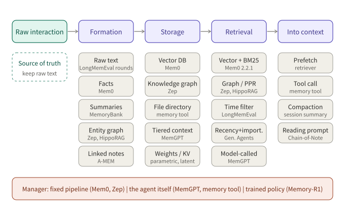
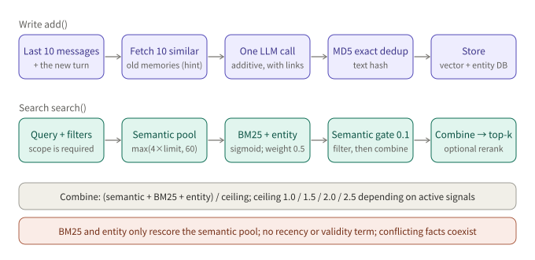
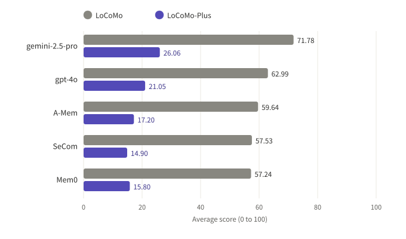

## Summary

"Adding memory to an LLM" has been built in many shapes over the last three years: paging old messages out to external storage (MemGPT), scoring every memory and retrieving by score (Generative Agents), having a model distill conversations into facts (Mem0), building a temporal knowledge graph (Zep), letting memories link to each other and evolve (A-MEM), training the add/update/delete policy with reinforcement learning (Memory-R1), and the plainest one of all: giving the agent a directory of files (Anthropic's memory tool).

This article puts them in one coordinate system. **Memory is a pipeline**: raw interaction goes through formation, storage, retrieval and entry into the context, and each step has a few options; systems differ in which option they pick at each step. I also read the source of Mem0 2.2.1 to see what a production implementation actually does on this pipeline, and what it does not do. Finally I checked the design and published numbers of the main benchmarks to say what those numbers can and cannot support.

Every fact comes from a paper, document or source file I actually opened. Numbers published by a vendor are labelled "vendor-reported"; my own inferences are labelled "inference".

---

## Key conclusions

- **Memory is neither long context nor RAG.** Long context is capacity, RAG is retrieval over a static corpus, memory is state that is written, updated and forgotten during interaction. The boundary is blurry in practice (the survey says so itself), but "has writes and evolution" is what sets memory apart.
- **The design space compresses to four choices**: what to store (raw text, facts, summaries, graphs, weights), when to process (at write time or at read time), who manages it (a fixed pipeline, the agent itself, a trained policy), and how to retrieve (vectors, keywords, graphs, time filters, tool calls).
- **The design in the paper and the implementation in the code can differ.** The Mem0 paper describes a per-fact choice among ADD / UPDATE / DELETE / NOOP made by the model. In the 2.2.1 source I read, the write path is a single extraction call that only adds; old facts are not rewritten or removed automatically. Read a system's current implementation, not just its paper.
- **Read benchmark numbers together with dataset size.** LoCoMo conversations are only 16K to 26K tokens, and in Mem0's own table the full-context baseline scores highest (72.90 against 66.88 to 68.44 for the memory variants). The practical gain of memory there is in tokens and latency, not accuracy. Only on LongMemEval and BEAM, at 115K to 10M tokens, do results start to favor memory systems.
- **One class of ability is not measured by the usual benchmarks.** LoCoMo-Plus inserts "implicit constraint" questions into LoCoMo, and every memory system tested falls from around 57 to around 15. Current methods are good at finding a sentence, and poor at remembering a state and using it in an unrelated question.
- **A defensible engineering default**: keep raw data as the source of truth, treat extracted facts, summaries and graphs as rebuildable derived indexes, retrieve with several signals plus a time filter, and let conflicting facts coexist with timestamps instead of silently overwriting. This is my synthesis across sources, not a sentence from any single paper.

---

## 1. What memory is, and is not

### 1.1 Three concepts and their boundaries

The survey "Memory in the Age of AI Agents", published at the end of 2025, gives a widely cited taxonomy that cuts memory three ways:

| View | Categories |
|---|---|
| Forms | token-level (explicit, editable units, organized as flat, planar/graph or hierarchical); parametric (in model weights or external adapters/LoRA); latent (hidden states, KV cache) |
| Functions | factual (knowledge about users and the environment); experiential (lessons from task execution: cases, strategies, skills); working (the workspace within a task) |
| Dynamics | formation (summarization, distillation, structured construction, ...); evolution (consolidation, update, forgetting); retrieval (when to retrieve, how to build queries, how to process results) |

It also separates concepts that are easily mixed up. RAG mainly grounds a model in static external sources for individual inference tasks and does not maintain an evolving record of the agent's own interaction. Context engineering treats the window as a limited resource and optimizes what goes into it. Agent memory governs what the agent knows, what it has experienced, and how that changes over time. The survey admits the boundary has blurred and that, in practice, the distinction depends on the task setting: memory is evaluated in multi-turn, time-dependent environments, RAG on knowledge-intensive question answering.

### 1.2 The cognitive-architecture view

CoALA (Sumers, Yao, Narasimhan, Griffiths; TMLR 2024) splits a language agent's memory into four parts, and its names are still used by many systems:

- **Working memory**: information for the current decision cycle, persisting across LLM calls.
- **Episodic memory**: experience from earlier cycles, such as past dialogues or trajectories.
- **Semantic memory**: knowledge about the world and about itself.
- **Procedural memory**: implicit in the model weights, and explicit in the agent's code.

It also splits the agent's actions into external (interacting with an environment) and internal (retrieval, reasoning, learning). **Retrieval reads long-term memory into working memory; learning writes long-term memory.** Almost every difference between the systems below is "who triggers retrieval and learning, when, and what gets written".

---

## 2. Design space: one pipeline, four choices



*Figure 1: Raw interaction passes through formation, storage and retrieval into the context. Common options sit under each step, with representative systems.*

This figure is how the rest of the article is organized.

### 2.1 Formation: what to store

| Option | Example | Trade-off |
|---|---|---|
| Raw text (chunked by round or session) | round-level index in LongMemEval; recall storage in MemGPT | lossless; quality depends on the index; large storage |
| Extracted facts | Mem0; entity and relation edges in Zep | compact, easy to dedupe; a bad extraction loses information for good |
| Summaries | daily and global summaries in MemoryBank; recursive summary in MemGPT | saves tokens; loses detail, irreversibly |
| Graph (entities and relations) | Zep/Graphiti; HippoRAG; Mem0^g | good at multi-hop and time; expensive to build and maintain |
| "Notes" with metadata | A-MEM: keywords, tags, context description, links | can evolve; several model calls per write |
| Into weights or KV | parametric and latent memory in the survey | takes no context; hard to edit or delete |

LongMemEval's ablations give rare controlled evidence. Indexing by single round beats indexing by whole session; compressing history into "user facts" as the index hurts overall, though it helps multi-session reasoning; adding extracted facts as extra keys on the raw index (key expansion) raises recall@k by 9.4% and QA accuracy by 5.4% on average.

### 2.2 Who manages it

Three modes coexist:

1. **Fixed pipeline**: the developer hard-codes "extract, write and retrieve after each turn" (Mem0, Zep, MemoryBank). Predictable and observable.
2. **The agent itself**: reads and writes are tools and the model decides when to use them (function calls in MemGPT/Letta, Anthropic's memory tool). Flexible, but dependent on tool-calling ability; the MemGPT paper itself notes that GPT-3.5 did poorly on document QA because of weaker function calling.
3. **A trained policy**: Memory-R1 uses PPO or GRPO, with answer correctness as the reward, to train a Memory Manager that picks ADD / UPDATE / DELETE / NOOP and an Answer Agent that filters retrieved memories. The paper reports training with only 152 QA pairs from LoCoMo.

### 2.3 When to process

Processing at write time (extraction, summarization, graph building) puts the cost on the write side and makes reads cheap. Processing at read time (store raw text, let the model retrieve, read and reason at query time) puts the cost on the read side and loses less information. **They are not exclusive**: Zep's episode subgraph keeps raw input losslessly while deriving semantic entities and communities on top of it; LongMemEval's key expansion also keeps both.

---

## 3. Representative systems

### 3.1 Memory stream and scoring: Generative Agents, MemoryBank

The memory stream in **Generative Agents** is a list in which each memory has a natural-language description, a creation time and a last-access time. The retrieval score is a sum of three terms:

```
score = α_recency · recency + α_importance · importance + α_relevance · relevance
```

- recency: exponential decay over game hours since the memory was last retrieved, decay factor 0.995;
- importance: an integer from 1 to 10 given by the LLM when the memory is created;
- relevance: cosine similarity between the memory embedding and the query embedding;
- each term is min-max normalized to [0, 1], and all α are 1 in the paper.

**Reflection** is triggered when the summed importance of recent perceived events exceeds 150 (the paper reports two to three times a day in practice). The model takes the 100 most recent records, generates 3 high-level questions, retrieves for each, and produces 5 insights with citations to supporting memories, stored back in the stream. Reflections can cite reflections, forming trees with observations as leaves. In the ablation, removing reflection lowers the TrueSkill μ from 29.89 to 26.88; removing memory, planning and reflection lowers it to 21.21, below the human crowdworker baseline of 22.95.

**MemoryBank** updates memory with the Ebbinghaus forgetting curve: `R = e^(-t/S)`, with S starting at 1; each recall adds 1 to S and resets t to 0. The paper describes this as a deliberately simplified model. For storage it condenses conversations into daily event summaries, rolls them into a global summary, and distills a user portrait day by day.

The legacy of this branch is **putting time and importance into the retrieval score**. In later open-source implementations those terms are often missing (see Section 4).

### 3.2 OS-style tiers: MemGPT / Letta

MemGPT likens a fixed-length context window to physical memory and uses function calls to "page" between the window and external storage.

- **Main context** holds: read-only system instructions; a fixed-size working context writable only through functions; a FIFO message queue whose first entry is a recursive summary of evicted messages.
- **External context** holds: recall storage (the full message database, searchable) and archival storage (arbitrary-length text objects).
- **Queue management**: every message is first written to recall storage; at about 70% of the window a "memory pressure" warning tells the model to save important information; at 100% about 50% of the queue is evicted and the recursive summary is updated.
- **Control flow**: a heartbeat flag lets the model chain function calls; user messages, system alerts and timers drive the agent.

Reported results: on multi-session deep memory retrieval, accuracy rises from 32.1% to 92.5% for GPT-4, from 35.3% to 93.4% for GPT-4 Turbo, and from 38.7% to 66.9% for GPT-3.5 Turbo. On nested key-value retrieval, GPT-3.5 and GPT-4 fall to 0% at 1 and 3 levels of nesting, while MemGPT with GPT-4 stays stable across levels.

Letta is the productized successor. According to its documentation page, memory is organized into "memory blocks": blocks attached to an agent are pinned in the system prompt and always visible, can be edited by the agent through tools or by developers through the API, and one block can be attached to several agents as a shared block. All state (messages, reasoning, tool calls) is stored in a database, and evicted content can still be retrieved through retrieval tools. (I only read the concept page, not its interface for archival or recall memory, so I do not go further here.)

### 3.3 Extraction-based memory: Mem0

The Mem0 paper has two phases. **Extraction**: a prompt built from a conversation summary, the m=10 most recent messages and the new message pair asks an LLM to extract candidate facts. **Update**: for each candidate, the s=10 most similar existing memories are fetched from the vector store, and the LLM picks one of ADD, UPDATE, DELETE, NOOP through a tool call. The variant Mem0^g stores entities and relations as a directed labelled graph and, on conflict, marks the old relation invalid instead of deleting it, which preserves temporal reasoning.

The paper's LoCoMo numbers are in Section 5. One point only here: **the update phase the paper describes differs from the write path of the open-source 2.2.1 code**, discussed in Section 4.

### 3.4 Links and evolution: A-MEM

A-MEM (NeurIPS 2025) borrows the Zettelkasten method. Each note holds the original content, a timestamp, LLM-generated keywords, tags and a context description, an embedding, and links to other notes. When a new note arrives, the system takes nearest-neighbor candidates by cosine similarity and lets the LLM decide which to link; the LLM then **goes back and updates the neighbors' context, keywords and tags** in light of the new note (memory evolution). Retrieval takes the top-k by the same encoder, and linked notes are reachable too.

The cost is several model calls per write. The core idea of this branch is that memory should be reinterpreted as new information arrives, not frozen when written.

### 3.5 Graphs and time: Zep / Graphiti, HippoRAG

The **Zep (Graphiti engine)** graph has three tiers:

- an episode subgraph that stores raw input (messages, text, JSON) losslessly and links it to the entities extracted from it;
- a semantic entity subgraph of entities and the facts (edges) between them, resolved against existing nodes at write time;
- a community subgraph of strongly connected entities, each with a summary, found by label propagation rather than Leiden so it can be extended incrementally.

The time model is **bi-temporal**: one timeline records when an event happened (valid and invalid times of a fact), the other when data was ingested and expired. When new information contradicts an old fact, an LLM flags the conflict and sets an invalid time on the old fact; it is not deleted. Retrieval is search, rerank, construct: search uses cosine similarity, Okapi BM25 and breadth-first search over the graph; rerankers include RRF, MMR, node distance and cross-encoders.

**HippoRAG** (NeurIPS 2024) takes another route. Offline, an LLM runs open information extraction over each passage to build a schemaless knowledge graph, with synonymy edges added by embedding similarity (threshold 0.8). Online, it extracts entities from the query, links them to graph nodes, seeds **Personalized PageRank** on those nodes, and aggregates node scores into passage scores. This performs **multi-hop association in one retrieval step**. The paper reports R@5 of 89.1 on 2WikiMultiHopQA against 68.2 for ColBERTv2, and, compared with iterative IRCoT, single-step HippoRAG performs comparably or better while being roughly 10 to 30 times cheaper and 6 to 13 times faster at online retrieval.

### 3.6 Experiential memory: Reflexion

Memory is not only "what the user said". After a failed task, Reflexion has the agent write a verbal reflection, stores it in an episodic memory buffer, and reads it into the prompt on the next attempt, with no weight updates. The abstract reports 91% pass@1 on HumanEval against 80% for GPT-4 at the time. This corresponds to "experiential memory" in the survey. It is a separate need from "user facts", and benchmarks barely cover it.

### 3.7 A file system as memory: Anthropic's memory tool

The plainest design: give the model a `/memories` directory and six commands, `view`, `create`, `str_replace`, `insert`, `delete` and `rename`. According to the official documentation it is **implemented client-side**: the model issues file operations and the application executes them on storage it controls. The model checks its memory directory before starting a task and reads on demand instead of loading everything. The docs recommend pairing it with two kinds of context management: context editing (clearing particular tool results) and compaction (server-side summarization as the conversation nears the window limit); compaction keeps the active context small, and memory preserves information that has to survive summarization. The docs also describe a multi-session development pattern: an initializer session creates a progress log, a feature checklist and a startup script; later sessions read them and update the log before ending.

On security, the docs require the handler to validate every path against path traversal (rejecting `../` and URL-encoded forms), to cap file size, and suggest periodically deleting files not accessed for a long time. They also note that the model usually refuses to write sensitive information to memory, but stronger guarantees need your own validation.

### 3.8 Summary table

| System | What is stored | Who manages | Conflict / update | Retrieval |
|---|---|---|---|---|
| Generative Agents | observations, reflections, plans (memory stream) | fixed pipeline | no overwrite; reflections stack into trees | recency + importance + relevance |
| MemoryBank | daily and global summaries, user portrait | fixed pipeline | forgetting-curve decay, reinforced by recall | dense retrieval (FAISS) |
| MemGPT / Letta | working context + recall + archival | the agent (function calls) | model edits blocks; recursive summary | tool-based retrieval |
| Mem0 (paper) | extracted facts (optional graph) | fixed pipeline + LLM decision | ADD / UPDATE / DELETE / NOOP | vectors (graph variant: entities + triplets) |
| A-MEM | notes with keywords, tags, links | fixed pipeline + LLM evolution | neighbor notes rewritten | embedding top-k + links |
| Zep / Graphiti | episodes + entity edges + communities | fixed pipeline | bi-temporal, old facts invalidated | cosine + BM25 + graph traversal, then rerank |
| HippoRAG | schemaless knowledge graph | offline build | not addressed | PPR |
| Memory-R1 | external memory bank | RL-trained policy | learned ADD / UPDATE / DELETE / NOOP | learned filtering |
| memory tool | files | the agent | model edits files | model reads files |

---

## 4. A source sample: what Mem0 2.2.1 does

What follows is based on the `mem0ai/mem0` repository I read (version 2.2.1 in `pyproject.toml`), mainly `mem0/memory/main.py` and `mem0/utils/scoring.py`. The conclusions come from static reading; I did not run it.



*Figure 2: write path (top) and search path (bottom). Score details are in `mem0/utils/scoring.py`.*

### 4.1 Write: one extraction, add only

The path of `add()`: take the last 10 messages in the scope as context; use the embedding of the new messages to fetch the 10 most similar existing memories and hand them to the LLM together with the new messages (the prompt is `ADDITIVE_EXTRACTION_PROMPT`); the LLM returns the memories to add in a single call, with `linked_memory_ids` in the output; before storing, an MD5 of the text gives exact deduplication; entities are extracted at the same time, written to an entity store and linked to the memory id.

Compared with the paper: the 2.2.1 write path has **no** per-candidate ADD / UPDATE / DELETE / NOOP decision. Existing memories serve only as a deduplication hint during extraction, and **conflicting new and old facts coexist** (for example "lives in Beijing" and "moved to Shanghai last month" are both in the store). To make the old fact go away, the caller must `update` or `delete` explicitly.

This is a design choice rather than a defect: add-only keeps the write path simpler, cheaper and easier to audit (a history table records every change). The cost is that conflicts have to be resolved at read time, and 2.2.1 retrieval has no time signal (see below).

### 4.2 Search: boosts on a semantic candidate pool

`search()` requires a scope through `filters` (such as `user_id`). Internally:

1. take `internal_limit = max(limit × 4, 60)` semantic candidates (vector search);
2. if available, run keyword search too (the BM25 slot of Qdrant, with the query lemmatized), and normalize the raw score with a sigmoid whose parameters depend on query length (midpoint 5.0 and steepness 0.7 for up to 3 terms; midpoint 7.0 and steepness 0.6 for 4 to 6 terms, and so on);
3. extract entities from the query, look them up in the entity store, and add an entity score to linked memories, with the constant `ENTITY_BOOST_WEIGHT = 0.5`;
4. candidates whose semantic score is below the threshold (default 0.1) are **dropped outright**, even if BM25 or entity scores are high;
5. combine: `combined = (semantic + bm25 + entity) / max_possible`, where the divisor depends on active signals: 1.0 for semantic only, 2.0 for semantic plus BM25, 2.5 for all three, 1.5 for semantic plus entity;
6. optional rerank, then take top-k.

Consequences:

- **BM25 and entity scores only add to candidates already in the semantic pool; they cannot pull in memories from outside it.** A memory that matches keywords exactly but is semantically far will not be recalled.
- **There is no time signal.** `scoring.py` has no recency or validity term, so when conflicting facts coexist, retrieval does not naturally prefer the newer one (inference: unless the query or a reranker brings time in).
- Entity extraction and tokenization rely on spaCy's `en_core_web_sm`, so **with Chinese queries the BM25 and entity terms are expected to be near 0 and retrieval degrades to pure semantic search** (from static reading of the code and its dependencies, not tested).
- The "normalization" divides by the ceiling of the active signals, so the same memory's score is not directly comparable across queries that activate different signals.

### 4.3 How this relates to the numbers in the Mem0 paper

The paper evaluates on LoCoMo with GPT-4o-mini and reports the implementation at that time. Section 4.1 shows that the implementation has changed, so **a score quoted from the paper should not be assumed to describe 2.2.1**. This holds for any fast-moving open-source memory project.

---

## 5. Evaluation: what the numbers can tell you

### 5.1 Three benchmarks

| Benchmark | Size and design | What it tests |
|---|---|---|
| LoCoMo (ACL 2024) | about 600 turns and 16K tokens per conversation, up to 32 sessions; tasks: QA, event summarization, multimodal dialogue | single-hop, multi-hop, temporal, open-domain, adversarial |
| LongMemEval (ICLR 2025) | 500 questions; S about 115K tokens (about 50 sessions), M 500 sessions about 1.5M tokens | information extraction, multi-session reasoning, knowledge update, temporal reasoning, abstention |
| BEAM (ICLR 2026) | 100 synthetic conversations from 100K to 10M tokens, 2,000 validated questions | ten abilities, including the new instruction following, event ordering and contradiction resolution |

The length of LoCoMo is written differently in different sources: the abstract of the ACL version says about 600 turns and 16K tokens; the arXiv page and later work also show about 300 turns and 9K tokens, and the Mem0 paper counts about 26K tokens with its own tokenizer. Say which version you use when you cite it.

The headline result of LongMemEval: commercial systems (ChatGPT and Coze, both on GPT-4o) score 37% and 64% lower in sustained interaction than offline reading of the same history; long-context LLMs score about 30% to 60% lower on the S setting than when given only the evidence sessions. BEAM's result: even with a 1M-token window, long-context models degrade as conversations get longer; its LIGHT framework (an episodic retrieval index, working memory of recent turns, and a notes-style scratchpad) improves over long-context baselines more as length grows, for example +44%, +76% and +107% for GPT-4.1-nano at 100K, 1M and 10M tokens. These numbers come from the paper's own setup, and LIGHT is the authors' own method.

### 5.2 Published numbers

Only numbers I checked against the source are listed, with their provenance.

**Mem0 paper, LoCoMo, GPT-4o-mini, LLM-as-a-Judge (paper-reported; baselines chosen by the authors):**

| Method | Overall J | Memory tokens | Search p95 | End-to-end p95 |
|---|---|---|---|---|
| Full context | 72.90 | 26,031 | n/a | 17.117 s |
| Mem0^g | 68.44 | 3,616 | 0.657 s | 2.590 s |
| Mem0 | 66.88 | 1,764 | 0.200 s | 1.440 s |
| Zep (as configured in the paper) | 65.99 | 3,911 | 0.778 s | 2.926 s |
| Best RAG (k=2, 256-token chunks) | 60.97 | n/a | n/a | n/a |

From this table by hand: Mem0's end-to-end p95 is 91.6% lower than full context (1.440 against 17.117) and it uses 93.2% fewer memory tokens (1,764 against 26,031), but its overall J is 6.0 points lower. **Full context scores highest**, as the paper itself says.

**Zep paper, LongMemEval S (about 115K tokens), vendor-reported:**

| Answer model | Memory | Accuracy | Latency | Avg. context |
|---|---|---|---|---|
| gpt-4o-mini | Zep | 63.8% | 3.20 s | 1.6k |
| gpt-4o-mini | Full context | 55.4% | 31.3 s | 115k |
| gpt-4o | Zep | 71.2% | 2.58 s | 1.6k |
| gpt-4o | Full context | 60.2% | 28.9 s | 115k |

At this length the memory system is both more accurate and faster: 11.0 points higher with gpt-4o, and 91% lower latency. Set against the previous table, **the conclusion flips with context length**: at 16K tokens full context is best, at 115K tokens it falls behind. This is my reading of the two tables side by side (inference); the two experiments use different models and judges and are not one curve.

**A dispute between vendors**: Zep published a post saying the Mem0 paper misconfigured Zep (both speakers set to the user role, timestamps appended to message text instead of the `created_at` field, searches run sequentially) and reports a corrected LoCoMo J of 75.14, above every entry in the Mem0 paper. These are Zep's claims alone; I did not reproduce them, and I did not check whether Mem0 responded. What the episode shows is something else: **on the same benchmark, cross-vendor numbers depend on who configures the competitor's system**, so do not compare them directly.

### 5.3 Beyond factual recall: LoCoMo-Plus

LoCoMo-Plus (2026) points out that LoCoMo-style benchmarks mostly test factual recall where cue and question overlap semantically, while in real conversations implicit constraints (the user's state, goals, values, causal background) often matter without being mentioned in the question. It inserts "cue and trigger" pairs into LoCoMo dialogues, with surface semantics deliberately dissimilar, and scores constraint consistency.



*Figure 3: average scores of the same methods on LoCoMo and LoCoMo-Plus (values as reported in the paper).*

Every memory system tested falls sharply: Mem0 from 57.24 to 15.80, A-Mem from 59.64 to 17.20, SeCom from 57.53 to 14.90; gemini-2.5-pro from 71.78 to 26.06. The paper also finds that this "cognitive memory" degrades faster than factual recall as dialogues get longer; that disclosing the task type inflates temporal and adversarial scores; and that overlap metrics such as EM and F1 favor outputs close to the reference length. The dataset is small, English-only and relies on LLM judges, which the authors list as limitations.

### 5.4 Rules for reading numbers

1. **Check how long the conversations are.** On a benchmark that fits in the context, the full-context baseline is strong.
2. **Check who configured the competitor.** Cross-vendor comparisons rarely use one configuration.
3. **Check the judge.** LLM judges shift scores by 0.68 to 3.33 points across backbones (measured in LoCoMo-Plus).
4. **Check whether it tests the ability you need.** Good factual recall does not mean the user's state gets used in an unrelated question.
5. **A number in a paper describes the paper's implementation.** Re-measure after an open-source project moves on.

---

## 6. Engineering trade-offs

### 6.1 Store raw text or facts

**Conclusion: raw text as the source of truth, extracted results as rebuildable indexes.** (Inference, based on the following.)

- Extraction is lossy and irreversible: if the model misses or misreads a fact and the raw text is gone, nothing can be corrected. In LongMemEval, compressing the whole history into user facts as the index got worse overall.
- Fact indexes do help: the gain from key expansion shows that "raw text plus facts" beats either alone.
- Raw text also decides whether compliance is feasible: a deletion request must locate and rebuild every derived artifact. Zep's episode subgraph is one implementation of this idea: raw data is kept losslessly, and entities and facts point back to episodes.

The cost is more storage and index, and more candidates to handle at read time; retrieval quality and reranking have to pay for it.

### 6.2 Conflicts, updates and time

Three approaches:

| Approach | Example | Risk |
|---|---|---|
| Rewrite or delete in place | UPDATE / DELETE in the Mem0 paper; A-MEM rewriting neighbors | a wrong edit cannot be traced unless there is history |
| Add only, conflicts coexist | the write path in Mem0 2.2.1 | the read side must pick the newer one |
| Bi-temporal, old facts marked invalid | Zep / Graphiti; invalidation in Mem0^g | graph building and conflict judgment are expensive |

LongMemEval's time-aware query expansion adds a detail: having the model extract a time range from the question and filtering by it improves temporal-reasoning recall by 11.3% (round level) and 6.8% (session level), but only when a strong model (GPT-4o) extracts the range; Llama 3.1 8B did poorly. So **a time filter is only as good as the time extraction behind it**.

### 6.3 Retrieval and reading

- **Hybrid retrieval is the baseline**: Zep uses cosine, BM25 and graph traversal; Mem0 2.2.1 uses semantic plus BM25 plus entities; LongMemEval's indexing experiments also favor several signals.
- **How the memory is read also matters**: LongMemEval finds that Chain-of-Note prompting with memory items formatted as JSON adds up to about 10 points of accuracy even with perfect retrieval.
- **What is fetched can matter more than how**: the Mem0 paper reports about 7k tokens per conversation for Mem0 and more than 600k for Zep, which shows that "how much to store" and "how much to fetch" are separate knobs.

### 6.4 Memory as a tool, or as a prefetch

A common question: if an agent can retrieve with tools, is a memory layer redundant?

- **Prefetch (retrieve and inject automatically before each turn)**: bounded latency, and it does not depend on the model remembering to look; but it pays retrieval cost every turn, and what is injected may not match the current intent.
- **Tool (the model decides whether to look)**: pay only when needed, the query is built by the model from the task, and it can iterate; but it depends on tool-calling ability, and a model does not know what it has forgotten, so it will not look for what it does not realize is missing.
- They do not conflict. The memory tool docs are tool-style, and say that the model checks its memory directory before starting a task, which layers a default prefetch habit on top of the tool.

A common misunderstanding needs clearing up here. Implementing memory as "a vector store plus a retrieval tool" is, in form, the same as RAG. What a memory layer adds is on the **write side**: extraction, deduplication, conflict handling, time, scoping and deletion. If none of those are needed, storing raw text and giving the agent a retrieval tool is a reasonable minimal design. (Inference.)

### 6.5 Context management and long-term memory are two layers

The Parlant documentation (the unreleased `compass-wip` branch) is an example that separates the two. **Session memory** is built in: each turn loads the session history, and when it passes a threshold it is compacted into a summary and the session continues on top of it. Default thresholds are tiered by effort: about 24,000 tokens for MIN and LOW, 32,000 for MEDIUM, 48,000 for HIGH and 64,000 for MAX, so higher effort tolerates a longer raw history before compacting and preserves more when it does. **Customer memory** is not built in; the user brings their own. The stated reason is that what may be retained, for how long, where it is stored, how it is deleted on request and how it is shared across agents are product and compliance questions a framework should not decide for you. It offers two connection points: a retriever that runs before the reply (read), and an `on_messages_emitted` hook that fires after the reply has been sent (write). The docs stress writing both the customer's and the assistant's side, because a reference like "he turned 5 today" can only be resolved with the assistant's turn. Its worked example uses Mem0.

This split is the same idea as CoALA's working versus long-term memory, and as the memory tool docs' "compaction keeps the active context small, and memory preserves information that must survive summarization".

### 6.6 Security and compliance

- **Paths and injection**: file-based memory needs protection against path traversal (an explicit requirement in the memory tool docs). (Inference: what is written to memory is later read back as context, so letting untrusted input into memory persists a prompt injection; the docs do not expand on this, but the design has to account for it.)
- **Sensitive data**: the model usually refuses to write sensitive data, but the docs say stronger guarantees need your own validation.
- **Deletion**: deletion must work per user scope and take derived artifacts with it (Mem0's entity store links back to memories through `linked_memory_ids`, and the code cleans up entity links when a memory is deleted).
- **Expiry**: the memory tool docs suggest periodically deleting files not accessed for a long time; forgetting curves (MemoryBank) and validity periods (Zep) are two automated approaches.

---

## 7. Open problems

1. **Memory of implicit state.** The size of the drop in LoCoMo-Plus shows current methods largely fail when the cue and the question are semantically unrelated.
2. **The distance between long-range benchmarks and real use.** LoCoMo-style data fits in the context; BEAM pushes length to 10M tokens, but its conversations are synthetic.
3. **Who learns.** Memory-R1 shows memory management can be trained, but its training and evaluation center on LoCoMo; the zero-shot transfer to MSC and LongMemEval is a supplementary experiment and should not be read as a general result.
4. **Shared memory across agents.** Letta's shared blocks and Parlant's cross-agent customer memory solve it at the engineering level, with little systematic study of consistency and permissions (the survey lists it as a frontier).
5. **Auditable benchmarks.** Numbers on one benchmark are disputed between vendors; evaluations with published configurations are needed.

---

## Conclusion

Memory systems differ in the choice made at each step of the pipeline: raw text or facts, processing at write time or read time, management by a fixed flow, the agent or a trained policy, and which signals retrieval uses. To read a particular system, look at what its current code does at each step, because the paper's design and the open-source implementation can diverge. To read an evaluation number, first look at the conversation length, how the competitor was configured and how it was judged.

The engineering advice I can offer with sources behind it: keep raw text as the source of truth; keep extracted results as timestamped derived indexes; retrieve with several signals and support time filtering; resolve conflicts with time instead of silent overwrite; treat context compaction and long-term memory as two layers; and design deletion and expiry from the start.

---

## References

**Surveys and concepts**

- Memory in the Age of AI Agents: A Survey, arXiv:2512.13564 — <https://arxiv.org/abs/2512.13564>
- Cognitive Architectures for Language Agents (CoALA), TMLR 2024, arXiv:2309.02427 — <https://arxiv.org/abs/2309.02427>

**Systems and methods**

- MemGPT: Towards LLMs as Operating Systems, arXiv:2310.08560 — <https://arxiv.org/abs/2310.08560>
- Generative Agents: Interactive Simulacra of Human Behavior, arXiv:2304.03442 — <https://arxiv.org/abs/2304.03442>
- MemoryBank: Enhancing Large Language Models with Long-Term Memory, AAAI 2024, arXiv:2305.10250 — <https://arxiv.org/abs/2305.10250>
- Reflexion: Language Agents with Verbal Reinforcement Learning, NeurIPS 2023, arXiv:2303.11366 — <https://arxiv.org/abs/2303.11366>
- Mem0: Building Production-Ready AI Agents with Scalable Long-Term Memory, arXiv:2504.19413 — <https://arxiv.org/abs/2504.19413>
- Zep: A Temporal Knowledge Graph Architecture for Agent Memory, arXiv:2501.13956 — <https://arxiv.org/abs/2501.13956>
- A-MEM: Agentic Memory for LLM Agents, NeurIPS 2025, arXiv:2502.12110 — <https://arxiv.org/abs/2502.12110>
- HippoRAG: Neurobiologically Inspired Long-Term Memory for Large Language Models, NeurIPS 2024, arXiv:2405.14831 — <https://arxiv.org/abs/2405.14831>
- Memory-R1: Enhancing Large Language Model Agents to Manage and Utilize Memories via Reinforcement Learning, arXiv:2508.19828 — <https://arxiv.org/abs/2508.19828>

**Evaluation**

- Evaluating Very Long-Term Conversational Memory of LLM Agents (LoCoMo), ACL 2024 — <https://aclanthology.org/2024.acl-long.747>
- LongMemEval: Benchmarking Chat Assistants on Long-Term Interactive Memory, ICLR 2025, arXiv:2410.10813 — <https://arxiv.org/abs/2410.10813>
- Beyond a Million Tokens: Benchmarking and Enhancing Long-Term Memory in LLMs (BEAM), ICLR 2026, arXiv:2510.27246 — <https://arxiv.org/abs/2510.27246>
- Locomo-Plus: Beyond-Factual Cognitive Memory Evaluation Framework for LLM Agents, arXiv:2602.10715 — <https://arxiv.org/abs/2602.10715>
- Zep, "Lies, Damn Lies, & Statistics: Is Mem0 Really SOTA in Agent Memory?" (vendor post) — <https://www.getzep.com/blog/lies-damn-lies-statistics-is-mem0-really-sota-in-agent-memory/>

**Code and documentation**

- Mem0 repository, version 2.2.1, `mem0/memory/main.py`, `mem0/utils/scoring.py` — <https://github.com/mem0ai/mem0>
- Anthropic, Memory tool documentation — <https://platform.claude.com/docs/en/agents-and-tools/tool-use/memory-tool>
- Letta, Agent Memory documentation — <https://docs.letta.com/guides/agents/memory>
- Parlant, `compass-wip` branch, `docs/memory.md` and `docs/compaction.md` (unreleased) — <https://github.com/emcie-co/parlant>

*Note on numbers: numbers in the tables are copied from the papers or posts above; percentages marked "by hand" are my own arithmetic on the tables. Do not mix vendor-reported and third-party-reproduced numbers.*
