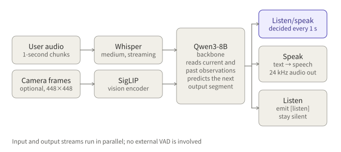
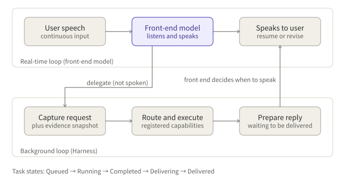

## Summary

Each paper solves half of the problem. **MiniCPM-o 4.5** answers "how can one model listen and speak at the same time?". **Realtime-Venus** answers "how can a model that listens and speaks at once hand slow work to a back end without stalling the conversation?". The first is the base model; the second is post-training plus a runtime built on top of it.

Key points:

- MiniCPM-o 4.5 uses Omni-Flow, 1-second windows that put input and output streams on one timeline. The model itself decides in every window whether to listen or speak, with no external VAD.
- Realtime-Venus starts from MiniCPM-o 4.5 and post-trains two separate 9B models, Audio and Omni, plus a Harness. The front-end model writes a private `<delegate>` request that is never spoken, the back end executes it, and the front end decides when to speak once the result is back.
- Delegation differs from ordinary function calling not in format but in who keeps control of the conversation.
- Building a dual loop on MiniCPM-o 4.5 yourself is feasible, but the main obstacle is that there is no documented way to inject a back-end result into a running duplex session.

This note is based on the papers and model cards. Anything I could not check against the source is listed in the to-verify list at the end.

## Papers and resources

| Item | MiniCPM-o 4.5 | Realtime-Venus |
|---|---|---|
| arXiv | 2604.27393 | 2609.13814 (submitted 2026-09-23) |
| PDF | `https://arxiv.org/pdf/2604.27393` | `https://arxiv.org/pdf/2609.13814` |
| Weights | `openbmb/MiniCPM-o-4_5`; quantized `openbmb/MiniCPM-o-4_5-GPTQ`; GGUF at `OpenBMB/MiniCPM-o-4_5-gguf` | Realtime-Venus from inclusionAI (Audio and Omni models) |
| Code | Official OpenBMB repositories (including llama.cpp-omni) | The Harness is only in the GitHub repository, not in the model card |
| License | Apache-2.0 (per README) | Apache-2.0 (per model card; not stated on the paper page) |

To download the papers from the command line:

```bash
curl -L -o minicpm-o-4.5.pdf https://arxiv.org/pdf/2604.27393
curl -L -o realtime-venus.pdf  https://arxiv.org/pdf/2609.13814
```

## How MiniCPM-o 4.5 works

### Components

About 9B parameters in total. The backbone is Qwen3-8B, with three smaller modules:

- Audio encoder: Whisper-medium, about 0.3B, used in streaming mode.
- Vision encoder: SigLIP, about 0.4B.
- Speech decoder: about 0.3B, turning the text-side output into 24 kHz speech.

### Omni-Flow: cutting time into windows

Classic voice systems run listening, thinking and speaking as serial steps, with a VAD deciding when the user has finished. MiniCPM-o 4.5 instead cuts time into 1-second windows. Each window carries three parallel streams: environment video, environment audio and the model's own output. The model reads the current window plus history and predicts the next output segment.


*Figure 1: inside one window the model first emits a listen/speak token, then decides whether to produce sound.*

### The listen/speak token and time alignment

At the start of each window the model emits a control token. To speak, it continues with text that is decoded into speech. To listen, it emits only `[listen]` and stays silent. This decision happens entirely inside the model, which is why no external VAD is needed.

To keep speech and text aligned in time, the paper uses TAIL (time-aligned interleaving): text and speech segments are interleaved by time, so the model knows which second of audio a piece of text belongs to.

### Input, output and interface

Input is 16 kHz mono audio fed in 1-second chunks (16,000 samples); output is 24 kHz speech. The official duplex interface looks roughly like this:

```python
model = model.as_duplex()
model.prepare(prefix_system_prompt=..., ref_audio=...)
model.streaming_prefill(...)          # feed one chunk per second
out = model.streaming_generate(
    max_new_speak_tokens_per_chunk=20,
    decode_mode="sampling",
)
# out contains: is_listen, text, end_of_turn, current_time, audio_waveform
```

It requires `transformers==4.51.0`. On memory, the PyTorch demo needs about 28 GB, and quantized streaming inference about 12 GB.

## Training

The paper describes four stages:

1. **Speech pre-training**: teach the language model speech input and output.
2. **Joint pre-training**: speech, vision and text together, to build omni-modal ability.
3. **Joint SFT**: supervised fine-tuning on instruction data, including data in duplex form.
4. **Reinforcement learning**: GRPO with a smoothed length reward (answers about 35.3% shorter on average) and RLAIF-V to reduce hallucination.

## Results and limitations

Reported numbers include OpenCompass 77.6, IFEval-PLS 84.7, MM-IFEval 66.3 and LiveSports-3K-CC 54.4. On latency, first-token latency with visual input is about 0.58 to 0.59 seconds (RTX 4090, vLLM), and the real-time factor is about 0.21 for INT4 llama.cpp-omni.

The limitations are worth stating plainly:

- The paper has **no** benchmark dedicated to turn-taking or interruption, so how well it handles interruptions has no direct number.
- Speech supports Chinese and English only.
- Known issues include occasional mispronunciation and instability when mixing Chinese and English.
- There is no documented tool-use ability.

## How Realtime-Venus works

Realtime-Venus targets a specific problem: a full-duplex model is good at conversation, but looking up an order, computing a price or calling a business system is slow, and the model cannot stop and wait.

### 1. The front-end model

Starting from MiniCPM-o 4.5, the authors post-train two separate 9B models: Audio (audio only) and Omni (which also sees video). Both share one causal timeline on which user input, model output and "delegation events" are written, so the model always knows which words have already been spoken and which tasks are still running in the background.

### 2. The Harness: the background loop

When the front-end model decides something needs background work, it writes a private natural-language request, `<delegate>`, which is **not spoken**. The Harness captures it together with an evidence snapshot (the conversation and observations at that moment), then routes it to a registered capability for asynchronous execution. Task states go Queued → Running → Completed → Delivering → Delivered. When the result is ready it goes back to the front end, which decides when and how to say it.


*Figure 2: the real-time loop handles the conversation, the background loop handles execution, and the two connect only through delegation requests and delivery.*

### 3. Three behaviours after an interruption

The paper focuses on what the model does when the user interrupts, summarized as three cases. If the user only makes a backchannel sound, the model **keeps going**. If the user asks something new, the model **switches to answering it**. If what the user said makes the current answer obsolete, the model **ends the stale response and revises the part not yet spoken**.

### 4. How delegation differs from ordinary function calling

This is the point most easily confused. A `<delegate>` looks like a function call, but they play different roles:

| | Ordinary function calling | Delegation |
|---|---|---|
| Form | Structured function name and arguments | A natural-language request plus an evidence snapshot |
| While running | The model usually waits; the conversation pauses | The model keeps listening and speaking |
| Who picks the target | The model must choose the right function and fill the arguments | The Harness routes to a registered capability |
| How the result returns | Goes straight into context as a tool result and the model continues at once | Enters a delivery state; the front end decides when to speak |
| Can it go stale | Usually not considered | If the user changes their mind, the front end can drop or revise it |
| Control | Inside the call chain | Always with the front-end model |

In one sentence: function calling is "the model calls a tool", whereas delegation is "the model hands a job to an assistant who comes back to report on its own".

## Venus training

Both models share one post-training recipe with three kinds of data:

- offline understanding data, to preserve base ability;
- proactive full-duplex trajectories, to teach when to speak and when to yield the turn;
- delegation workflows, to teach when to write `<delegate>` and how to pick the conversation back up naturally once the result arrives.

I could not verify data sizes or hyperparameters on the pages I could access; see the to-verify list at the end.

## Venus results and limitations

On Full-Duplex-Bench v1.5 the paper reports C_RESPOND 0.75 for Venus (against 0.88 for Joy-Duplex, 0.78 for GPT-4o and 0.77 for Gemini 3.1 Live) and C_RESUME 0.97 (against 0.88 and 0.86). So it is very strong at resuming after an interruption, but not the best at responding when it should. The Omni model ranks first on 6 of 8 video benchmarks.

Limitations:

- The paper pages give no guidance on writing system prompts or on supported languages; the license follows the model card.
- The model card covers local Transformers inference only (BF16, `trust_remote_code`, 40,960 context), with **no** serving setup; the Harness lives only in the GitHub repository.

## Comparison, and what it means for controlled phone conversations

MiniCPM-o 4.5 is a general omni-modal base whose strengths are end-to-end low latency and multimodal ability. Realtime-Venus is post-training and a runtime built on it specifically for "conversation plus background tasks".

For a phone-conversation system that follows an SOP, the idea worth borrowing from Venus is the division of labour: run the SOP and business rules in the background loop and let the front end handle natural conversation and pacing. Two cautions. First, the paper says nothing about how to use system prompts, so how an SOP constrains the front-end model must be verified yourself. Second, a comparable open option is DuplexOmni (initialized from Qwen3-Omni, 35B MoE, using control tokens such as `[THINK]`, `[CUT]` and `[WAIT]`, with a swappable thinking layer), but its hardware requirement is high (at least 8 H20 GPUs recommended).

## Building the dual loop on MiniCPM-o 4.5 yourself: feasibility

Can you skip Venus and build the dual loop directly on MiniCPM-o 4.5? Yes, but there are gaps:

- There is no documented way to **inject text** into the model mid-session, that is, to send a back-end result back.
- There is no tool-use training, let alone `<delegate>`-style training.
- So the model will not offload background work on its own.

Three paths are worth considering:

1. **Use Venus directly.** It already has this training, so it suits validating the idea.
2. **Wrap MiniCPM-o 4.5 in rules.** Use keywords or a small model to decide when to trigger the back end, and reply with preset phrases. Simple, but the front end never "thinks of" delegating by itself.
3. **Post-train it yourself.** Follow the Venus recipe and add delegation data to MiniCPM-o 4.5. This costs the most.

Whichever path you choose, **the real blocker is how to inject a result into a running duplex session.** That needs a source-code check, which I have not done.

## Getting started

- To try it first: start with the Venus Audio model using local Transformers inference, with MiniCPM-o 4.5 as the control.
- Do **not** use quantized versions during validation, so quantization effects are not mistaken for model differences.
- To see how the dual loop runs, read the Harness part of the GitHub repository.

## Reading advice and items to verify

Suggested order: the Omni-Flow and training-stage sections of MiniCPM-o 4.5 first, then the Venus Harness and evaluation, then the control-token design of DuplexOmni.

I did not check the following against the originals, so please confirm them in the papers before citing:

- Venus training data size, hyperparameters and mix of data types;
- the Venus license (the model card says Apache-2.0; the paper page does not mention it);
- whether `openbmb/MiniCPM-o-4_5-awq` exists (I could not confirm it; the GPTQ repository is confirmed);
- DuplexOmni details come from its model card, and the thinking layer in the paper's configuration is Gemini-3.1-Flash-Lite;
- how a background result is actually injected, which needs a source-code check.

Related reading: [Voice Is Just the Entry Point: The Three-Layer Architecture of Voice Agents, Seen Through GPT-Live]({{ '/2026/10/28/gpt-live-voice-agent-architecture/' | relative_url }}) (written in Chinese) covers how the front end, runtime and business execution are divided from an engineering angle.

## References

- [MiniCPM-o 4.5 paper (arXiv 2604.27393)](https://arxiv.org/abs/2604.27393)
- [Realtime-Venus paper (arXiv 2609.13814)](https://arxiv.org/abs/2609.13814)
- [MiniCPM-o 4.5 model page (Hugging Face)](https://huggingface.co/openbmb/MiniCPM-o-4_5)
- [DuplexOmni model page (Hugging Face)](https://huggingface.co/MuyeHuang/DuplexOmni)

*Note: all figures come from paper abstracts, model cards or READMEs and were not independently reproduced.*
