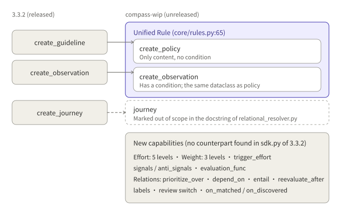
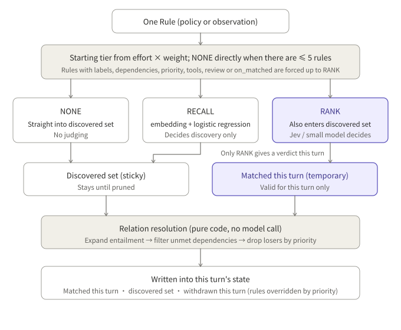
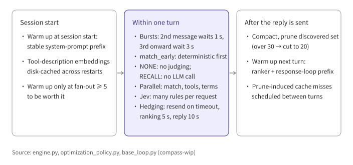

## Summary

Parlant is a framework for controlling the behavior of customer-facing conversational agents. Its new documentation site (next.parlant.io) introduces a set of concepts that are not on PyPI yet: `create_policy`, `Effort`, `Weight`, `signals`, `prioritize_over`, and more. Following those names I found the unreleased `compass-wip` branch and read the Compass engine in it.

What I took away:

- **The new API in the docs is not released.** The latest PyPI version is 3.3.2 (2026-04-28) and has no `create_policy`. The new concepts exist only in one WIP commit on the `compass-wip` branch, so for now they are a prototype.
- **The core design is unification.** A policy and an observation are the same `Rule`, differing only in whether there is a `condition`. Relations such as priority, dependency and entailment are not stored inside the rule; they live in a separate relation table.
- **Per-turn judging cost is split into three tiers.** Some rules are never judged, some use embeddings only, and only rules that must have a "matched this turn" verdict are handed to a model.
- **Speed comes from cache warm-up, concurrency, batched verdicts and hedging**, and the gain depends on the prompt prefix being byte-for-byte stable.

This article records only what can be verified in the code. All conclusions come from static reading; I did not run anything.

---

## 1. What I read

| Item | Detail |
|---|---|
| Repository | [emcie-co/parlant](https://github.com/emcie-co/parlant), Apache 2.0 |
| Released version | PyPI 3.3.2 (2026-04-28); the API has guideline, observation and journey |
| Branch read here | `compass-wip`, commit c30226c (2026-10-28), titled "WIP compass drop" |
| Default branch | `develop` has had no new commits since 2026-06-26 |

In other words, the Compass engine described below is an unreleased direction. I cannot tell whether it will be merged or when it will ship.

---

## 2. How the concepts evolved



| Object | 3.3.2 (released) | compass-wip (unreleased) |
|---|---|---|
| Behavior rule | `create_guideline` | `create_policy`: only `content`, no condition |
| Trigger observation | `create_observation` | `create_observation`: has a condition; same `Rule` type as policy |
| Flow | `create_journey` | Marked out of scope in the docstring of `relational_resolver.py` |
| Effort control | No counterpart found | Five `Effort` levels; a rule can raise the turn's level with `trigger_effort` |
| Importance | No counterpart found | Three `Weight` levels |
| Relations | Basic relations exist (I did not check each type) | `prioritize_over`, `depend_on`, `entail`, `reevaluate_after` |
| Judging aids | No counterpart found | `signals` / `anti_signals`, `evaluation_func` |
| After a match | No counterpart found | `on_matched`, `on_discovered`, `labels`, a review switch |

"No counterpart found" means I did not find it in `sdk.py` of 3.3.2; it does not mean nothing similar existed before.

The reasons the official docs give:

- Real conversations are not linear, and node switches and agent handoffs lose context, so keep one agent and assemble the context dynamically each turn.
- A policy can be written in three forms: a policy document (a one-page manual), a procedure (numbered steps, close to an SOP), or a steering guideline (a one-line nudge).
- Write a procedure as one whole policy rather than splitting it into fragments such as "when X, ask for the order number".

The matching fact in the code: policy and observation are the same `Rule` dataclass, differing only in whether there is a `condition`.

---

## 3. Core architecture

### 3.1 The unified Rule

`Rule` at `core/rules.py:65` has `content`, `condition`, `title`, `weight`, `effort`, `priority`, `signals`, `anti_signals`, `labels`, `message_review`, `tool_review`, `groups` and `metadata`. At least one of `content` or `condition` is required.

Relations (priority, dependency, entailment, re-evaluation) are not in the Rule. They are stored in a separate relation table with the types entailment, priority, dependency, dependency_any (OR within a group), reevaluation and overlap. When no id is given, a rule id is generated by hashing its content.

### 3.2 The flow of one turn

1. `match_early`: runs only deterministic early code checks, with no model call.
2. Cost gate: if a cost-control policy exists, it first decides whether this turn is allowed.
3. `preload`: loads the available rules, context variables and the discovered set.
4. `fill`: runs rule matching, tool scoring and glossary recall in parallel, then selects tools.
5. Response loop: model generation and tool calls; after each tool execution, the affected rules are re-judged.
6. After the reply is sent, the discovered rules are compacted and pruned in the background, and the cache is warmed for the next turn.

### 3.3 Three-tier matching



| Tier | How it is handled | Verdict this turn? |
|---|---|---|
| NONE | Admitted straight into the discovered set, no judging | No |
| RECALL | Embedding plus a per-rule logistic regression; decides only whether it enters the discovered set | No |
| RANK | If not yet discovered it still goes through recall; a ranking model then judges whether it matches this turn | Yes |

The starting tier comes from an effort × weight matrix, and when there are very few rules (≤ 5) NONE is used directly. A rule is forced up to RANK if it has `labels`, is depended on by other rules, has a priority relation, is tied to a tool (effort ≥ MEDIUM), declares a `trigger_effort`, requires review, has an `on_matched` callback, or explicitly specifies rank or distill evaluation. The reason is that these attachments fire only once an "official verdict for this turn" exists.

### 3.4 Two kinds of verdict

- **discovery**: answers "does the conversation make this rule continuously relevant to this session?". Rules that pass enter the discovered set and stay until pruned (stickiness).
- **turn evaluation**: answers "does this rule match this turn?". The result is valid for this turn only.

The system prompt contains the full discovered set, and each turn lists the rules matched this turn separately.

### 3.5 Three ways of judging

- **Recall** (`rule_recaller.py`): the conversation is embedded, and each rule has an offline-trained logistic regression. `signals` are positive examples; `anti_signals` and the positives of other rules are negatives. History is max-pooled, and an admission record prevents rules from flapping in and out.
- **Batched Jev verdicts** (`rule_ranker.py`): when effort is MIN, LOW or MEDIUM and a decision model is configured, the conversation is treated as the state and each rule as a Proposition; one request returns the probability for every rule, and ≥ 0.5 counts as a match. The prompt asks the model to lean toward yes when unsure, because this is only the first-pass filter.
- **Per-rule scoring**: when effort is HIGH or MAX, or there is no decision model, a small model gets a separate request for each rule and scores it 1 to 5; ≥ 4 counts as a match, and an explanation is included.

The batched-verdict request is structured roughly like this:

```
state     = system role + conversation history + "# CURRENT TURN" + tool events
questions = { rule_id: Proposition(
                instructions = { rule: "Title/Policy text + glossary + dependency context",
                                 question: "Does this rule apply to the current state of the conversation, especially the latest message?" },
                criteria     = { true:  signals as examples,
                                 false: anti_signals as examples } ) }
→ answers = { rule_id: { probability } }
```

`signals` are used differently in two places. Recall trains a classifier on them, so it can only measure similarity. Jev treats them as examples of the criterion, and the prompt says outright that "these are examples, not patterns to match".

The default OpenRouter models in the code are `openai/gpt-oss-20b:nitro` for ranking and `~typesafe/jev-latest` for verdicts. These are strings in the code; I did not independently verify the models.

### 3.6 Round-based evaluation and relation resolution

Rounds are used only when a turn has at least 8 candidate rules, with at most 2 rounds: a non-final round evaluates only rules whose prerequisites are already satisfied, and the final round evaluates every rule not yet judged unsatisfied. With fewer than 8 rules everything runs in one round.

Relation resolution is pure code with no model call:

- Entailment is expanded first, then unsatisfied dependencies are filtered out.
- A dependency can be satisfied only by "matched earlier in this session" and "matched in the same turn"; discovery admission does not count.
- Priority acts only on this turn's matched set, relational before numeric; a losing rule is downgraded to admission-only and recorded in a "withdrawn this turn" list that is flagged in the prompt.

### 3.7 Data model

Rules, rule vectors, rule-to-group links, rule-to-tool links and relations each have their own table. Runtime state (the discovered set and the rules matched so far) lives in session metadata, not in the rule tables.

---

## 4. Key mechanisms

### 4.1 Tools

Tools hang on rules through the rule-to-tool link table, not on the agent.

- **Selection**: `ToolRecaller` sorts tools into three buckets (tools of rules matched this turn, tools of discovered rules, all other tools), ranks each bucket by embedding relevance, and exposes at most 16. Tools have no admission-and-eviction lifecycle like rules.
- **Parameters**: `ToolParameterOptions.source` is any, context or customer, meaning extractable from anywhere, extractable only from context, or must be supplied by the customer in the conversation and never guessed.
- **High-risk tools**: a tool with `consequential=True` is marked CONSEQUENTIAL in the prompt, and the system prompt requires confirming with the user first. If a proposed call includes such a tool, tool review is forced on. But at `Effort.MIN` no review is ever done, and then only the prompt-level constraint remains.
- **Calling**: the model starts calls itself in the response loop, and multiple calls in one step run concurrently; failures and timeouts (180 seconds by default) are returned to the model as error results.
- **Re-judging and temporary rules**: `reevaluate_after(tool)` re-judges the related rules after the tool runs; a tool can also return rules that apply only this turn through `ToolResult(rules=[...])`.

### 4.2 Two tiering mechanisms

- **Effort**: five levels, MIN, LOW, MEDIUM, HIGH and MAX, decide how much work the engine does. The turn's effective level is the larger of the agent default and the `trigger_effort` of rules matched this turn, and it also takes part in model routing.
- **service_tier**: three levels, priority, standard and flex, decide which class of service a model request buys from the provider (faster, normal, or cheaper but slower). I checked the mapping only for the OpenAI and Gemini adapters.

The two are independent and can be combined.

### 4.3 Speed-ups



- **Cache warm-up**: the stable system-prompt prefix is warmed as soon as a session is created, and after each reply is sent the next turn is warmed. What gets warmed is the stable prefix of the ranker and the response loop; content that changes every turn is placed after the cache breakpoint. Warming is worth it only at a fan-out of ≥ 5, because warming is itself a request and a cache write costs more than ordinary input.
- **Concurrency and batching**: matching, tool scoring and glossary recall run in parallel; several tool calls in one turn run concurrently; Jev judges many rules in one request.
- **Skipping work**: the NONE tier does no judging, the RECALL tier makes no LLM call, and `Effort.MIN` does no review.
- **Hedging**: if a request has not returned by the timeout, an identical request is sent and whichever returns first is used. Defaults are 5 seconds for ranking, 10 seconds for the main reply and 10 seconds for review (15 seconds at HIGH and MAX).
- **Delay for bursts of messages**: within one turn the second customer message waits 1 second and the third onward wait 3 seconds, to avoid repeatedly starting and cancelling expensive processing.

### 4.4 Pruning

When discovered rules exceed 30, they are cleaned down to 20 in the background after a reply, at least 10 customer messages apart; each rule costs one small-model request, and rules with HIGH weight or matched this turn are not cleaned. The cache invalidation that cleaning causes is scheduled between turns.

### 4.5 labels

`labels` on a rule are written into the session labels as a set union once the rule is confirmed as matched, for analytics. Only matches confirmed by rank or code count, which is why a rule with labels is forced onto RANK.

---

## 5. Limits and prerequisites in the code

Each point below is backed by the code or comments of `compass-wip`.

- **Unreleased**: the new concepts exist only in one WIP commit on `compass-wip`, and `sdk.py` in PyPI 3.3.2 has no `create_policy`.
- **Cache prerequisite**: warming the ranker and the response loop depends on the prompt prefix being byte-for-byte identical across turns, with per-turn content placed after the `# CURRENT TURN` cache breakpoint (`rule_ranker.py`).
- **Warm-up has a threshold**: warming happens only at a fan-out of ≥ 5 (`optimization_policy.py`), because warming is itself a request and a cache write costs more than ordinary input.
- **Effort.MIN skips review**: at this level tool review is always skipped, and `consequential` tools are left with only the prompt-level confirmation requirement (`loop/base_loop.py`).
- **Batched verdicts depend on configuration**: Jev batched verdicts are used only when effort is MIN, LOW or MEDIUM and a decision model is configured in the routing; otherwise it falls back to per-rule scoring (`rule_ranker.py`).
- **The default models are strings in the code**: on the OpenRouter path, ranking uses `openai/gpt-oss-20b:nitro` and verdicts use `~typesafe/jev-latest` (`adapters/nlp/openrouter_service.py`).

---

## References

- Code: [emcie-co/parlant](https://github.com/emcie-co/parlant), branch `compass-wip`, commit c30226c
- Released package: [parlant 3.3.2 (PyPI)](https://pypi.org/project/parlant/)
- New docs: [Which construct for which job](https://next.parlant.io/docs/core-concepts/which-construct), [Agent architecture](https://next.parlant.io/docs/core-concepts/agent-architecture), [Observations and policies](https://next.parlant.io/docs/core-concepts/observations-and-policies), [Designing policies](https://next.parlant.io/docs/customizing-behavior/policies), [Consequential tools](https://next.parlant.io/docs/playbooks/consequential-tools), [Comparisons overview](https://next.parlant.io/docs/comparisons/overview), [Agents](https://next.parlant.io/docs/concepts/agents), [Perceived performance](https://next.parlant.io/docs/advanced/perceived-performance)
- Old docs: [Optimization](https://www.parlant.io/docs/advanced/optimization), [Agents](https://www.parlant.io/docs/concepts/entities/agents/)

*Note: all code conclusions come from static reading of the `compass-wip` branch and were not run; the default model names are strings in the code and were not independently verified; `compass-wip` is an unreleased WIP branch and may change substantially.*
