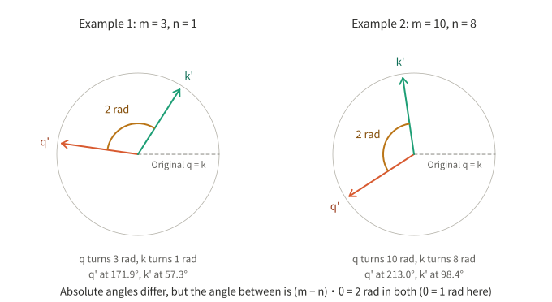
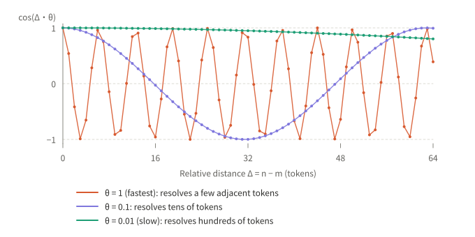
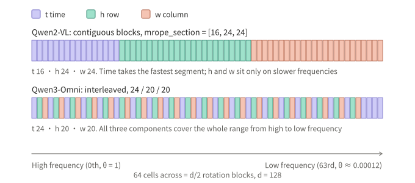
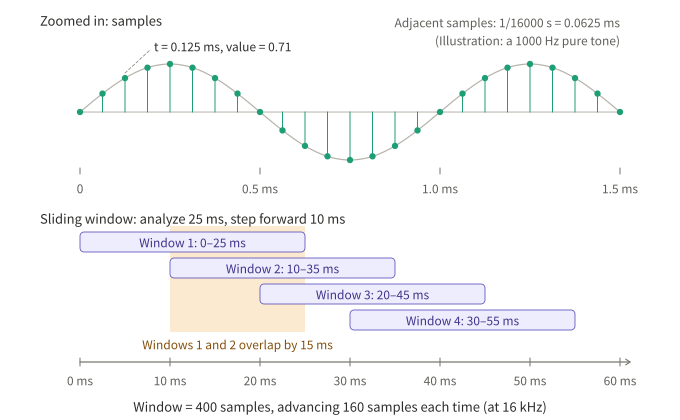
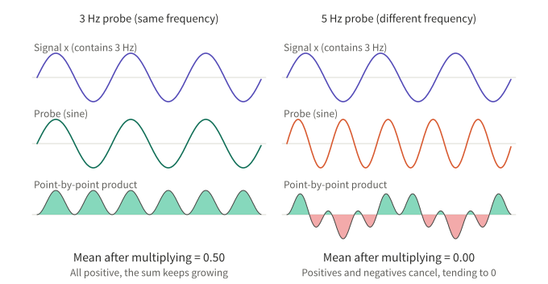
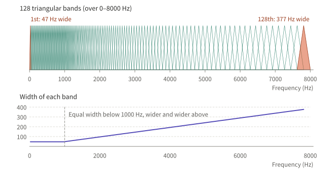
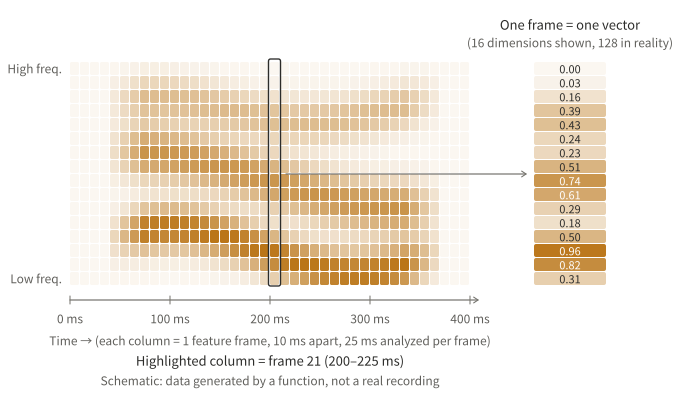
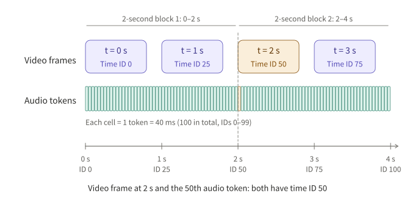
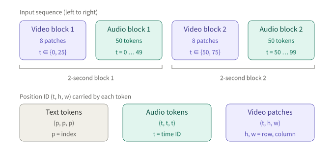

## Summary

Qwen-Omni can put text, images, audio and video into one sequence, and for positions it relies on an extension of RoPE called TM-RoPE. To read it, you first need to understand RoPE itself.

This article starts from "why attention does not know order", derives RoPE, checks it by hand with a d = 4 example, implements and runs it in PyTorch, and then shows how it extends to three components (time, height, width). The audio line starts from the very bottom: how sound becomes samples, windows, FFT, Mel bands and feature frames, and finally how audio and video are aligned on a time axis. Every number in the article is an actual result of running the code.

| # | Question |
|---|---|
| Q1 | Why must position information be "relative"? What are q, k, f and g in the formula? |
| Q2 | Why does rotation cancel the absolute positions and leave only the relative distance? |
| Q3 | What is the full RoPE formula? Where does θ come from, and does it need training? |
| Q4 | How do you implement and verify it in PyTorch? How is it used in training? |
| Q5 | What does TM-RoPE change on top of RoPE? |
| Q6 | How does sound become Mel-spectrogram feature frames? What are samples, windows, FFT and Mel bands? |
| Q7 | How are audio and video aligned on the time axis? |

## Key conclusions

- **Attention by itself does not know order.** To inject position, we want the score to depend only on the relative distance m − n between two tokens.
- **RoPE does this by rotation.** Pair adjacent dimensions of q and k, and rotate each pair by an angle "position × θ". In the dot product the two angles are subtracted, m and n each disappear, and only n − m remains.
- **θ is a constant, not a trainable parameter.** θᵢ is computed from base and head_dim, and the multiple frequencies work like the second and minute hands of a clock, handling short and long distances.
- **RoPE only requires that "position is a number".** M-RoPE and TM-RoPE replace that number with (t, h, w), each component taking a share of the frequencies, and the rotation formula is unchanged.
- **Audio first becomes a Mel spectrogram, then tokens.** Sound is quantized into samples (16,000 numbers per second at 16 kHz); every 10 ms a 25 ms window is taken; the FFT computes the strength of each frequency by "taking dot products with sinusoids of each frequency"; these are then merged into 128 bands on the ear's scale, giving a 128-dimensional feature frame.
- **Audio-video alignment relies on real time.** Each audio token corresponds to a fixed duration (about 40 ms in Qwen2.5-Omni, about 80 ms in Qwen3-Omni, 160 ms in Qwen3.5-Omni), and the time ID is tied to real time; video frames are converted to time IDs from real timestamps, patches of the same frame share t, and (h, w) tells positions apart.
- **For streaming input, what needs streaming training is the audio encoder and projection layer, not the LLM.** Under causal attention, chunked prefill is equivalent to whole-sequence prefill; a full-attention encoder produces different features in windowed mode, so the projection layer must have seen such features. Only listening-while-generating requires training on the LLM side.
- **Qwen3.5-Omni adds explicit timestamps.** Text timestamps in seconds are inserted before video or audio-video time blocks, and at random intervals in audio. The parts of the previous two generations' papers that I checked have no such step.

---

## 1. The problem: attention does not know order

In attention, each token's hidden state goes through two linear transforms to give two vectors:

- **q (query)**: what this token is looking for.
- **k (key)**: what this token can offer.

How much token i attends to token j is the dot product `qᵢ · kⱼ`. Since q and k are computed from content only, shuffling the tokens in the sequence leaves every pair's score unchanged, so the model cannot tell "I love you" from "you love me". Position has to be injected separately.

Let the asking token be at position m and the queried token at position n. We want to design an operation f such that:

```
⟨ f(q, m), f(k, n) ⟩ = g(q, k, m − n)
```

- **f**: the "inject position" operation to be designed. It takes a content vector and a position and returns a new vector with position. f(q, m) is the new query and f(k, n) is the new key.
- **g**: just a function name, meaning "the result may depend only on the content of q and k and on the difference m − n", and not on m or n alone.

Why relative position? In language, "how many words lie between subject and predicate" is more essential than "which positions they are at", and relative position generalizes naturally to sentences of different lengths.

The earliest approach added a position vector pₘ directly to the input, expanding the score into four terms:

```
(q + pₘ)·(k + pₙ) = q·k + q·pₙ + pₘ·k + pₘ·pₙ
```

Content and position are tangled, and no term depends explicitly on m − n alone, so the model has to learn the relative relation itself. RoPE takes a different route.

## 2. First principle: rotation turns positions into a subtraction

Rotation in a plane has two properties:

- rotation does not change a vector's length;
- rotations compose: turning by a then by b equals turning by a + b; conversely `R(a)ᵀ · R(b) = R(b − a)`.

So define f: a vector at position m is rotated by the angle m·θ.

```
f(x, m) = R(mθ) · x
⟨R(mθ)q, R(nθ)k⟩ = qᵀ R(mθ)ᵀ R(nθ) k = qᵀ R((n − m)θ) k
```

m and n each disappear, leaving only n − m, which is exactly the g we wanted in the previous section.



*Figure 1: take θ = 1 rad and q = k. The two examples use different positions (3 and 1, 10 and 8), and the absolute angles after rotation are completely different, but the angle between them is 2 rad in both, so the dot products are the same.*

Say it again with angles. Let the original direction of q be α and of k be β; after rotation:

```
direction of q' = α + mθ
direction of k' = β + nθ
angle between   = (β − α) + (n − m)θ
```

The dot product is determined by the angle between them. The first term β − α depends on content only, the second only on the position difference, and m and n cancel in the subtraction.

**About rad (radians):** on a circle, an arc whose length equals the radius subtends 1 rad at the center, about 57.3°; a full turn 360° = 2π rad. `cos` and `sin` take radians by default in code, and every angle in this article is in radians.

## 3. The full RoPE formula

Real q and k have d dimensions (d is head_dim, the vector length of each attention head, commonly 64 or 128). The approach is to pair adjacent dimensions, d/2 pairs in total, rotate each pair separately, with a different angular speed for each pair:

```
θᵢ = base^(−2i/d), i = 0, 1, …, d/2 − 1, commonly base = 10000
```

The full rotation matrix for position m is block diagonal, and its i-th 2×2 block is:

```
[ cos(m·θᵢ)  −sin(m·θᵢ) ]
[ sin(m·θᵢ)   cos(m·θᵢ) ]
```

You can also treat each pair as the complex number `x₂ᵢ + i·x₂ᵢ₊₁`, and the rotation is multiplication by `e^(i·m·θᵢ)`.

**Does θ need to be solved for? No.** It is a deterministic function of base and d, shared by all layers, heads and positions, and not updated in training. With d = 4, θ = (1, 0.01); with d = 128 it falls from 1 down to about 0.000115.

**Why several frequencies?** One frequency returns to the origin after a full turn, so two positions a full turn apart cannot be told apart. Several frequencies work like a clock: the second hand (high frequency) tells apart neighboring tokens, and the minute and hour hands (low frequency) tell apart long distances.



*Figure 2: the horizontal axis is relative distance Δ and the vertical axis is cos(Δ·θ). The block with θ = 1 oscillates quickly with distance, while the block with θ = 0.01 barely changes within 64 positions.*

RoPE acts on Q and K, not on V: position decides only "who attends to whom" and should not change the content that is retrieved.

## 4. Hand check: d = 4

With d = 4 there are only two blocks, θ₀ = 1 and θ₁ = 0.01. The matrix R(m) for position m is a 4×4 block-diagonal matrix; every position has exactly the same format, and only the numbers in the blocks change with m.

m = 0 (all angles are 0, the identity matrix, no rotation):

```
[ 1  0  0  0 ]
[ 0  1  0  0 ]
[ 0  0  1  0 ]
[ 0  0  0  1 ]
```

m = 1 (angles 1 rad and 0.01 rad):

```
[ 0.54030  −0.84147   0         0       ]
[ 0.84147   0.54030   0         0       ]
[ 0         0         0.99995  −0.01000 ]
[ 0         0         0.01000   0.99995 ]
```

m = 2 (angles 2 rad and 0.02 rad):

```
[ −0.41615  −0.90930   0         0       ]
[  0.90930  −0.41615   0         0       ]
[  0         0         0.99980  −0.02000 ]
[  0         0         0.02000   0.99980 ]
```

Take q = k = (1, 0, 1, 0). Without rotation q·k = 2 and there is no position information. Look at two examples with the same position difference:

| Positions | q' = R(m)q | k' = R(n)k | q'·k' |
|---|---|---|---|
| m = 3, n = 1 | (−0.98999, 0.14112, 0.99955, 0.03000) | (0.54030, 0.84147, 0.99995, 0.01000) | 0.58365 |
| m = 10, n = 8 | (−0.83907, −0.54402, 0.99500, 0.09983) | (−0.14550, 0.98936, 0.99680, 0.07991) | 0.58365 |

In the two examples every component of q' and k' differs, yet the dot product is the same. The theoretical value is `cos(2θ₀) + cos(2θ₁) = cos 2 + cos 0.02 = 0.58365`, matching the hand calculation.

## 5. PyTorch implementation

First, four functions. Verification uses float64; the choice of precision in real training has nothing to do with how RoPE works and is not discussed here.

```python
import torch

torch.set_default_dtype(torch.float64)


def rope_freqs(d: int, base: float = 10000.0) -> torch.Tensor:
    """θ_i = base^(-2i/d), i = 0 .. d/2-1, shape [d/2]. A constant, no trainable parameters"""
    return base ** (-torch.arange(0, d, 2) / d)


def rotation_matrix(m: int, d: int, base: float = 10000.0) -> torch.Tensor:
    """Teaching version: explicitly build the d×d block-diagonal rotation matrix (adjacent dimensions paired)"""
    theta = rope_freqs(d, base)
    R = torch.zeros(d, d)
    for i, th in enumerate(theta):
        c, s = torch.cos(m * th), torch.sin(m * th)
        R[2 * i, 2 * i], R[2 * i, 2 * i + 1] = c, -s
        R[2 * i + 1, 2 * i], R[2 * i + 1, 2 * i + 1] = s, c
    return R


def apply_rope_interleaved(x, pos, base=10000.0):
    """Interleaved layout (original paper). x: [L, d], pos: [L], the position of each token"""
    ang = pos[:, None] * rope_freqs(x.shape[-1], base)[None, :]  # [L, d/2]
    cos, sin = ang.cos(), ang.sin()
    x1, x2 = x[..., 0::2], x[..., 1::2]  # pair even and odd dimensions
    out = torch.empty_like(x)
    out[..., 0::2] = x1 * cos - x2 * sin
    out[..., 1::2] = x1 * sin + x2 * cos
    return out


def rotate_half(x):
    x1, x2 = x.chunk(2, dim=-1)  # pair the first half with the second half
    return torch.cat([-x2, x1], dim=-1)


def apply_rope_half(x, pos, base=10000.0):
    """Half-split layout (common in LLaMA / HuggingFace)"""
    ang = pos[:, None] * rope_freqs(x.shape[-1], base)[None, :]  # [L, d/2]
    ang = torch.cat([ang, ang], dim=-1)  # [L, d]
    return x * ang.cos() + rotate_half(x) * ang.sin()
```

Going through them one by one:

- **`rope_freqs`**: implements the θᵢ formula directly and returns d/2 angular speeds.
- **`rotation_matrix`**: fills each 2×2 block along the diagonal, matching the matrices of section 4 one to one; it is only for teaching and verification, and real code never builds the matrix.
- **`apply_rope_interleaved`**: `pos[:, None] * freqs[None, :]` gives an `[L, d/2]` table of angles, with a row per token and a column per frequency block. `x[..., 0::2]` and `x[..., 1::2]` pick out the two components of each pair, and the rotation formula is applied elementwise, in O(d) rather than the O(d²) of a matrix multiply.
- **`apply_rope_half`**: pairs dimension i with dimension i + d/2 and writes the rotation as `x·cos + rotate_half(x)·sin`. It is mathematically equivalent to the interleaved layout, differing only by a dimension reordering. **When loading weights trained by someone else, the pairing must match theirs**, or attention will be computed wrongly.

Next, verify the numbers of section 4 and three properties:

```python
# 1) the two d=4 examples
q = k = torch.tensor([1.0, 0.0, 1.0, 0.0])
for m, n in ((3, 1), (10, 8)):
    qm, kn = rotation_matrix(m, 4) @ q, rotation_matrix(n, 4) @ k
    print(f"m={m}, n={n}: q'·k' = {float(qm @ kn):.5f}")

# 2) matrix multiply == elementwise == half-split (after reordering)
torch.manual_seed(0)
x, pos = torch.randn(5, 8), torch.arange(5.0)
A = torch.stack([rotation_matrix(int(p), 8) @ x[i] for i, p in enumerate(pos)])
B = apply_rope_interleaved(x, pos)
perm = torch.cat([torch.arange(0, 8, 2), torch.arange(1, 8, 2)])  # even dimensions first, odd after
C = apply_rope_half(x[:, perm], pos)
print(torch.allclose(A, B), torch.allclose(C, B[:, perm]))

# 3) relative-position invariance (d=128)
q, k = torch.randn(1, 128), torch.randn(1, 128)
def score(m, n):
    return float(apply_rope_interleaved(q, torch.tensor([float(m)])) @
                 apply_rope_interleaved(k, torch.tensor([float(n)])).T)
for m, n in ((5, 3), (105, 103), (5005, 5003), (7, 3)):
    print(f"m={m}, n={n}, m-n={m - n}: score={score(m, n):.6f}")
```

Actual output:

```
m=3, n=1: q'·k' = 0.58365
m=10, n=8: q'·k' = 0.58365
True True
m=5, n=3, m-n=2: score=7.629485
m=105, n=103, m-n=2: score=7.629485
m=5005, n=5003, m-n=2: score=7.629485
m=7, n=3, m-n=4: score=1.773059
```

For the three groups with a position difference of 2, the score is identical whether the absolute position is 5 or 5005; the score changes only when the difference becomes 4.

## 6. How it is used in training

RoPE sits after the linear projections and before the dot product, rotating only q and k:

```python
import torch.nn as nn
import torch.nn.functional as F


class RoPEAttention(nn.Module):
    def __init__(self, d_model, n_heads):
        super().__init__()
        self.h, self.dh = n_heads, d_model // n_heads
        self.qkv = nn.Linear(d_model, 3 * d_model, bias=False)
        self.out = nn.Linear(d_model, d_model, bias=False)

    def forward(self, x, pos):  # x: [B, L, d_model], pos: [L]
        B, L, _ = x.shape
        q, k, v = self.qkv(x).view(B, L, 3, self.h, self.dh).unbind(dim=2)
        q, k, v = (t.transpose(1, 2) for t in (q, k, v))          # [B, H, L, dh]
        q, k = apply_rope_half(q, pos), apply_rope_half(k, pos)   # rotate only q and k, not v
        y = F.scaled_dot_product_attention(q, k, v, is_causal=True)
        return self.out(y.transpose(1, 2).reshape(B, L, -1))
```

Check with the same input:

```python
attn = RoPEAttention(d_model=32, n_heads=4)
x, pos = torch.randn(2, 6, 32), torch.arange(6.0)
print(torch.allclose(attn(x, pos), attn(x, pos + 1000), atol=1e-8))      # shift everything
print(torch.allclose(attn(x, pos), attn(x, torch.tensor([0., 1, 2, 3, 4, 9]))))  # change one position
print(sum(p.numel() for p in attn.parameters()))
```

The output is `True`, `False`, `4096`: shifting all positions by 1000 leaves the output unchanged; moving only the last token's position changes it; the parameter count is only the QKV and output projections, 3·32·32 + 32·32 = 4096, so RoPE itself has no parameters.

A few things worth remembering about training:

- **No trainable parameters.** θ is fixed, and the cos/sin tables can be precomputed and cached. What is learned is W_q and W_k: they decide which frequency blocks the content lands on, and therefore which distances the model is sensitive to.
- **Backpropagation passes through the rotation as usual.** The rotation is a fixed orthogonal linear transform, and the gradient is simply multiplied by its transpose.
- **Positions come from the data pipeline.** Ordinary training uses 0, 1, 2, …; when several short samples are packed into one long sequence, positions usually restart from 0 for each sample, while an attention mask stops them seeing each other.
- **At inference the KV cache stores the rotated k.** A new token only needs its own q and k rotated by its own position, and old tokens need no recomputation.
- **There are problems beyond the training length.** For positions beyond the training length, the angles of some low-frequency blocks fall in ranges never seen. Position interpolation, raising base and YaRN address this, and they are not covered here.

## 7. From RoPE to M-RoPE and TM-RoPE

Look back at the derivation in section 2: the only requirement RoPE places on position is that m is a number and the rotation angle is m·θᵢ. It does not care whether that number means "which token" or something else.

**M-RoPE** (introduced in Qwen2-VL) replaces that number with three: (t, h, w), meaning time, height and width. **TM-RoPE** (Qwen2.5-Omni) adds audio on top of that and ties the time component to real time.

### What h and w are

Before entering the model an image is cut into small squares (patches), one token per patch. These tokens lie in a line in the sequence but are two-dimensional on the picture. h is the patch's row number and w its column number. For a 3-row, 4-column example:

```
        w=0    w=1    w=2    w=3
h=0   (0,0)  (0,1)  (0,2)  (0,3)
h=1   (1,0)  (1,1)  (1,2)  (1,3)
h=2   (2,0)  (2,1)  (2,2)  (2,3)
```

In the sequence (0,3) and (1,0) are adjacent, yet on the picture one is at the far right of the first row and the other at the far left of the second row, far apart. With (h, w), attention can tell up, down, left and right neighbors apart.

### How each modality is assigned

| Modality | t | h | w |
|---|---|---|---|
| Text | index p | p | p |
| Audio | time ID (real time ÷ duration of one token) | same as t | same as t |
| Image | constant (same moment) | row | column |
| Video | the frame's time ID | row | column |

- For text all three components are equal, so the rotation is exactly the same as ordinary one-dimensional RoPE, and pure-text ability is not harmed.
- In Qwen2-VL the video t increases by frame index (2 frames sampled per second); Qwen2.5-Omni changed it to be converted from real time, so when the frame rate changes the time ID still corresponds to real time.
- When modalities are concatenated, the next modality's numbering continues from the largest number of the previous one.

### How the three components share the frequencies

The d/2 rotation blocks must be divided among t, h and w. Each block rotates by the position of one component only, and the rest of the formula is unchanged.



*Figure 3: the top is Qwen2-VL's contiguous split, where the time component takes the first (fastest) 16 frequencies; the bottom is Qwen3-Omni's interleaved allocation, where all three components cover the whole range from high to low frequency.*

- **Qwen2-VL**: the config has `mrope_section = [16, 24, 24]` (checked against the config of an open checkpoint based on Qwen2-VL-2B, with head_dim = 128 and 16 + 24 + 24 = 64), allocated in contiguous blocks, with the time component getting the fastest segment.
- **Qwen3-Omni**: the paper states that rotation angles are allocated to time, height and width in an interleaved way, in the quantities 24, 20 and 20, and points out that the previous generation's M-RoPE gave the first 16 angles to time; the purpose of interleaving is to balance local semantics and long-range dependence.

In code, you only need to answer "which component does each frequency belong to":

```python
def freq_owner(section, interleaved: bool) -> torch.Tensor:
    """Returns a tensor of length d/2: which position component (t=0, h=1, w=2) the i-th frequency uses"""
    n = sum(section)
    if not interleaved:  # Qwen2-VL: contiguous blocks [TTT..HHH..WWW]
        return torch.repeat_interleave(torch.arange(3), torch.tensor(section))
    owner = torch.zeros(n, dtype=torch.long)  # Qwen3 family: interleaved [THWTHW...TT]
    owner[1 : 3 * section[1] : 3] = 1
    owner[2 : 3 * section[2] : 3] = 2
    return owner


def apply_mrope(x, pos3, section, interleaved=False, base=10000.0):
    """x: [L, d], pos3: [3, L], the three rows are the positions of t, h and w"""
    L, d = x.shape
    freqs = rope_freqs(d, base)  # [d/2]
    ang = pos3[:, :, None] * freqs  # [3, L, d/2]: compute once for each of the three components
    owner = freq_owner(section, interleaved).view(1, 1, -1).expand(1, L, -1)
    ang = torch.gather(ang, 0, owner)[0]  # [L, d/2]: each frequency takes the angle of its owning component
    ang = torch.cat([ang, ang], dim=-1)
    return x * ang.cos() + rotate_half(x) * ang.sin()
```

- `ang` first multiplies the three positions t, h and w by all the frequencies, giving three tables of angles.
- `freq_owner` decides which table each frequency uses: with contiguous blocks, the first 16 go to t, the next 24 to h and the last 24 to w; with interleaving, t, h and w take turns and the leftover frequencies go to t (24 = 20 + 4, so 4 extra t at the end).
- `torch.gather` picks the owning component's angle for each frequency according to the ownership table, after which everything is identical to ordinary RoPE.

Verification:

```python
for sec, il in (([16, 24, 24], False), ([24, 20, 20], True)):
    o = freq_owner(sec, il)
    print("".join("THW"[i] for i in o.tolist()))

# For text the three components are equal → exactly the same as ordinary RoPE
xx, p = torch.randn(6, 128), torch.arange(6.0)
print(torch.allclose(apply_mrope(xx, torch.stack([p, p, p]), [24, 20, 20], True),
                     apply_rope_half(xx, p)))
```

```
TTTTTTTTTTTTTTTTHHHHHHHHHHHHHHHHHHHHHHHHWWWWWWWWWWWWWWWWWWWWWWWW
THWTHWTHWTHWTHWTHWTHWTHWTHWTHWTHWTHWTHWTHWTHWTHWTHWTHWTHWTTTT
True
```

Next verify that "each of the three components minds its own business": adding 25 to t of both tokens leaves the score unchanged, and the score changes only when t differs by 25.

```python
torch.manual_seed(1)
q1, k1 = torch.randn(1, 128), torch.randn(1, 128)

def sc(pq, pk):  # pq, pk are (t, h, w)
    a = apply_mrope(q1, torch.tensor(pq).view(3, 1).double(), [24, 20, 20], True)
    b = apply_mrope(k1, torch.tensor(pk).view(3, 1).double(), [24, 20, 20], True)
    return float(a @ b.T)

print(f"{sc([10, 2, 3], [4, 1, 1]):.6f}")   # t differs by 6
print(f"{sc([35, 2, 3], [29, 1, 1]):.6f}")  # t both +25, difference still 6
print(f"{sc([35, 2, 3], [4, 1, 1]):.6f}")   # t differs by 31
```

```
-7.656143
-7.656143
-24.134090
```

Two implementation notes: the interleaved part follows NVIDIA Megatron-Bridge's description of Qwen3-VL (T, H, W alternate, with the leftover T at the end), and the exact index expressions follow the official repository; the offsets of h and w when concatenating across modalities are omitted in this article's code.

## 8. How sound becomes feature frames

The "audio token" in TM-RoPE does not appear out of nowhere. Before entering the LLM, sound goes through four steps: **samples → windows → FFT → Mel bands**, producing a series of feature frames, which the encoder then compresses into tokens.

### Samples: sound is a series of numbers

A microphone converts air vibration into voltage and records one number at fixed intervals; that number is a **sample**. How many are recorded per second is the sampling rate. Qwen-Omni resamples all audio to 16 kHz (stated in the Qwen3.5-Omni report), meaning 16,000 numbers per second.

- A single sample is only the amplitude at one instant and has no "frequency". Frequency is how fast a stretch of waveform vibrates, and you must look at at least a short stretch to speak of it.
- At a 16 kHz sampling rate the highest representable frequency is half of that, 8 kHz (the Nyquist frequency).

### Window and hop: every 10 ms, look at 25 ms

The whole audio cannot be analyzed at once, or you would only know "which frequencies are in the whole clip" and not when they occur. Instead, a 25 ms window cuts out a small piece and slides forward 10 ms each time:

| Quantity | Time | Samples (16 kHz) |
|---|---|---|
| Window length | 25 ms | 400 |
| Hop (stride) | 10 ms | 160 |
| Overlap of adjacent windows | 15 ms | 240 |



*Figure 4: the top shows samples on the waveform; below are the successively sliding 25 ms windows, each producing one feature frame. Windows overlap by 15 ms, so there are 100 feature frames per second.*

One second of audio (16,000 points) yields (16000 − 400) / 160 + 1 = 98 complete windows.

### How the FFT works: probing frequencies with dot products

Each window holds 400 numbers, and we want to turn them into "how strong is each frequency". The core idea is **dot-product probing**: to know whether the signal contains a component of 5 cycles, multiply a 5-cycle cosine and sine with the signal point by point and sum.

- If the signal really has this frequency: the product at the same phase is always positive and the sum is large.
- If it does not: positives and negatives cancel and the sum is close to 0.
- Different integer frequencies are orthogonal to each other, so the probe of each frequency does not interfere with the others.



*Figure 5: on the left the probe frequency matches the signal, the products are all positive and the mean is 0.50; on the right the probe frequency does not match, the products cancel between positive and negative and the mean is 0.00.*

Implement this "dot product" version of the Fourier transform directly in PyTorch and compare with `torch.fft.rfft`:

```python
import math
import torch

torch.set_default_dtype(torch.float64)

def dft_by_dot(x):
    N = len(x); n = torch.arange(N); out = []
    for k in range(N // 2 + 1):                                  # probe 0 .. N/2 cycles
        c = (x * torch.cos(2 * math.pi * k * n / N)).sum()       # dot product with the cosine
        s = (x * torch.sin(2 * math.pi * k * n / N)).sum()       # dot product with the sine
        out.append(complex(c, -s))                               # the two dot products form one complex number
    return torch.tensor(out)
```

- `k` is the number of cycles in the whole window, corresponding to frequency k·sr/N.
- The cosine and the sine each get a dot product because the phase of the signal is unknown: for one frequency at different phases, a dot product with the cosine alone would miss the signal. The two results are combined into a complex number, and its modulus is the strength of this frequency.

First check with a small 8-point example: the signal is a 1-cycle cosine (amplitude 2) plus a 3-cycle sine (amplitude 1).

```python
n = torch.arange(8)
x = 2 * torch.cos(2 * math.pi * 1 * n / 8) + torch.sin(2 * math.pi * 3 * n / 8)
X = dft_by_dot(x)
print(x.numpy().round(3))
print(X.abs().numpy().round(3), (2 * X.abs() / 8).numpy().round(3))
print(torch.allclose(X, torch.fft.rfft(x)))
```

```
[ 2.     2.121 -1.    -0.707 -2.    -2.121  1.     0.707]
[0. 8. 0. 4. 0.] [0. 2. 0. 1. 0.]
True
```

The 1st and 3rd frequency bins have strength, with moduli 8 and 4, and multiplying by 2/N recovers amplitudes 2 and 1 exactly; the rest are 0. The result matches `torch.fft.rfft` exactly.

Now a realistic window size: 400 points containing 200 Hz (amplitude 1.0) plus 1000 Hz (amplitude 0.5).

```python
sr, N = 16000, 400
t = torch.arange(N) / sr
w = 1.0 * torch.sin(2 * math.pi * 200 * t) + 0.5 * torch.sin(2 * math.pi * 1000 * t)
amp = 2 * torch.fft.rfft(w).abs() / N
for k in amp.topk(2).indices.sort().values.tolist():
    print(f"bin {k}: {k * sr / N:.0f} Hz, amplitude {amp[k]:.3f}")
print(len(amp), sr / N)
```

```
bin 5: 200 Hz, amplitude 1.000
bin 25: 1000 Hz, amplitude 0.500
201 40.0
```

A real FFT of 400 points gives 201 frequency bins spaced sr/N = 40 Hz apart. The two frequencies fall on bins 5 and 25, with strengths exactly 1.0 and 0.5.

- **"FFT" is just a faster algorithm.** The code above scans the signal once per frequency, about N² = 160,000 multiply-adds in total; the FFT uses symmetry to bring this to about N·log N, a few thousand. The result is the same.
- **Window function.** If the number of cycles in the signal is not an integer (for instance 210 Hz is 5.25 cycles in 400 points), the cut piece does not match at its ends and energy leaks into other bins. Multiplying the window by a Hann curve that goes to 0 at both ends makes the leakage much smaller. In this 210 Hz example, the relative strength of bins far from the main peak is about 0.4% without a window, and drops to about 3×10⁻⁷ with a Hann window.

### Mel: merging frequencies on the ear's scale

The FFT gives 201 evenly spaced frequency bins, but the human ear is more sensitive at low frequencies: 100 Hz and 200 Hz sound very different, while 7000 Hz and 7100 Hz sound almost the same. So the 201 bins are merged into 128 **Mel bands**: narrow, finely divided bands at low frequencies, and wide, coarsely divided bands at high frequencies.

Each band is a triangular weight: largest at the center and falling linearly to 0 on both sides. The triangles' edges are equally spaced on the Mel scale, and converted back to hertz they become "narrow at low frequency, wide at high frequency". The scale used here is Slaney (linear below 1000 Hz, logarithmic above), which is also librosa's default.



*Figure 6: 128 triangular filters. The triangles are narrow and dense at low frequency and wide and sparse at high frequency; below, the width of each band as a function of frequency.*

At 16 kHz with a 400-point window, the widths of a few bands are:

| Band number | Center frequency | Width |
|---|---|---|
| 1st to 32nd | 23 Hz to 748 Hz | 46.8 Hz (all the same) |
| 45th | 1055 Hz | 50.9 Hz |
| 64th | 1669 Hz | 80.5 Hz |
| 96th | 3610 Hz | 174.1 Hz |
| 128th | 7809 Hz | 376.7 Hz |

42 bands have centers below 1000 Hz, 58 between 1000 and 4000 Hz, and 28 above 4000 Hz.

A complete Mel spectrogram needs only two functions:

```python
def mel_filterbank(sr=16000, n_fft=400, n_mels=128):
    """Triangular Mel filterbank on the Slaney scale, returns [n_mels, n_fft//2+1]"""
    f_sp, logstep = 200.0 / 3, math.log(6.4) / 27
    to_mel = lambda f: torch.where(f < 1000, f / f_sp, 15 + torch.log(f.clamp_min(1000) / 1000) / logstep)
    to_hz = lambda m: torch.where(m < 15, f_sp * m, 1000 * torch.exp(logstep * (m - 15)))
    bins = torch.linspace(0, sr / 2, n_fft // 2 + 1)                      # 201 FFT frequency bins
    top = float(to_mel(torch.tensor(sr / 2)))
    edges = to_hz(torch.linspace(0.0, top, n_mels + 2))                   # n_mels+2 edges (equally spaced on the Mel scale)
    l, c, r = edges[:-2, None], edges[1:-1, None], edges[2:, None]        # left edge, center, right edge of each band
    tri = torch.minimum((bins - l) / (c - l), (r - bins) / (r - c)).clamp_min(0)
    return tri * (2.0 / (r - l))                                          # Slaney normalization: equal area for every band


def mel_spectrogram(wave, sr=16000, win=400, hop=160, n_mels=128):
    """wave: [num_samples] → [T, n_mels], each row is one feature frame"""
    window = torch.hann_window(win, periodic=True)
    frames = wave.unfold(0, win, hop)                                     # [T, 400]: 25 ms window, 10 ms stride
    spec = torch.fft.rfft(frames * window, dim=-1).abs() ** 2             # [T, 201]: energy of each frequency bin
    return spec @ mel_filterbank(sr, win, n_mels).T                       # [T, 128]: merged into 128 Mel bands
```

- `unfold(0, win, hop)` does the "sliding window" in one step: take 400 points every 160 points, giving `[T, 400]`.
- Each frame is multiplied by the Hann window, then `rfft` is applied, and the squared modulus gives the energy of each frequency bin, `[T, 201]`.
- The last step is a matrix multiply: `[T, 201] @ [201, 128]`, merging the 201 frequency bins into 128 bands by triangular weights.

Feed in the earlier 200 Hz + 1000 Hz signal lasting 1 second and see, then compare with librosa:

```python
t = torch.arange(16000) / 16000
wave = 1.0 * torch.sin(2 * math.pi * 200 * t) + 0.5 * torch.sin(2 * math.pi * 1000 * t)
M = mel_spectrogram(wave)
print(tuple(M.shape), tuple(mel_filterbank().shape))
print(M.mean(0).topk(2).indices.sort().values + 1)   # the two bands with the largest mean energy (numbered from 1)
```

```
(98, 128) (128, 201)
tensor([8, 9])
```

One second of audio gives 98 frames of 128 dimensions each. 200 Hz falls exactly between the 8th band (center 187 Hz) and the 9th band (center 210 Hz), and the energy is shared between them. I also compared against librosa (`n_fft=400, hop_length=160, center=False, n_mels=128`): the maximum relative error is about 8×10⁻⁸, the filterbank shape is (128, 201), and there is no all-zero band.

### Mel-spectrogram frames: one frame is a 128-dimensional vector

Stack the results of all windows vertically and you get the **Mel spectrogram**, of shape `[T, 128]`: the horizontal axis is time, the vertical axis the 128 bands, and the color the energy. **One column, that is one frame, is a 128-dimensional vector** describing how strong each band is in this roughly 10 ms of sound.



*Figure 7: on the left is the Mel spectrogram, where one vertical column is one frame; on the right one frame is expanded into a 128-dimensional vector.*

The amount of data per second changes like this:

| Stage | Amount per second |
|---|---|
| Samples | 16,000 numbers |
| Mel-spectrogram frames | 100 frames × 128 = 12,800 numbers |
| Audio tokens into the LLM (Qwen2.5-Omni, 25 Hz) | 25 |
| Audio tokens into the LLM (Qwen3-Omni, 12.5 Hz) | 12.5 |
| Audio tokens into the LLM (Qwen3.5-Omni, 6.25 Hz) | 6.25 |

Note that **a feature frame is not an LLM token.** The 100 Hz frames go through an audio encoder (Qwen3-Omni's AuT has an 8× downsampling convolution) that compresses them into fewer vectors, and those are the "audio tokens" in TM-RoPE. Real models have further details in taking logs and normalizing, which are not covered here and which I did not check item by item against the papers.

> An analogy, only to aid understanding and not a claim from the papers: the e^(−iωn) in the DFT and the e^(imθ) in RoPE are the same kind of mathematical object, both rotations in the complex plane. But their uses are completely different: the former probes which frequencies a signal contains, the latter numbers the positions of tokens, and RoPE's θ has nothing to do with audio hertz.

## 9. Audio-video alignment and how vision comes in

### First, tell the "frequencies" apart

| Name | Meaning | Example |
|---|---|---|
| Sound frequency | How fast the waveform vibrates (hertz), which sets the pitch | 200 Hz, 1000 Hz |
| Feature frame rate | How many Mel-spectrogram frames per second | 100 Hz (25 ms window, 10 ms hop) |
| Token rate | How many audio tokens per second, which sets the sequence length | 25 Hz (Qwen2.5-Omni), 12.5 Hz (Qwen3-Omni), 6.25 Hz (Qwen3.5-Omni) |
| RoPE's θ | How many radians to turn per position moved | Unrelated to the other three |

The token rate directly sets the sequence length: one minute of audio is 1,500 tokens at 25 Hz, 750 at 12.5 Hz and 375 at 6.25 Hz.

### Time IDs tied to real time

In TM-RoPE the time ID of an audio token is converted from real time: in Qwen2.5-Omni one time ID is 40 ms, in Qwen3-Omni 80 ms, and in Qwen3.5-Omni 160 ms. The time ID of a video frame is also converted from its real time; when the frame sampling rate changes, the ID difference between frames changes with it, but every ID always stands for the same length of real time.



*Figure 8: taking 1 ID = 40 ms as an example, video frames land at IDs 0, 25, 50 and 75, and audio tokens occupy IDs 0 to 99 consecutively. The video frame at 2 seconds and the 50th audio token have the same time ID, so their relative position in time within attention is zero.*

### Interleaving

Qwen2.5-Omni cuts video with audio into blocks of 2 seconds, with video first and audio after within a block, and blocks follow one another. Qwen3-Omni keeps the chunked streaming mechanism; the paper does not give a specific block length, and alignment mainly relies on absolute-time IDs.

The two mechanisms have separate jobs: interleaving makes content adjacent in time physically adjacent in the sequence, and time IDs provide precise time marks.



*Figure 9: the sequence is laid out in 2-second blocks; text, audio and video tokens carry (p, p, p), (t, t, t) and (t, h, w) respectively.*

Generate this toy example in code (1 ID = 40 ms, a block every 2 seconds, video at 1 frame per second, 2×2 patches per frame):

```python
def build_av_position_ids(num_chunks=2, chunk_s=2.0, fps=1.0, grid=(2, 2), ms_per_id=40):
    """Returns [(modality, t, h, w), ...]; within each 2-second block video comes first, audio after"""
    toks = []
    for c in range(num_chunks):
        t0 = round(c * chunk_s * 1000 / ms_per_id)  # time ID of the block start
        for k in range(int(chunk_s * fps)):
            t = t0 + round(k / fps * 1000 / ms_per_id)  # the frame's real time → time ID
            for r in range(grid[0]):
                for col in range(grid[1]):
                    toks.append(("V", t, r, col))
        for j in range(int(chunk_s * 1000 / ms_per_id)):
            toks.append(("A", t0 + j, t0 + j, t0 + j))  # audio: all three components equal
    return toks
```

- A video frame's time ID comes from "real time ÷ 40 ms", not from the frame index, so changing `fps` changes the ID spacing automatically.
- Each audio token takes 1 ID, so a 2-second block has 50 audio tokens.
- Here h and w start from 0, and the offset for concatenating across modalities is omitted; the real implementation follows the paper and the official code.

Check the generated result:

```python
toks = build_av_position_ids()
print(len(toks), sum(t[0] == "V" for t in toks), sum(t[0] == "A" for t in toks))
print(toks[:6])
v = next(t for t in toks if t[0] == "V" and t[1] == 50)  # first video patch at 2.0 s
a = next(t for t in toks if t[0] == "A" and t[1] == 50)  # audio token at 2.0 s
print(v, a)
print(sorted({t[1] for t in toks if t[0] == "V"}))      # time IDs of the video frames
print(min(t[1] for t in toks if t[0] == "A"), max(t[1] for t in toks if t[0] == "A"))
```

```
116 16 100
[('V', 0, 0, 0), ('V', 0, 0, 1), ('V', 0, 1, 0), ('V', 0, 1, 1), ('V', 25, 0, 0), ('V', 25, 0, 1)]
('V', 50, 0, 0) ('A', 50, 50, 50)
[0, 25, 50, 75]
0 99
```

The video patch and the audio token at 2.0 seconds both have time ID 50. In attention, on the frequency blocks owned by t their phase difference is zero, which is how the model can match "this sentence" with "this picture".

In the Qwen2.5-Omni and Qwen3-Omni papers, the parts I checked insert no explicit timestamps into the sequence, and alignment relies on position IDs alone. Qwen3.5-Omni changes this, as described in a later section.

### How vision comes in

Images and video are first cut into patches and encoded by the vision encoder, then each patch gets three positions (t, h, w), and everything is concatenated with audio and text into one sequence. Taking video as the example:

1. **Frame sampling**: frames are taken from the video at some rate, and each frame records its real time (in seconds). The Qwen3.5-Omni report says frame sampling uses a dynamic frame rate, to keep as much video information as possible while staying aligned with the audio stream.
2. **Encoding into patches**: the vision encoder (the Qwen3.5-Omni report says it reuses Qwen3.5's vision encoder, marked SigLIP2 in its Table 1) cuts each frame into a grid, each cell being a patch vector. The report does not give the patch edge length or how adjacent patches are merged; Qwen2-VL uses 14-pixel patches and merges adjacent 2×2 into one token, with every 2 frames of video forming one temporal unit. Those numbers belong to Qwen2-VL and should not be taken as Qwen3.5-Omni settings.
3. **Assigning positions**: all patches of the same frame share the same t, converted from that frame's real time; h and w are the patch's row and column numbers, with the same rule as for still images.
4. **Concatenation**: when several modalities are concatenated in turn, position numbers stay continuous, and the next modality starts from the previous modality's maximum position ID plus 1.

Write steps 3 and 4 as toy code (1 ID = 160 ms, a 2×2 grid; the starting point of row and column numbers and the concatenation offset are simplifications I made for the demo, and the real implementation follows the official code):

```python
def build_video_position_ids(timestamps, grid=(2, 2), ms_per_id=160, start=0):
    """(t, h, w) for each video frame: t is converted from real time, h/w are patch row and column; returns (position list, start of the next modality)"""
    pos = []
    for ts in timestamps:
        t = start + round(ts * 1000 / ms_per_id)
        for r in range(grid[0]):
            for c in range(grid[1]):
                pos.append((t, start + r, start + c))
    nxt = max(max(p) for p in pos) + 1
    return pos, nxt

pos, nxt = build_video_position_ids([0.0, 0.5, 1.5, 3.0])     # dynamic sampling: uneven intervals
print([p for p in pos if p[1:] == (0, 0)])
print(sorted({p[0] for p in pos}), nxt)
pos2, nxt2 = build_video_position_ids([0.0, 0.5], start=nxt)   # the next modality, concatenated after
print(pos2[0], pos2[-1], nxt2)
```

```
[(0, 0, 0), (3, 0, 0), (9, 0, 0), (19, 0, 0)]
[0, 3, 9, 19] 20
(20, 20, 20) (23, 21, 21) 24
```

- Frames at 0, 0.5, 1.5 and 3.0 seconds convert to time IDs 0, 3, 9 and 19. **With unevenly spaced sampling, the ID spacing follows real time**, so the training data is not required to be evenly distributed over all frame rates.
- The 4 patches of the same frame share t and are told apart by h and w.
- The largest ID of the previous video is 19, so the next one starts at 20; numbering is continuous with no overlap.

### Qwen3.5-Omni: adding explicit timestamps

The Qwen3.5-Omni report points out two problems with relying purely on absolute-time IDs: for long video with audio, the time IDs of visual patches become "too sparse", weakening long-range temporal modeling; and it needs large-scale, evenly distributed training data over all frame rates, which is costly to build.

So on top of TM-RoPE it **adds a text timestamp in seconds (a formatted text string) before every video or audio-video time block**, and also inserts timestamps in the audio sequence at random intervals. The cost is a slightly longer context; the benefits are more precise time perception and steadier long-context extrapolation.

Taken together with the position-ID part:

| Item | Approach (source: Qwen3.5-Omni report) |
|---|---|
| Audio time ID | One ID per 160 ms |
| Video time ID | Converted from real timestamps, unified to 160 ms per ID |
| Video h, w | Same as still images |
| Multimodal concatenation | Positions continuous; the next modality starts at the previous modality's largest ID + 1 |
| Explicit timestamps | Text timestamps before video or audio-video time blocks; inserted at random intervals in audio |
| Alignment | Anchored to absolute time by time IDs, so streaming input of any length can be supported |

You can think of the division of labor in two layers: **position IDs let attention "know", through phase, how much time separates two tokens; text timestamps let the model directly "read" what second it is now**, and the two complement each other.

### Streaming input: who needs separate training for streaming

The above is about how positions are marked. A neighboring question: **audio arrives chunk by chunk, so which part needs separate training for "streaming"?** The answer depends on the layer, because the three components in the chain have different constraints.

```
audio chunk → [audio encoder] → [projection layer/adapter] → [LLM incremental prefill] → generate
              windowed vs full attention   feature distribution received   causal, chunked equals whole
```

| Component | Needs streaming training? | Basis |
|---|---|---|
| Audio encoder | Yes. An offline encoder uses full attention, so each frame sees later frames; for streaming it must be limited to within a chunk or a finite window | AuT pre-training itself uses a dynamic attention window of 1 to 8 seconds (Qwen3-Omni and Qwen3-ASR reports); Qwen2.5-Omni changed the encoder to 2-second block-wise attention; Freeze-Omni uses dynamic chunk training |
| Projection layer (adapter) | Yes, it needs training or validation on the feature distribution it will meet | NIM4-ASR puts the streaming constraint in the training of the encoder and adapter; chunk size and the number of visible left-context chunks are sampled dynamically per batch |
| LLM (streaming input only) | No. Each position sees only earlier positions, and chunked prefill is numerically equivalent to whole-sequence prefill | Freeze-Omni's LLM is frozen throughout, and each chunk is prefilled directly with the KV cache kept |
| LLM (generating while listening) | Yes. The input seen by the output is incomplete, so prefix data is needed in training | Speech ReaLLM uses interleaved sequences and BLANK; Group Position Encoding uses LoRA with a matching attention mask |

**Why the LLM side needs no training but the encoder side does.** In causal attention, computing earlier positions does not depend on later content, so later chunks arriving late does not change the KV already computed for earlier ones. A full-attention encoder is different: the same frame gets different feature values when computed in "can see the whole clip" and "can see only the window" modes. The projection layer receives exactly these features, so the inconsistency occurs in the encoder, not in the LLM.

**What this means for the projection layer.** If the projection layer is trained only on offline (full-attention) features, it will meet an unseen distribution at streaming inference. There are two safe approaches:

- Mix offline and chunked features during training, so the same projection layer has seen both modes (NIM4-ASR's dynamic chunk size and context length sampling belong to this kind);
- Fix one chunk size and keep training and inference consistent. Freeze-Omni reports that without dynamic chunk training, decoding with a fixed chunk of 4 gives better results, at the cost that the chunk size cannot be changed later.

The trade-off between the two is accuracy versus flexibility: a fixed chunk size is more accurate and dynamic sampling is more flexible. Which is better depends on whether the chunk size needs to be adjustable online.

**Boundaries to state honestly.** The above is a summary of how several papers do it. Two questions the papers do not answer: first, how the window size is sampled during AuT training (neither the Qwen3-ASR nor the Qwen3-Omni report says); second, "how much worse a projection layer trained offline gets when switched to chunked features". The latter has to be measured, by directly comparing feature similarity and transcription error rate in the two modes, not reasoned out. Streaming also has a cost: in the Qwen3-ASR report the average error rate of the 1.7B model rises from 2.69 offline to 3.33 with 2-second-chunk streaming.

**Streaming for ASR and streaming input for an LLM are not the same thing.** ASR must output text while listening, and later audio changes the judgment about earlier text, so a rollback mechanism is required: in the official qwen-asr 0.0.6 the streaming interface re-feeds all the accumulated audio into the model for every chunk (2 seconds by default), takes the previous text minus its last 5 tokens as the prefix for the decoder to continue from, and the first 2 chunks carry no prefix; NIM4-ASR likewise allows rolling back the last 5 tokens. When an LLM does only streaming input, it can wait until the input ends before generating and does not need to revise text; once it must start outputting before the input ends (for example to decide on an interruption), it becomes interleaved input and output, and only then does the LLM side need training. The difference between the two is not "causal or not" (the decoder of an LLM-based ASR is itself causal), but **when the output is produced and whether it must align with the audio**.

### How the official Qwen3-ASR streaming works

The following comes from reading the qwen-asr 0.0.6 source.

- AuT's window size is not structure but a runtime setting, `n_window_infer`: the Mel features are first cut into blocks of `n_window×2` frames, each block passes through the convolutional downsampling independently, then bidirectional attention runs within a window, and windows cannot see each other. The same weights work under different window settings, matching the report's "dynamic window of 1 to 8 seconds".
- The official streaming interface `streaming_transcribe` does not cache encoder state. Each time a chunk's worth of audio (2 seconds by default) has accumulated, it **re-feeds all the audio so far as a whole**; the decoder's prefix is the previous text minus its last 5 tokens, and the first 2 chunks carry no prefix. The model keeps no streaming state internally; the state lives only in the caller's Python objects.
- In other words, its "streaming" is **recomputation plus continuing from a prefix**, and the window configuration never changes.

This also supports the earlier point: window size changes the features the encoder produces, so real incremental encoding with a small window means retraining the downstream projection layer on windowed features, whereas keeping whole-clip re-feeding leaves each segment's feature computation identical to offline, at the cost of repeated encoding.

## 10. Summary and common misconceptions

The whole thread is one sentence: **RoPE uses rotation so attention sees only relative position, and TM-RoPE replaces "position" with (time, height, width) and ties time to real time.**

| Common misconception | What is actually true |
|---|---|
| θ is learned | θ is computed from base and head_dim, a constant, not updated in training |
| RoPE acts on Q, K and V | It acts only on Q and K; V is not rotated |
| h and w are pixel coordinates | They are the patch's row and column numbers in the picture |
| The time ID is just the token index | For audio and video it is an ID converted from real time; only text uses the index |
| Each of the three components takes a contiguous range of frequencies | Qwen2-VL uses contiguous blocks (time takes the fastest segment); Qwen3-Omni allocates in an interleaved way and all three cover the whole frequency range |
| Audio Hz and RoPE's θ are the same thing | The former is time resolution (how many tokens per second), the latter how many radians to turn per position |
| A single sample has a frequency | Frequency is how fast a stretch of waveform vibrates, and you need at least one window |
| Mel bands have equal width | Narrow at low frequency and wide at high: about 47 Hz to 377 Hz at 16 kHz (Slaney scale) |
| One feature frame is one LLM token | Feature frames are 100 Hz and are compressed by the audio encoder into tokens at 25, 12.5 or 6.25 Hz |
| Video with audio is aligned by position IDs alone | True for Qwen2.5/3-Omni; Qwen3.5-Omni also adds text timestamps |
| Streaming input means retraining the LLM too | Not when only the input is streamed: under causal attention chunked prefill equals whole prefill; what needs training is the encoder's windowed attention and the projection layer's adaptation to chunked features |
| ASR streaming and LLM input streaming are the same | ASR must emit text while listening and needs rollback revisions; LLM input streaming can wait for the input to end before generating. The difference is when output is produced, not whether it is causal |

## References

- [RoFormer: Enhanced Transformer with Rotary Position Embedding](https://arxiv.org/abs/2104.09864) (the original RoPE paper)
- [Qwen2-VL: Enhancing Vision-Language Model's Perception of the World at Any Resolution](https://arxiv.org/abs/2409.12191) (M-RoPE)
- [Qwen2.5-Omni Technical Report](https://arxiv.org/abs/2503.20215) (TMRoPE, 40 ms audio tokens, 2-second interleaving)
- [Qwen3-Omni Technical Report](https://arxiv.org/abs/2509.17765) (AuT 12.5 Hz, 80 ms time ID, 24/20/20 interleaved allocation)
- [NVIDIA Megatron-Bridge: Qwen3-VL RoPE docs](https://docs.nvidia.com/nemo/megatron-bridge/nightly/apidocs/bridge/bridge.models.qwen_vl.modelling_qwen3_vl.rope.html) (layout of interleaved MRoPE)
- [Qwen3.5-Omni Technical Report](https://arxiv.org/abs/2604.15804) (160 ms time ID, explicit text timestamps, continuous-position concatenation, 16 kHz / 128-channel Mel / 6.25 Hz audio tokens)
- [Qwen3-ASR Technical Report](https://arxiv.org/abs/2601.21337) (AuT dynamic attention window of 1 to 8 seconds; 2-second-chunk streaming evaluation, offline average 2.69 and streaming 3.33)
- [Freeze-Omni](https://arxiv.org/abs/2411.00774) (frozen LLM, chunked streaming encoder, dynamic chunk training, the trade-off of fixed chunk=4)
- [NIM4-ASR](https://arxiv.org/abs/2604.18105) (dynamic chunk size and left-context sampling, 640 ms chunks, streaming chunked prefill, rolling back the last 5 tokens)
- [Speech ReaLLM](https://arxiv.org/abs/2406.09569) (decoder-based streaming ASR, BLANK and interleaved training sequences)
- [LLM as Effective Streaming Processor: Bridging Streaming-Batch Mismatches with Group Position Encoding](https://arxiv.org/abs/2505.16983) (three mismatches between streaming and batch, LoRA fine-tuning)
