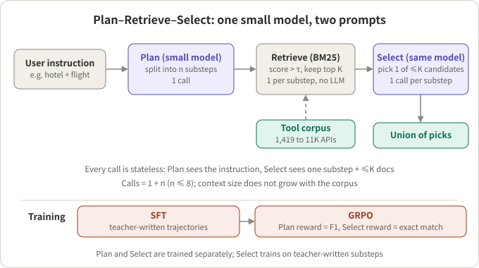
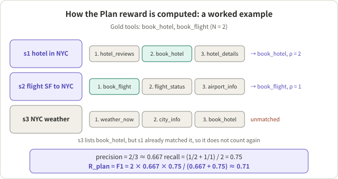
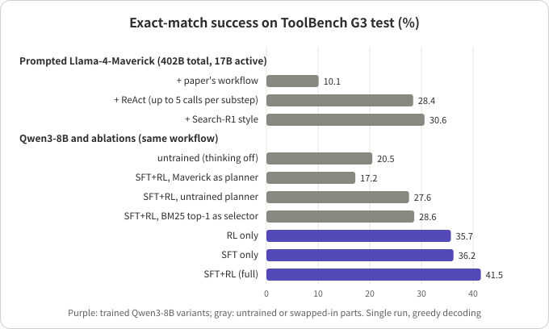

## Summary

With a tool corpus of thousands to tens of thousands of APIs, an agent cannot put every tool description in context, so "which tool does this step need" becomes a separate decision that precedes execution. The paper *Training Small Language Models for Transferable Tool Selection* (arXiv 2610.31483, 2026-10-22) by Zhaoyi Zhou, Akshayaa Magesh, Jeongyeol Kwon, Artem Kuriksha, Daniel Jiang, Andrea Zanette and Ayush Jain (Meta and Carnegie Mellon University) hands that decision to a small model. The model first splits the user instruction into substeps (Plan), runs one BM25 retrieval per substep (Retrieve), and then picks one tool from at most K candidates (Select). Qwen3 at 1.7B, 4B and 8B is first fine-tuned (SFT) on trajectories written by a teacher model, then trained with GRPO. All rewards are computed automatically from existing gold tool sets, with no extra human labels.

On the ToolBench G3 test split, counting an instruction as solved only when the selected tool set equals the gold set exactly, the 8B model reaches 41.5%; the best prompting protocol for Llama-4-Maverick reaches 30.6%. The trained models also run on four other benchmarks and on another retriever without retraining.

My reading: this is a small, clean engineering paper. Its value is a reproducible recipe (workflow, rewards, hyperparameters and prompts are all written out), and ablations that show the main source of the gain is the **trained Plan stage**, not model scale and not RL by itself. What needs discounting: "beats a 402B model" compares against a prompted baseline that is also the teacher; most of the cross-domain gain comes from SFT, with RL adding only 0.5 to 13.6 points on new domains; every number is a single run, and no model, data or code is released.

## Key conclusions

- **Verdict: borrow the design, not the leaderboard position.** Tool selection becomes a small-model subroutine whose calls are stateless with a bounded context: 1 + n calls (n substeps, at most 8), with context size independent of corpus size.
- **The gain comes mainly from trained decomposition.** The full 8B model scores 41.5%. Swapping the planner for Llama-4-Maverick drops it to 17.2%, for untrained Qwen3-8B to 27.6%; replacing Select with "take the BM25 top-1" drops it to 28.6%. Both stages need training, and Plan matters more.
- **SFT does the heavy lifting; RL adds on top.** At 8B, SFT alone gives 36.2% and RL alone 35.7%, about the same; RL after SFT reaches 41.5%. On the four transfer benchmarks, SFT adds 10.7 to 18.8 points over the untrained model, and RL adds another 1.9 to 6.8 (8B).
- **"Beats Maverick" depends on the setup.** Under the same workflow it is 41.5% vs 10.1%, but Maverick is not fine-tuned and is also the teacher that produced the SFT data; its best protocol (Search-R1 style) reaches 30.6%. On TaskBench Maverick is 7.8 points higher, though with 103 instructions that gap is about 8 instructions.
- **The scope is narrow.** The paper assumes each substep maps to exactly one tool and substeps are independent, and it scores only the selected set, not argument filling or execution. Dependent tool chains are out of scope.

## A few concepts first

- **Tool selection vs tool calling.** Tool selection answers only "which tools are needed"; tool calling also fills arguments, executes and handles results. This paper does only the former, and evaluation looks only at the selected set.
- **Retrievers.** BM25 is lexical: it scores a tool by how query terms appear in its documentation, weighting rare terms more, and needs no training. COLT is dense: an encoder trained on ToolBench maps instruction and tool descriptions into one vector space and ranks by similarity. A retriever produces a relevance ranking; it does not know which tools the task actually needs.
- **Threshold τ and cap K.** After each substep's retrieval, only tools scoring above τ are kept, then truncated to the top K. Defaults are τ = 3 and K = 15 (on the BM25 score scale). K sets how many tool documents the Select stage reads.
- **Exact-match success rate.** An instruction succeeds if and only if the selected tool set equals the gold set; an extra tool, a missing tool or an unparseable action all fail. This is stricter than Recall@K or NDCG@K from the retrieval literature, which only require gold tools to *appear* in the candidate list.
- **Gold-set filtering.** ToolBench gold tools come from reference solution trajectories, so some cannot be inferred from the instruction and some are near-duplicates. The paper keeps a (instruction, tool) pair only if the tool can be identified from the instruction alone: a shared-content-word rule first, then the teacher model for the rest. On the G3 test split, 2,124 of 2,373 instructions (89.5%) survive, and all G3 numbers are computed on this filtered set.
- **Teacher model and SFT warm start.** RL from a base model starts slowly because the base rarely completes the workflow. The paper has Llama-4-Maverick write decompositions and selection rationales, fine-tunes the small model on them so it learns the output format and basic reasoning, then runs RL.
- **GRPO.** A policy-gradient method without a value network: sample a group of responses per prompt (16 here), normalize each reward by the group's mean and standard deviation to get an advantage, then update with a clipped objective and a KL penalty.
- **Stateless calls.** Each call holds one system prompt and one user message, re-rendered from structured state; the model never sees a growing transcript. Plan sees only the instruction; Select sees only the current substep and at most K candidates.



*Figure 1: An illustration drawn from Section 3 and Algorithm 1 of the paper. One small model serves both Plan and Select under two prompts.*

## 1. The workflow: one model, two prompts, 1 + n calls

**Conclusion: the design caps context cost, at the price of handling only independent substeps.**

The algorithm is short:

```
Input: instruction x, model π, retriever R, threshold τ, cap K
1  π_Plan splits x into substeps s1..sn; T ← ∅
2  for each si:
3      R scores every tool against si
4      Ci ← tools with score > τ, truncated to top K
5      if Ci is empty: continue
6      π_Select picks one tool id from Ci
7      T ← T ∪ ({id} ∩ Ci)
8  return T
```

Details worth noting:

- **Why decompose first.** When the retriever scores the whole instruction, the terms of one request interfere with retrieval for another. Split into "book a hotel in NYC" and "book a flight from SF to NYC", each retrieves better on its own.
- **The substep text is the query.** The model does not write a separate search query, and each substep retrieves once. A ReAct-style loop, in contrast, writes its own query each turn and may search up to four times.
- **The pick is intersected with the candidates.** `{id} ∩ Ci` drops any invented id that is not in the candidate list.
- **The Select prompt keeps the original instruction.** The Select prompt in Appendix D starts with `User task: {query}` to recover details the decomposition may have dropped.

The cost bound can be checked by hand: one Plan call plus one Select call per substep, with at most 8 substeps in evaluation, so at most 9 LLM calls; a Select context holds at most K tool documents and one substep. Growing the corpus from 1,419 to 11,474 tools does not change the per-call context.

## 2. Training: what each stage does and which loss it uses

### 2.1 Data construction

All training uses only the ToolBench G3 training split: 21,361 instructions and 57,836 (instruction, gold tool) pairs, 2.71 tools per instruction on average.

| Step | Method | What survives |
|---|---|---|
| Gold filtering | Rule (shared content word) plus teacher judgment of "identifiable from the instruction" | 54,695 pairs (94.6%) |
| Decomposition | Teacher splits the instruction into substeps, each matched to one gold tool; unused gold tools are removed | another 1,928 tools removed |
| Discard | No gold tool left, or the teacher fails output validation three times | 1,268 instructions dropped (5.9%), 20,093 left |
| Rationales | Plan rationales are rewritten given the substeps, so they do not leak gold tools; Select rationales justify the pick among candidates | 19,841 Plan and 38,293 Select examples |

A validation step regenerates any rationale that names a tool outside the candidate set or leaks candidate indices.

### 2.2 Stage 1: SFT

- **What is trained:** all parameters, on a mix of Plan and Select examples.
- **Labels:** (prompt, rationale + action) pairs; the rationale sits in Qwen3's `<think>…</think>` block, followed by a JSON action.
- **Loss:** the paper says only "standard SFT", i.e. next-token cross-entropy on the target sequence:

```
L_SFT = − Σ_t log π(y_t | prompt, y_<t)
```

  Whether the loss is computed only on the response is not stated.
- **Hyperparameters:** LLaMA-Factory, DeepSpeed ZeRO-3, bf16; AdamW, learning rate 1e-5, cosine schedule, 3% linear warm-up, 3 epochs, effective batch 128 sequences, max length 4,096 (packed), 8×A100.

### 2.3 Stage 2: GRPO

- **What is trained:** all parameters, starting from the SFT checkpoint. For stability, Plan and Select are trained as separate stages: Select is trained on teacher-written substeps, not the model's own plans. Each stage is one stateless call with its own reward. Whether the two are trained one after the other or mixed in the same batches is not spelled out; the paper says only that the RL prompt set has "one Plan prompt per instruction and one Select prompt per teacher-written substep".
- **Plan reward:** with N gold tools and n emitted substeps, walk the substeps in order; for each, scan its retrieved list from highest score down and match the first gold tool not matched yet, recording its rank ρ. With n_cov matched substeps:

```
precision = n_cov / n
recall    = (1/N) · Σ_j 1/ρ_j          # sum over matched substeps
R_plan    = F1(precision, recall)
```

  Precision penalizes redundant or useless substeps; recall rewards covering each gold tool *and* getting it ranked high. Because the reward is computed through the retriever, the model learns to write substeps that let BM25 find the right tool.

- **Select reward:** exact match; 1 only when the pick is exactly the substep's gold tool:

```
R_sel = 1[ selected == {g} ]
```

- **GRPO itself:** following the original GRPO paper (Shao et al., 2024), sample G responses per prompt, set the advantage to `A_i = (r_i − mean(r)) / std(r)`, and optimize a clipped ratio objective with a KL penalty. This paper uses VeRL, with rollouts from vLLM.
- **Hyperparameters:** learning rate 1e-6, constant; 300 steps; 64 prompts per batch; 16 rollouts per prompt; sampling temperature 0.9; KL coefficient 0.001; 1 update per batch; up to 4,096 tokens for prompt and for completion; 8×A100. The same values at all three scales.
- **Not given:** the training reward for malformed output (it counts as failure in evaluation), and how many steps go to Plan vs Select.



*Figure 2: An illustration; the example is mine, the algorithm follows Section 3.3 of the paper. s1 finds book_hotel at rank 2, s2 finds book_flight at rank 1; s3 also lists book_hotel, but s1 already matched it, so s3 is unmatched. Precision = 2/3, recall = (1/2 + 1) / 2 = 0.75, F1 ≈ 0.71.*

## 3. Results: the full tables

### 3.1 ToolBench G3 (training domain)

2,124 test instructions, a corpus of 1,419 APIs, BM25, τ = 3, K = 15. All models use greedy decoding.

| Method | Success (%) |
|---|---|
| Llama-4-Maverick (prompted) + ReAct | 28.4 |
| Llama-4-Maverick + hierarchical search (AnyTool style) | 8.6 |
| Llama-4-Maverick + Search-R1 style | 30.6 |
| Llama-4-Maverick + paper's workflow | 10.1 |
| Qwen3-1.7B (SFT+RL) + paper's workflow | 37.6 |
| Qwen3-4B (SFT+RL) + paper's workflow | 40.3 |
| Qwen3-8B (SFT+RL) + paper's workflow | 41.5 |

Llama-4-Maverick is a 128-expert MoE with 402B total and 17B active parameters. The paper itself notes that in active parameters it is only about twice the 8B model.

### 3.2 Transfer to new tool corpora

The same checkpoints, with no retraining, on four benchmarks. ToolBench G2 is a larger split of the same RapidAPI universe (11,474 tools, about 9% shared with G3, 7,238 instructions after filtering). Gorilla (598 instructions, three model hubs) and CRAFT (654, math, tabular and visual QA) have exactly one gold tool per instruction, so no Plan stage is needed and they test Select. TaskBench (103 instructions, three splits with 23 to 40 tools each, 2.6 tools per instruction on average) tests both Plan and Select. The last three use the original gold labels without filtering.

| Method | ToolBench G2 | Gorilla | CRAFT | TaskBench |
|---|---|---|---|---|
| Maverick + ReAct | 15.6 | 16.0 | 18.0 | 60.2 |
| Maverick + Search-R1 style | 20.8 | 15.9 | 41.0 | **80.6** |
| Maverick + paper's workflow | 4.4 | 9.2 | 47.9 | 36.9 |
| Qwen3-1.7B untrained | 0.9 | 5.5 | 44.8 | 5.8 |
| Qwen3-4B untrained | 4.4 | 8.7 | 49.7 | 45.6 |
| Qwen3-8B untrained | 11.2 | 8.0 | 53.4 | 55.3 |
| Qwen3-1.7B SFT | 21.8 | 17.6 | 64.7 | 54.4 |
| Qwen3-4B SFT | 23.0 | 14.5 | 65.9 | 59.2 |
| Qwen3-8B SFT | 23.9 | 26.8 | 66.4 | 66.0 |
| Qwen3-1.7B SFT+RL | 23.7 | 21.2 | 67.9 | 63.1 |
| Qwen3-4B SFT+RL | 23.5 | 19.7 | 68.2 | 72.8 |
| Qwen3-8B SFT+RL | **25.8** | **29.9** | **69.0** | 72.8 |

Three things I read from this table:

- **Absolute numbers on G2 are low.** 41.5% in-domain on G3 becomes 25.8% on G2. The paper attributes this to an 8× larger corpus with more distractors, which pushes gold tools deeper in the BM25 ranking.
- **On CRAFT an untrained small model already wins.** Untrained Qwen3-8B with the paper's workflow scores 53.4%, above Maverick on the same workflow at 47.9%. With a single tool and few candidates, Select itself is not hard; decomposing multi-tool instructions is.
- **The TaskBench gap needs its sample size.** 72.8% is 75/103 and 80.6% is 83/103, a difference of 8 instructions. By the binomial formula, the two proportions have standard errors of about 4.4 and 3.9 points, and the difference is about 1.3 times the combined standard error, so not significant for a single run. The paper's explanation ("Plan needs some domain knowledge") is a reasonable guess, but the evidence is thin.

### 3.3 Swapping the retriever

Replacing BM25 with COLT (a dense retriever trained on ToolBench G3), with τ = 0.6, K unchanged and the same checkpoints and prompts, raises G3 success at all three scales. The text gives no exact numbers, only a bar chart, so I do not quote values. Note that the experiment is run only in the training domain G3, with a retriever trained for G3; a new domain and a new retriever at the same time are not tested.

## 4. Where the gain actually comes from

**Conclusion: training Plan matters most, training Select second; RL adds on top of SFT but is not the main cause.**



*Figure 3: Redrawn from the paper's Table 1 and Figure 5; all bars are the 8B checkpoint or Maverick on the G3 test split.*

| Comparison | Success (%) | My reading |
|---|---|---|
| Full SFT+RL (8B) | 41.5 | reference |
| Plan replaced by Llama-4-Maverick | 17.2 | The large model is the worst planner: its substeps are not written for BM25 |
| Plan replaced by untrained Qwen3-8B | 27.6 | Plan training contributes about 14 points |
| Select replaced by BM25 top-1 | 28.6 | Select training contributes about 13 points |
| SFT only | 36.2 | |
| RL only (from base) | 35.7 | About the same as SFT only |
| Untrained base (thinking off) | 20.5 | |
| K from 5 to 30 | about 38 to 44 | No gain past K = 20; default 15 |

My judgments:

- **"Training beats scale" holds for Plan.** Maverick as planner scores 17.2%, 10 points below untrained Qwen3-8B. My inference: since the Plan reward is computed through BM25, the trained model learns to write BM25-friendly substeps (wording close to tool docs), while Maverick writes more natural substeps that may miss the docs' terms. That also means what Plan learns is somewhat tied to the training retriever; the gain when swapping to COLT suggests the tie is not strong enough to break transfer.
- **RL's margin in-domain is 5.3 points.** With 2,124 instructions and success around 40%, the standard error is about 1.1 points, so the gap is real. But RL only and SFT only are nearly the same, which suggests SFT mostly gives RL a better starting point.
- **On transfer benchmarks SFT does most of the work.** At 8B, SFT adds 12.7, 18.8, 13.0 and 10.7 points over the untrained model on G2, Gorilla, CRAFT and TaskBench; RL then adds 1.9, 3.1, 2.6 and 6.8. At 4B, RL adds only 0.5 on G2.

## 5. Checking the text against the tables

- **Units.** The text says "ReAct exceeds our workflow by 18%" and "the learned selector improves success by about 13%". From the tables these are 28.4 − 10.1 = 18.3 and 41.5 − 28.6 = 12.9, both percentage points, not relative percentages.
- **"Beats a 402B model".** The comparison is with few-shot, greedy, prompted Maverick that got no equivalent fine-tuning; Maverick is also the teacher that generated SFT data and filtered the gold sets. In active parameters it is 17B vs 8B. Maverick wins on TaskBench, which the body acknowledges and the abstract does not.
- **The base comparison is not fully like-for-like.** Untrained models run with thinking disabled (native thinking often exhausted the generation budget), while trained models run with thinking on. Part of the "base to SFT" gain may come from that difference; the paper does not separate it.
- **Single runs.** The appendix says repeated runs of the same checkpoint differ by one or two instructions; no number has a confidence interval.
- **The evaluation set is filtered.** G3 and G2 numbers are on teacher-filtered gold sets, with about 10% to 12% of test instructions removed. Those removed are exactly the ones whose gold tools cannot be inferred from the instruction, so the filtered task is cleaner than raw ToolBench, and absolute values cannot be compared directly with ToolBench numbers from other papers.
- **Nothing is released.** Appendix C states that the curated gold sets, SFT trajectories, checkpoints and code are not released; prompts, hyperparameters and software versions are given for re-implementation.

## 6. When it pays to hand "which one" to a small model

**Conclusion: split it out when tools are many, calls are frequent and subtasks are independent; do not when tools are few, steps depend on each other, or decomposition needs domain knowledge.**

| Situation | Split or not | Precondition or reason |
|---|---|---|
| Thousands of tools, too many for the main model's context | Split | The paper's core setting; Select context is at most K docs |
| Tool selection is on the critical path of every request, at high volume | Split | 1 + n calls to an 8B model that can be self-hosted; requires gold tool sets to train on |
| Trajectory logs exist that show which tools each instruction used | Split | Rewards are computed from gold sets with no extra labels; but first filter out tools that the instruction does not call for, as the paper does |
| Only a few dozen tools that fit in context | Don't | Splitting adds a call and a failure point |
| The next tool depends on the previous tool's output | Don't, or use another method | The paper assumes independent substeps; Select does not see earlier results |
| Decomposition needs domain knowledge (TaskBench-like) | Be careful | The paper itself loses here to a large model without decomposition (Search-R1 style) |
| Arguments and whether to call must be decided too | Not enough | The paper scores only the selected set, not arguments or execution |

Comparison caveats:

- **Cost.** The paper reports no latency, throughput or token counts; only call counts can be inferred from the structure. ReAct style uses up to 5 calls per substep, this workflow 1; but the generation length per call (including `<think>`) is not reported.
- **For a streaming voice agent**, tool selection usually sits on the critical path between the user finishing and the agent starting to speak. My inference: since substeps are independent, the n Select calls can run in parallel, cutting the critical path to one Plan plus one Select call. The paper neither discusses nor measures this.

Ideas to borrow directly:

- **Stateless, re-rendered calls.** Each call carries only what it needs, with a hard context bound. This is the same idea as showing an agent only what the current step needs, and it applies to picking the few applicable rules or guidelines out of many; see the tiered matching in [Parlant's New Direction: the Compass Engine Source]({{ '/en/parlant-compass-engine-walkthrough/' | relative_url }}).
- **Compute the reward through a downstream component.** The Plan reward does not compare substep text; it asks whether the substep lets the retriever rank the right tool high. Wherever an LLM's output feeds a fixed component, this avoids hand-labelling the intermediate output.
- **Intersect with the candidate set.** One line, `{id} ∩ Ci`, removes invented tool names.
- **Clean labels before training.** "Gold tools" recovered from trajectories are not all asked for by the instruction. Without cleaning, the model is trained to pick things the user did not request.
- **Use the strictest metric.** Exact set equality, where both extra and missing tools fail, is closer to the cost at execution time than Recall@K.

## Conclusion

The paper answers a specific question: for tool selection over a large corpus, can prompting a large model be replaced by training a small one? Within its scope (independent substeps, one tool per step, selection only), yes; 8B and even 1.7B beat prompted Maverick. The ablations show the main gain comes from trained decomposition, learned around the retriever. Caveats remain: the baseline is not fine-tuned, transfer gains come mostly from SFT, TaskBench is too small, and nothing is released. For people building agent runtimes, the more useful part is the structure: stateless calls, bounded context, and rewards computed automatically by a downstream component.

## References

- Zhou et al., [Training Small Language Models for Transferable Tool Selection](https://arxiv.org/abs/2610.31483), arXiv 2610.31483, 2026 ([PDF](https://arxiv.org/pdf/2610.31483))
- Qin et al., [ToolLLM: Facilitating Large Language Models to Master 16000+ Real-world APIs](https://github.com/OpenBMB/ToolBench), ICLR 2024 (ToolBench)
- Qu et al., Towards Completeness-Oriented Tool Retrieval for Large Language Models, CIKM 2024 (COLT, [checkpoint](https://huggingface.co/Tool-COLT/contriever-base-msmarco-v1-ToolBenchG3))
- Shao et al., [DeepSeekMath](https://arxiv.org/abs/2402.03300), arXiv 2402.03300, 2024 (GRPO)
- Jin et al., [Search-R1](https://openreview.net/forum?id=Rwhi91ideu), COLM 2025
- Shi et al., [Retrieval Models Aren't Tool-Savvy](https://aclanthology.org/2025.findings-acl.1258/), Findings of ACL 2025 (ToolRet, which packages Gorilla, CRAFT and TaskBench in one format)

**To verify:** (1) The paper says the filtered gold set is "used for both training and evaluation", but the decomposition step also removes 1,928 gold tools the teacher judged unnecessary (mentioned only in the training-data statistics of Appendix A.2); whether that step is applied to the test set is not stated. (2) Figure 4 (retriever swap) and Figure 5b (K sweep) are charts only, with no exact values in the text; the K range above is read approximately off the axis.

*Note: all success rates come from the paper's Tables 1 and 2 and Figure 5 and are the authors' single-run results, not reproduced by me; standard errors, point differences and instruction counts are my hand calculations from the sample sizes the paper gives.*
