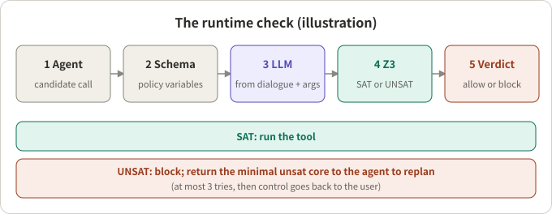
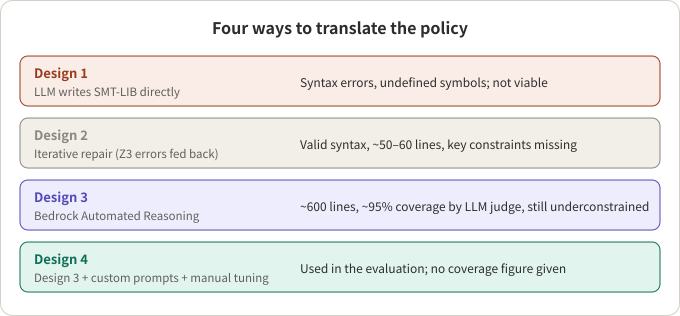

## Summary

Customer-service agents call write tools such as rebook, cancel and refund, while the business policy (cancellable within some hours, which fare classes can change) usually lives as natural language in the system prompt. A prompt does not guarantee the model complies. In March 2026, Cailin Winston, Claris Winston and René Just (University of Washington) proposed translating tool-use policy into SMT-LIB 2.0 constraints. Before each write call, an LLM extracts the variable values from the conversation and Z3 decides: satisfiable (allow) or unsatisfiable (block).

My reading: the design splits "the model understands the policy" into "the model extracts facts" and "a solver decides", which gives a clear and auditable boundary. But the paper itself admits that formalising the policy still needs a human, the value-extraction step is not verified, only one domain is evaluated, and most numbers appear in figures rather than text. Treat it as an architecture worth borrowing, not as a quantitatively proven method.

## Key conclusions

- The paper treats "is this tool call compliant" as a constraint-satisfaction problem checked before execution, not as output filtering afterwards.
- The hard part is translation, not solving: of four ways to go from natural language to SMT-LIB, only the "automated reasoning tool + custom prompts + manual tuning" version was used in the final evaluation.
- With the checker, invalid write calls drop to 29% of all write calls; the baseline had "roughly equal" valid and invalid write calls. The price is fewer correct write calls (slightly lower recall).
- Success falls by 26% as k grows with the checker versus 40% for the baseline (the paper's wording; exact pass^k values are only in figures).
- The guarantee holds only if value extraction is right and the encoding is complete; neither step is formally verified.

## A few concepts first

**SMT and Z3.** An SMT (satisfiability modulo theories) solver decides whether a set of logical constraints can hold together. Z3 is a widely used one. Given "policy constraints + current facts" it answers SAT (some assignment satisfies everything, so the call does not violate the policy) or UNSAT (they cannot all hold, so it does).

**Minimal unsatisfiable core.** On UNSAT the solver can point to the constraints that conflict. The paper puts that core into the retry prompt as the explanation for the block; it does not describe the core's format.

**pass^k.** The reliability metric from τ-bench: repeat a task k times and measure whether it succeeds consistently. The τ-bench authors report that function-calling agents such as gpt-4o succeed on under 50% of tasks, with retail pass^8 under 25%.

**Precision and recall of write calls.** The paper counts write tool calls: high precision means most issued writes are compliant; high recall means the writes that should happen are not missed.

## Method

### Policy translation (human-guided)

A domain expert (with LLM-drafted starting points) writes the policy as SMT-LIB 2.0: uninterpreted constants, enum-like sorts, predicates and assertions over agent-observable state and tool arguments. The authors encode only tool-use policy and set other behavioural rules aside, to isolate the effect of runtime enforcement.

Each tool gets a validation schema: the policy variables it needs, their types, and a designated policy predicate. Unconditionally allowed tools have an empty schema and are not checked.

### Runtime pipeline

*Figure 1: The runtime check (an illustration drawn from the paper's description).*

1. The agent proposes a candidate tool call.
2. The checker fetches the tool's schema.
3. An LLM extracts concrete variable values from the conversation history and tool arguments.
4. The values become assertions appended to the static encoding; the policy predicate is the condition handed to Z3.
5. SAT runs the call. UNSAT blocks it and the minimal unsat core goes into the prompt so the agent replans, at most three times, after which control returns to the user.

The split is clear: the LLM extracts values and drafts; Z3 decides.

## How hard is the translation?

*Figure 2: Four designs and the outcomes the paper reports (compiled from the paper's text).*

| Design | Approach | Outcome |
|---|---|---|
| 1 | LLM writes SMT-LIB directly (Proof-of-Thought style) | Frequent syntax errors and undefined symbols; judged not viable |
| 2 | Iterative repair, Z3 errors fed back to the LLM | Valid syntax, about 50–60 lines, but essential constraints missing |
| 3 | AWS Bedrock Automated Reasoning | About 600 lines, "around 95% coverage" by an LLM judge, still underconstrained |
| 4 | Design 3 + custom prompts + manual tuning | Used in the evaluation; no coverage figure given |

The paper's example of underconstraint is typical: a cancellation rule says "allowed within 24 hours" but never says "forbidden outside it". With no prohibition, the solver finds the call satisfiable and the violating call goes through. This is the usual "implicit negation and exclusivity left unstated" problem in formalising rules.

## Setup and results

Setup: the airline domain of τ²-bench, 50 tasks, 13 tools and a 1,242-word policy document; GPT-4.1 for the customer and service agents, GPT-4o for tool-call validation; k=4 trials per task, reporting pass^1 to pass^4 plus write-call precision and recall.

| Question | What the paper's text says |
|---|---|
| Violating writes | Baseline: roughly equal valid and invalid write calls; with the checker, invalid calls are 29% of all write calls |
| Recall | Fewer correct write calls than the baseline; the authors call it a precision/recall trade-off |
| Overall success | Similar, slightly better with the checker |
| Decline as k grows | 26% with the checker, 40% for the baseline |

Note that the paper has no numeric table. The main data is in Figures 3 and 4, and the text gives neither the baseline's invalid fraction nor the pass^k values; the baseline definition behind "26% vs 40%" is also not spelled out. Quote only what the table above says.

## Checking the text against the evidence

- 29% of write calls are still invalid with the checker, so it reduces violations rather than removing them. My inference: the cause could be underconstrained encodings, extraction errors, or policy that was never encoded; the paper does not break this down.
- "Maintains accuracy" and "recall drops" should be read together: blocking costs some correct actions, in exchange for steadier behaviour.
- There is no ablation. The Design 1 to 4 progression is the closest comparison, but it compares translation quality, not the contribution of runtime components.
- One domain, one benchmark and one hand-tuned encoding; whether this transfers is not answered.

## Is it worth it? An engineering view

**Where it pays off (each with a precondition).**

- Policies that reduce to explicit conditions: time windows, state enums, amount caps. Precondition: someone maintains the formal encoding.
- Costly, irreversible writes (refund, cancel) where an extra block is cheaper than a wrong action. Precondition: users tolerate an occasional "please confirm".
- Settings that need an audit trail: every allow or block traces to constraints.

**Where it does not, or needs care.**

- Policies full of judgement calls ("at the agent's discretion"). These are hard to encode and stay with the model, or call for evaluating policy ambiguity directly (for example the DRIP-R benchmark, which I have only seen through a search summary).
- For a streaming voice agent, an LLM extraction plus a solver call before each write adds latency. My inference: enable it only for write tools that have a schema and skip read-only tools, as the paper does.
- Value extraction becomes a new single point of failure: if it extracts wrong facts, the solver will "correctly" allow or block on them.

**Ideas to borrow directly.**

- Separate fact extraction from rule evaluation, and keep the rules in a deterministic component.
- Have each tool declare the policy variables it needs; skip checks for unconditional tools.
- On a block, return the minimal conflicting reason, not just "not allowed"; cap replanning and hand back to the user.
- Write both the "allowed" and the "forbidden" side of each rule, to avoid implicit negation.
- Evaluate violation rate and recall together, and watch stability with pass^k, not single-run success.

## Conclusion

The paper's value is architectural: a solver turns policy compliance into an auditable decision and points at translation as the real difficulty. The evidence is thin: one domain, a hand-tuned encoding, numbers mostly in figures. It is a good design reference; the effect needs re-checking on your own policies and tools.

## References

- [Solver-Aided Verification of Policy Compliance in Tool-Augmented LLM Agents (arXiv 2603.20449)](https://arxiv.org/abs/2603.20449), Cailin Winston, Claris Winston, René Just, University of Washington
- [τ-bench: A Benchmark for Tool-Agent-User Interaction in Real-World Domains (arXiv 2406.12045)](https://arxiv.org/abs/2406.12045), Shunyu Yao, Noah Shinn, Pedram Razavi, Karthik Narasimhan
- [DRIP-R (arXiv 2605.07699)](https://arxiv.org/abs/2605.07699), mentioned only as a pointer to the policy-ambiguity direction

Related reading: [Parlant's New Direction: From Guidelines to Unified Rules]({{ '/en/parlant-compass-engine-walkthrough/' | relative_url }}).

*Note: all numbers come from the paper's prose and were not independently reproduced; "my inference" marks personal judgement.*
