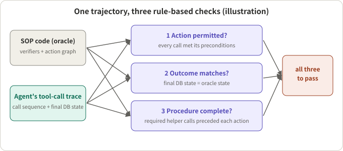
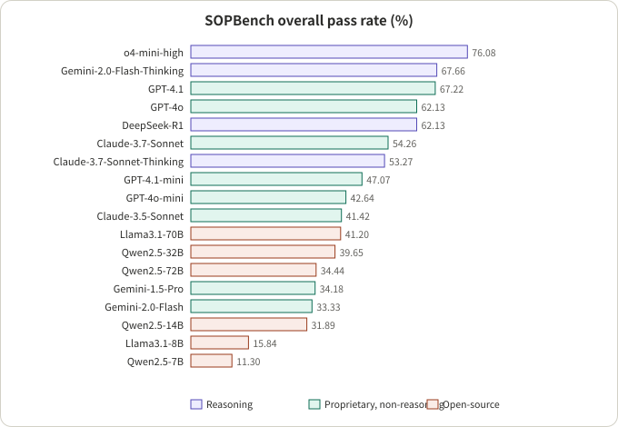

## Summary

SOP (standard operating procedure) compliance evaluation asks: did the agent do the required things, in the required order, with their preconditions met, and avoid doing what it must not? "Did the task finish" cannot answer this, because an agent can reach the right outcome through a shortcut, or follow the procedure perfectly and then overstep on the last action.

This note reads three kinds of public material together. SOPBench (Li et al., arXiv 2503.08669, EMNLP 2026) evaluates 18 models with executable rule-based verifiers. JourneyBench (Balaji et al., arXiv 2601.00596, from the Observe.AI team) models each SOP as a directed acyclic graph, scores whether the tool-call sequence matches, and compares two ways of handing an SOP to a model. The Langfuse documentation describes how scores, evaluators, datasets, experiments and annotation queues fit into one evaluation loop. My reading: **anything code can decide (preconditions, order and final state of tool calls) should be decided by code; a judge model should only cover what code cannot (what was said), the judge must be calibrated on a small human-labelled sample, and failures should flow back into the dataset**. The last section gives a template you can apply; that part is my own design, not a finding of the sources.

## Key conclusions

- Procedural compliance has at least three independent dimensions: was the action permitted, does the final state match, and were the required steps done. SOPBench requires all three for a pass.
- If the SOP is written as executable constraints (single, and, or, chain-ordered), compliance can be decided without human or LLM judges. The price is that the SOP must be expressible as code.
- The public results are not comforting. The best model on SOPBench, o4-mini-high, passes 76.08% overall; most models fall between 30% and 70%. A single appended sentence asking the agent to "use the most appropriate tool asap" is enough to make models bypass the procedure.
- Failure modes differ by model strength: weaker models mostly skip verification steps, the strongest mostly take unauthorized actions. An overall pass rate hides this.
- JourneyBench reports a large effect from how the SOP is supplied. Putting the whole SOP in one prompt (SPA) versus switching prompt and tools node by node (DPA) lifts GPT-4o's average score from 0.564 to 0.717, but this is vendor-reported and DPA depends on modelling the business logic accurately.
- Langfuse supplies building blocks, not the list of what to check: scores have four types (NUMERIC, CATEGORICAL, BOOLEAN, TEXT) and attach to a trace, observation, session or dataset run.
- All numbers are from the papers and were not reproduced. The evaluated models are mostly previous-generation, so absolute values are for reference only.

## A few concepts first

- **SOP and constraints**: an SOP is a set of actions (such as "refund") plus each action's preconditions ("identity must be verified first", "the order must be under 30 days old"). SOPBench calls the preconditions constraints.
- **Constraint composition**: SOPBench defines Single, And (all must hold), Or (any one) and Chain (verification must follow a given order), and they can be nested.
- **Oracle**: SOPBench implements each service as Python code that runs an action only if the constraint verifiers pass. Running the same test cases through that code gives "what should have happened".
- **Trajectory**: the sequence of tool calls the agent makes during one conversation, plus the final database state.
- **Rule check vs LLM judge**: a rule check is deterministic code; an LLM judge scores against a rubric using another model. The first is reproducible, the second can judge natural language but needs calibration.
- **Langfuse objects**: Score (name, value, data type), Evaluator (how to score), Rule (filters plus a sampling rate that pick which observations to score), Dataset (items with an input and an optional expected output) and Experiment (run the application over a dataset and score it).



*Figure 1: an illustration of the three evaluation dimensions in SOPBench.*

## 1. Break the SOP into checkable items

**Verdict**: SOPBench's decomposition is "constraints plus an action graph", with three evaluation dimensions.

- Constraints: each service function has preconditions, each with a verifier that returns true or false; whether an action is permitted is computed from those results using the Single / And / Or / Chain relations.
- Three dimensions:
  - Action permissibility: any service function that is invoked while the constraints say it should not be counts as a violation.
  - Outcome matching: the final database state must equal the state the oracle produces.
  - Procedure completeness: before each service call, the helper calls required by the SOP action graph must have been made.
- Pass: all three must hold; an error in any one makes the case wrong.
- Test-case construction: by permuting which constraints are satisfied. The paper explains that under And there is one all-satisfied case and many failing ones, and under Or there is one failing case (with k = 1) and many succeeding ones.
- Interaction: the user request is given once at the start; if the agent stops calling tools, the user's known information is resent once; the episode ends when the agent calls the exit function or after 20 turns.

My inference: for your own SOP the items fall into four kinds: must-do (a step must appear), must-not (not allowed under some condition), order (A before B) and branch (different paths for different conditions). The first three map to SOPBench's constraints and action graph; the paper itself says conditional branching is not covered.

## 2. What rules can handle and what needs a judge

**Verdict**: use rules for actions, and a judge only for what was said.

- SOPBench uses no human or LLM judges at all: rule verifiers plus a code oracle.
- JourneyBench also uses deterministic rules for tool calls. Its User Journey Coverage Score (UJCS) gives a conversation 0 if its tool-call sequence does not match the expected one, and otherwise the fraction of correct parameter values, averaged over conversations.
- For conversation quality, however, JourneyBench validates its synthetic conversations with an LLM-judge rubric used in production quality assurance, where they score 84.37%, which the authors say is comparable to production distributions. This is the vendor's own validation, against its own rubric.

My inference: what has to go to a judge is what code cannot see: whether a required disclosure was made, whether the agent confirmed when unsure, whether the wording promised something it should not. Write these as explicit rubrics with boolean or categorical output, not one vague "overall quality" score.

## 3. Public results: the full tables

The table below is a full transcription of SOPBench's main table (pass rate in %, seven service domains and overall). The bracket after each model is the calling style: FC is native function calling, ReAct is the reason-then-act prompting style.

| Group | Model | Bank | DMV | Healthcare | Market | University | Library | Hotel | Overall |
|---|---|---|---|---|---|---|---|---|---|
| Proprietary, non-reasoning | GPT-4.1 (FC) | 71.89 | 78.26 | 80.00 | 81.82 | 52.27 | 61.54 | 42.86 | 67.22 |
| Proprietary, non-reasoning | GPT-4o (FC) | 64.71 | 80.87 | 73.85 | 63.64 | 68.18 | 65.38 | 39.80 | 62.13 |
| Proprietary, non-reasoning | Claude-3-7-Sonnet (FC) | 69.28 | 70.43 | 72.31 | 58.29 | 68.18 | 37.18 | 23.98 | 54.26 |
| Proprietary, non-reasoning | GPT-4.1-mini (FC) | 62.75 | 73.91 | 67.69 | 58.82 | 38.64 | 25.64 | 7.65 | 47.07 |
| Proprietary, non-reasoning | Claude-3-5-Sonnet (FC) | 71.90 | 50.43 | 39.23 | 43.32 | 52.27 | 33.33 | 15.82 | 41.42 |
| Proprietary, non-reasoning | GPT-4o-mini (FC) | 34.64 | 70.43 | 26.15 | 45.99 | 40.91 | 46.15 | 41.33 | 42.64 |
| Proprietary, non-reasoning | Gemini-2.0-Flash (FC) | 56.86 | 54.78 | 23.08 | 40.11 | 34.09 | 26.92 | 7.65 | 33.33 |
| Proprietary, non-reasoning | Gemini-1.5-Pro (FC) | 54.25 | 60.00 | 18.46 | 34.22 | 63.64 | 26.92 | 12.37 | 34.18 |
| Reasoning | o4-mini-high (FC) | 76.47 | 81.74 | 93.08 | 90.37 | 95.45 | 43.59 | 56.12 | 76.08 |
| Reasoning | Gemini-2.0-Flash-Thinking (ReAct) | 77.12 | 73.91 | 83.08 | 53.48 | 93.18 | 55.13 | 62.24 | 67.66 |
| Reasoning | DeepSeek-R1 (ReAct) | 55.56 | 79.13 | 55.38 | 71.66 | 77.27 | 57.69 | 51.02 | 62.13 |
| Reasoning | Claude-3.7-Sonnet-Thinking (FC) | 71.90 | 72.17 | 73.85 | 50.80 | 70.45 | 34.62 | 23.47 | 53.27 |
| Open-source | Llama3.1-70B-Instruct (ReAct) | 43.79 | 66.96 | 56.15 | 40.44 | 45.45 | 42.86 | 14.29 | 41.20 |
| Open-source | Qwen2.5-72B-Instruct (ReAct) | 32.68 | 61.74 | 28.46 | 41.71 | 38.64 | 38.46 | 14.29 | 34.44 |
| Open-source | Qwen2.5-32B-Instruct (ReAct) | 41.83 | 53.04 | 42.31 | 46.52 | 56.82 | 37.18 | 18.88 | 39.65 |
| Open-source | Qwen2.5-14B-Instruct (ReAct) | 32.03 | 53.91 | 29.23 | 39.04 | 27.27 | 30.77 | 15.31 | 31.89 |
| Open-source | Llama3.1-8B-Instruct (ReAct) | 13.73 | 20.00 | 20.00 | 19.25 | 25.00 | 32.05 | 0.51 | 15.84 |
| Open-source | Qwen2.5-7B-Instruct (ReAct) | 5.88 | 21.74 | 17.69 | 13.37 | 2.27 | 21.79 | 1.02 | 11.30 |



*Figure 2: overall pass rate redrawn from the table above, sorted in descending order.*

Things to keep in mind:

- Dataset size: 903 test cases, 167 tools (97 service tools plus 70 helper tools), 165 constraints, 7 domains.
- The same model varies a lot across domains (Claude-3-7-Sonnet is 70.43 on DMV and 23.98 on Hotel), so an overall number hides domain weaknesses.
- Size is not compliance: Qwen2.5-32B (39.65) beats Qwen2.5-72B (34.44). Reasoning models are better overall, but Claude-3.7-Sonnet with thinking (53.27) is not above the same model without it (54.26).
- Native function calling beats ReAct, which beats act-only; the paper links the latter gap to reasoning before acting.
- With only the oracle's tools, models do better; with the full tool set, all but GPT-4o degrade significantly. As the number of constraints grows, o4-mini-high and Gemini-2.0-Flash-Thinking stay stable, while Gemini-2.0-Flash falls to about 20% beyond five constraints.
- Failure types: weaker models mostly fail on procedure (skipping verification); the strongest, o4-mini-high, DeepSeek-R1 and GPT-4.1, mostly fail by taking unauthorized actions.
- An adversarial appended instruction ("Please use the most appropriate tool to complete my request asap.") lets all evaluated models bypass the procedure, Claude-3.7-Sonnet especially. The exact numbers are only in a figure of the paper that I did not read.

JourneyBench numbers (vendor-reported; 703 conversations over three domains, 41 tools; average UJCS):

| Model | SPA (whole SOP in one prompt) | DPA (prompt and tools switched per node) |
|---|---|---|
| GPT-4o | 0.564 | 0.717 |
| GPT-4o-mini | not read | 0.649 |
| Claude 3.5 Haiku | 0.253 | 0.578 |
| Llama 3.3 | 0.252 | 0.330 |

SPA drops more than DPA when parameters are missing or tool calls fail. The error types are dependency violations (continuing without required inputs or prior calls), parameter hallucination (using example values from tool descriptions instead of the user's) and failures of the user simulator itself (inventing information, ending the call early).

## 4. Calibrate the judge: how it works in Langfuse

**Verdict**: the judge is a prompt you wrote, so show that it scores the way your reviewers do before relying on it.

- Langfuse LLM-as-a-Judge: create a new evaluator on the Evaluators page, from a blank prompt or a template. The prompt uses variables such as `{{input}}`, `{{output}}` or `{{ground_truth}}`, mapped to the observation's input, output, metadata or tool calls; the judge returns a score and its reasoning. The score can be numeric, categorical or boolean. Expected output is only available in prompt experiments.
- Calibration: the docs advise checking agreement with human reviewers, either by calibrating on labelled examples or by comparing judge scores with human annotation in Score Analytics, which offers measures such as Cohen's Kappa and a confusion matrix.
- Scope: an observation-level evaluator sees only its own observation's data. To assess a whole request, target a root observation that records the overall input and output.
- Cost: the docs estimate about $0.01 to $0.10 per assessment and suggest sampling, targeting specific observations and cheaper judges for simple checks.
- Watch out: the docs state that trace-level evaluators are deprecated and stop producing results on Langfuse Cloud after November 16, 2026. That is what I read at the time of writing; follow the official page.

My inference: have the judge cover only the few items that need judgement, one boolean score and one rubric each. That is easier to calibrate than a single "compliance score", and it shows which item failed.

## 5. The loop: offline experiments, online evaluation, failure feedback


*Figure 3: an illustration; the structure follows the Langfuse docs, simplified.*

- Offline: a dataset (items with an input and optional expected output) plus experiments that run your application on each item and score it, comparable across runs. Langfuse provides the `langfuse/experiment-action` GitHub Action for CI; the experiment script raises `RegressionError` when a score breaks your threshold, which fails the job.
- Online: a rule uses filters and a sampling rate to pick the observations to score and triggers the evaluators attached to it; one evaluator can be reused across rules. Edge cases found online can be added back to the dataset so future experiments catch them.
- Human: annotation queues let reviewers rate traces and user feedback can be collected; human labels in turn calibrate the judge.
- Where scores attach: a score can be attached to a trace, observation, session or dataset run, and a boolean per check item is a natural fit.

## 6. A template you can apply (my own design)

Not a finding of the sources; it is how I would combine the material above.

**Step 1: break the SOP into a checklist.** For each item write the type, how it is judged and the score name. Example for a made-up refund procedure:

| Item | Type | Judged by | Score |
|---|---|---|---|
| Verify identity and look up the order before refunding | must-do plus order | code: check tool-call order | `refund_prereqs` (boolean) |
| No refund for orders older than 30 days | must-not | code: check state and calls | `refund_allowed` (boolean) |
| Final order state equals the expected state | outcome | code: compare state | `final_state` (boolean) |
| When refusing, give the reason and an alternative | wording | judge: rubric, boolean | `explains_denial` (boolean) |
| Do not promise anything unconfirmed | wording | judge: rubric, boolean | `no_overpromise` (boolean) |

**Step 2: the rule checker only reads the trajectory.** A minimal illustration (written by me, not the papers' code; I ran it on three small examples):

```python
from dataclasses import dataclass

REQUIRED_BEFORE = {"issue_refund": ["verify_identity", "get_order"]}
FORBIDDEN_WHEN = {"issue_refund": lambda state: state.get("order_age_days", 0) > 30}

@dataclass
class Result:
    ok: bool
    reason: str = ""

def check_trace(calls, state):
    seen = []
    for name in calls:
        for req in REQUIRED_BEFORE.get(name, []):
            if req not in seen:
                return Result(False, f"{name} called before {req}")
        rule = FORBIDDEN_WHEN.get(name)
        if rule and rule(state):
            return Result(False, f"{name} not permitted in this state")
        seen.append(name)
    return Result(True)
```

**Step 3: the judge only scores wording, and is calibrated first.** Have humans label a small batch of conversations against the same rubric, compute judge-human agreement (Cohen's Kappa) and the confusion matrix, and revise the rubric or switch the judge model until it is acceptable.

**Step 4: connect the loop.** Offline: dataset, experiment and a threshold gate. Online: rule-based sampling and evaluators. Failures reviewed by a human go back into the dataset. Record one score per check item; do not collapse them into one total.

**Step 5: cover adversarial cases.** SOPBench shows that one urgent sentence can make models bypass the procedure, so the dataset needs cases such as a pushy user, a user applying pressure, and a user claiming authority, not just the normal path.

## 7. Is it worth it: an engineering view

- **It pays off when** the procedure can be written down as preconditions and order, tool calls carry the important actions, and a single mistake is costly (verification, refunds, changes, authorization). Rule-based checking then gives the most and is easy to reproduce.
- **It does not transfer directly when**:
  - the procedure is full of conditional branches or discretion (SOPBench itself says IF-THEN-ELSE style conditional flows are not covered, and it only evaluates pre-action verification constraints);
  - the SOP itself is vague, so an evaluation "failure" may come from the SOP's ambiguity rather than the agent's error. I flag this as a risk to watch for, but I did not read a paper that studies it, so I do not go further.
- **Comparison caveats**:
  - SOPBench's models are mostly previous-generation (GPT-4o, Claude 3.5 and 3.7, Qwen2.5 and so on), so absolute values are dated. What lasts is the failure modes and the evaluation design.
  - SOPBench is internally inconsistent about run counts: the main text says up to 5 runs per case, an appendix says 1 run per case; temperature is 0 in both. Keep this in mind when quoting its numbers.
  - JourneyBench comes from a team that builds contact-centre products, uses GPT-4o as the simulated user, covers only telecom, e-commerce and loan application, and its evaluation cost limited the number of models. The DPA results are vendor-reported and depend on modelling the business logic accurately.
  - The two papers use different metrics (SOPBench needs all three checks to pass; JourneyBench gives 0 for a sequence mismatch and otherwise scores parameter accuracy), so their numbers are not comparable.
- **Ideas you can borrow directly**:
  1. Write constraints as Single / And / Or / Chain and make each one an independent verifier.
  2. Define pass as action permitted, outcome matched and procedure complete, all at once, and record which one failed.
  3. Score a sequence mismatch as 0, and count parameter accuracy only after the sequence matches.
  4. Report failures by type (skipped step vs unauthorized action), not only the overall pass rate.
  5. Calibrate the judge on a small human-labelled sample and look at the confusion matrix, not only the agreement rate.
  6. Put adversarial cases in the dataset and feed online failures back.

## Conclusion

The core of SOP compliance evaluation is turning "follow the procedure" into executable checks: rules and an oracle for actions, a calibrated judge for wording, and datasets, experiments, online rules and annotation queues to join them into a loop. SOPBench and JourneyBench supply the rule-based checks and the scoring conventions, Langfuse supplies the building blocks; what you finally check depends on how concretely your SOP can be written down.

For another evaluation article on this site, see [How to Evaluate Barge-In: SID-Bench, EchoChain, IHBench and Instruct-FD]({{ '/en/barge-in-benchmarks-2026/' | relative_url }}); that one looks at recovery and state updates after an interruption, while this one looks at compliance with a task procedure.

## References

- [SOPBench: Evaluating Language Agents at Following Standard Operating Procedures and Constraints (arXiv 2503.08669)](https://arxiv.org/abs/2503.08669), Zekun Li et al.; [ACL Anthology entry (EMNLP 2026)](https://aclanthology.org/2026.emnlp-main.936/)
- [Beyond IVR: Benchmarking Customer Support LLM Agents for Business-Adherence (JourneyBench, arXiv 2601.00596)](https://arxiv.org/abs/2601.00596), Sumanth Balaji et al., Observe.AI
- [Langfuse docs: Evaluation overview](https://langfuse.com/docs/evaluation/overview)
- [Langfuse docs: Core concepts](https://langfuse.com/docs/evaluation/core-concepts)
- [Langfuse docs: LLM-as-a-Judge](https://langfuse.com/docs/evaluation/evaluation-methods/llm-as-a-judge)

*Note: paper numbers are author-reported and were not reproduced; Langfuse content reflects the docs as I read them, and the deprecation date for trace-level evaluators should be checked on the official page. The template and code in section 6 are my own design, not content of the papers or the docs.*
