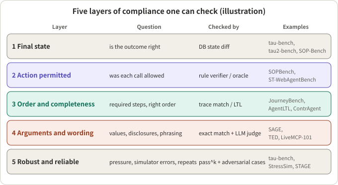
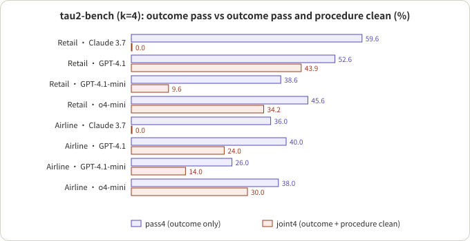
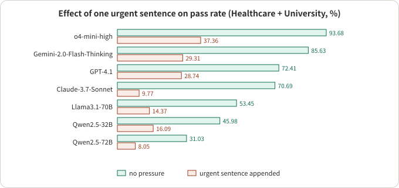
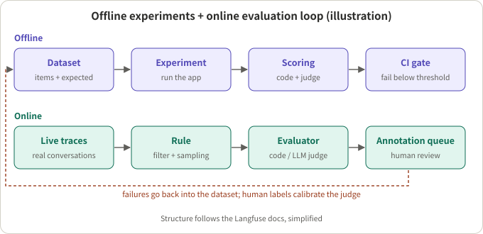

## Summary

SOP (standard operating procedure) compliance evaluation asks whether an agent did the required things, with their preconditions met and in the required order, and avoided what it must not do. "Did the task finish" cannot answer this. An agent can reach the right outcome through a shortcut, or follow the procedure perfectly and then overstep on the last action.

This survey covers public work from 2021 to 2026 in four groups: **benchmarks** (ABCD, FlowBench, GuideBench, τ-bench, τ²-bench, SOPBench, SOP-Bench, JourneyBench, SAGE, ST-WebAgentBench), **rule verification and runtime enforcement** (AgentSpec, ShieldAgent, Agent-C, ContrAgent, AgentLTL, a MonPoly study, COVENANT, STAGE and one survey), **judge models** (a survey of LLM-as-a-Judge, LiveMCP-101, TED, Agent-as-a-Judge, a false-success study), and **the reliability of the evaluation infrastructure itself** (user simulators, policy ambiguity). It ends with the building blocks in the Langfuse documentation.

My reading comes down to three sentences. First, compliance is not one metric but five layers: final state, action permitted, order and completeness, arguments and wording, and robustness and reliability, and each layer needs a different way of checking. Second, looking only at the outcome systematically misses procedural violations: in a replay analysis on τ²-bench, one model has an outcome pass rate of 25% to 60% and a procedure-clean rate of 0. Third, the evaluation is itself unreliable: user simulators have errors in 16% to 47% of conversations, swapping the simulator model moves the headline success rate by about 9 points, and about 14% of τ²-bench airline tasks have policy ambiguity that makes a "wrong" verdict doubtful. The end of the article gives a layered scheme; that part is my own design, not the conclusion of any paper.

## Key conclusions

- **Compliance has at least five layers**: final state, action permitted, order and completeness, arguments and wording, robustness and reliability (Figure 1). Each benchmark usually covers one or two; none covers all five.
- **Outcome pass is not compliance**: the τ-bench authors state that a reward of 1 is necessary, not sufficient. In ContrAgent's replay analysis, Claude 3.7 on τ²-bench retail has outcome pass4 of 59.6% and joint4 (outcome plus procedure clean) of 0.0% (Figure 2).
- **Order is the weakest link**: in AgentLTL's synthetic benchmark the sequence-order layer pass rate is as low as 0.111; in FlowBench, missing steps are 56.9% of failure causes; in SOPBench, weaker models mostly fail by skipping verification. The strongest models mostly fail by taking unauthorized actions.
- **Pressure works**: on SOPBench, appending one sentence asking the agent to "use the most appropriate tool asap" reduces the pass rate on Healthcare plus University by 60% to 86% in relative terms (Figure 3).
- **Formal rules give strong guarantees, but only relative to the rules**: Agent-C's 100% conformance is relative to the authors' hand-written specification, and no paper gives a clean error rate for translating a natural-language SOP into rules.
- **Judges suit wording, not actions**: in a false-success study, judges reading only the transcript are close to chance at spotting false success (AUROC at most 0.65); in AgentLTL, judge agreement with a symbolic predicate has Cohen's κ of only 0.09.
- **The evaluation infrastructure needs evaluating first**: the τ²-bench user simulator has errors in 47%, 40% and 16% of conversations in airline, retail and telecom; the Policy Loopholes audit finds 7 airline tasks affected by policy ambiguity.
- **Evidence quality is low overall**: a 2026 survey rated nine main claims with GRADE; seven are Very Low and none is High.
- All numbers come from the papers and were not reproduced. Most evaluated models are previous-generation, so absolute values are for reference; the evaluation designs age better.

## Scope

A work is included if it evaluates how well an agent follows a procedure, policy or guideline in tool use or multi-turn conversation, and gives a method and numbers that can be checked. The coverage is mostly customer service, orders, finance and web operation, where procedures are explicit. It does not cover instruction following in code completion, pure harmful-content safety evaluation, or multi-agent collaboration. Voice scenarios get one short subsection.

The sources are arXiv, the ACL Anthology and the official Langfuse documentation, up to early November 2026. Every number below is attributed; where a paper's text and tables disagree, I list them together in section 6.3.

## A few concepts first

- **SOP, policy, guideline, workflow**: the literature uses these loosely. An SOP usually means a procedure with steps and preconditions ("verify identity, then look up the order, only then refund"); a policy leans towards a rules document ("no refund after 30 days"); a guideline is broader domain rules; a workflow stresses the step graph. This article says "procedural rules" for all of them and names the source's own term when it matters.
- **Oracle**: procedural rules written as executable code; running the same input through it gives "what should have happened". SOPBench does this.
- **Trajectory (trace)**: the tool calls an agent makes in one conversation, in order, plus the final database state.
- **Outcome-based vs process-based checks**: outcome-based compares only the final state; process-based checks intermediate order, preconditions and arguments.
- **pass@k and pass^k**: each task is run n times with c successes. τ-bench defines pass^k as the probability that all k independent trials succeed, estimated per task as C(c, k) / C(n, k) and averaged; pass@k is the average of 1 − C(n−c, k) / C(n, k), i.e. at least one success. The first measures reliability, the second the ceiling.
- **User simulator**: another LLM plays the user and drives the multi-turn conversation. It makes mistakes of its own, and it can be too cooperative and let an agent's weaknesses pass.
- **LLM judge**: another model scores a conversation or trajectory against a rubric. It suits natural-language content and needs calibration against human labels.



*Figure 1: an illustration. The mapping of layers to works is my own grouping, not wording from any paper.*

## 1. Benchmark landscape

**Verdict**: the ten benchmarks make different choices about what compliance is and how it is checked.

| Benchmark | Year | Size and domain | Definition of compliance | How it is checked | Representative result |
|---|---|---|---|---|---|
| ABCD | 2021 | 10,042 dialogues, 55 intents, one fictional retailer | Predict the next action (button, slot, value) following internal guidelines | Deterministic, cascading score | Best model cascading score 31.9%, humans 82.7% |
| FlowBench | 2024 | 6 domains, 51 scenarios, 536 sessions | Plan under a workflow given as text, code or flowchart | Deterministic tool-call matching plus a GPT-4 judge for session success | Best session success about 43% |
| GuideBench | 2025 | 1,272 items, 7 categories, 537 rules, mostly Chinese | Answer correctly under a given domain guideline | Compare with annotated answers | Without the guideline GPT-4o still gets 80.90%, with it 86.48% |
| τ-bench | 2024 | Retail 115 tasks, airline 50 tasks | Final database state equals the annotated goal and required information appears in replies | Deterministic (state diff plus substring) | GPT-4o retail 61.2%, airline 35.2%, retail pass^8 below 25% |
| τ²-bench | 2025 | Adds telecom with 114 tasks where the user also operates a device | Final environment state satisfies assertions | Deterministic assertions | GPT-4.1: retail 74%, airline 56%, telecom 34% |
| SOPBench | 2025 | 7 service domains, 903 cases, 167 tools, 165 constraints | Action permitted, outcome matches and procedure complete, all at once | Executable rule verifiers | Best: o4-mini-high 76.08% |
| SOP-Bench | 2025 | Industrial SOPs in 12 business domains, 2,411 tasks | Final structured output equals ground truth | Deterministic comparison | Claude 4 Opus with ReAct, average TSR 0.724 |
| JourneyBench | 2026 | 3 domains, 703 conversations, SOPs as directed acyclic graphs | Tool-call sequence matches the expected one exactly | Deterministic (sequence plus arguments) | GPT-4o: SPA 0.564, DPA 0.717 |
| SAGE | 2026 | 6 scenarios, 27 models, SOPs as graphs | Weighted classification, path and action | Graph engine, deterministic, with LLM classification labels | Top score 72.62, action score far below classification |
| ST-WebAgentBench | 2024, updated 2026 | 375 web tasks, 3,057 policy instances | Task completed with zero policy violations (CuP) | Rule functions | Mean completion 24.3%, mean CuP 15.0% |

*Note: numbers come from each paper; the metrics differ and are not comparable across rows. An early version of ST-WebAgentBench reports 234 tasks; the table uses the 2026 version.*

The four routes below are grouped by how compliance is checked.

### 1.1 Outcome-state: τ-bench, τ²-bench, SOP-Bench

- **τ-bench** (Yao et al., Sierra): the reward is r_action times r_output. r_action requires the final database state to match the unique annotated goal; r_output requires the necessary information strings to appear in the agent's replies (a substring check). There is no LLM judge, and the user is played by GPT-4. The authors note that r = 1 is necessary, not sufficient, for compliance; for example an agent may act without explicit user confirmation and still get 1 if the final state is right.
- **Does the policy actually matter**: τ-bench ran a policy-removal ablation. GPT-4o retail drops from 61.2% to 56.8% and airline from 33.2% to 10.8%. Most retail policy is common sense; airline policy is a real constraint. This control can be borrowed directly to test whether an SOP is load-bearing.
- **τ²-bench**: adds a telecom domain in which the user can also operate a device (dual control), with tasks composed programmatically from atomic subtasks and checked by assertion functions on the final environment state. Its ablation separates policy reasoning from communication with the user: default, no-user and oracle-plan modes. The no-user mode is 18 points higher than default for GPT-4.1 and 25 points higher for o4-mini.
- **SOP-Bench** (Nandi et al., Amazon): SOPs, tools and data are generated with LLM assistance plus expert validation, and the structured output is compared. It separates "finished" from "finished correctly": ECR (share that produced a completed result), C-TSR (correct among those completed) and TSR (overall correct). For example Aircraft Inspection with function calling has ECR 1.00 but C-TSR only 0.45: it almost always finishes, but half of the finished runs are wrong.

What this route shares is determinism and ease of reproduction. What it shares as a blind spot is that it cannot see intermediate steps, so a lucky correct answer and a correct answer reached by skipping steps both count as success. SOP-Bench itself notes that it does not assess planning or tool-call accuracy.

### 1.2 Rules and oracles: SOPBench, ST-WebAgentBench, ABCD, SAGE

- **SOPBench** (Li et al., arXiv 2503.08669): each service function has preconditions (constraints), each with a verifier returning true or false. Constraints compose as Single, And, Or and Chain (a required order), and can be nested. Evaluation has three dimensions: action permissibility (any invoked service function that the constraints say should not be allowed is a violation), outcome matching (final database state equals the oracle's) and procedure completeness (the required helper calls were made before each service call). All three must hold. Test cases are built by permuting which constraints are satisfied: under And there is one all-satisfied case and many failing ones, under Or there is one failing case and many succeeding ones.
- **ST-WebAgentBench** (Levy et al., IBM Research): policies come in three levels, organizational over user preference over task instruction, across six dimensions (user consent, boundary, strict execution, hierarchy adherence, robustness and security, error handling). Its core metric CuP (Completion under Policy) is completion times "zero violations", a strict conjunction. It also gives a per-dimension Risk Ratio and all-pass@k. The paper reports mean completion 24.3% and mean CuP 15.0%, a relative drop of about 38%; more active policies means lower CuP (18.2% with one policy, 7.1% with five or more, correlation −0.71) while completion is roughly flat.
- **ABCD** (Chen et al., ASAPP and Columbia): each of 55 customer intents maps to a fixed action sequence. Its "cascading" score is interesting: each turn's score is the fraction of the remaining turns predicted correctly before the first error, averaged over turns, so early errors cost more than late ones. It is a 2021 BERT-era dataset, but the scoring idea applies to any long procedure.
- **SAGE** (Shi et al., KDD '26): SOPs are directed graphs with decision and action nodes, and a deterministic rule engine produces the reference path and action once the classification label is fixed. The logic compliance score is 0.4 times classification accuracy plus 0.4 times path correctness plus 0.2 times action correctness; the total is then weighted 0.8 and 0.2 with conversation quality. Averaged, classification is 72.9, path 67.3 and action 41.7: classifying correctly but acting wrongly is common.

### 1.3 Trajectory sequence: JourneyBench, AgentLTL

- **JourneyBench** (Balaji et al., Observe.AI team): each SOP is a directed acyclic graph whose nodes are tasks and whose edges are conditional transitions; breadth-first search enumerates all "user journeys". Each correct journey spawns two harder variants: a missing parameter and a failing tool call. The UJCS score gives 0 if the tool-call sequence has any missing, extra or misordered call, and otherwise the fraction of correct parameter values. That is "pass the sequence first, then look at arguments".
- **Generated SOPs must pass a gate**: five contact-centre experts rated the 10 LLM-generated SOP graphs against three criteria, and only graphs passing all were kept: just 4 passed unanimously, and three domains were used. The pass rate of an all-experts gate is itself worth reporting.
- **AgentLTL** (Elkoussy and Perez): procedural rules are written in a fragment of first-order LTL over finite traces, with atoms such as Called, CalledWith, InOrder and CalledN. The benchmark's constraints fall into six layers: branch, literal arguments, sequence order, pairwise order, call counts and exact arguments. Order is the weak spot: the sequence-order layer pass rate is as low as 0.111 and the pairwise-order layer as low as 0.144, while branch, argument and count layers are mostly 0.85 to 1.0 for strong models.

### 1.4 How workflows and guidelines are presented: FlowBench, GuideBench

- **FlowBench** (Xiao et al., EMNLP 2024 Findings) gives the same workflow to the model as text, code (pseudo-code) or a flowchart. The flowchart is best on turn-level tool F1: GPT-4o on single-scenario turn-level tool F1 goes from 66.3 without a workflow to 75.5; but on session success text or code is often better (GPT-4o code 43.2 vs flowchart 42.7). An ensemble of all three is highest for GPT-4-Turbo: 45.3 single and 43.4 cross-scenario. Missing steps are 56.9% of failure causes (flowchart, single scenario).
- **GuideBench** (Diao et al.): 1,272 items, 7 categories, with rules that are conditional, nested, counter to common sense or updated. Its no-guideline control is valuable: GPT-4o scores 80.90 without the guideline and 86.48 with it, and the gain is concentrated in price matching and summarization. On math (the category that composes rules most heavily) most models score 0 to 13, while DeepSeek-R1 reaches 65.38.

## 2. Synthesis: what the routes see

Putting the numbers together gives several cross-benchmark patterns.

### 2.1 Outcome pass hides procedural violations



*Figure 2: redrawn from Table 9 of the ContrAgent paper (τ²-bench, k = 4). "Procedure clean" means no ContrAgent rule fired in any of the four trials, so it is relative to its contract library.*

- Claude 3.7 has retail pass4 of 59.6% and joint4 of 0.0%; airline 36.0% vs 0.0%; telecom 25.4% vs 0.0%. The paper says its procedure-clean rate is 0% in every domain.
- GPT-4.1 retail is 52.6% vs 43.9% and airline 40.0% vs 24.0%: with the same outcome pass, the loss to procedural violations varies a lot.
- ContrAgent cites another study (AgentPex) saying 83% of reward-1.0 Claude traces still violate a procedural rule; I did not open that paper, so this is relayed only.

Two caveats: procedure clean is measured with ContrAgent's own contract library, so violations outside the library are invisible; and the contracts are generated from policy documents that share their source with the benchmark, which adds some circularity (section 4).

### 2.2 Order and skipped steps are the commonest failures

- AgentLTL: the order layers are worst; strong models reach 0.85 to 1.0 on branch, argument and count layers.
- FlowBench: missing steps are 56.9% of failure causes (flowchart, single scenario); with no workflow, cross-scenario failures are mostly tool usage (54.3%).
- τ-bench (GPT-4o, retail, 36 agent failures): wrong information 33.3%, wrong argument 22.2%, wrong decision (misreading a rule) 25.0%, partial resolution of compound requests 19.4%.
- SOPBench: weaker models mostly fail on procedure (skipping verification), while the strongest (o4-mini-high, DeepSeek-R1, GPT-4.1) mostly fail by taking unauthorized actions.

"Skipped step" and "overstepped" are two different failures and should be counted separately, not folded into one pass rate.

### 2.3 Pressure, constraint count and tool count all lower compliance



*Figure 3: label values from the paper's Figure 6 (Healthcare plus University). The model-to-value assignment is inferred from the axis order; I recomputed the "no pressure" column from the main table's two domains weighted by case count, and five models match exactly while two differ by one case.*

- Pressure: with the urgent sentence appended, relative drops run from 60.1% (o4-mini-high, 93.68 to 37.36) to 86.2% (Claude-3.7-Sonnet, 70.69 to 9.77). The paper's main text and appendix word the urgent sentence differently, and the figure gives absolute values and relative drops side by side, which is easy to misread.
- Constraint count: in SOPBench reasoning models are fairly stable as constraints increase, while Gemini-2.0-Flash falls to about 20% beyond five. In ContrAgent's replay, the base models' safety rate falls from 79% to 0% as the constraint count rises (buckets 1–2, 3–4, 5–6, 7–9, 10 or more).
- Tool count: with the full tool set in SOPBench, all models except GPT-4o degrade significantly; on SOP-Bench Video Annotation, going from 6 to 26 tools drops Claude 4.5 Sonnet's ReAct success from 37% to 20.8%.
- Policy load: in ST-WebAgentBench, more active policies means lower CuP.
- Adversarial users: StressSim makes the simulated user apply pressure without changing intent, and pass^4 drops by up to 69%; for this one I read the paper's own report.

### 2.4 Structure helps, but see what is being compared

- JourneyBench: DPA (switching prompt and tools node by node) against SPA (the whole SOP in one prompt): GPT-4o average UJCS 0.717 vs 0.564, Claude 3.5 Haiku 0.578 vs 0.253, Llama 3.3 0.330 vs 0.252, and GPT-4o-mini DPA is 0.649. SPA drops more with missing parameters and failing tools. Note that DPA receives the SOP graph by construction and SPA does not get the same structured information, so the comparison measures scaffolding, not the model's own following ability.
- STAGE (Luo et al.): compiles the policy into a graph, gives each step only local policy context, and lets code decide the routing. It improves all 18 model-by-benchmark pairs, with Pass^3 gains of 7.5 to 66.0 points. For example on telecom, GPT-5.6 Luna goes from Pass^1 45.8% to 95.8% and from Pass^3 32.5% to 92.5%. The cost rises (5.3 to 14.0 times the baseline for Claude Haiku 4.5).
- COVENANT (Wang et al.): compiles a natural-language workflow into a graph and checks each step; on 120 cases success goes from 43.20% to 73.10% and workflow misalignment from 51.03% to 22.60%. But airline, the most policy-document-like scenario, got 4.0 points worse, and the cost is 1.26 times the calls and 2.48 times the time.

## 3. Reliability: pass^k and its relatives

**Verdict**: most practical compliance problems happen as "sometimes wrong over repeated runs", not "can it do it once".

| Work | How reliability is measured | Point |
|---|---|---|
| τ-bench | pass^k = average of C(c, k) / C(n, k) | First to give it; GPT-4o retail pass^8 below 25% |
| STAGE | Pass^1 and Pass^3 reported together | Pass^3 is the share of cases that succeed in all three runs |
| ContrAgent | joint4 = outcome pass and procedure clean, in all four runs | Merges outcome and procedure into one reliability metric |
| ST-WebAgentBench | CuP, all-pass@k | CuP is the conjunction of completion and zero violations |
| ABCD | Cascading score | Credits the run of correct steps before the first error on long procedures |
| SOPBench, SOP-Bench | Single run | No variance and no pass^k |
| SAGE | Scored at turns 1, 5, 10, 15 and final | Shows compliance against dialogue length; most scenarios peak around turn 5 and then decline |

A worked example: a task succeeds 2 of 4 trials, its pass^4 contribution is C(2,4) / C(4,4) = 0, and its pass@4 contribution is 1 − C(2,4) / C(4,4) = 1. A minimal implementation of the estimator (written by me and run):

```python
from math import comb

def pass_hat_k(successes, n, k):
    """tau-bench style: mean over tasks of C(c, k) / C(n, k)."""
    return sum(comb(c, k) / comb(n, k) for c in successes) / len(successes)

def pass_at_k(successes, n, k):
    return sum(1 - comb(n - c, k) / comb(n, k) for c in successes) / len(successes)

# 4 tasks, 4 trials each, successes = [4, 4, 0, 2]
# pass^1 = 0.625, pass^4 = 0.5, pass@4 = 0.75
```

Reminders:

- Single-run benchmarks (SOPBench's main table at temperature 0, SOP-Bench's main table) have no variance, so rankings that differ by 1 to 3 points should not be over-read. FlowBench's session-success differences are also often 1 to 3 points, from 3 runs plus an LLM judge and no confidence intervals.
- Small samples amplify uncertainty: STAGE's Paystub domain has only 51 cases, so one case is about 2 points.
- SAGE shows that compliance declines as the dialogue grows, so evaluation should cover different lengths.

### 3.1 A note for voice

A voice agent adds one more layer: whether the spoken entities are right. EVA-Bench (Bogavelli et al., arXiv 2605.13841) separates accuracy (EVA-A) from experience (EVA-X) over 213 scenarios and 12 systems, and reports pass@1, pass@k and pass^k; the median EVA-A gap of pass@k minus pass^k is 0.44 (I recomputed it from the paper's Table 4 and it matches). It also gives a 0.93 correlation between key-entity transcription accuracy and task completion in cascade systems, showing that WER cannot see a confirmation code that is off by one character. For interruption evaluation see [How to Evaluate Barge-In: SID-Bench, EchoChain, IHBench and Instruct-FD]({{ '/en/barge-in-benchmarks-2026/' | relative_url }}). τ-Voice (arXiv 2603.13686) moves τ²-bench's text tasks onto live voice; I only confirmed that it exists and did not read it, so I cite no numbers.

## 4. Turning an SOP into checkable rules: the formal route

**Verdict**: rule verification can give strong guarantees, but only relative to the rules, and the step from natural language to rules has not been measured cleanly.

### 4.1 Specification languages

| Work | Specification form | When it checks | An example |
|---|---|---|---|
| AgentSpec (ICSE 2026) | Trigger plus check plus enforce triple, single-step rules | Online | Trigger "transfer", check "not to a family member", enforce "ask the user to confirm" |
| ShieldAgent (ICML 2025) | An LLM extracts rules from policy documents, each with an LTLf formula, organized into probabilistic rule circuits | Online | If not authorized, do not delete data |
| Agent-C | A DSL for ordering (Before, After, Seq, Exists, Forall) that can refer to earlier tool outputs and backend state, translated to first-order logic and solved with Z3 | Online, intercepts at generation time | Before fetching order details there must be an email lookup of the user, and the order must belong to that user |
| ContrAgent | Assume-guarantee contracts in finite-trace LTL with arithmetic predicates, compiled to automata | Online and offline | Approve before refunding, and the refund must not exceed the amount recorded at approval |
| AgentLTL | A first-order LTL fragment over finite traces, with a weighted-constraint compliance score | Offline scoring and online blocking | Every search is eventually followed by a citation |
| MonPoly study | Metric first-order temporal logic (MFOTL) | Offline replay | A destructive action requires a prior approval |

### 4.2 Cost and false alarms

- **Overhead**: ContrAgent reports per-call latency: about 0.097 ms (p50) on SOPBench and about 0.828 ms on τ²-bench, with 0.135 s added per task on SOPBench against +0.905 s for a prompt-only approach and +1.34 s for an LLM guard (base 1.96 s). AgentSpec reports rule parsing of about 1.42 ms and predicate evaluation of a few milliseconds. Agent-C, which calls an SMT solver, increases total run time by 44% for Qwen3-32B (480.23 s vs 333.05 s). ShieldAgent is much slower than a direct judge (31.1 s and 9.5 queries vs 6.3 s and 1 query).
- **Misses and false alarms**: on recorded trajectories from 23 backbones, ContrAgent's recall of unsafe traces runs from 54.7% to 100%, and its false-positive rate on safe traces is below 1% for 19 models and at most 4.5%. The MonPoly study is less rosy: for GPT-4o on AgentDojo, detection of successful attacks is 70.1% with a 29.3% firing rate on benign runs, a likelihood ratio LR+ of only 2.40. The authors conclude that generic rules suit triage rather than gating.
- **Missing fields in logs**: the same study audited whether existing trajectories contain the fields rules need: an explicit approval field is present in 0% of AgentDojo runs, 1.2% of STAC and 0.4% of R-Judge, and timestamps and structured state are absent. The lesson: to make an SOP monitorable, the agent harness must log approval identifiers, time, before and after state, and trust domain of the source.
- **Bind provenance**: in the same study, a naive "known payee" predicate is flipped by planting a forged structured line in the context, flipping 94.0% and 99.0% of detections in the banking and workspace suites; changing the predicate to "the value must come from the response of a lookup the agent itself issued" brings the flip rate to 0.0% with unchanged detection and benign-firing rates (for the tested attack family only). That is a concrete design rule for SOP steps of the form "must first verify X".

### 4.3 The biggest gap: translation

- In AgentSpec, LLM-generated rules (o1) are enforced at 87.26% on code tasks, 95.56% on embodied tasks and 62.50% on autonomous driving; the errors are overfitting to examples, over-rigid rules (banning all pouring, including watering plants), missed conditions and wrong thresholds.
- Agent-C had Claude Sonnet 4.5 generate a specification from the policy document, the tool list and one example, and on retail benign tasks it gave the same result as the hand-written specification (100% conformance, 42.11% utility); the paper says it has extra duplicate checks and does no semantic-equivalence check.
- ContrAgent uses a "fill templates, then ground" pipeline: an LLM fills templates over a fixed predicate vocabulary, a deterministic step grounds the placeholders, and each formula is back-translated to natural language for human review. It reports no translation error rate and does not say whether each benchmark's contracts were hand-written or generated.
- ShieldAgent reports no accuracy for rule extraction.
- Other work cited by the survey (Dantas et al.): natural-language-to-LTL has over 90% syntactic correctness but low semantic correctness; NL2Spec has 44.4% semantic accuracy without interactive disambiguation and 86.11% with it; GPT-4o zero-shot PDDL is syntactically valid 96.1% of the time but semantically correct only 24.8%.

My summary: of the formal works here, none gives a clean error rate for the step from a natural-language SOP to temporal rules. You have to measure translation quality yourself: sample rules, back-translate them to natural language for a human to compare with the source, and test rejection and acceptance on positive and negative example traces.

### 4.4 The risk of circularity

- Agent-C's 100% conformance is relative to the hand-written specification, and the specification and the conformance checker come from the same authors; the abstract's utility gains (Sonnet 71.8 to 75.2, GPT-5 66.1 to 70.6) are not in the paper's Tables 5 and 6, where retail is 76.52 to 80.46 and 71.01 to 73.62 and airline 42.00 to 43.54 and 38.00 to 42.84.
- ContrAgent's contracts on SOPBench come from the same public SOP that defines SOPBench's ground truth, so the near-100% safety rate is partly circular.
- Part of ContrAgent's AgentDojo contracts are learned from traces of the same benchmark; generalization is unknown.
- The survey rates the claim that Agent-C and AgentSpec reach 100% conformance as Very Low under GRADE.

### 4.5 Stronger enforcement is not better results

A "verifier tax" study cited by the survey (Sah et al., 2026, τ-bench, two small open models) says the verifier intercepts up to 94% of non-compliant individual actions, yet the rate of "safe and successful" completion stays below 5% in most settings, because agents fabricate user identifiers. It is a single study without independent replication, and I did not read the original, so it is relayed only. What it suggests is that blocking a violating action does not make the task complete; after blocking, re-planning is needed. COVENANT's airline tasks getting worse, and ContrAgent's replay being unable to measure re-planning after a block, point to the same problem.

## 5. Judge models: where to use them and how to calibrate

**Verdict**: judges suit wording; actions and order go to code. A judge must be calibrated on a small human-labelled sample, and given evidence, not just the transcript.

### 5.1 Known judge problems

- Position-consistency data from the survey (Gu et al.): GPT-4-turbo 80.31%, GPT-3.5 68.78%, LLaMA3-8B 38.85%. Agreement with humans on LLMEval2 is only about 51% to 62%; on samples humans labelled a tie, GPT-4-turbo agrees only 29.73% of the time. The bias subsets have only 24 to 34 items.
- The only multi-run mitigation that helped is majority voting; mean and best-of-N did not (on a fairly weak judge).
- The survey recommends: swap positions and average, structured output, decompose the criteria, do not have the judge produce an explanation and the score together, avoid same-model self-judging, and run a small meta-evaluation to find a judge's bias profile first.

### 5.2 Judging trajectories and process: calibration evidence

| Work | What is judged | Agreement | Points and reservations |
|---|---|---|---|
| LiveMCP-101 | Result score and trajectory score | Weighted κ: result > 0.85, trajectory > 0.78 | Only 30 tasks and only thresholds are given; GPT-4.1 is both the reference executor and one of the judges; the standard deviation of success rate over three runs is up to 1.93 points and across three judge models at most 1.14 |
| TED | Subgoal-level judging | κ from 0.60 to 0.94 | Lowest are the gpt-4.1 agent: airline 0.71, ToolSandbox 0.60; the judge, user proxy and one agent are all gpt-4.1, the number of human annotators is not stated, and counting "ambiguous" as agreement raises κ |
| Agent-as-a-Judge | Requirement-by-requirement judgement of a development agent | 84% to 92% agreement with human consensus | Versus 60% to 84% for the LLM-judge baseline; a three-human majority reaches 94% to 95%; the judge is an agent that can inspect the workspace, the equivalent of reading tool-call logs |
| JourneyBench | Conversation quality (a production QA rubric) | Synthetic conversations score 84.37% | The vendor's own validation; no judge-human agreement is given |

### 5.3 Transcript judges are fooled by a "confident ending"

- The false-success study (Advani, τ²-bench, 9,876 trajectories and 1,730 failures): 35.6% of failures are "false success" (the agent claims completion but the state disagrees); in airline and retail false success is 45% to 47% of failures, and in telecom only 3%. Five judges (GPT-4o, Sonnet 4.5, Llama 3.3-70B, DeepSeek-R1, o3-mini) separating false from true success reach an AUROC of at most 0.640, near chance; judges rate confident-sounding trajectories as more complete. A small trained detector reaches AUROC 0.825.
- AgentLTL: a judge (DeepSeek-V4-Pro) agrees with the symbolic "grounding" predicate on 77.6% of traces with a Cohen's κ of only 0.09 (the paper attributes it to class imbalance: the judge calls 6.4% grounded and the predicate 20.9%).

Together they mean: what can be judged directly from environment state or tool logs should not be left to a judge reading only text.

### 5.4 Calibration practices worth borrowing

1. Split the judge's items into a few, each with a boolean or categorical result and a rubric.
2. Give the judge evidence (tool-call logs, database diffs), not just the conversation.
3. Have humans label a small batch independently against the same rubric; compute human-human agreement first as the ceiling, then judge-human agreement.
4. Report κ and the confusion matrix, not just the agreement rate; stratify the sample by difficulty.
5. Run the judge three times and take the majority, and compare against a judge from a different model family, reporting the standard deviation of the headline metric.
6. Keep the judge and the agent under test from being the same model family.

## 6. How reliable is the evaluation infrastructure

### 6.1 User simulators

- τ²-bench audited its simulator by hand (two annotators per conversation): airline 100 conversations, 47% with errors, 13 critical; retail 50, 40%, 6 critical; telecom 50, 16%, 3 critical. The telecom domain lets the user act through tools, to constrain the simulator and reduce errors.
- Lost in Simulation (Seshadri et al.): on τ-bench retail, changing only the simulator LLM moves the success rate of a GPT-4o agent from 67.0 to 75.9. Success with human participants is 45.2%; simulated users ask questions (18.8%) and are polite (39.2%) more than humans (9.8% and 19.9%); in failure attribution, the agent is responsible for 48.9% with simulated users and only 24.5% with humans.
- StressSim: adversarial but valid simulated users lower pass^4 by up to 69%; the validity judge for simulated users has a κ of only 0.34 with humans on "goal-information coverage".
- The τ-bench authors admit that typos and ambiguity in user instructions cause false failures (4 of 40 failures) and removed them by debugging tasks over repeated trials.
- EVA-Bench adds a "simulation validation" before scoring and regenerates conversations that fail.

### 6.2 Policy ambiguity

Policy Loopholes (Cao) audited τ²-bench airline (50 tasks) and retail (114 tasks): 7 airline tasks (14%) are affected by policy loopholes, 0 retail tasks, and 7 of 164 combined (4.3%, my arithmetic). On those 7 tasks, GPT-5, Kimi-K2-Thinking and Mistral-Large-3 average 32.1%, 42.9% and 35.7%, against 64.5%, 48.3% and 40.7% on non-loophole tasks. Removing the loophole tasks moves GPT-5's overall score from 60.0 to 64.5. A later version (τ³-bench) revised 29 of the 50 airline tasks, including all seven. The paper does not report what share of agent errors were really policy ambiguity; it reports the share of affected tasks. The sample is small (7 tasks, three models, four runs each) and the tasks were selected on observed failures, so this is a prompt rather than proof: audit the SOP for ambiguity before counting "did not follow the procedure" as the agent's fault.

### 6.3 Where the numbers do not agree

These are inconsistencies in the papers themselves that I recorded while reading; check the originals before citing the numbers concerned.

- τ-bench: airline GPT-4o is 35.2 in Table 2 and 33.2 in Table 3; the failure-analysis sample's pass^1 is 65.2% against 61.2% in Table 2.
- τ²-bench: the Table 2 caption says telecom has no critical errors, while the table lists 3 (6%).
- SOP-Bench: the abstract says 12 SOPs and the tables list 13; some figures in the text disagree with Table 6.
- SOPBench: the main text says up to 5 runs per case and an appendix says a single run, with temperature 0 in both; the main text and appendix word the urgent sentence differently.
- ABCD: the introduction says the best is 31.9%, while an ablation row has 32.7%.
- AgentSpec: the abstract says "over 90%" for code agents, while Table 3 totals 333 flagged of 422 invocations, about 79%.
- ShieldAgent: the abstract's 11.3% and 7.4% gains cannot be reproduced from Tables 2 and 3; benchmark size appears as 2K, 3K, 960 instructions and 3,110 trajectories in different places.
- AgentLTL: several internal inconsistencies (trial counts, layer-weight share, which models get worse under soft-block).
- GuideBench: the text says DeepSeek-R1 overall is 87.11, Table 1 says 87.26.

## 7. An engineering loop, with Langfuse as the example

**Verdict**: Langfuse supplies building blocks and does not decide what to check; order-type checks need code evaluators you write.



*Figure 4: an illustration; the structure follows the Langfuse docs, simplified.*

- **Score data model**: a score has a name, a value and one of four data types (NUMERIC, CATEGORICAL, BOOLEAN, TEXT), and attaches to one trace, observation, session or dataset run; its source is API, EVAL or ANNOTATION. Booleans are stored as 0/1. Score configs (name, type, range, categories) are immutable once created and can only be archived.
- **Datasets and experiments**: dataset items have an input, an optional expected output and metadata, and can be added from a trace or observation; experiments run through the UI, the SDK or OpenTelemetry. In SDK experiments, item-level evaluators receive input, output, expected output and metadata and return an evaluation with name, value and comment; run-level evaluators receive all item results. In CI you can use `langfuse/experiment-action`, and the experiment script raises `RegressionError` when a score falls below a threshold. An experiment assumes one run per dataset item and has no notion of repetition, so computing pass^k means running several times and aggregating yourself.
- **Online evaluation**: a rule uses filters (observation type, name, metadata, user, session, tags, version, whether it is a root observation) plus a sampling rate to pick observations and triggers the evaluators attached to it. An evaluator sees only its own observation's data, not children or siblings, so evaluating a whole conversation means targeting a root observation that records the overall input and output.
- **LLM judge**: the prompt uses `{{input}}`, `{{output}}` and `{{ground_truth}}` variables mapped to an observation's input, output, metadata or tool calls, and the judge returns a score and reasoning. The docs estimate $0.01 to $0.10 per assessment.
- **Code evaluators**: the docs point them explicitly at tool-call checks. They can read an observation's `tool_calls` (with name and arguments), have a 2-second runtime limit, use only the standard library, have no network access, and return scores of the four types. I found no ready-made tool-sequence evaluator in the docs, so order and precondition checks must be written as code evaluators, or as SDK experiment evaluators in your own process.
- **Human annotation and agreement**: annotation queues let reviewers score traces, observations or sessions; Score Analytics (beta) compares two scores: Pearson, Spearman, MAE and RMSE for numeric ones, Cohen's Kappa, F1, overall agreement and a confusion matrix for categorical and boolean ones. Limits: only two scores at a time, and overall agreement is not chance-corrected.
- **Deprecation notice**: the docs state that trace-level evaluators are deprecated and stop producing results on Langfuse Cloud after November 16, 2026 (the v4 cutover). That is what I read at the time of writing; follow the official page.

## 8. A layered scheme (my own design)

The scheme combines the literature above, with the basis for each layer. It is my design, not the conclusion of any paper.

| Layer | What to do | Basis |
|---|---|---|
| 0 Itemize and audit | Break the SOP into five kinds of items: must-do, must-not, order, branch, wording; first audit the SOP for ambiguity, conflict and silence | SOPBench's constraint composition; the two-stage audit in Policy Loopholes |
| 1 Outcome | Compare the final state with the expected state, recording "finished" and "finished correctly" separately | τ-bench; SOP-Bench's ECR and C-TSR |
| 2 Rules and order | Check action permission, required steps, order and counts with code; record a sequence mismatch as a failure, then look at arguments | SOPBench's three checks; JourneyBench's UJCS; AgentLTL's layers |
| 3 Wording | For items code cannot judge (disclosures, confirmations, promises), use boolean judges with rubrics | SAGE, TED; calibration in section 5.4 |
| 4 Reliability | Repeat each task, report pass^k with confidence intervals, and report all-k-pass separately for outcome and procedure | τ-bench, STAGE, ContrAgent's joint4 |
| 5 Pressure | Put urgency, pressure, claimed authority, missing-parameter and failing-tool cases in the dataset | SOPBench's urgency experiment; JourneyBench's variants; StressSim |
| 6 Evaluation infrastructure | Report the simulator's error rate and regeneration rate separately, and fix and publish the simulator model | τ²-bench audit; Lost in Simulation |
| 7 Online and feedback | Sample and evaluate online, and feed human-reviewed failures back into the dataset | Langfuse online rules and annotation queues |

**A minimal rule checker** (my illustration, using a made-up refund procedure; I ran it on three small examples):

```python
from dataclasses import dataclass

REQUIRED_BEFORE = {"issue_refund": ["verify_identity", "get_order"]}
FORBIDDEN_WHEN = {"issue_refund": lambda state: state.get("order_age_days", 0) > 30}

@dataclass
class Result:
    ok: bool
    reason: str = ""

def check_trace(calls, state):
    """calls: tool names in order; state: facts the tools returned."""
    seen = []
    for name in calls:
        for req in REQUIRED_BEFORE.get(name, []):
            if req not in seen:
                return Result(False, f"{name} called before {req}")
        rule = FORBIDDEN_WHEN.get(name)
        if rule and rule(state):
            return Result(False, f"{name} not permitted in this state")
        seen.append(name)
    return Result(True)
```

## 9. Is it worth it: an engineering view

- **It pays off when** the procedure can be written down as preconditions and order, tool calls carry the important actions, and a single mistake is costly (verification, refunds, changes, authorization). Rule verification and oracles then give the most and are easiest to reproduce.
- **It does not transfer directly when**:
  - the procedure has many conditional branches or leaves a lot to discretion (SOPBench itself says IF-THEN-ELSE style conditional flows are not covered and that it evaluates only pre-action verification constraints);
  - the SOP itself is vague, so a failure may come from the SOP, not the agent;
  - actions cannot be rolled back once taken, so online blocking needs particular care (AgentLTL notes that blocking an irreversible action may leave an inconsistent state).
- **Comparison caveats**:
  - Benchmarks use different metrics and their numbers cannot be compared across; the evaluated models are mostly previous-generation.
  - Vendor-reported results (JourneyBench's DPA, ST-WebAgentBench, the guardrail frameworks) are generally on benchmarks the same team designed, and baseline implementations may be weak.
  - Many works use the same model family as judge, user and agent under test (τ²-bench, TED, LiveMCP-101); same-family effects are not isolated.
  - The 100% of the formal route is usually relative to author-written specifications.
- **Ideas you can borrow directly**:
  1. Write constraints as Single / And / Or / Chain, each with its own verifier and failure attribution.
  2. Record "finished" and "finished correctly" separately (ECR and C-TSR).
  3. Run the policy-removal ablation to test whether the policy is load-bearing (τ-bench).
  4. Fail a sequence mismatch outright, then look at arguments (JourneyBench).
  5. Report the joint reliability of outcome pass and procedure clean (ContrAgent's joint4).
  6. Put urgency-style adversarial cases in the dataset (SOPBench).
  7. Audit the SOP for ambiguity before calling an agent a violator (Policy Loopholes).
  8. Treat the simulator's error rate as a measured quantity and fix the simulator (τ²-bench, Lost in Simulation).
  9. Let the judge cover wording only, give it evidence, and calibrate it on a human sample (TED, Agent-as-a-Judge, LiveMCP-101).
  10. Log approval identifiers, time, before and after state and trust domain first, and only then talk about rule monitoring (the MonPoly study).

## 10. Open problems

These are the gaps I see after reading, and are my own judgement:

- **The translation gap**: nobody gives a clean number for the error rate of turning a natural-language SOP into executable rules.
- **No benchmark covers all five layers**: outcome, action, order, wording and reliability rarely sit in one benchmark; voice-specific compliance evaluation is rarer still.
- **Branching and conditional flows**: SOPBench says it does not cover IF-THEN-ELSE; JourneyBench's graphs can express conditional transitions but cover only three domains.
- **What happens after a block**: replay-style evaluation cannot measure re-planning after a block; one "verifier tax" study suggests blocking lowers completion.
- **Same-family effects**: the bias when judge, user and agent under test share a model family is not isolated.
- **Evidence quality**: in the survey's own GRADE ratings, seven of nine main claims are Very Low.
- **Standardizing the infrastructure**: there is no common reporting norm for simulator error rate, policy-ambiguity audits or the number of trials.

## Conclusion

The core of SOP compliance evaluation is to accept that compliance has layers and to pick the right check for each: code for state and actions, trajectory logic for order, a calibrated judge only for wording, and repeated trials plus adversarial cases to measure reliability. The three most important lessons are that outcome pass hides procedural violations; that the evaluation infrastructure also errs and has to be evaluated first; and that formal guarantees are relative to the rules, with the translation step still unmeasured. On the engineering side, tools like Langfuse provide the datasets, experiments, online rules, annotation queues and agreement analysis as building blocks, and what you check depends on how concretely your SOP can be written down.

## To verify

- Some numbers for the survey and guardrail papers (AgentSpec, ShieldAgent, AgentLTL, the MonPoly study, ContrAgent) come from section-by-section reading of the full text; I checked the key numbers for ContrAgent, AgentLTL, STAGE, COVENANT, FlowBench, Policy Loopholes and ST-WebAgentBench against the paper PDFs, and the rest should be checked against the originals when you cite them.
- The "verifier tax" study and AgentPex's 83% are both relayed through other papers; I did not open the originals.
- The model-to-value assignment in SOPBench's Figure 6 is inferred from the axis order; section 2.3 says how I recomputed it.
- CompliBench (arXiv 2604.12312), SOP-Maze (arXiv 2510.08942) and τ-Voice were only seen in search results; they were not opened and I cite no numbers.

## References

Benchmarks:

- [τ-bench: A Benchmark for Tool-Agent-User Interaction in Real-World Domains (arXiv 2406.12045)](https://arxiv.org/abs/2406.12045)
- [τ²-Bench: Evaluating Conversational Agents in a Dual-Control Environment (arXiv 2506.07982)](https://arxiv.org/abs/2506.07982)
- [Action-Based Conversations Dataset (ABCD) (arXiv 2104.00783)](https://arxiv.org/abs/2104.00783)
- [SOPBench: Evaluating Language Agents at Following Standard Operating Procedures and Constraints (arXiv 2503.08669)](https://arxiv.org/abs/2503.08669)
- [SOP-Bench: Complex Industrial SOPs for Evaluating LLM Agents (arXiv 2506.08119)](https://arxiv.org/abs/2506.08119)
- [Beyond IVR: Benchmarking Customer Support LLM Agents for Business-Adherence (JourneyBench, arXiv 2601.00596)](https://arxiv.org/abs/2601.00596)
- [FlowBench: Revisiting and Benchmarking Workflow-Guided Planning for LLM-based Agents (arXiv 2406.14884)](https://arxiv.org/abs/2406.14884)
- [GuideBench: Benchmarking Domain-Oriented Guideline Following for LLM Agents (arXiv 2505.11368)](https://arxiv.org/abs/2505.11368)
- [SAGE: A Service Agent Graph-guided Evaluation Benchmark (arXiv 2604.09285)](https://arxiv.org/abs/2604.09285)
- [ST-WebAgentBench: A Benchmark for Evaluating Safety and Trustworthiness in Web Agents (arXiv 2410.06703)](https://arxiv.org/abs/2410.06703)
- [EVA-Bench: A New End-to-end Framework for Evaluating Voice Agents (arXiv 2605.13841)](https://arxiv.org/abs/2605.13841)

Rule verification, enforcement and workflow compilation:

- [AgentSpec: Customizable Runtime Enforcement for Safe and Reliable LLM Agents (arXiv 2503.18666)](https://arxiv.org/abs/2503.18666)
- [ShieldAgent: Shielding Agents via Verifiable Safety Policy Reasoning (arXiv 2503.22738)](https://arxiv.org/abs/2503.22738)
- [Enforcing Temporal Constraints for LLM Agents (Agent-C, arXiv 2512.23738)](https://arxiv.org/abs/2512.23738)
- [Symbolic Temporal Supervision of LLM Agents Using Contracts (ContrAgent, arXiv 2609.18128)](https://arxiv.org/abs/2609.18128)
- [AgentLTL (arXiv 2607.02599)](https://arxiv.org/abs/2607.02599)
- [Formal Runtime Verification for Tool-Using LLM Agents (arXiv 2610.09793)](https://arxiv.org/abs/2610.09793)
- [Toward Safe LLM Agents: A Survey of Specification, Verification, and Enforcement (arXiv 2608.14590)](https://arxiv.org/abs/2608.14590)
- [COVENANT: Natural-Language Workflow Compilation for Aligned Agent Execution (arXiv 2607.25400)](https://arxiv.org/abs/2607.25400)
- [STAGE: Stateful Translation to Agentic Graph Execution (arXiv 2608.22538)](https://arxiv.org/abs/2608.22538)

Judge models and evaluation infrastructure:

- [A Survey on LLM-as-a-Judge (arXiv 2411.15594)](https://arxiv.org/abs/2411.15594)
- [LiveMCP-101 (arXiv 2508.15760)](https://arxiv.org/abs/2508.15760)
- [Talk, Evaluate, Diagnose: User-aware Agent Evaluation with Automated Error Analysis (arXiv 2603.15483)](https://arxiv.org/abs/2603.15483)
- [Agent-as-a-Judge: Evaluate Agents with Agents (arXiv 2410.10934)](https://arxiv.org/abs/2410.10934)
- [Lost in Simulation: LLM-Simulated Users are Unreliable Proxies for Human Users in Agentic Evaluations (arXiv 2601.17087)](https://arxiv.org/abs/2601.17087)
- [From Confident Closing to Silent Failure: Characterizing False Success in LLM Agents (arXiv 2606.09863)](https://arxiv.org/abs/2606.09863)
- [Intent-Preserving Adversarial User Simulation for Multi-Turn Agent Evaluation (StressSim, arXiv 2610.35426)](https://arxiv.org/abs/2610.35426)
- [Policy Loopholes in Agent Evaluation: When Policy Ambiguity Masquerades as Agent Error (arXiv 2609.14400)](https://arxiv.org/abs/2609.14400)

Tool documentation:

- [Langfuse: Evaluation overview](https://langfuse.com/docs/evaluation/overview)
- [Langfuse: Core concepts](https://langfuse.com/docs/evaluation/core-concepts)
- [Langfuse: LLM-as-a-Judge](https://langfuse.com/docs/evaluation/evaluation-methods/llm-as-a-judge)

Related reading: [How to Evaluate Barge-In: SID-Bench, EchoChain, IHBench and Instruct-FD]({{ '/en/barge-in-benchmarks-2026/' | relative_url }}).

*Note: all paper numbers are author-reported and were not reproduced by me; the content marked "my summary", "my design" or "my arithmetic" is my own judgement, not a conclusion of the papers.*
